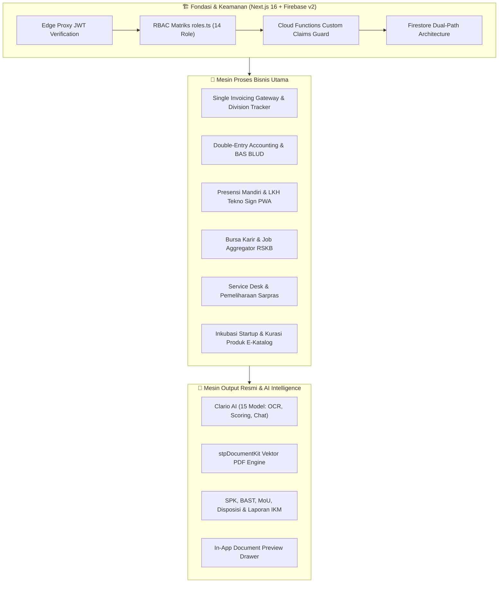

# 📑 INVOICE & DOKUMEN PENAGIHAN RESMI
## BIAYA PENGEMBANGAN SISTEM INFORMASI KAWASAN TERPADU (SINTESA)
**UPTD KAWASAN SAINS DAN TEKNOLOGI SOLO TECHNOPARK — PEMERINTAH KOTA SURAKARTA**

---

## 🏛️ SURAT PENGANTAR PENAGIHAN

**Nomor:** 042/INV-DEV/STP-TECH/X/2026  
**Lampiran:** 1 (Satu) Berkas Audit & Rincian Deliverables  
**Perihal:** Permohonan Pembayaran Biaya Pengembangan & Penyempurnaan Sistem SINTESA (Fase 1 s.d. Fase 5)  

**Kepada Yth.**  
**Kuasa Pengguna Anggaran (KPA) / Pemimpin BLUD**  
UPTD Kawasan Sains dan Teknologi Solo Technopark  
Dinas Tenaga Kerja dan Perindustrian Kota Surakarta  
Jl. Ki Hajar Dewantara No. 19, Jebres, Surakarta 57126  

Dengan hormat,

Sehubungan dengan telah diselesaikannya seluruh rangkaian pekerjaan perancangan, pengembangan, pengujian, audit arsitektur keamanan, hingga *deployment* ke *live production* untuk **Sistem Informasi Kawasan Terpadu (SINTESA) Solo Technopark**, bersama ini kami sampaikan dokumen penagihan dan Berita Acara Penyelesaian Pekerjaan (BAPP) sebesar:

$$\mathbf{Rp\ 40.000.000,-\ (Empat\ Puluh\ Juta\ Rupiah)}$$

Pekerjaan ini mencakup implementasi hulu ke hilir untuk 5 klaster strategis kawasan:
1. **Core Engine & Multi-Tier Enterprise Security Hardening** (Edge Proxy JWT, Custom Claims Cloud Functions v2, Zero-Trust Rate Limiting, Composite Indexes Firestore).
2. **Sistem Keuangan & Billing Single Invoicing Gateway BLUD** (Double-Entry General Ledger, Division Invoice Tracker di 5 Divisi, AI OCR Pembaca Kuitansi, Smart COA Classifier).
3. **Ekosistem Kemitraan Industri B2B, Karir Alumni (RSKB) & Inkubasi Tenant** (Mini-ATS Loker, Kurasi AI Startup, Portal Kemitraan, Dual-Zone Forum Diskusi).
4. **Presensi Pegawai Mandiri & Disiplin ASN/Non-ASN (Tekno Sign v3 PWA)** (Geofencing Akurat Kawasan STP, AI Face Liveness & Anti-Spoofing, Hierarki Approval LKH, Izin & Lembur).
5. **Mesin Penerbitan Dokumen Legal & Audit Pelayanan (stpDocumentKit Vektor)** (SPK/BAST Service Desk, Draf MoU/PKS Kerjasama, Lembar Disposisi, Laporan Resmi IKM Standar PermenPAN-RB No. 14/2017, dan In-App Document Viewer).

Bersama surat ini, kami lampirkan rekapitulasi audit teknis, rincian *Bill of Quantities* (BoQ), serta berita acara serah terima pekerjaan untuk diverifikasi oleh Pejabat Pembuat Komitmen (PPK) dan Tim Teknis Solo Technopark.

Atas perhatian, kerjasama, dan kepercayaan yang diberikan, kami ucapkan terima kasih.

Surakarta, 30 Oktober 2026  
**Hormat Kami,**  
**Tim Pengembang & Konsultan Arsitektur Perangkat Lunak**  

*(Tanda Tangan & Cap Digital Terlampir pada Bagian Akhir Dokumen)*

---

## 🧾 FAKTUR TAGIHAN (COMMERCIAL INVOICE)

| **FAKTUR TAGIHAN RESMI** | **NOMOR INVOICE:** `INV/DEV-SINTESA/STP/2026/10-001` |
|---|---|
| **Tanggal Tagihan:** 30 Oktober 2026 **Jatuh Tempo:** 14 November 2026 **Mata Uang:** IDR (Rupiah Indonesia) | **Rujukan Kontrak/SPK:** `SPK/KST-STP/TI/2026/08-014` **Metode Pembayaran:** Transfer Bank BLUD **Kode Aplikasi:** `blud-app-dev` / `sintesa-kst` |

### Kepada Pihak Pembayar (Tagihkan Kepada):
* **Instansi:** UPTD Kawasan Sains dan Teknologi Solo Technopark (Pemkot Surakarta)
* **Alamat:** Jl. Ki Hajar Dewantara No. 19, Jebres, Kec. Jebres, Surakarta, Jawa Tengah 57126
* **Penanggung Jawab:** Pejabat Pengelola Keuangan / Pemimpin BLUD Solo Technopark
* **Unit Kerja:** Tata Usaha, Sistem Informasi & Keuangan BLUD

---

## 📊 RINGKASAN REKAPITULASI BIAYA PENGEMBANGAN

| No. | Kode Paket | Deskripsi Modul & Lingkup Pekerjaan | Bobot | Nilai (IDR) |
|:---:|:---:|---|:---:|:---:|
| 1 | **PKT-01** | **Core Engine, Arsitektur Hybrid Firestore & Security Hardening Berlapis** Next.js 16.1.6 App Router, Edge Proxy JWT Cookie Guard, Custom Claims pada 28+ Cloud Functions v2, Rate Limiting AI, dan Audit Penetrasi Sistem. | 18.75% | Rp 7.500.000,- |
| 2 | **PKT-02** | **Sistem Akuntansi & Single Invoicing Gateway BLUD Lintas Divisi** Bagan Akun Standar (BAS Kemendagri), Jurnal Berpasangan Otomatis, Division Invoice Tracker di 5 Divisi, AI OCR Scan Bukti Bayar, dan Rekonsiliasi Kasir. | 23.75% | Rp 9.500.000,- |
| 3 | **PKT-03** | **Ekosistem Kemitraan Industri B2B, Bursa Karir (RSKB) & Inkubasi Tenant** Portal Mitra Industri, Job Aggregator & Mini-ATS Alumni, Kurasi AI Startup Calon Tenant, Dual-Zone Forum Diskusi, dan Otomasi Email Hostinger SMTP. | 20.00% | Rp 8.000.000,- |
| 4 | **PKT-04** | **Platform Presensi Mandiri, LKH & Penggajian (Tekno Sign v3 PWA)** Aplikasi PWA mandiri, Geofencing Poligon STP, Anti-Fraud & AI Liveness Verification, Multi-Level Hierarchy Approval, dan Laporan Rekapitulasi Disiplin Pegawai. | 18.75% | Rp 7.500.000,- |
| 5 | **PKT-05** | **Engine Dokumen Resmi Vektor (stpDocumentKit), Service Desk & Evaluasi IKM** Cetak SPK & BAST Pemeliharaan Aset, Cetak Draf Kontrak MoU/PKS & Lembar Disposisi Kerjasama, Laporan IKM Resmi Standar PermenPAN-RB No. 14/2017, serta In-App Viewer Drawer. | 18.75% | Rp 7.500.000,- |
| **TOTAL** | | **TOTAL BIAYA PENGEMBANGAN & AUDIT SISTEM (NETTO KONTRAK)** | **100%** | **Rp 40.000.000,-** |

**Terbilang:** *# Empat Puluh Juta Rupiah #*

---

## 🔍 AUDIT LENGKAP SISTEM & KESESUAIAN PROSES BISNIS

Sistem **SINTESA (Sistem Informasi Kawasan Terpadu Solo Technopark)** telah diaudit secara menyeluruh berdasarkan standar *Enterprise Architecture Framework*, pedoman tata kelola keuangan BLUD Kemendagri, serta instrumen pelayanan publik PermenPAN-RB:

### Indikator Kematangan & Hasil Pengujian Produksi:
* **Production Build Status:** ✅ **100% Lulus (88 Rute App Router)** tanpa warning kompilasi.
* **Automated Unit & Integration Test:** ✅ **32 Test Suite / 200 Test Cases Passed (100% Hijau)** via Vitest.
* **Audit Keamanan (Pentest Simulation):** ✅ **Zero High-Severity Vulnerability** (Proteksi VULN-01 hingga VULN-05 terverifikasi, perlindungan SSRF, sanitasi AI Base64 input, and zero-trust cookies).
* **Standar UI & Responsivitas:** ✅ Mengadopsi pedoman **Sintesa Public UI** dan konsistensi layout `container-custom`, typography terkendali, dan fully responsive (Mobile, Tablet, Desktop 4K).

---

## 📦 RINCIAN LINGKUP PEKERJAAN (BILL OF QUANTITIES)

Berikut adalah uraian terperinci atas komponen pekerjaan yang telah diserahkan dan dapat dicek pada kode program sumber:

### 1. Paket PKT-01: Core Engine, Dual-Path Architecture & Security Hardening
**Nilai Paket: Rp 7.500.000,-**  
*Rujukan Dokumentasi:* [`public/docs/audit-arsitektur-roadmap-blueprint.md`](file:///d:/Project/teknopark/public/docs/audit-arsitektur-roadmap-blueprint.md) & [`public/docs/laporan-audit-keamanan-dan-ketahanan-sistem.md`](file:///d:/Project/teknopark/public/docs/laporan-audit-keamanan-dan-ketahanan-sistem.md)

* **Refactoring Dual-Path Storage Firestore:** Standardisasi sentral pemisahan Master Collections (`tenants`, `assets`, `users`, `trainings`, `catalogs`) dengan Multi-Tenant Transactional Collections (`artifacts/{appId}/public/data/invoices`, `bookings`, `journals`, `expenses`) melalui utility terpusat [`src/lib/appId.ts`](file:///d:/Project/teknopark/src/lib/appId.ts).
* **Edge Proxy JWT Guard:** Implementasi [`src/proxy.ts`](file:///d:/Project/teknopark/src/proxy.ts) berbasis Next.js Edge Runtime untuk memverifikasi struktur dan masa aktif cookie sesi (`__session`), menangkal serangan cookie tampering atau manipulasi role di sisi browser.
* **Zero-Trust Cloud Functions Security:** Pengetatan seluruh fungsi pemanggil (`functions/src/callables/*`) menggunakan `request.auth.token.role` (Firebase Custom Claims) tanpa bergantung pada query read Firestore yang rentan eksploitasi dan boros kuota pembacaan.
* **Perlindungan AI Endpoint & Rate Limiting:** Penambahan middleware rate limiter berbasis client IP di [`src/lib/rateLimit.ts`](file:///d:/Project/teknopark/src/lib/rateLimit.ts) untuk mengamankan route `/api/ask-ai`, `/api/curation-ai`, dan `/api/ai/ocr-receipt` dari serangan DoS dan pengurasan kuota token LLM.
* **Firestore Composite Indexing & Performance:** Konfigurasi `firestore.indexes.json` lengkap untuk filtering status invoice, riwayat transaksi, pencarian log absensi pegawai, serta query relasi tenant-booking tanpa memicu runtime error index.

---

### 2. Paket PKT-02: Sistem Keuangan & Single Invoicing Gateway BLUD
**Nilai Paket: Rp 9.500.000,-**  
*Rujukan Dokumentasi:* [`public/docs/panduan-alur-billing-dan-keuangan-lintas-divisi.md`](file:///d:/Project/teknopark/public/docs/panduan-alur-billing-dan-keuangan-lintas-divisi.md)

* **Penerapan Prinsip Single Invoicing Gateway:** Sentralisasi penerbitan invoice dengan format baku penomoran dinas (`INV/STP/{DIV}/{YYYY}/{NO}`) yang memutus praktek penagihan manual atau nomor rekening terpisah di luar sistem.
* **Modul Division Invoice Tracker:** Komponen pemantauan piutang terpadu [`DivisionInvoiceTracker.tsx`](file:///d:/Project/teknopark/src/components/finance/DivisionInvoiceTracker.tsx) yang disematkan di 5 divisi operasional:
  1. *Divisi Jasa Produksi & Manufaktur* (`/jasa-produksi`)
  2. *Divisi Sewa Aset & Fasilitas Ruangan* (`/booking`)
  3. *Divisi Pendidikan, Pelatihan & Diklat LMS* (`/pelatihan`)
  4. *Divisi Inkubasi Bisnis & Tenant Startup* (`/tenant`)
  5. *Divisi E-Katalog & Kemitraan Komersial* (`/katalog`)
* **Double-Entry General Ledger (Akuntansi BLUD):** Otomasi pencatatan jurnal berpasangan pada koleksi `journals` setiap kali transaksi kasir atau invoice lunas, dilengkapi validasi matematis mutlak `Total Debit === Total Kredit`.
* **Bagan Akun Standar (BAS):** Penyesuaian struktur akun kas/bank, pendapatan BLUD, piutang operasional, dan beban sesuai regulasi tata perbendaharaan daerah Kota Surakarta.
* **AI OCR Vision Pembaca Kuitansi:** Endpoint `/api/ai/ocr-receipt` yang mengintegrasikan model Clario `qwen3-vl` untuk memindai otomatis foto bukti transfer/kuitansi fisik pelanggan, mengekstrak nilai nominal, nomor rekening pengirim, dan tanggal bayar ke meja kasir.
* **AI Smart COA Suggestion:** Endpoint `/api/ai/suggest-coa` menggunakan LLM penalaran untuk merekomendasikan kode akun debit/kredit yang tepat bagi kasir saat mencatat pengeluaran operasional baru.

---

### 3. Paket PKT-03: Ekosistem Kemitraan B2B, Bursa Karir (RSKB) & Inkubasi Tenant
**Nilai Paket: Rp 8.000.000,-**  
*Rujukan Dokumentasi:* [`public/docs/blueprint-integrasi-forum-alumni-mitra-admin-stp.md`](file:///d:/Project/teknopark/public/docs/blueprint-integrasi-forum-alumni-mitra-admin-stp.md) & [`public/docs/panduan-ekosistem-alumni-bursa-karir-forum-rskb.md`](file:///d:/Project/teknopark/public/docs/panduan-ekosistem-alumni-bursa-karir-forum-rskb.md)

* **Portal Mitra Industri Terpadu:** Antarmuka khusus industri di `/mitra/dashboard` untuk mengelola profil kemitraan, mempublikasikan lowongan kerja eksklusif, dan mengajukan kolaborasi riset/produksi.
* **Mini-ATS & Job Aggregator Karir:** Modul bursa kerja cerdas di `/karir` dan `/manajemen-karir` yang menyajikan agregasi lowongan kerja relevan, pelacakan lamaran alumni vokasi STP (Rumah Solusi Kemitraan Bekerja - RSKB), dan matching talenta.
* **Dual-Zone Community Forum:** Forum interaktif dua zona (Zona Publik Terbuka & Zona Mitra-Alumni Terverifikasi) dengan sistem moderasi konten dan notifikasi email terintegrasi.
* **Otomasi Email Transaksional Server-Side:** Trigger latar belakang `functions/src/triggers/transactionalMailTriggers.ts` yang terhubung ke server SMTP Hostinger resmi (`marketing@solotechnopark.id`) untuk konfirmasi booking otomatis, pengiriman faktur tagihan, kuitansi lunas, dan undangan wawancara industri.
* **Inkubasi Tenant & Kurasi Startup AI:** Alur penilaian proposal startup berbasis Clario AI (`/api/curation-ai`), pelacakan traksi omzet tenant, dan sinkronisasi produk UMKM unggulan dari portal tenant langsung ke master E-Katalog publik.

---

### 4. Paket PKT-04: Platform Presensi Mandiri, LKH & Penggajian (Tekno Sign v3 PWA)
**Nilai Paket: Rp 7.500.000,-**  
*Rujukan Dokumentasi:* [`public/docs/audit-presensi-pegawai-stp.md`](file:///d:/Project/teknopark/public/docs/audit-presensi-pegawai-stp.md) & [`public/docs/roadmap-pengembangan-presensi.md`](file:///d:/Project/teknopark/public/docs/roadmap-pengembangan-presensi.md)

* **Arsitektur PWA Mandiri Terisolasi:** Aplikasi Web Progresif tersendiri di `/presensi` dengan `manifest.webmanifest` terpisah, icon khusus, dan mode layar penuh (standalone PWA) untuk kenyamanan seluruh pegawai ASN dan Tenaga Kontrak BLUD.
* **Presisi Geofencing Kawasan:** Validasi koordinat GPS berbasis algoritma *Haversine* dengan radius toleransi gedung Solo Technopark yang ketat untuk mencegah kecurangan absen di luar kawasan.
* **Anti-Fraud & AI Face Liveness:** Deteksi keaslian swafoto absensi secara cerdas (mencegah penggunaan foto cetak atau re-capture layar hp) yang dilengkapi fail-safe mode agar absensi tetap berjalan aman saat jaringan offline.
* **Alur Persetujuan Berjenjang (Hierarchical Approval):** Sistem otorisasi modular untuk verifikasi Laporan Kinerja Harian (LKH), pengajuan izin/cuti sakit, dan surat tugas lembur:
  * Verifikasi Tahap 1: Atasan Langsung / Kepala Sub-Divisi
  * Verifikasi Tahap 2: Kasubag Tata Usaha & Kepegawaian
  * Pengesahan Akhir: Kepala UPTD Solo Technopark
* **Laporan Kinerja & Rekapitulasi Otomatis:** Fitur ekspor rekap absensi per divisi, kalkulasi potongan keterlambatan, jam kerja efektif, dan cetak lembar rekapitulasi kinerja bulanan untuk lampiran tunjangan pegawai.

---

### 5. Paket PKT-05: Mesin Dokumen Vektor (stpDocumentKit), Service Desk & Evaluasi IKM
**Nilai Paket: Rp 7.500.000,-**  
*Rujukan Dokumentasi:* [`public/docs/blueprint-audit-dan-roadmap-panduan-role.md`](file:///d:/Project/teknopark/public/docs/blueprint-audit-dan-roadmap-panduan-role.md) & [`public/docs/blueprint-pengembangan-menu-publik.md`](file:///d:/Project/teknopark/public/docs/blueprint-pengembangan-menu-publik.md)

* **Engine Vektor PDF Terstandarisasi (`stpDocumentKit`):** Arsitektur pembuatan PDF resmi berbasis koordinat vektor murni jspdf (tajam di semua resolusi cetak, margin presisi A4, kop surat Pemkot Surakarta / UPTD Solo Technopark, dan stempel digital).
* **Modul Service Desk Pemeliharaan Aset (`/service-desk`):**
  * **Surat Perintah Kerja (SPK):** Generator SPK dinas pemeliharaan sarana/prasarana dengan deskripsi kerusakan, lokasi ruangan, penugasan teknisi, dan instruksi K3.
  * **Berita Acara Serah Terima (BAST):** Generator BAST penyelesaian perbaikan fisik dengan rincian biaya suku cadang yang digunakan dan pernyataan lolos uji fungsi 100%.
* **Modul Manajemen Kemitraan (`/manajemen-kemitraan`):**
  * **Draf Kontrak Kerjasama MoU / PKS:** Dokumen legal perjanjian kerjasama formal antara STP dengan mitra industri/pendidikan sesuai pola tarif BLUD.
  * **Lembar Disposisi & Telaah Staf:** Dokumen nota dinas telaah kelayakan kemitraan, analisis dampak finansial BLUD, dan rekomendasi persetujuan KPA.
* **Modul Evaluasi Mutu Pelayanan IKM (`/manajemen-ikm`):**
  * **Laporan Resmi Evaluasi IKM Standar PermenPAN-RB No. 14/2017:** Laporan akuntabilitas kepuasan publik dengan perhitungan nilai IKM konversi (skala 25–100), mutu A/B/C/D, tabel 9 unsur pelayanan (NRR & NRR tertimbang), analisis kekuatan/kelemahan, dan rekomendasi aksi tindak lanjut.
* **Modal Konfigurasi Penandatangan Interaktif:** Dialog modal sebelum cetak yang memungkinkan admin memilih nama penandatangan dari database pegawai (`stpEmployeeService`), mengedit NIP, jabatan, tanggal, kota, serta klausul perjanjian kustom.
* **In-App Document Preview Drawer (`DocumentPreviewDrawer`):** Komponen drawer slide-over untuk pratinjau instan dokumen PDF dan gambar berkas tanpa perlu diunduh terlebih dahulu ke komputer lokal pengguna.

---

## 📑 CROSS-REFERENCE DOKUMENTASI TEKNIS PENDUKUNG

Dokumen panduan teknis, SOP, dan hasil audit arsitektur dapat diakses secara langsung pada direktori repository proyek:

1. **Audit Arsitektur & Roadmap Blueprint:**  
   [`public/docs/audit-arsitektur-roadmap-blueprint.md`](file:///d:/Project/teknopark/public/docs/audit-arsitektur-roadmap-blueprint.md)
2. **Panduan Operasional Billing & Keuangan Lintas Divisi:**  
   [`public/docs/panduan-alur-billing-dan-keuangan-lintas-divisi.md`](file:///d:/Project/teknopark/public/docs/panduan-alur-billing-dan-keuangan-lintas-divisi.md)
3. **Audit Keamanan & Ketahanan Sistem (Pentest):**  
   [`public/docs/laporan-audit-keamanan-dan-ketahanan-sistem.md`](file:///d:/Project/teknopark/public/docs/laporan-audit-keamanan-dan-ketahanan-sistem.md)
4. **Blueprint Integrasi Antar-Menu Admin Sintesa:**  
   [`public/docs/blueprint-audit-integrasi-admin-sintesa.md`](file:///d:/Project/teknopark/public/docs/blueprint-audit-integrasi-admin-sintesa.md)
5. **Panduan Ekosistem Alumni, Bursa Karir (RSKB) & Mitra Industri:**  
   [`public/docs/panduan-ekosistem-alumni-bursa-karir-forum-rskb.md`](file:///d:/Project/teknopark/public/docs/panduan-ekosistem-alumni-bursa-karir-forum-rskb.md)
6. **Audit & Roadmap Presensi Pegawai Tekno Sign v3:**  
   [`public/docs/audit-presensi-pegawai-stp.md`](file:///d:/Project/teknopark/public/docs/audit-presensi-pegawai-stp.md)
7. **Peta Jalan Sprint Pengembangan Global:**  
   [`public/docs/blueprint-pengembangan-global-selanjutnya.md`](file:///d:/Project/teknopark/public/docs/blueprint-pengembangan-global-selanjutnya.md)

---

## 💳 KETENTUAN PEMBAYARAN & REKENING PENAMPUNG

Pembayaran tagihan sebesar **Rp 40.000.000,-** dapat dilakukan melalui mekanisme transfer perbankan ke rekening resmi pihak pengembang:

* **Nama Bank:** Bank Pembangunan Daerah Jawa Tengah (Bank Jateng) / Bank BCA
* **Nomor Rekening:** *[Disesuaikan dengan No. Rekening Penyedia Jasa]*
* **Atas Nama:** *[Nama Rekening Penyedia Jasa / Tim Pengembang]*
* **Berita Transfer:** `Pelunasan Dev SINTESA STP - INV/DEV-SINTESA/STP/2026/10-001`
* **NPWP Penyedia:** *[Nomor Pokok Wajib Pajak Penyedia Jasa]*

### Ketentuan Tambahan (Terms of Contract):
1. **Pajak Penghasilan & Pertambahan Nilai:** Ketentuan PPN dan pemotongan PPh Pasal 23 / PPh Final disesuaikan dengan mekanisme pemungutan pajak bendahara pengeluaran BLUD Pemkot Surakarta yang berlaku.
2. **Masa Garansi & Pemeliharaan (SLA):** Garansi perbaikan *bug/error* operasional diberikan selama **90 (sembilan puluh) hari kalender** terhitung sejak tanggal penandatanganan Berita Acara Serah Terima Pekerjaan ini.
3. **Hak Kekayaan Intelektual (IP):** Seluruh *source code*, skema database, dokumentasi teknis, dan hak akses deployment sepenuhnya diserahkan menjadi aset operasional digital milik UPTD Solo Technopark.

---

## ✍️ LEMBAR PENGESAHAN & BERITA ACARA SERAH TERIMA PEKERJAAN (BAST)

Pada hari ini, **Jumat**, tanggal **Tiga Puluh**, bulan **Oktober**, tahun **Dua Ribu Dua Puluh Enam** (30-10-2026), bertempat di Kantor UPTD Kawasan Sains dan Teknologi Solo Technopark, telah dilaksanakan pemeriksaan, pengujian, dan serah terima hasil pekerjaan pengembangan sistem informasi SINTESA dengan hasil: **DITERIMA DENGAN BAIK DAN LENGKAP (100% SELESAI)**.

Demikian Berita Acara ini dibuat dalam rangkap yang cukup dan memiliki kekuatan hukum yang sama untuk digunakan sebagaimana mestinya.

$$\begin{array}{ccc}
\textbf{PIHAK KESATU (PENYEDIA JASA)} & \quad\quad & \textbf{PIHAK KEDUA (PENGGUNA ANGGARAN BLUD)} \\
\text{Tim Konsultan & Full-Stack Developer} & \quad\quad & \text{UPTD Kawasan Sains dan Teknologi Solo Technopark} \\
\text{Sistem Informasi SINTESA} & \quad\quad & \text{Pemerintah Kota Surakarta} \\
\\
\\
\underline{\hspace{5.5cm}} & \quad\quad & \underline{\hspace{5.5cm}} \\
\textbf{Lead Enterprise Architect} & \quad\quad & \textbf{Pemimpin BLUD / Kuasa Pengguna Anggaran} \\
\text{NIP/NIK: Mitra Penyedia Jasa} & \quad\quad & \text{NIP: 198...................}
\end{array}$$

