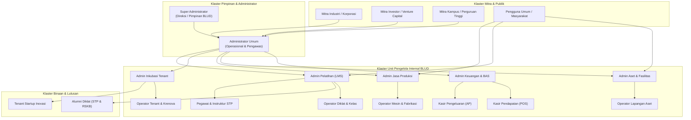
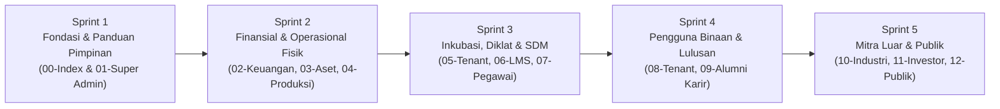

# 🗺️ BLUEPRINT AUDIT SISTEM, MATRIKS ROLE, & ROADMAP PANDUAN PENGGUNA TERPADU
## Solo Technopark (Sintesa Technopark Management System)

> **Versi Dokumen:** 1.0.0  
> **Tanggal Rilis:** 29 Oktober 2026  
> **Status:** Siap Eksekusi (Ready for Sprint Implementation)  
> **Target Lokasi Berkas Panduan:** `public/panduan/`

---

## 📌 Ringkasan Eksekutif

1. **Audit Menyeluruh Sistem**: Sistem Solo Technopark (Sintesa) saat ini melayani ekosistem kawasan inovasi teknologi terlengkap di Indonesia dengan mencakup **6 Klaster Layanan Utama**: Komersial & Aset, Manufaktur/Jasa Produksi, Inkubasi Startup, Pelatihan Vokasi & LMS, Bursa Karir & Tracer Study (STP & RSKB), serta Kepegawaian (Presensi Techno Sign).
2. **20 Role Pengguna Terdaftar**: Teridentifikasi **20 Entitas Role** di dalam sistem (berdasarkan `src/config/roles.ts` dan hierarki kepegawaian) yang terbagi dalam **4 Tingkat Kewenangan**: Pimpinan BLUD, Pengelola Internal Unit Teknis, Pengguna Eksternal Binaan/Lulusan, dan Mitra Strategis/Publik.
3. **Folder Panduan Terpusat**: Seluruh panduan operasional pengguna akan dikonsolidasikan ke dalam folder `public/panduan/` menggunakan format Markdown terstruktur (`.md`) dan siap dikonversi ke PDF interaktif untuk kemudahan distribusi offline maupun onboarding pengguna baru.
4. **Pendekatan Eksekusi Berbasis Sprint**: Roadmap penyusunan panduan dirancang dalam **5 Sprint Terfokus** agar setiap modul terdokumentasi secara mendalam, memiliki SOP alur kerja yang jelas, serta dilengkapi troubleshooting dan visualisasi diagram alur.
5. **Standar Dokumen Enterprise**: Setiap panduan memuat 5 bab wajib: *Ringkasan Peran & Akses Rute*, *Hak Akses & Matriks Permission*, *Prosedur Operasional Standar (SOP) Langkah demi Langkah*, *Integrasi Lintas Modul*, serta *Pusat Bantuan & FAQ Khusus Peran*.

---

## 🏗️ Audit Arsitektur Akses & Matriks 20 Role Pengguna



---

### 📊 Tabel Matriks 20 Role Sistem Sintesa

| No | Kode Role (`roles.ts`) | Label Resmi Sistem | Cakupan Rute Utama | Hak Akses Kunci (Permissions) |
| :-: | :--- | :--- | :--- | :--- |
| **1** | `super_admin` | Super Administrator | `*` (Seluruh Halaman) | Hak penuh seluruh aksi, konfigurasi sistem, RBAC user, profil instansi, & BAS keuangan. |
| **2** | `admin` | Administrator Umum | `/dashboard`, `/aset`, `/booking`, `/billing`, `/tenant`, `/pelatihan`, `/karir`, dll. | Mengelola operasional kawasan, menyetujui data, moderasi forum, tanpa hak kelola RBAC super admin. |
| **3** | `admin_keuangan` | Admin Keuangan & Billing | `/dashboard`, `/billing`, `/katalog`, `/afiliasi`, `/karir` | Pembuatan invoice multi-divisi, buku besar, Bagan Akun Standar (BAS), approval biaya, laporan keuangan. |
| **4** | `kasir` | Kasir Pendapatan (POS) | `/dashboard`, `/billing`, `/karir` | Verifikasi transfer masuk (AI OCR matching), penerbitan invoice resmi, cetak kuitansi thermal/PDF. |
| **5** | `kasir_pengeluaran`| Kasir Pengeluaran (AP) | `/dashboard`, `/billing`, `/karir` | Pencatatan pengeluaran kas kecil/operasional, unggah nota fisik, integrasi COA beban belanja. |
| **6** | `admin_aset` | Admin Aset & Booking | `/dashboard`, `/aset`, `/booking`, `/karir` | Manajemen master aset/gedung/mesin, penentuan tarif sewa, persetujuan jadwal reservasi fasilitas. |
| **7** | `operator_aset` | Operator Lapangan Aset | `/dashboard`, `/aset`, `/booking`, `/karir` | Cek fisik kesiapan ruangan/peralatan, serah terima aset, pelaporan kerusakan/pemeliharaan. |
| **8** | `admin_produksi` | Admin Layanan Jasa Produksi | `/dashboard`, `/jasa-produksi`, `/billing`, `/karir` | Penerimaan Work Order (WO) fabrikasi, perhitungan biaya bahan & jasa, pembuatan Surat Jalan / DO. |
| **9** | `operator_produksi`| Operator Bengkel & Produksi | `/dashboard`, `/jasa-produksi`, `/karir` | Pembaruan progres pengerjaan mesin CNC/bubut/3D printing, pencatatan waktu operasi mesin. |
| **10**| `admin_tenant` | Admin Ekosistem Tenant | `/dashboard`, `/tenant`, `/manajemen-event`, `/manajemen-krenova`, `/karir` | Kurasi tenant startup, monitoring milestone inkubasi, VDR, cap table, pendanaan, serta event demo day. |
| **11**| `operator_tenant` | Operator Tenant | `/dashboard`, `/tenant`, `/manajemen-event`, `/karir` | Pendampingan teknis tenant, monitoring laporan traksi berkala, absensi mentoring & workshop. |
| **12**| `admin_pelatihan` | Admin Pelatihan (LMS) | `/dashboard`, `/pelatihan`, `/lms`, `/manajemen-karir`, `/karir` | Manajemen program diklat vokasi, kurikulum, batch kelas, kelulusan, penerbitan e-sertifikat, & tracer study. |
| **13**| `operator_pelatihan`| Operator Pelatihan | `/dashboard`, `/pelatihan`, `/lms`, `/karir`, `/manajemen-karir` | Absensi harian kelas diklat, input nilai ujian kompetensi, administrasi berkas peserta didik. |
| **14**| `pegawai` | Pegawai Solo Technopark | `/presensi/*`, `/karir` | Presensi wajah & GPS Techno Sign, Lembar Kerja Harian (LKH), pengajuan izin/cuti/lembur. |
| **15**| `tenant` | Akun Tenant Inovasi | `/tenant/*`, `/lms`, `/ekosistem` | Dashboard pertumbuhan, pelaporan omzet bulanan, data tim, pembayaran tagihan sewa, rekrutmen talenta. |
| **16**| `alumni` | Alumni KST & Lulusan | `/alumni-portal`, `/portal`, `/lms`, `/karir` | Klaim akun lulusan, bursa lowongan kerja eksklusif, forum diskusi terverifikasi, verifikasi sertifikat. |
| **17**| `industri` | Mitra Industri / Korporasi | `/mitra/*`, `/ekosistem`, `/karir` | Pemasangan lowongan kerja terverifikasi, Mini-ATS seleksi pelamar, pencarian direktori talenta alumni. |
| **18**| `investor` | Mitra Investor / VC | `/ekosistem`, `/portfolio` | Eksplorasi katalog startup binaan terkurasi, review pitch deck, undangan business matchmaking. |
| **19**| `kampus` | Mitra Perguruan Tinggi | `/ekosistem`, `/riset` | Kolaborasi riset terapan, program magang mahasiswa bersertifikat (MBKM), penggunaan laboratorium bersama. |
| **20**| `public` | Pengguna Umum / Masyarakat | `/`, `/portal`, `/fasilitas`, `/bukti-bayar`, `/verifikasi-sertifikat` | Pendaftaran akun, pemesanan fasilitas kawasan, pembelian produk e-katalog, konfirmasi bukti bayar. |

---

## 📁 Struktur Berkas Panduan di `public/panduan/`

Direktori `public/panduan/` akan memuat **12 Berkas Panduan Utama** yang terorganisir per klaster peran:

```
public/panduan/
├── 00-INDEX-PANDUAN-SISTEM-SINTESA.md       # Peta Induk, Matriks RBAC, & Navigasi Panduan
├── 01-PANDUAN-SUPER-ADMIN-DAN-PIMPINAN.md  # Super Admin & Eksekutif BLUD
├── 02-PANDUAN-KEUANGAN-BILLING-KASIR.md     # Admin Keuangan, Kasir POS, & Kasir AP
├── 03-PANDUAN-ASET-DAN-RESERVASI.md         # Admin Aset & Operator Aset
├── 04-PANDUAN-JASA-PRODUKSI-MANUFAKTUR.md   # Admin Produksi & Operator Bengkel
├── 05-PANDUAN-INKUBASI-TENANT-KRENOVA.md    # Admin Tenant & Operator Inkubasi
├── 06-PANDUAN-PELATIHAN-LMS-TRACER-STUDY.md # Admin Pelatihan & Operator LMS
├── 07-PANDUAN-PEGAWAI-PRESENSI-TECHNO-SIGN.md # Pegawai, Dosen Praktisi, & Instruktur
├── 08-PANDUAN-TENANT-STARTUP-BINAAN.md      # Startup & Wirausaha Binaan
├── 09-PANDUAN-ALUMNI-DAN-BURSA-KARIR.md     # Lulusan Diklat STP & RSKB Surakarta
├── 10-PANDUAN-MITRA-INDUSTRI-DAN-ATS.md     # Perusahaan Rekanan & HR Rekruter
├── 11-PANDUAN-INVESTOR-DAN-KAMPUS.md        # Venture Capital, Angel, & Kampus Riset
└── 12-PANDUAN-PENGGUNA-UMUM-DAN-PORTAL.md   # Pelanggan Fasilitas & Calon Siswa Diklat
```

---

## 📑 Format Standar Template Setiap Dokumen Panduan

Setiap dokumen di dalam `public/panduan/` wajib mengikuti format standar 6 bagian:

```markdown
# 📘 Panduan Operasional Sistem: [Nama Role / Divisi]
## Sistem Manajemen Kawasan Solo Technopark (Sintesa)

### 1. Ringkasan Peran & Kewenangan
- Deskripsi tugas utama peran
- Hak akses rute URL resmi
- Hubungan koordinasi dengan role lain

### 2. Matriks Hak Akses & Permissions (RBAC)
- Tabel fitur yang boleh Dilihat (Read), Dibuat (Create), Diedit (Update), Dihapus (Delete), atau Disetujui (Approve)

### 3. Prosedur Operasional Standar (SOP) Langkah demi Langkah
- Alur kerja 1: [Operasi Utama A] (disertai langkah klik tombol, form yang diisi, dan outputnya)
- Alur kerja 2: [Operasi Utama B]
- Alur kerja 3: [Operasi Utama C]

### 4. Integrasi Lintas Divisi & Notifikasi Otomatis
- Kapan notifikasi email / sistem terpicu
- Keterhubungan data dengan modul lain (misal: Invoice Otomatis saat Booking disetujui)

### 5. Troubleshooting & FAQ Khusus Peran
- Solusi jika sesi habis / kendala upload file
- Pertanyaan teknis yang sering dialami oleh role ini

### 6. Lembar Checklist Harian / Mingguan Peran
- Checklist tugas wajib operasional agar akuntabilitas terjaga
```

---

## 🏃 Roadmap Eksekusi Pembuatan Panduan (5 Sprint)

Dokumentasi ini dibagi menjadi **5 Sprint Terstruktur**:



---

### 🏁 SPRINT 1: Fondasi Peta Akses & Panduan Pimpinan Eksekutif
**Fokus Utama:** Menyiapkan navigasi induk panduan dan panduan operasional pimpinan tertinggi BLUD.

- [ ] **Tugas 1.1 — Indeks Peta Panduan (`00-INDEX-PANDUAN-SISTEM-SINTESA.md`):**
  - Matriks perbandingan hak akses 20 role secara tabular.
  - Peta arsitektur rute web dan single-sign-on (SSO).
  - Tautan navigasi langsung ke masing-masing berkas panduan.
- [ ] **Tugas 1.2 — Panduan Super Administrator & Pimpinan (`01-PANDUAN-SUPER-ADMIN-DAN-PIMPINAN.md`):**
  - Panduan tata kelola pengguna & RBAC role di `/pengaturan` (Tab Keamanan).
  - Panduan konfigurasi global di `/pengaturan` (Tab Sistem: Pengumuman Bar, Jam Operasional, Helpdesk).
  - Panduan pemantauan Dashboard Eksekutif (`/dashboard`: okupansi aset, pendapatan BLUD, serapan alumni, traksi tenant).
  - Panduan audit trail dan investigasi log aktivitas sistem.

---

### 💳 SPRINT 2: Panduan Operasional Finansial & Fasilitas Fisik
**Fokus Utama:** Mendokumentasikan SOP alur komersial pendapatan BLUD, kas operasional, dan utilisasi fasilitas.

- [ ] **Tugas 2.1 — Panduan Keuangan, Billing, & Meja Kasir (`02-PANDUAN-KEUANGAN-BILLING-KASIR.md`):**
  - SOP Kasir POS: Verifikasi bukti transfer dengan asistensi AI OCR (`/billing` -> Tab Konfirmasi).
  - SOP Penerbitan Invoice: Skema Full Payment, DP, Termin, dan Langganan.
  - SOP Kasir Pengeluaran (AP): Pencatatan beban belanja dan penatausahaan nota kas kecil.
  - SOP Admin Keuangan: Pengelolaan Bagan Akun Standar (BAS), jurnal umum, mutasi kas, dan ekspor laporan neraca / laba-rugi BLUD.
- [ ] **Tugas 2.2 — Panduan Aset & Jadwal Reservasi (`03-PANDUAN-ASET-DAN-RESERVASI.md`):**
  - SOP Admin Aset: Pendaftaran aset gedung, coworking, dan mesin lab di `/aset`, setting tarif per jam/hari/bulan.
  - SOP Approval Booking: Verifikasi bentrok jadwal di `/booking`, approval sewa yang otomatis men-generate invoice ke modul keuangan.
  - SOP Operator Lapangan: Cek fisik kesiapan sarana, checklist inventaris sebelum dan sesudah acara.
- [ ] **Tugas 2.3 — Panduan Jasa Produksi & Manufaktur (`04-PANDUAN-JASA-PRODUKSI-MANUFAKTUR.md`):**
  - SOP Admin Produksi: Penerimaan order manufaktur di `/jasa-produksi`, kalkulasi RAB pesanan, dan koordinasi penerbitan Surat Jalan (DO).
  - SOP Operator Bengkel: Update tahapan pengerjaan (Bahan -> Bubut/Milling -> QC -> Siap Ambil), pencatatan jam kerja mesin CNC.

---

### 🎓 SPRINT 3: Panduan Ekosistem Inkubasi, Diklat Vokasi, & Kepegawaian
**Fokus Utama:** Mendokumentasikan manajemen program inkubasi startup, pelatihan kerja, dan kedisiplinan pegawai.

- [ ] **Tugas 3.1 — Panduan Inkubasi Tenant & Inovasi Krenova (`05-PANDUAN-INKUBASI-TENANT-KRENOVA.md`):**
  - SOP Penerimaan & Kurasi Calon Tenant di `/tenant`.
  - SOP Monitoring Cap Table, Virtual Data Room (VDR), dan tahapan pendanaan (*Funding Rounds*).
  - SOP Penilaian Lomba Krenova Surakarta di `/manajemen-krenova`.
  - SOP Penyelenggaraan Demo Day & Expo Startup di `/manajemen-event`.
- [ ] **Tugas 3.2 — Panduan Pelatihan, LMS, & Tracer Study (`06-PANDUAN-PELATIHAN-LMS-TRACER-STUDY.md`):**
  - SOP Admin Pelatihan: Pembuatan program diklat di `/pelatihan`, pembukaan batch kuota, dan seleksi administrasi.
  - SOP Kelulusan & Sertifikasi: Uji kompetensi, generate sertifikat resmi ber-nomor register (`STP-CERT/...`), ekspor buku induk alumni.
  - SOP Monitoring Serapan Kerja: Pembacaan analitik serapan kerja gabungan, STP Vokasi, dan RSKB Surakarta di `/manajemen-karir`.
- [ ] **Tugas 3.3 — Panduan Pegawai & Presensi Techno Sign (`07-PANDUAN-PEGAWAI-PRESENSI-TECHNO-SIGN.md`):**
  - SOP Presensi Harian: Check-in & check-out berbasis GPS geofencing dan swafoto biometrik anti-spoofing AI.
  - SOP Pelaporan Kinerja: Pengisian Lembar Kerja Harian (LKH) harian berbasis 152 Master Aktivitas baku.
  - SOP Pengajuan Hak Pegawai: Pengajuan izin, cuti tahunan, surat dokter, dan penugasan lembur.
  - SOP Atasan Langsung / Pimpinan: Verifikasi LKH bawahan dan persetujuan lembur/izin.

---

### 🚀 SPRINT 4: Panduan Pengguna Binaan & Lulusan Talenta
**Fokus Utama:** Memberikan pedoman bagi entitas binaan kawasan untuk memaksimalkan fasilitas dan karir.

- [ ] **Tugas 4.1 — Panduan Tenant Startup Binaan (`08-PANDUAN-TENANT-STARTUP-BINAAN.md`):**
  - Navigasi Dashboard Mandiri Tenant (`/tenant/dashboard` & `/tenant/incubation`).
  - Cara pelaporan traksi bulanan (pendapatan, jumlah karyawan, pencapaian produk).
  - Pengelolaan Virtual Data Room (VDR: legalitas PT/CV, HKI, proposal investasi) untuk menarik investor.
  - Pembayaran tagihan sewa ruangan / utilitas di `/tenant/billing`.
- [ ] **Tugas 4.2 — Panduan Alumni & Pencari Kerja (`09-PANDUAN-ALUMNI-DAN-BURSA-KARIR.md`):**
  - Prosedur aktivasi dan klaim kode alumni (`AL-YYYY-XXXXXX`) di `/alumni-portal`.
  - Eksplorasi Bursa Karir STP: Melamar pekerjaan dengan profil kompetensi terverifikasi di `/karir`.
  - Pemanfaatan Kanal Forum Alumni: Diskusi teknis di Zona A & konsultasi industri di Zona B.
  - Verifikasi sertifikat kelulusan mandiri di `/verifikasi-sertifikat`.
  - Pembaruan status karir mandiri (*Tracer Study Self-Report*) di `/profil`.

---

### 🤝 SPRINT 5: Panduan Mitra Industri, Investor, Kampus, & Publik
**Fokus Utama:** Mendokumentasikan titik interaksi mitra luar kawasan, investor modal ventura, kampus, dan pelanggan umum.

- [ ] **Tugas 5.1 — Panduan Mitra Industri & Mini-ATS Rekrutmen (`10-PANDUAN-MITRA-INDUSTRI-DAN-ATS.md`):**
  - Pendaftaran akun mitra industri di `/kemitraan` & verifikasi profil perusahaan.
  - Dashboard Mitra (`/mitra/dashboard`): Memasang lowongan kerja terverifikasi Solo Technopark.
  - Penggunaan Pipeline Mini-ATS: Mengelola status kandidat pelamar (*Reviewing -> Interviewing -> Hired/Rejected*).
  - Direktori Talenta: Mencari profil lulusan diklat terbaik dan mengirim *Direct Talent Invitation*.
- [ ] **Tugas 5.2 — Panduan Mitra Investor & Kampus Riset (`11-PANDUAN-INVESTOR-DAN-KAMPUS.md`):**
  - Akses Smart Hub Ekosistem di `/ekosistem` & penelusuran portofolio startup binaan.
  - Menghubungi founder startup untuk investasi tahap awal (*Pre-Seed, Seed, Series A*).
  - Pengajuan kolaborasi riset, magang industri MBKM, dan pemanfaatan laboratorium bersama oleh pihak kampus.
- [ ] **Tugas 5.3 — Panduan Pengguna Umum & Portal Layanan (`12-PANDUAN-PENGGUNA-UMUM-DAN-PORTAL.md`):**
  - Alur pendaftaran akun umum di `/daftar` dan verifikasi email.
  - Penggunaan Portal Layanan Mandiri di `/portal` (Onboarding Checklist 4 Langkah).
  - Tata cara pemesanan fasilitas kawasan di `/fasilitas` & reservasi tanggal.
  - Tata cara pembayaran dan upload bukti transfer di `/bukti-bayar` dan konfirmasi status tagihan di `/profil`.
  - Pengecekan keaslian sertifikat diklat vokasi di `/verifikasi-sertifikat`.

---

## 🎯 Standar Kualitas & Definisi Selesai (Definition of Done)

Setiap sprint penyusunan panduan dinyatakan **Selesai (Done)** apabila memenuhi kriteria berikut:

1. **Kelengkapan Dokumen**: Seluruh berkas target sprint telah ditulis lengkap dalam format Markdown (`.md`) di `public/panduan/` tanpa ada bagian *placeholder* atau "TBD".
2. **Kesesuaian Kode Aktual**: Setiap nama rute URL, nama field form, nama tombol aksi, dan permission yang dicantumkan sesuai 100% dengan implementasi kode berjalan di repositori `src/`.
3. **Navigasi Saling Terhubung**: Semua berkas panduan memiliki tautan silang (*cross-reference links*) yang valid ke `00-INDEX-PANDUAN-SISTEM-SINTESA.md` dan dokumen terkait lainnya.
4. **Indikator Visual**: Dilengkapi diagram alur Mermaid untuk SOP utama dan kotak info peringatan (`> [!NOTE]`, `> [!IMPORTANT]`, `> [!TIP]`).
5. **Aksesibilitas Publik**: Berkas dapat diakses langsung melalui browser lokal pada rute static public (misal: `http://localhost:3000/panduan/...`).

---

## 💡 Rekomendasi Eksekusi Selanjutnya

Panduan dapat dieksekusi secara bertahap mulai dari **Sprint 1** hingga **Sprint 5**.  
Untuk memulai sesi eksekusi, cukup berikan prompt:

> *"Mari kita kerjakan Sprint 1 pembuatan panduan role: buatkan `00-INDEX-PANDUAN-SISTEM-SINTESA.md` dan `01-PANDUAN-SUPER-ADMIN-DAN-PIMPINAN.md` di folder `public/panduan/` sesuai standar template pada blueprint."*
