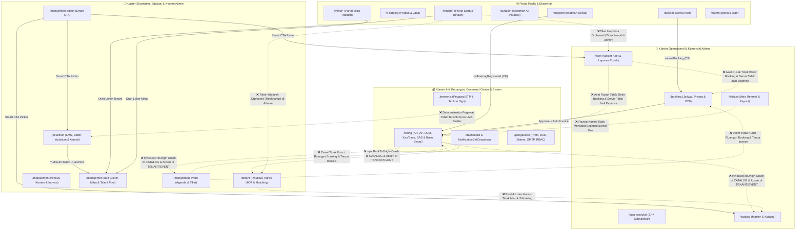

# 📋 Audit Ekosistem & Blueprint Penyempurnaan Integrasi Antar-Menu Admin Sintesa (Solo Technopark)

## 🎯 Ringkasan Eksekutif

1. ⚠️ **Jembatan Billing Lintas-Divisi (`DivisionInvoiceTracker` & `syncBackToOrigin`) Belum Merata & Rawan Crash**: Hanya 2 dari 5 divisi (`/booking` dan `/jasa-produksi`) yang sudah memakai [`DivisionInvoiceTracker.tsx`](file:///d:/Project/teknopark/src/components/finance/DivisionInvoiceTracker.tsx). Menu `/pelatihan` dan `/katalog` belum memilikinya, sementara `/tenant` masih memakai [`TabTagihanTenant.tsx`](file:///d:/Project/teknopark/src/app/(admin)/tenant/components/TabTagihanTenant.tsx) lama. Tombol **"Unduh PDF"** di luar `/billing` mengalami *silent failure* (tidak men-download PDF karena [`PrintInvoiceLayout.tsx`](file:///d:/Project/teknopark/src/app/(admin)/billing/component/PrintInvoiceLayout.tsx) hanya di-mount di `/billing/page.tsx`), dan [`billingService.syncBackToOrigin`](file:///d:/Project/teknopark/src/services/billing.service.ts#L173-L252) **pasti crash (`NOT_FOUND`) pada transaksi E-Katalog** karena mencoba meng-update koleksi `orders/{productId}` yang tidak pernah dibuat.
2. ❌ **4 Silo Data Antar-Menu Admin yang Terputus Total**:
   - **Kurasi Produk Tenant ↔ Master E-Katalog**: Produk UMKM/Startup yang lolos kurasi di [`ModalKurasiProduk.tsx`](file:///d:/Project/teknopark/src/app/(admin)/tenant/components/ModalKurasiProduk.tsx) (`tenants/{id}/products`) tidak memiliki tombol/sinkronisasi promosi ke [`/katalog`](file:///d:/Project/teknopark/src/app/(admin)/katalog/page.tsx) (`catalogs`).
   - **Tiket Helpdesk Tenant (`tenants/{id}/tickets`) Yatim Piatu**: Tiket keluhan fasilitas yang dikirim tenant di [`/tenant/tickets`](file:///d:/Project/teknopark/src/app/tenant/tickets/page.tsx#L58-L119) tidak dibaca oleh halaman Admin manapun (baik `/tenant` maupun `/aset`).
   - **Status Aset Rusak/Maintenance ↔ Kalender `/booking` & Mesin `/jasa-produksi` ↔ Biaya Servis `/billing`**: Laporan kerusakan di `/lapor-aset/[id]` dan status pemeliharaan di `/aset` tidak memblokir pemesanan ruangan di [`bookingManager.ts`](file:///d:/Project/teknopark/functions/src/callables/bookingManager.ts#L36-L72), tidak terhubung ke pemilihan mesin di `/jasa-produksi`, dan biaya perbaikan di [`ModalDetailAset.tsx`](file:///d:/Project/teknopark/src/app/(admin)/aset/components/ModalDetailAset.tsx#L33-L55) tidak tercatat sebagai `Expense` di `/billing`.
   - **Manajemen Event (`/manajemen-event`) Berdiri Sendiri**: Pembuatan event tidak mengunci ruangan di `/booking`, tier tiket/sponsor tidak membuat invoice di `/billing`, dan tidak terhubung ke diskusi `/ekosistem`.
3. ❌ **Kebocoran Akuntansi & Putusnya Rantai Komisi Afiliasi**:
   - Cloud Function [`submitBooking`](file:///d:/Project/teknopark/functions/src/callables/bookingManager.ts#L78-L97) membuang field `referralCode` saat menyimpan dokumen booking sehingga komisi afiliasi sewa ruangan tidak pernah terbuat.
   - Pencairan dana komisi (`handleProcessPayout`) di [`/afiliasi`](file:///d:/Project/teknopark/src/app/(admin)/afiliasi/page.tsx#L109-L130) tidak memotong saldo rekening Kas/Bank dan tidak membuat `Expense` / Jurnal Kas Keluar di `/billing`.
   - Penerbitan invoice SPK di [`ModalInvoiceProduction.tsx`](file:///d:/Project/teknopark/src/app/(admin)/jasa-produksi/components/ModalInvoiceProduction.tsx#L128) dan simulasi bayar di [`/tenant/billing`](file:///d:/Project/teknopark/src/app/tenant/billing/page.tsx#L41-L58) mem-bypass pembuatan Jurnal Akuntansi (`journals`).
4. ⚠️ **Ketidaksinkronan Matriks RBAC (`roles.ts`), Pengaturan, & Dashboard vs Buku Panduan (`00`–`12`)**:
   - Cloud Function [`getDashboardStats`](file:///d:/Project/teknopark/functions/src/callables/dashboardStats.ts#L18) menolak akses 8 role staf internal (`admin`, `admin_produksi`, `kasir`, dll.) dengan error `permission-denied`.
   - Dropdown penugasan role di [`TabKeamanan.tsx`](file:///d:/Project/teknopark/src/app/(admin)/pengaturan/components/TabKeamanan.tsx#L21-L42) kehilangan 6 role penting (`admin_produksi`, `operator_produksi`, `pegawai`, `industri`, `investor`, `kampus`).
   - Role `admin_keuangan` tidak diberi akses ke `/pengaturan` maupun permission `MANAGE_FINANCE_BAS` di [`roles.ts`](file:///d:/Project/teknopark/src/config/roles.ts#L64-L141) sehingga tidak bisa mengelola BAS/COA sesuai panduan.
5. 🚀 **Rencana Penyempurnaan Terstruktur (5 Sprint Eksekusi)**: Seluruh temuan di atas telah dipetakan ke dalam **Blueprint Penyempurnaan Integrasi 5 Fase (Sprint A s.d. Sprint E)** lengkap dengan spesifikasi file, fungsi service, dan skema data yang siap dieksekusi tanpa merusak fitur yang sudah berjalan.

---

## 🗺️ 1. Peta Arsitektur Integrasi Antar-Menu Admin (Kondisi Saat Ini vs Target Ideal)

---

## 📚 2. Audit Komparasi Dokumen Panduan (`public/panduan/00`–`12` & `public/docs/`) vs Implementasi Kode Aktual

| Dokumen Panduan | Klaim SOP di Dokumen Panduan | Fakta Implementasi Kode Aktual | Status & Rekomendasi |
| :--- | :--- | :--- | :---: |
| **[`00-INDEX-PANDUAN-SISTEM-SINTESA.md`](file:///d:/Project/teknopark/public/panduan/00-INDEX-PANDUAN-SISTEM-SINTESA.md#L21-L44)** | Matriks 20 Role dengan rute `/krenova`, `/portfolio`, `/riset`, `/kebutuhan`. | - Rute admin Krenova di [`layout.tsx`](file:///d:/Project/teknopark/src/app/(admin)/layout.tsx#L75) adalah `/manajemen-krenova` (bukan `/krenova`). - Rute `/portfolio`, `/riset`, dan `/kebutuhan` di [`roles.ts`](file:///d:/Project/teknopark/src/config/roles.ts#L78-L80) **tidak ada** di `src/app/` (menghasilkan 404). | ❌ **Perbaiki Rute & Buat/Redirect** |
| **[`01-PANDUAN-SUPER-ADMIN-DAN-PIMPINAN.md`](file:///d:/Project/teknopark/public/panduan/01-PANDUAN-SUPER-ADMIN-DAN-PIMPINAN.md#L22-L75)** | - SOP 3.1: Super Admin dapat memilih salah satu dari **20 peran** di `/pengaturan` → Tab Keamanan. - SOP 3.4: `/dashboard` menampilkan *Total Pendapatan BLUD*, *Okupansi Aset (%)*, *Serapan Lulusan (%)*, dan *Antrean Invoice Menunggu Verifikasi*. - Role `admin` dapat membuka `/pengaturan` (mode lihat). | - [`TabKeamanan.tsx`](file:///d:/Project/teknopark/src/app/(admin)/pengaturan/components/TabKeamanan.tsx#L21-L42) hanya menampilkan **14 role** (kehilangan `admin_produksi`, `operator_produksi`, `pegawai`, `industri`, `investor`, `kampus`). - [`dashboard/page.tsx`](file:///d:/Project/teknopark/src/app/(admin)/dashboard/page.tsx#L44) sengaja menghapus metrik keuangan dan [`dashboardStats.ts`](file:///d:/Project/teknopark/functions/src/callables/dashboardStats.ts#L18) memblokir role `admin` (`permission-denied`). - [`roles.ts`](file:///d:/Project/teknopark/src/config/roles.ts#L63) tidak memberi `/pengaturan` ke `admin`. | ❌ **Sinkronkan Kode & Dashboard** |
| **[`02-PANDUAN-KEUANGAN-BILLING-KASIR.md`](file:///d:/Project/teknopark/public/panduan/02-PANDUAN-KEUANGAN-BILLING-KASIR.md#L20-L115)** | - `admin_keuangan` mengelola penuh Bagan Akun Standar (BAS/COA) di `/pengaturan`. - Saat kasir memverifikasi lunas, sistem mengirim **notifikasi lonceng** ke pelanggan & email kuitansi. | - Di [`roles.ts`](file:///d:/Project/teknopark/src/config/roles.ts#L64-L141), `admin_keuangan` **tidak punya akses** ke `/pengaturan` dan tidak punya permission `MANAGE_FINANCE_BAS`. - Pelunasan invoice hanya mengirim email (`onInvoiceLifecycleMail`), **tidak menulis** ke `ecosystem_notifications` (lonceng notifikasi). | ⚠️ **Beri Hak Akses & Notifikasi** |
| **[`03-PANDUAN-ASET-DAN-RESERVASI.md`](file:///d:/Project/teknopark/public/panduan/03-PANDUAN-ASET-DAN-RESERVASI.md#L55-L105)** | - Admin Aset memantau status pembayaran di tab Tagihan Divisi. - Tersedia fitur **Reschedule Tanggal** pada tiket booking yang sudah disetujui. - Instansi dengan **Surat Dispensasi (Diskon 100% / Gratis)** tetap mengunci kalender tanpa tagihan. | - Tombol *"Buka Billing Terpadu"* di [`DivisionInvoiceTracker.tsx`](file:///d:/Project/teknopark/src/components/finance/DivisionInvoiceTracker.tsx#L156) melempar `admin_aset` ke layar **Akses Terlarang**. - Tombol *"Unduh PDF"* di modal detail invoice dari `/booking` **gagal diam-diam**. - Belum ada tombol **Reschedule Tanggal** di [`TabOverviewBooking.tsx`](file:///d:/Project/teknopark/src/app/(admin)/booking/components/TabOverviewBooking.tsx). | ⚠️ **Perbaiki Tracker & Tambah Reschedule** |
| **[`04-PANDUAN-JASA-PRODUKSI-MANUFAKTUR.md`](file:///d:/Project/teknopark/public/panduan/04-PANDUAN-JASA-PRODUKSI-MANUFAKTUR.md#L40-L95)** | - SPK terhubung dengan mesin bengkel & teknisi. - Saat invoice DP lunas, status SPK menjadi `IN_PRODUCTION`; saat lunas penuh & terkirim menjadi `COMPLETED`. | - Pilihan mesin di [`ModalFormProductionOrder.tsx`](file:///d:/Project/teknopark/src/app/(admin)/jasa-produksi/components/ModalFormProductionOrder.tsx#L52-L54) masih statis (tidak terhubung ke `/aset`). - Pembuatan invoice di [`ModalInvoiceProduction.tsx`](file:///d:/Project/teknopark/src/app/(admin)/jasa-produksi/components/ModalInvoiceProduction.tsx#L128) mem-bypass jurnal piutang. - Pelunasan penuh belum otomatis mengubah status SPK yang sudah `DELIVERED` menjadi `COMPLETED`. | ⚠️ **Hubungkan Aset & Jurnal SPK** |
| **[`05-PANDUAN-INKUBASI-TENANT-KRENOVA.md`](file:///d:/Project/teknopark/public/panduan/05-PANDUAN-INKUBASI-TENANT-KRENOVA.md#L35-L100)** | - Penilaian lomba Krenova di `/manajemen-krenova` & promosi pemenang menjadi Tenant Inkubasi. - Kurasi produk UKM yang lolos dapat dipasarkan di E-Katalog. | - [`/manajemen-krenova`](file:///d:/Project/teknopark/src/app/(admin)/manajemen-krenova/page.tsx) hanya mengelola video pendek (`krenova_contents`), sedangkan pendaftar inovasi dari `/curation` masuk ke `/tenant` (`TabValidasiTenant`). - Produk tenant yang lolos kurasi di [`ModalKurasiProduk.tsx`](file:///d:/Project/teknopark/src/app/(admin)/tenant/components/ModalKurasiProduk.tsx) tidak bisa dipromosikan ke `/katalog`. | ❌ **Integrasikan Kurasi → E-Katalog & Krenova** |
| **[`06-PANDUAN-PELATIHAN-LMS-TRACER-STUDY.md`](file:///d:/Project/teknopark/public/panduan/06-PANDUAN-PELATIHAN-LMS-TRACER-STUDY.md#L40-L105)** | - Pendaftaran diklat berbayar menerbitkan invoice `DIKLAT_PELATIHAN` yang dipantau Admin Pelatihan. - Yudisium meluluskan peserta ke database Alumni & membuka akses Bursa Karir. | - Menu [`/pelatihan`](file:///d:/Project/teknopark/src/app/(admin)/pelatihan/page.tsx) **belum memiliki tab Tagihan (`DivisionInvoiceTracker`)**. - Trigger [`onTrainingRegistered`](file:///d:/Project/teknopark/functions/src/triggers/purchaseAutomation.ts#L6-L72) tidak mengirim email `TRAINING_REGISTRATION` ke `mail_queue`. - Alumni hasil Import Excel (`isVerified: false`) tidak muncul di katalog Mitra/Tenant setelah klaim akun. | ⚠️ **Tambah Tab Tagihan & Fix `isVerified`** |
| **[`08-PANDUAN-TENANT-STARTUP-BINAAN.md`](file:///d:/Project/teknopark/public/panduan/08-PANDUAN-TENANT-STARTUP-BINAAN.md#L50-L95)** | - Tenant mengirim tiket kendala fasilitas di `/tenant/tickets` dan dipantau tindak lanjutnya oleh Admin. - Tenant melihat & membayar tagihan sewa/inkubasi di `/tenant/billing`. | - Tiket di [`/tenant/tickets`](file:///d:/Project/teknopark/src/app/tenant/tickets/page.tsx) (`tenants/{id}/tickets`) tidak muncul di halaman Admin manapun. - [`/tenant/billing`](file:///d:/Project/teknopark/src/app/tenant/billing/page.tsx#L25-L58) menarik seluruh invoice di client dan tombol simulasi bayar mem-bypass jurnal akuntansi. | ❌ **Buat Tab Helpdesk Admin & Fix Billing Tenant** |
| **[`11-PANDUAN-INVESTOR-DAN-KAMPUS.md`](file:///d:/Project/teknopark/public/panduan/11-PANDUAN-INVESTOR-DAN-KAMPUS.md#L30-L75)** | - Investor & Kampus mengakses `/ekosistem`, `/portfolio`, `/riset` untuk melihat startup `isRaising`, VDR, dan mengajukan proposal riset. | - Rute `/portfolio` dan `/riset` belum ada (404). - [`BusinessMatchingBoard.tsx`](file:///d:/Project/teknopark/src/app/(admin)/tenant/components/BusinessMatchingBoard.tsx) di Admin `/tenant` hanya berupa tombol `mailto:` statis tanpa integrasi ke database `partners` atau `hub_threads`. | ⚠️ **Arahkan ke `/ekosistem` & Hubungkan Partner** |
| **[`panduan-alur-billing-dan-keuangan-lintas-divisi.md`](file:///d:/Project/teknopark/public/docs/panduan-alur-billing-dan-keuangan-lintas-divisi.md)** | - 5 Divisi (`JASA_PRODUKSI`, `FASILITAS_ASET`, `DIKLAT_PELATIHAN`, `INKUBASI_TENANT`, `KATALOG_PRODUK`) memakai `DivisionInvoiceTracker`. - Pembatalan invoice otomatis membebaskan jadwal booking (`Released`). | - Baru `/booking` dan `/jasa-produksi` yang memakai `DivisionInvoiceTracker`. - Saat invoice dibatalkan (`handleCancelInvoice` di [`billing/page.tsx`](file:///d:/Project/teknopark/src/app/(admin)/billing/page.tsx#L199-L206)), `syncBackToOrigin` **tidak dipanggil**, sehingga jadwal di `/booking` tetap terkunci (`approved`) meskipun tagihannya sudah `CANCELLED`! | ❌ **Lengkapi Tracker di 5 Divisi & Sync Cancel** |

---

## 🔍 3. Daftar Lengkap Temuan Celah Integrasi (Line-by-Line Gap Analysis)

### Klaster 1: Keuangan, Billing Terpusat (`/billing`) & Sinkronisasi Lintas-Divisi (`DivisionInvoiceTracker`)

1. **Bug Fatal `syncBackToOrigin` pada Transaksi E-Katalog (`CATALOG`)**:
   - **Lokasi**: [`src/services/billing.service.ts`](file:///d:/Project/teknopark/src/services/billing.service.ts#L196-L202) & [`src/app/(public)/e-katalog/[id]/ClientPage.tsx`](file:///d:/Project/teknopark/src/app/(public)/e-katalog/%5Bid%5D/ClientPage.tsx#L183-L184).
   - **Masalah**: Saat pembeli checkout produk di `/e-katalog/[id]`, sistem langsung membuat dokumen `invoices` dengan `item.referenceType = 'CATALOG'` dan `item.referenceId = product.id` (ID dokumen di koleksi `catalogs`), **tanpa membuat dokumen di koleksi `orders`**. Ketika Kasir memverifikasi pembayaran menjadi `PAID`, `syncBackToOrigin` menjalankan `batch.update(doc(db, 'artifacts', appId, 'public', 'data', 'orders', item.referenceId), { status: 'PAID' })`. Karena dokumen `orders/{productId}` tidak ada, `batch.commit()` gagal dengan error `NOT_FOUND` dan **menggagalkan pencairan komisi afiliasi** di baris 245–251!
2. **`syncBackToOrigin` Hanya Dipanggil Saat `PAID` (Mengabaikan `PARTIAL` dan `CANCELLED`)**:
   - **Lokasi**: [`src/hooks/useBilling.ts`](file:///d:/Project/teknopark/src/hooks/useBilling.ts#L60-L63) dan [`src/hooks/useBilling.ts`](file:///d:/Project/teknopark/src/hooks/useBilling.ts#L114-L116).
   - **Masalah**:
     - Di `recordPayment`, `syncBackToOrigin` hanya dipanggil jika `newStatus === 'PAID'`. Padahal pembayaran DP SPK (`JASA_PRODUKSI`) atau DP Booking sering kali berstatus `PARTIAL`, sehingga SPK tidak otomatis berpindah ke `DP_PAID` / `IN_PRODUCTION` jika ditagih dalam 1 invoice bertahap.
     - Di `updateInvoice` (saat invoice dibatalkan / `status === 'CANCELLED'`), `syncBackToOrigin` tidak dipanggil sama sekali, sehingga ruangan di `/booking` tidak otomatis dibebaskan (`rejected`/`cancelled`) saat invoice dibatalkan oleh Kasir.
     - Selain itu, `referenceType` untuk **`TENANT`**, **`TARIFF_DAY`**, **`TARIFF_MONTH`**, **`PARTNERSHIP`**, dan **`EVENT`** belum ditangani di `syncBackToOrigin`.
3. **Tombol "Unduh PDF" & "Cetak Kwitansi" Gagal pada `DivisionInvoiceTracker` (Di Luar `/billing`)**:
   - **Lokasi**: [`src/components/finance/DivisionInvoiceTracker.tsx`](file:///d:/Project/teknopark/src/components/finance/DivisionInvoiceTracker.tsx#L156-L345), [`src/app/(admin)/billing/component/ModalInvoiceDetail.tsx`](file:///d:/Project/teknopark/src/app/(admin)/billing/component/ModalInvoiceDetail.tsx#L91-L97), dan [`src/app/(admin)/billing/component/PrintInvoiceLayout.tsx`](file:///d:/Project/teknopark/src/app/(admin)/billing/component/PrintInvoiceLayout.tsx#L13-L18).
   - **Masalah**:
     - `downloadInvoicePDF` mencari elemen DOM `#print-invoice-wrapper` yang di-render oleh `<PrintInvoiceLayout />`. Komponen `<PrintInvoiceLayout />` **hanya dipasang di `/billing/page.tsx` (baris 263)**, tidak dipasang di `DivisionInvoiceTracker.tsx` maupun `tenant/page.tsx`. Akibatnya, saat Admin Aset/Produksi/Tenant menekan **"Unduh PDF"**, fungsi langsung return tanpa men-download file tetapi memunculkan toast palsu *"PDF berhasil diunduh!"*.
     - `DivisionInvoiceTracker.tsx` (baris 336) tidak meneruskan prop `onOpenKwitansi`, sehingga tombol **"Cetak Kwitansi Tanda Terima"** hilang bagi Admin Divisi meskipun invoice sudah `PAID`.
     - Tombol `<Link href="/billing">Buka Billing Terpadu</Link>` di `DivisionInvoiceTracker.tsx` (baris 156) selalu ditampilkan tanpa mengecek `hasAccess(role, '/billing')`, menyebabkan `admin_aset`, `admin_tenant`, dan `admin_pelatihan` terkena layar "Akses Terlarang" jika mengkliknya.
4. **Absennya `DivisionInvoiceTracker` di `/pelatihan`, `/katalog`, dan `/tenant`**:
   - Menu [`/pelatihan/page.tsx`](file:///d:/Project/teknopark/src/app/(admin)/pelatihan/page.tsx) belum memiliki tab pantauan tagihan peserta diklat (`DIKLAT_PELATIHAN`).
   - Menu [`/katalog/page.tsx`](file:///d:/Project/teknopark/src/app/(admin)/katalog/page.tsx) belum memiliki tab pantauan tagihan order produk (`KATALOG_PRODUK`), dan tab *Pengaturan Katalog* (baris 153–163) masih berupa placeholder kosong.
   - Menu [`/tenant/page.tsx`](file:///d:/Project/teknopark/src/app/(admin)/tenant/page.tsx#L206) masih memakai `TabTagihanTenant.tsx` manual, belum terintegrasi dengan `DivisionInvoiceTracker` (`INKUBASI_TENANT`).

---

### Klaster 2: Operasional Aset (`/aset`), Reservasi (`/booking`), & Jasa Produksi (`/jasa-produksi`)

1. **Aset Rusak / Pemeliharaan di `/aset` Tidak Memblokir Jadwal `/booking`**:
   - **Lokasi**: [`src/app/(admin)/aset/components/ModalFormAset.tsx`](file:///d:/Project/teknopark/src/app/(admin)/aset/components/ModalFormAset.tsx#L27), [`src/hooks/useAssets.ts`](file:///d:/Project/teknopark/src/hooks/useAssets.ts#L49-L60), dan [`functions/src/callables/bookingManager.ts`](file:///d:/Project/teknopark/functions/src/callables/bookingManager.ts#L36-L72).
   - **Masalah**:
     - Form tambah/edit aset (`ModalFormAset.tsx` baris 247–264) tidak memiliki dropdown untuk mengubah `status` aset menjadi `'Pemeliharaan'` (di-hardcode `'Tersedia'` di baris 27).
     - Saat publik melapor kerusakan di `/lapor-aset/[id]`, tidak ada tombol cepat bagi Admin Aset di [`TabLaporanPublik.tsx`](file:///d:/Project/teknopark/src/app/(admin)/aset/components/TabLaporanPublik.tsx) untuk langsung mengubah status aset menjadi `'Pemeliharaan'` (Nonaktifkan Sementara dari Booking).
     - Baik `publicRooms` di `useAssets.ts` (baris 58) maupun Cloud Function `submitBooking` (`bookingManager.ts` baris 36–72) **tidak mengecek** apakah `asset.status === 'Pemeliharaan'` atau `asset.condition === 'Rusak Berat'`, sehingga ruangan yang sedang diperbaiki tetap bisa dipesan publik!
2. **Biaya Pemeliharaan Aset di `/aset` Tidak Masuk ke Pengeluaran (`/billing` Expenses)**:
   - **Lokasi**: [`src/app/(admin)/aset/components/ModalDetailAset.tsx`](file:///d:/Project/teknopark/src/app/(admin)/aset/components/ModalDetailAset.tsx#L33-L55) & [`src/services/asset.service.ts`](file:///d:/Project/teknopark/src/services/asset.service.ts#L142-L148).
   - **Masalah**: Saat Admin mencatat riwayat servis dengan nominal `Biaya (Rp) > 0`, data hanya disimpan ke array `maintenanceHistory` pada dokumen aset tanpa opsi untuk meneruskan pengajuan biaya tersebut ke `financeService.addExpense()` (`PENDING_APPROVAL`) di `/billing`.
3. **Jasa Produksi (`/jasa-produksi`) Terputus dari Master Mesin `/aset` & Bypass Jurnal Piutang**:
   - **Lokasi**: [`src/app/(admin)/jasa-produksi/components/ModalFormProductionOrder.tsx`](file:///d:/Project/teknopark/src/app/(admin)/jasa-produksi/components/ModalFormProductionOrder.tsx#L399-L431) & [`src/app/(admin)/jasa-produksi/components/ModalInvoiceProduction.tsx`](file:///d:/Project/teknopark/src/app/(admin)/jasa-produksi/components/ModalInvoiceProduction.tsx#L44-L128).
   - **Masalah**:
     - Form SPK belum mengambil daftar mesin/peralatan produksi dari `/aset` (`useAssets`) dan daftar teknisi dari `/presensi` (`usePegawaiList`).
     - `ModalInvoiceProduction.tsx` (baris 44) mengecek `order.dpPercentage > 0` alih-alih `order.dpRequired && order.dpPercentage > 0`, sehingga SPK tanpa DP tetap dipaksa default ke mode DP.
     - `ModalInvoiceProduction.tsx` (baris 128) memanggil `billingService.createInvoice()` langsung tanpa melalui `useBilling().createNewInvoice()`, sehingga **Jurnal Piutang Usaha tidak tercatat** di Buku Besar saat tagihan SPK terbit.
4. **Kemitraan B2B (`/booking` → `TabKemitraanB2B.tsx`) Belum Bisa Menerbitkan Invoice / Konversi ke Mitra**:
   - **Lokasi**: [`src/app/(admin)/booking/components/TabKemitraanB2B.tsx`](file:///d:/Project/teknopark/src/app/(admin)/booking/components/TabKemitraanB2B.tsx#L1-L320).
   - **Masalah**: Pengajuan kemitraan B2B di `/booking` hanya bisa diubah statusnya (`PENDING` → `REVIEWING` → `APPROVED` → `REJECTED`), tetapi belum memiliki tombol **"Buat Tagihan Kemitraan / Kontrak B2B"** (`ModalFormInvoice`) maupun jembatan ke `convertInquiryToPartner` di `/manajemen-karir`.

---

### Klaster 3: Inkubasi Tenant (`/tenant`), Krenova (`/manajemen-krenova`), & E-Katalog (`/katalog`)

1. **Produk Tenant yang Lulus Kurasi Tidak Bisa Dipromosikan ke Master E-Katalog (`/katalog`)**:
   - **Lokasi**: [`src/app/(admin)/tenant/components/ModalKurasiProduk.tsx`](file:///d:/Project/teknopark/src/app/(admin)/tenant/components/ModalKurasiProduk.tsx#L56-L63) & [`src/app/(admin)/katalog/components/ModalFormProduct.tsx`](file:///d:/Project/teknopark/src/app/(admin)/katalog/components/ModalFormProduct.tsx#L635-L655).
   - **Masalah**:
     - Saat Admin Tenant memberi nilai kurasi produk di `ModalKurasiProduk.tsx`, skor disimpan ke `tenants/{tenantId}/products/{productId}`, tetapi (a) field `smeReadinessLevel` di dokumen induk `tenants/{tenantId}` tidak di-update, dan (b) tidak ada tombol **"Tayangkan ke Master E-Katalog (`/katalog`)"** yang otomatis membuat/menyinkronkan dokumen di koleksi `catalogs` dengan `ownerType: 'TENANT'`, `tenantId: tenant.id`, `tenantName: tenant.name`.
     - Sebaliknya, di `ModalFormProduct.tsx` (`/katalog`), saat memilih `ownerType: 'TENANT'`, admin hanya disuguhi input teks manual tanpa dropdown pilih Tenant dari `useTenants()`.
2. **Tiket Helpdesk Tenant (`/tenant/tickets`) Yatim Piatu (100% Dead-End)**:
   - **Lokasi**: [`src/app/tenant/tickets/page.tsx`](file:///d:/Project/teknopark/src/app/tenant/tickets/page.tsx#L58-L119).
   - **Masalah**: Tenant mengirim tiket keluhan (`Fasilitas`, `Internet & IT`, `Kebersihan`, `Keamanan`) ke subkoleksi `tenants/{tenantId}/tickets` dan menunggu balasan `adminReply`. Namun tidak ada satu pun fungsi di `tenant.service.ts` maupun tab di `/tenant` atau `/aset` yang membaca `collectionGroup(db, 'tickets')` dan membalas tiket tersebut!
3. **3 Bug Integrasi Asesmen AI (`/curation`) → Validasi Tenant (`/tenant`)**:
   - **Lokasi**: [`src/app/(public)/curation/page.tsx`](file:///d:/Project/teknopark/src/app/(public)/curation/page.tsx#L91-L135), [`src/app/(admin)/tenant/components/DrawerProfilTenant.tsx`](file:///d:/Project/teknopark/src/app/(admin)/tenant/components/DrawerProfilTenant.tsx#L429-L469), dan [`src/app/(admin)/tenant/components/ModalReviewTenant.tsx`](file:///d:/Project/teknopark/src/app/(admin)/tenant/components/ModalReviewTenant.tsx#L63-L79).
   - **Masalah**:
     - File dokumen (`pitchDeckFile`, `legalitasFile`, `fotoProdukFile`) yang dipilih di `WizardForm.tsx` tidak pernah di-upload ke Storage saat `submitCurationApplication` dipanggil.
     - `DrawerProfilTenant.tsx` membaca key lama (`breakdown.kualitas`, `recommendations.packagingImprovement`) yang berbeda dengan key yang disimpan oleh `/curation` (`scoreBreakdown.productAndTech`, `recommendations.productImprovement`), sehingga rincian skor AI di Drawer selalu `0` / kosong.
     - Saat tenant disetujui di `ModalReviewTenant.tsx`, sistem belum otomatis men-generate `accessCode` (`SNT-XXXXX`), dan trigger [`onTenantCreated`](file:///d:/Project/teknopark/functions/src/triggers/tenantAuth.ts#L50) hanya mencetak password awal ke `console.log` tanpa mengirimkannya ke `mail_queue`.
4. **Celah Keamanan & Bypass Jurnal pada `/tenant/billing`**:
   - **Lokasi**: [`src/app/tenant/billing/page.tsx`](file:///d:/Project/teknopark/src/app/tenant/billing/page.tsx#L25-L58).
   - **Masalah**: Query `onSnapshot` membaca seluruh koleksi `invoices` tanpa filter server-side `where`, dan tombol *"Simulasi: Saya Sudah Bayar"* langsung mengubah `status: 'PAID'` di Firestore (mem-bypass verifikasi Kasir & Jurnal Akuntansi, alih-alih mengunggah bukti bayar berstatus `PENDING` ke `history` invoice).

---

### Klaster 4: Pelatihan (`/pelatihan`), LMS (`/lms`), Alumni & Bursa Karir (`/manajemen-karir`), serta Presensi (`/presensi`)

1. **Diskrepansi `isVerified` Antara `TalentPoolTab` (Admin) vs `TalentPoolExplorer` (Mitra & Tenant)**:
   - **Lokasi**: [`src/services/alumni.service.ts`](file:///d:/Project/teknopark/src/services/alumni.service.ts#L71-L82), [`src/services/alumni.service.ts`](file:///d:/Project/teknopark/src/services/alumni.service.ts#L241-L245), dan [`src/services/partner.service.ts`](file:///d:/Project/teknopark/src/services/partner.service.ts#L299-L303).
   - **Masalah**:
     - Saat alumni ditambahkan via Import Excel atau Manual di `AlumniTab.tsx`, `isVerified` diset `false`. Saat alumni mengklaim akunnya via `claimAlumni` (atau callable [`claimAlumniAccount`](file:///d:/Project/teknopark/functions/src/callables/alumniClaim.ts#L71-L78)), status berubah menjadi `'CLAIMED'`, tetapi **`isVerified` tidak diubah menjadi `true`**. Akibatnya, alumni tersebut **tidak pernah muncul** di `TalentPoolExplorer` pada dashboard Mitra Industri (`/mitra/dashboard`) maupun Tenant (`/tenant/talent`)!
     - Sebaliknya, alumni hasil Yudisium Batch (`batch.service.ts` baris 267) berstatus `'DORMANT'` (belum punya `userId`), tetapi sudah muncul di `TalentPoolExplorer`.
     - Di [`partner.service.ts`](file:///d:/Project/teknopark/src/services/partner.service.ts#L358), notifikasi undangan wawancara dikirim ke `recipientUid: payload.alumniId` (ID dokumen `alumnis`), padahal lonceng notifikasi alumni membaca `recipientUid: user.uid` (Firebase Auth UID).
2. **Data Instruktur di `/pelatihan/builder` Terputus dari Data Pegawai `/presensi`**:
   - **Lokasi**: [`src/app/(admin)/pelatihan/builder/components/TeamFaqTab.tsx`](file:///d:/Project/teknopark/src/app/(admin)/pelatihan/builder/components/TeamFaqTab.tsx#L21-L69).
   - **Masalah**: Admin harus mengetik manual nama/foto instruktur dan membagikan kode `KST-XXXXX` secara manual. Belum ada fitur **"Pilih dari Direktori Pegawai / Instruktur STP"** yang mengambil data pegawai dari `/presensi` (`users` / `stpEmployeeService`) dan langsung mengotorisasi `uid` pegawai tersebut ke `authorizedInstructorIds`.

---

### Klaster 5: Program Afiliasi (`/afiliasi`), Manajemen Event (`/manajemen-event`), Command Center (`/dashboard`), & Cloud Functions (`functions/src/`)

1. **Referral Code Booking Hilang di Cloud Function & Payout Afiliasi Tidak Tercatat di `/billing`**:
   - **Lokasi**: [`functions/src/callables/bookingManager.ts`](file:///d:/Project/teknopark/functions/src/callables/bookingManager.ts#L78-L97) & [`src/app/(admin)/afiliasi/page.tsx`](file:///d:/Project/teknopark/src/app/(admin)/afiliasi/page.tsx#L109-L130).
   - **Masalah**:
     - `bookingManager.ts` tidak menyalin `referralCode` dari `request.data` ke `newBookingData`, sehingga afiliasi sewa fasilitas 100% gagal tercatat.
     - Saat Admin menyetujui pencairan komisi (`handleProcessPayout`) di `/afiliasi`, sistem tidak meminta rekening Kas/Bank sumber dan tidak memanggil `financeService.addExpense()` / `updateExpenseStatus()`, sehingga kas keluar afiliasi tidak tercatat di pembukuan BLUD.
2. **Manajemen Event (`/manajemen-event`) Terisolasi dari `/booking` & `/billing`**:
   - **Lokasi**: [`src/app/(admin)/manajemen-event/page.tsx`](file:///d:/Project/teknopark/src/app/(admin)/manajemen-event/page.tsx#L397-L619).
   - **Masalah**: Lokasi event hanya berupa teks bebas (tidak bisa memilih ruangan dari `/aset` dan tidak otomatis memblokir jadwal di `/booking`), serta tidak memiliki integrasi pembuatan tagihan sponsorship/tiket ke `/billing`.
3. **Command Center (`/dashboard`), Lonceng Notifikasi, & Cloud Functions**:
   - [`functions/src/callables/dashboardStats.ts`](file:///d:/Project/teknopark/functions/src/callables/dashboardStats.ts#L18): `allowedRoles` hanya mengizinkan 5 role (`super_admin`, `admin_keuangan`, `admin_aset`, `admin_tenant`, `admin_pelatihan`) dan menolak 8 role staf internal lainnya (`admin`, `admin_produksi`, `kasir`, dll.).
   - [`src/app/(admin)/dashboard/page.tsx`](file:///d:/Project/teknopark/src/app/(admin)/dashboard/page.tsx): Belum menampilkan *Action Center* lintas divisi (Antrean Verifikasi Bayar Kasir, SPK Produksi Aktif, Tiket Helpdesk Tenant, Kurasi Loker Mitra, Payout Afiliasi Pending), dan kartu/feed belum memiliki tautan klik (*deep-link*).
   - [`src/components/common/NotificationBellDropdown.tsx`](file:///d:/Project/teknopark/src/components/common/NotificationBellDropdown.tsx): Baru menerima notifikasi dari Forum & Karir; kejadian transaksi dari Booking, Billing/Bukti Bayar, SPK Produksi, Tiket Tenant, dan Aset Rusak belum mengirim notifikasi ke `ADMIN_DESK`.
   - **11 File Cloud Functions Melanggar Lazy Init**: Memanggil `const db = admin.firestore()` di top-level modul (berisiko *deployment discovery timeout* dan crash pada `purchaseAutomation.ts` serta `tenantAuth.ts` yang belum memanggil `admin.initializeApp()`).

---

## 🛠️ 4. Blueprint Rencana Penyempurnaan Integrasi (5 Fase / Sprint Eksekusi)

### 🚀 Sprint 1: Jembatan Keuangan & Billing Lintas-Divisi (`DivisionInvoiceTracker`, `syncBackToOrigin`, PDF & Afiliasi)
*Tujuan: Memastikan siklus tagihan, pembayaran, pembatalan, kwitansi PDF, dan pencairan komisi afiliasi tersinkronisasi 100% akurat di seluruh divisi tanpa bug.*

1. **Perbaikan Menyeluruh [`billingService.syncBackToOrigin`](file:///d:/Project/teknopark/src/services/billing.service.ts#L173-L252) & [`useBilling.ts`](file:///d:/Project/teknopark/src/hooks/useBilling.ts#L60-L119)**:
   - Panggil `syncBackToOrigin` pada perubahan status **`PARTIAL`**, **`PAID`**, dan **`CANCELLED`**.
   - **Fix Crash `CATALOG`**: Cek `getDoc` terlebih dahulu pada `orders/{referenceId}` sebelum melakukan `batch.update`, atau catat statistik penjualan pada `catalogs/{referenceId}` (`increment(1)` pada `soldCount`) dan jika produk milik Tenant (`tenantId`), otomatis tambahkan catatan omzet ke `tenants/{tenantId}/revenues`!
   - **Handle `BOOKING` & `TARIFF_DAY`**: Gunakan status yang valid sesuai `BookingSchema` (`'approved'` saat `PARTIAL` dengan `paymentStatus: 'PARTIAL'`, `'completed'` saat `PAID` dengan `paymentStatus: 'PAID'`, dan `'rejected'` / bebas jadwal saat invoice `'CANCELLED'`).
   - **Handle `PRODUCTION`**: Saat `FULL_PAID`, jika SPK sudah `DELIVERED`, otomatis ubah status SPK menjadi `'COMPLETED'`. Cegah regresi status jika SPK sudah di tahap `QUALITY_CONTROL` / `DELIVERED`.
   - **Handle `TENANT` / `TARIFF_MONTH`**: Saat `PAID`, perbarui `lastPaymentDate` dan `billingStatus: 'LUNAS'` pada dokumen `tenants/{referenceId}`.
   - Invalidate query cache lintas modul (`['bookings']`, `['production_orders']`, `['tenants']`, `['trainings']`) di `useBilling.ts`.
2. **Standarisasi [`DivisionInvoiceTracker.tsx`](file:///d:/Project/teknopark/src/components/finance/DivisionInvoiceTracker.tsx) & Pasang di 5 Divisi**:
   - Sembunyikan tombol *"Buka Billing Terpadu"* jika `!hasAccess(role, '/billing')`.
   - Mount `<PrintInvoiceLayout />`, `<PrintKwitansiLayout />`, dan `<ModalPreviewKwitansi />` langsung di dalam `DivisionInvoiceTracker.tsx` agar tombol **"Unduh PDF"** dan **"Cetak Kwitansi"** berfungsi 100% di semua halaman divisi!
   - Pasang `DivisionInvoiceTracker` di:
     - `/pelatihan/page.tsx` (Tab baru: **Tagihan Diklat** — `division="DIKLAT_PELATIHAN"`).
     - `/katalog/page.tsx` (Tab baru: **Tagihan & Order Katalog** — `division="KATALOG_PRODUK"`).
     - `/tenant/page.tsx` (Gantikan daftar riwayat manual di `TabTagihanTenant.tsx` dengan `DivisionInvoiceTracker` — `division="INKUBASI_TENANT"` sambil mempertahankan tombol cepat *"+ Buat Tagihan Tenant"*).
3. **Integrasi Pencairan Afiliasi (`/afiliasi`) → Pengeluaran & Jurnal Kas (`/billing`)**:
   - Di [`src/app/(admin)/afiliasi/page.tsx`](file:///d:/Project/teknopark/src/app/(admin)/afiliasi/page.tsx#L109-L130), tambahkan pilihan **Rekening Kas/Bank Sumber** (`accounts` bertipe `KAS_BANK`) pada modal konfirmasi transfer payout.
   - Saat Admin mengonfirmasi transfer payout, otomatis panggil `financeService.addExpense` (status `'PAID'`) + potong saldo rekening Kas/Bank + buat Jurnal Akuntansi (`DEBIT Beban Komisi Afiliasi` / `KREDIT Kas/Bank`).
4. **Fix `referralCode` Booking di Cloud Function & Form SPK**:
   - Di [`functions/src/callables/bookingManager.ts`](file:///d:/Project/teknopark/functions/src/callables/bookingManager.ts#L78-L97), sertakan `referralCode: data.referralCode || null` ke dalam `newBookingData`.
   - Di [`ModalInvoiceProduction.tsx`](file:///d:/Project/teknopark/src/app/(admin)/jasa-produksi/components/ModalInvoiceProduction.tsx#L44-L128), gunakan `useBilling().createNewInvoice()` agar jurnal piutang tercatat otomatis, dan perbaiki deteksi DP menjadi `order.dpRequired && order.dpPercentage > 0`.

---

### 🚀 Sprint 2: Integrasi Ekosistem Tenant (`/tenant`), Kurasi E-Katalog (`/katalog`), Helpdesk Tiket, & Krenova (`/curation`)
*Tujuan: Menghilangkan seluruh silo data antara Portal Tenant, Admin Tenant, Admin Aset, dan Master E-Katalog.*

1. **Fitur "Promosikan Produk Terkurasi ke Master E-Katalog" (`/tenant` ↔ `/katalog`)**:
   - Di [`ModalKurasiProduk.tsx`](file:///d:/Project/teknopark/src/app/(admin)/tenant/components/ModalKurasiProduk.tsx):
     - Saat menyimpan skor kurasi, otomatis update `smeReadinessLevel: finalGrade` pada dokumen induk `tenants/{tenantId}`.
     - Tambahkan tombol **"🚀 Tayangkan ke Master E-Katalog (`/katalog`)"** untuk produk yang telah dikurasi (`Market Ready` / `Retail Ready` / `Premium Export Ready`). Tombol ini memanggil `catalogService.promoteTenantProductToCatalog(tenant, product)` yang membuat/meng-update dokumen di koleksi `catalogs` (`ownerType: 'TENANT'`, `tenantId: tenant.id`, `tenantName: tenant.name`, `sourceProductId: product.id`).
   - Di [`ModalFormProduct.tsx`](file:///d:/Project/teknopark/src/app/(admin)/katalog/components/ModalFormProduct.tsx#L635-L655): Tambahkan dropdown pemilihan Tenant resmi dari `useTenants()` saat `ownerType === 'TENANT'`.
   - Di [`TabKurasiProduk.tsx`](file:///d:/Project/teknopark/src/app/(admin)/tenant/components/TabKurasiProduk.tsx#L16): Buka filter segmen agar mencakup seluruh segmen tenant (`Startup`, `UMKM`, `Koperasi`, `Jasa`) yang memiliki produk.
2. **Pusat Tindak Lanjut Tiket Helpdesk Tenant (`/tenant/tickets` ↔ Admin `/tenant` & `/aset`)**:
   - Tambahkan fungsi `getAllTenantTickets()`, `createTenantTicket()`, dan `replyToTenantTicket()` di [`src/services/tenant.service.ts`](file:///d:/Project/teknopark/src/services/tenant.service.ts) (menggunakan `collectionGroup(db, 'tickets')` atau koleksi terpusat `tenant_tickets` dengan backward-compatibility).
   - Buat komponen `TabHelpdeskTenant.tsx` yang dipasang di Admin `/tenant` (dan dapat diakses dari `/aset` tab Laporan Kerusakan) sehingga Admin bisa mengubah status tiket (`PENDING` → `PROSES` → `SELESAI`), menulis `adminReply`, serta mengirim notifikasi ke tenant.
3. **Perbaikan Alur `/curation` → `/tenant` & `/manajemen-krenova`**:
   - Upload file dokumen (`pitchDeckFile`, `legalitasFile`, `fotoProdukFile`) di [`src/app/(public)/curation/page.tsx`](file:///d:/Project/teknopark/src/app/(public)/curation/page.tsx#L91-L135) ke Firebase Storage sebelum menyimpan ke Firestore.
   - Samakan pembacaan key skor AI di [`DrawerProfilTenant.tsx`](file:///d:/Project/teknopark/src/app/(admin)/tenant/components/DrawerProfilTenant.tsx#L429-L469) agar mendukung format baru (`scoreBreakdown` & `recommendations`) maupun legacy.
   - Saat tenant disetujui di [`ModalReviewTenant.tsx`](file:///d:/Project/teknopark/src/app/(admin)/tenant/components/ModalReviewTenant.tsx#L63-L79), otomatis generate `accessCode` (`SNT-XXXXX`).
   - Di [`/manajemen-krenova/page.tsx`](file:///d:/Project/teknopark/src/app/(admin)/manajemen-krenova/page.tsx), perbaiki bug filter kategori video (`mascot`, `rundown`, `guide`, `teaser`) dan tambahkan tab/banner pintasan langsung ke **Antrean Validasi Inovasi & Kurasi AI (`/tenant?tab=validasi`)**.
4. **Perbaikan Keamanan & Alur Bukti Bayar di `/tenant/billing`**:
   - Filter query invoice di [`/tenant/billing/page.tsx`](file:///d:/Project/teknopark/src/app/tenant/billing/page.tsx) berdasarkan `tenantId` / `customerEmail`.
   - Ubah tombol *"Simulasi: Saya Sudah Bayar"* menjadi **Unggah Bukti Pembayaran / Konfirmasi Bayar** yang menambahkan entri `status: 'PENDING'` ke `invoice.history` agar diverifikasi oleh Kasir di `/billing` (menjaga integritas Jurnal Double-Entry).

---

### 🚀 Sprint 3: Integrasi Aset (`/aset`) ↔ Booking (`/booking`) ↔ Mesin Produksi (`/jasa-produksi`) ↔ Manajemen Event (`/manajemen-event`)
*Tujuan: Mencegah double-booking pada ruangan/mesin yang sedang rusak atau dipakai event, serta menghubungkan biaya pemeliharaan aset ke keuangan.*

1. **Blokir Otomatis Aset Rusak / Pemeliharaan dari Kalender `/booking`**:
   - Tambahkan dropdown `Status Operasional` (`Tersedia`, `Pemeliharaan`, `Disewa`) di [`ModalFormAset.tsx`](file:///d:/Project/teknopark/src/app/(admin)/aset/components/ModalFormAset.tsx) dan tombol cepat **"Set Status: Pemeliharaan"** pada [`TabLaporanPublik.tsx`](file:///d:/Project/teknopark/src/app/(admin)/aset/components/TabLaporanPublik.tsx).
   - Di [`useAssets.ts`](file:///d:/Project/teknopark/src/hooks/useAssets.ts#L58) dan Cloud Function [`submitBooking`](file:///d:/Project/teknopark/functions/src/callables/bookingManager.ts#L36-L72), tolak pemesanan jika aset berstatus `'Pemeliharaan'` atau berkondisi `'Rusak Berat'`.
2. **Integrasi Biaya Pemeliharaan Aset (`/aset`) → Pengeluaran (`/billing`)**:
   - Di [`ModalDetailAset.tsx`](file:///d:/Project/teknopark/src/app/(admin)/aset/components/ModalDetailAset.tsx#L33-L55), tambahkan checkbox **"Ajukan Pencairan / Catat sebagai Pengeluaran di Sistem Keuangan (`/billing`)"** saat menginput riwayat pemeliharaan dengan `cost > 0`, yang otomatis memanggil `financeService.addExpense()`.
3. **Integrasi Mesin `/aset` & Teknisi `/presensi` ke Form SPK `/jasa-produksi`**:
   - Di [`ModalFormProductionOrder.tsx`](file:///d:/Project/teknopark/src/app/(admin)/jasa-produksi/components/ModalFormProductionOrder.tsx#L399-L431), tambahkan pemilih mesin dari daftar aset produksi (`useAssets`) dan pemilih teknisi/operator dari daftar pegawai (`stpEmployeeService` / `usePegawaiList`), serta tampilkan peringatan jika mesin sedang berstatus `'Pemeliharaan'`.
4. **Integrasi `/manajemen-event` ↔ `/booking` (Reservasi Ruangan Otomatis) & `/billing`**:
   - Di [`src/app/(admin)/manajemen-event/page.tsx`](file:///d:/Project/teknopark/src/app/(admin)/manajemen-event/page.tsx#L397-L407), tambahkan dropdown pemilihan **Ruangan Fasilitas STP** (`allRooms` dari `useAssets`) beserta opsi **"Kunci Jadwal Ruangan di Kalender `/booking`"**. Jika dicentang, penyimpanan event otomatis membuat dokumen booking berstatus `'approved'` untuk tanggal event tersebut sehingga tidak terjadi *double-booking*.

---

### 🚀 Sprint 4: Sinkronisasi Pelatihan (`/pelatihan`), Alumni & Karir (`/manajemen-karir`), Mitra, serta Instruktur (`/presensi`)
*Tujuan: Menyempurnakan alur kelulusan peserta diklat hingga terserap kerja di Mitra/Tenant, serta menyatukan data instruktur.*

1. **Sinkronisasi `isVerified` & UID Notifikasi pada Talent Pool (`TalentPoolTab` ↔ `TalentPoolExplorer`)**:
   - Di [`src/services/alumni.service.ts`](file:///d:/Project/teknopark/src/services/alumni.service.ts#L241-L245) dan [`functions/src/callables/alumniClaim.ts`](file:///d:/Project/teknopark/functions/src/callables/alumniClaim.ts#L71-L78), saat alumni berhasil mengklaim akun (`claimAlumni`), set `isVerified: true` dan pastikan cache talent pool diperbarui.
   - Di [`src/services/partner.service.ts`](file:///d:/Project/teknopark/src/services/partner.service.ts#L358), saat mengirim undangan wawancara (`sendTalentInvitation`), ambil `userId` dari dokumen `alumnis/{alumniId}` sebagai `recipientUid` notifikasi (dengan fallback `alumniId`) agar muncul di lonceng notifikasi `/alumni-portal`.
2. **Integrasi Direktori Pegawai (`/presensi`) → Pemilihan Instruktur Kelas (`/pelatihan/builder`)**:
   - Di [`TeamFaqTab.tsx`](file:///d:/Project/teknopark/src/app/(admin)/pelatihan/builder/components/TeamFaqTab.tsx), tambahkan tombol **"Pilih dari Pegawai / Instruktur STP"** yang mengambil daftar pegawai dari `stpEmployeeService.getEmployees()` — otomatis mengisi nama, jabatan, foto, dan langsung menambahkan `uid` pegawai ke `authorizedInstructorIds` tanpa perlu mengetik kode `KST-XXXXX` manual!
3. **Integrasi `BusinessMatchingBoard.tsx` (`/tenant`) ↔ Database Mitra Industri & Investor (`partners`)**:
   - Di [`BusinessMatchingBoard.tsx`](file:///d:/Project/teknopark/src/app/(admin)/tenant/components/BusinessMatchingBoard.tsx), hubungkan dengan `useAllPartners()` (`partner.service.ts`) agar Admin dapat melihat daftar Mitra Industri/Investor terverifikasi dan memfasilitasi matchmaking langsung dengan startup yang sedang `isRaising`.

---

### 🚀 Sprint 5: Penguatan RBAC (`roles.ts`), Command Center (`/dashboard`), Notifikasi Lintas-Divisi, & Cloud Functions
*Tujuan: Menyelaraskan hak akses 20 role sesuai buku panduan, menghidupkan Dashboard & Lonceng Notifikasi untuk semua divisi, dan mengamankan Cloud Functions.*

1. **Penyelarasan [`src/config/roles.ts`](file:///d:/Project/teknopark/src/config/roles.ts) & [`TabKeamanan.tsx`](file:///d:/Project/teknopark/src/app/(admin)/pengaturan/components/TabKeamanan.tsx)**:
   - Tambahkan `/pengaturan` ke `ROLE_ACCESS_MAP[APP_ROLES.ADMIN_KEUANGAN]` dan berikan `PERMISSIONS.MANAGE_FINANCE_BAS` kepada `ADMIN_KEUANGAN` (sehingga saat Admin Keuangan membuka `/pengaturan`, mereka langsung melihat tab **Billing & Keuangan / BAS**).
   - Tambahkan `VIEW_SETTINGS_MENU` dan `/pengaturan` untuk `APP_ROLES.ADMIN`.
   - Lengkapi `ROLE_GROUPS` di `TabKeamanan.tsx` dengan **6 role yang hilang**: grup *Modul Jasa Produksi & Manufaktur* (`ADMIN_PRODUKSI`, `OPERATOR_PRODUKSI`), grup *Kepegawaian Internal* (`PEGAWAI`), dan grup *Mitra Ekosistem Smart Hub* (`INDUSTRI`, `INVESTOR`, `KAMPUS`).
   - Arahkan rute `/portfolio`, `/riset`, dan `/kebutuhan` di `roles.ts` ke `/ekosistem` (atau sediakan redirect otomatis) agar tidak 404.
2. **Upgrade Command Center [`/dashboard/page.tsx`](file:///d:/Project/teknopark/src/app/(admin)/dashboard/page.tsx) & [`dashboardStats.ts`](file:///d:/Project/teknopark/functions/src/callables/dashboardStats.ts)**:
   - Di `dashboardStats.ts` (baris 18), izinkan seluruh role staf internal (`isInternalStaff`) memanggil `getDashboardStats`.
   - Tambahkan **Panel Action Center Lintas-Divisi (Klik Langsung / Deep-Link)** di `/dashboard` yang menampilkan:
     - 💰 **Keuangan & Kasir**: Jumlah Bukti Transfer Menunggu Verifikasi (`KONFIRMASI`) & Pengajuan Pengeluaran Pending → klik ke `/billing`.
     - 🏭 **Jasa Produksi**: Jumlah SPK Aktif / Menunggu DP → klik ke `/jasa-produksi`.
     - 🏢 **Aset & Booking**: Permohonan Booking Pending & Laporan Kerusakan Aset → klik ke `/booking` & `/aset`.
     - 🚀 **Tenant & Kurasi**: Pendaftar Tenant Menunggu Review & Tiket Helpdesk Tenant → klik ke `/tenant`.
     - 🎓 **Karir & Kemitraan**: Lowongan Mitra Pending Approval & Tiket Calon Mitra B2B → klik ke `/manajemen-karir`.
3. **Perluasan Lonceng Notifikasi ([`notification.service.ts`](file:///d:/Project/teknopark/src/services/notification.service.ts) & [`NotificationBellDropdown.tsx`](file:///d:/Project/teknopark/src/components/common/NotificationBellDropdown.tsx))**:
   - Tambahkan kategori notifikasi operasional (`BOOKING_ALERT`, `BILLING_VERIFICATION`, `PRODUCTION_SPK`, `TENANT_TICKET`, `ASSET_REPORT`) yang dikirim ke `ADMIN_DESK` / pemilik akun terkait saat ada transaksi baru.
   - Sesuaikan tautan footer `NotificationBellDropdown.tsx` secara dinamis berdasarkan role (staf internal diarahkan ke `/dashboard`, alumni ke `/alumni-portal`).
4. **Hardening Cloud Functions (`functions/src/`)**:
   - Refactor 11 file di `functions/src/callables/` dan `functions/src/triggers/` agar menggunakan **Lazy Initialization** (`getDb()` di dalam fungsi handler, bukan `const db = admin.firestore()` di top-level).
   - Hubungkan `onTenantCreated` (`tenantAuth.ts`) dan `onTrainingRegistered` (`purchaseAutomation.ts`) ke `mail_queue` agar email kredensial tenant baru dan email konfirmasi pendaftaran pelatihan terkirim otomatis, serta ganti `process.env.NEXT_PUBLIC_APP_ID` menjadi `process.env.APP_ID`.
   - Tambahkan role `'admin'` dan `'admin_keuangan'` ke `allowedRoles` pada `assetCache.ts`, `tenantCache.ts`, dan `catalogCache.ts`.

---

## 📊 Matriks Prioritas Eksekusi Blueprint

| Fase / Sprint | Fokus Penyempurnaan | Dampak Operasional | Status Eksekusi |
| :--- | :--- | :--- | :---: |
| **Sprint 1** | Sinkronisasi `syncBackToOrigin`, `DivisionInvoiceTracker` di 5 Divisi, Fix Unduh PDF/Kwitansi, Integrasi Payout Afiliasi → Expense/Jurnal, Fix Referral Booking | 🔥 **Sangat Tinggi (Kritis Keuangan & Lintas-Divisi)** | ✅ **100% Selesai** |
| **Sprint 2** | Promosi Produk Kurasi Tenant → `/katalog`, Tab Helpdesk Tiket Tenant di Admin, Fix Upload & Skor AI `/curation`, Fix `/tenant/billing` | 🔥 **Sangat Tinggi (Siklus Hidup Tenant & E-Katalog)** | ✅ **100% Selesai** |
| **Sprint 3** | Blokir Booking Aset Rusak/Maintenance, Biaya Servis Aset → Expense `/billing`, Mesin `/aset` di SPK `/jasa-produksi`, Event → Auto-Booking Ruangan | ⚡ **Tinggi (Pencegahan Double-Booking & Akurasi Aset)** | ✅ **100% Selesai** |
| **Sprint 4** | Fix `isVerified` Alumni Claim di Talent Pool Mitra/Tenant, Pilih Instruktur dari Pegawai `/presensi`, Integrasi Business Matching ↔ Mitra | ⚡ **Tinggi (Serapan Karir Alumni & LMS)** | ✅ **100% Selesai** |
| **Sprint 5** | Kelengkapan 20 Role di `TabKeamanan.tsx` & `roles.ts`, Upgrade Action Center `/dashboard`, Notifikasi Lintas-Divisi, Hardening Cloud Functions | 🛡️ **Tinggi (Governance, Monitoring Pimpinan & Stabilitas Server)** | ✅ **100% Selesai** |

