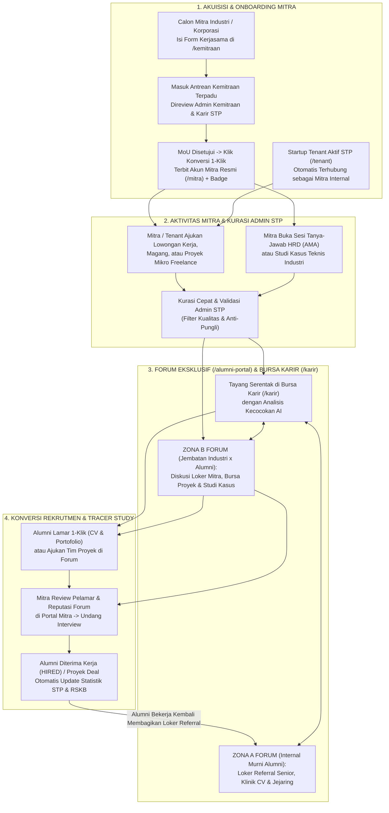
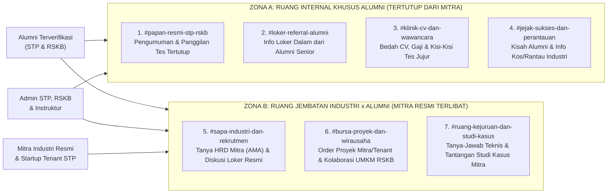
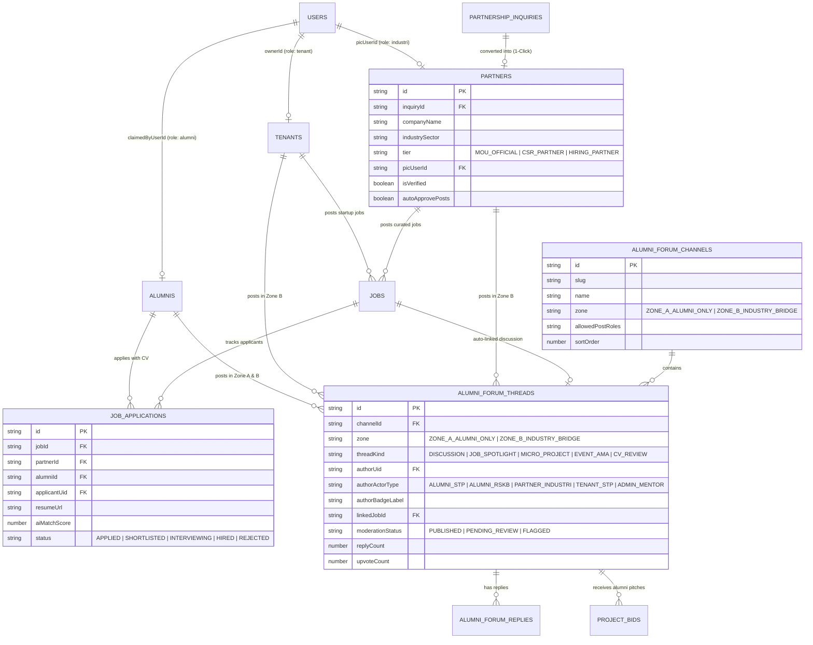

# 🏗️ AUDIT & BLUEPRINT PENGEMBANGAN: EKOSISTEM FORUM EKSKLUSIF TERINTEGRASI (MITRA × ADMIN STP × ALUMNI)

> **Tujuan Dokumen:** Menjadi panduan rekayasa fitur dan alur kerja agar **Kanal Forum Eksklusif Alumni** tidak berdiri sendiri sebagai ruang obrolan pasif, melainkan menjadi **mesin kolaborasi dan penyerapan kerja hidup** yang menghubungkan **Calon Mitra**, **Mitra Industri & Startup Tenant**, **Admin Solo Technopark / RSKB**, dan **Alumni Pelatihan** secara utuh.

---

## 📋 RINGKASAN EKSEKUTIF

1. **Temuan Utama Audit Hulu-ke-Hilir:** Saat ini sistem telah memiliki modul **Pengajuan Calon Mitra (`/kemitraan`)**, **Portal Tenant (`/tenant`)**, **Manajemen Pelatihan & Alumni (`/pelatihan`)**, **Bursa Karir (`/karir`)**, serta **Smart Hub (`/ekosistem`)**, namun **kelima modul tersebut masih berjalan terpisah (*siloed*)** tanpa jembatan konversi otomatis dari Calon Mitra menuju Akun Mitra Aktif, Bursa Karir, dan Forum Alumni.
2. **Konsep Kunci "Forum Dua Zona Berjenjang":** Agar privasi alumni tetap terjaga namun kolaborasi industri tetap maksimal, Forum Eksklusif (`/alumni-portal`) dibagi menjadi **Zona A (Ruang Internal Murni Alumni)** untuk berbagi info loker *referral* dan diskusi gaji/CV secara leluasa, serta **Zona B (Ruang Jembatan Industri × Alumni)** tempat Mitra Resmi & Tenant dapat membuka sesi rekrutmen, lempar proyek mikro/*freelance*, dan memantau bakat teknis alumni.
3. **Transformasi Calon Mitra Menjadi Mitra Rekrutmen Aktif:** Pengajuan kerjasama di `/kemitraan` yang telah disetujui MoU-nya oleh Admin STP dapat dikonversi dalam **1 klik** menjadi **Akun Mitra Terverifikasi (`Partner Workspace`)** yang berhak mengirim lowongan, proyek kolaborasi, dan undangan wawancara.
4. **Orkestrasi Penuh di Tangan Admin STP:** Admin STP berfungsi sebagai **Kurator & Pengendali Mutu (*Gatekeeper*)** yang memvalidasi calon mitra, menyetujui tayangan lowongan/proyek sebelum masuk ke forum alumni, dibantu **Moderasi Cerdas AI** untuk mencegah spam atau pungutan liar.
5. **Siklus Tertutup (*Closed-Loop Tracking*):** Setiap interaksi—mulai dari lowongan mitra, diskusi di forum, pengajuan lamaran/proyek oleh alumni, hingga status diterima bekerja (`HIRED`)—tercatat otomatis dalam satu dasbor terpadu.

---

## 1. HASIL AUDIT INTEGRASI 3 ARAH SAAT INI (KONDISI AS-IS & TITIK PUTUS)

Audit menyeluruh dilakukan pada alur penghubung antara **Calon Mitra**, **Mitra/Tenant**, **Admin STP**, dan **Alumni** di kode sistem saat ini.

### 1.1 Peta Kapabilitas Eksisting per Aktor Sistem

| Aktor Ekosistem | Modul yang Sudah Ada Saat Ini | Yang Sudah Berjalan Baik | Titik Putus Integrasi (*Gap*) Saat Ini |
| :--- | :--- | :--- | :--- |
| **1. Calon Mitra Luar** (Perusahaan, BUMN, Kampus, Instansi) | Halaman `/kemitraan` (`partnership.service.ts`) | Memiliki form pengajuan RFP/MoU termasuk kategori `TALENT_RECRUITMENT` (*Industrial Talent Pipeline*). | Berhenti sebatas tiket teks statis (`CLOSED`). Belum ada tombol konversi menjadi **Akun Mitra Resmi** yang bisa login ke sistem. |
| **2. Mitra Industri Terdaftar** (`role: 'industri'`, `'kampus'`, `'investor'`) | Konfigurasi `src/config/roles.ts` | Role `'industri'`, `'kampus'`, dan `'investor'` sudah didefinisikan di kamus hak akses. | Diarahkan ke route `/kebutuhan` yang belum dibangun; belum punya akses ke *Talent Pool*, pengajuan loker mandiri, maupun jembatan forum alumni. |
| **3. Startup Tenant STP** (`role: 'tenant'`) | Workspace `/tenant/dashboard` s.d. `/tenant/traction` | Sudah memiliki portal mandiri lengkap untuk profil, katalog produk, dan traksi bisnis. | Terisolasi dari ekosistem alumni: Tenant belum bisa memasang lowongan magang/kerja atau melempar sub-kontrak proyek ke alumni diklat STP/RSKB. |
| **4. Admin STP** (Pelatihan, Karir, Tenant, Aset) | `/pelatihan`, `/manajemen-karir`, `/booking` (`TabKemitraanB2B`) | Bisa meluluskan batch ke alumni, mengelola *Talent Pool*, dan memposting lowongan kerja manual. | Tiket kemitraan B2B tersembunyi di dalam menu `/booking`, sehingga Admin Karir/Pelatihan tidak langsung melihat pengajuan rekrutmen dari calon mitra; input lowongan mitra masih diketik ulang manual oleh admin. |
| **5. Alumni STP & RSKB** (`role: 'alumni'`) | `/profil` (`TabAlumni`), `/karir`, & AI Matcher | Sudah memiliki klaim kode unik, portofolio CV/proyek, toggle `OPEN TO WORK`, dan cek skor AI lowongan. | Klaim kode belum otomatis menaikkan role akun ke `'alumni'`; tombol lamar lowongan belum mencatat histori lamaran internal; halaman `/alumni-portal` belum dibangun. |
| **6. Forum Komunitas** | `Smart Hub` di `/ekosistem` (`hub.service.ts`) | Bisa membuat thread dan balasan dasar di halaman publik. | Terbuka bebas untuk publik umum, belum punya kanal tematik, tidak terhubung dengan data lowongan `/karir` maupun portofolio alumni, dan belum memiliki panel moderasi admin. |

---

### 1.2 Tujuh Masalah Utama yang Harus Diselesaikan Agar Forum Benar-Benar Siap Pakai

1. **Tidak Ada Jembatan dari `/kemitraan` ke Akun Mitra:** Calon mitra yang tertarik merekrut lulusan lewat halaman `/kemitraan` tidak memiliki kelanjutan alur digital setelah dihubungi PIC.
2. **Mitra & Tenant Tidak Punya Pintu Partisipasi Terstruktur:** Jika mitra ingin berbagi studi kasus industri, mencari *freelancer* alumni, atau mengadakan sesi tanya-jawab rekrutmen, belum ada jalur masuk resmi yang diawasi Admin.
3. **Risiko Privasi Bila Mitra Dicampur Bebas di Seluruh Kanal Alumni:** Jika perusahaan ditaruh di ruang yang sama dengan tempat alumni membahas keluh kesah tes kerja atau perbandingan gaji, alumni akan sungkan berbicara dan forum menjadi kaku.
4. **Lowongan Kerja & Forum Masih Terpisah:** Lowongan di `/karir` tidak memiliki kolom diskusi/tanya-jawab alumni, sementara obrolan lowongan di forum belum bisa dilamar dengan portofolio sistem.
5. **Belum Ada Sistem Reputasi Kompetensi di Forum:** Alumni yang cerdas dan rajin membantu menjawab masalah teknis di forum belum mendapatkan lencana atau poin keahlian yang bisa dilihat oleh perusahaan pencari bakat.
6. **Risiko Forum Sepi (*Cold-Start Problem*):** Forum komunitas tanpa pemicu konten otomatis (seperti pengumuman loker baru, tantangan proyek berhadiah/berbayar, atau sesi tanya HRD terjadwal) berpotensi sepi setelah minggu pertama.
7. **Ketiadaan Panel Moderasi & Pengawasan Keamanan Loker:** Diperlukan pagar pengaman agar tidak ada pihak yang menyebarkan lowongan berindikasi pungutan liar, skema penipuan, atau promosi spam di tengah komunitas alumni.

---

## 2. ARSITEKTUR SEGITIGA TERPADU: DARI CALON MITRA HINGGA ALUMNI BEKERJA

Untuk memaksimalkan nilai ekosistem, sistem dirancang sebagai **siklus hidup tertutup (*Closed-Loop Synergy*)** yang mempertemukan **Permintaan Industri (Mitra & Tenant)** dengan **Kesiapan Talenta (Alumni STP & RSKB)** melalui **Orkestrasi Admin STP**.

### 2.1 Diagram Alur End-to-End Lintas Aktor

---

### 2.2 Peran Spesifik & Keuntungan Masing-Masing Aktor di Dalam Sistem

| Aktor | Apa yang Bisa Dilakukan di Ekosistem Baru | Manfaat Langsung yang Diterima |
| :--- | :--- | :--- |
| **🏢 Calon Mitra** | Mengajukan kemitraan rekrutmen, kelas industri (CSR), atau sub-kontrak manufaktur/IT melalui `/kemitraan` dan memantau status tiketnya. | Proses penjajakan MoU jelas, cepat, dan begitu disetujui langsung mendapatkan akun akses ke jaringan talenta STP & RSKB. |
| **🏭 Mitra Resmi & Startup Tenant** | Memasang lowongan kerja/magang, melempar proyek lepas (*micro-project*), ikut menjawab/membuat studi kasus di Zona Kolaborasi Forum, serta mengundang wawancara alumni dari *Talent Pool*. | Mendapatkan kandidat yang bukan hanya bagus di atas kertas CV, tetapi terlihat nyata cara berpikir, etika komunikasi, dan kemampuan teknisnya di forum! |
| **🛡️ Admin STP & Koordinator RSKB** | Mengonversi calon mitra jadi mitra aktif, menyetujui tayangan loker/proyek mitra, memoderasi forum, mempromosikan loker *referral* alumni ke Bursa Karir, dan memantau *funnel* serapan kerja. | Bebas dari pekerjaan ketik ulang manual via WhatsApp; seluruh alur kemitraan hingga penempatan alumni terekam rapi dalam satu pusat kendali. |
| **👨‍🎓 Alumni STP & RSKB** | Berdiskusi aman sesama alumni di Zona Internal, berinteraksi langsung dengan HRD/praktisi mitra di Zona Jembatan, membangun reputasi keahlian, serta melamar kerja/proyek dalam 1 klik. | Memperoleh akses langsung ke pengambil keputusan di perusahaan mitra, peluang penghasilan proyek, dan pendampingan karir seumur hidup. |

---

## 3. DESAIN ARSITEKTUR "FORUM DUA ZONA" (KUNCI KENYAMANAN & INTEGRASI)

Agar fungsi forum maksimal bagi **Alumni** sekaligus menarik bagi **Mitra Industri**, arsitektur ruang di `/alumni-portal` dirancang dengan **Pemisahan Zona Berjenjang (*Dual-Zone Architecture*)**:

### Mengapa Pembagian Dua Zona Ini Sangat Penting?
1. **Zona A Menjamin Kejujuran & Rasa Aman Alumni:** Alumni bebas menanyakan *"Berapa kisaran gaji operator CNC pemula di kawasan Cikarang?"* atau *"Tolong koreksi kekurangan CV saya"* tanpa rasa takut dinilai negatif oleh HRD perusahaan mitra.
2. **Zona B Menciptakan Pertemuan Bernilai Tinggi dengan Industri:** Di Zona B, Mitra Resmi dan Startup Tenant hadir secara terhormat sebagai pembuka peluang kerja, pemberi order proyek, dan pembimbing studi kasus industri—menciptakan interaksi profesional yang menguntungkan kedua belah pihak.

---

## 4. DELAPAN FITUR KUNCI YANG PERLU DIKEMBANGKAN AGAR SIAP PAKAI

Berikut adalah rincian komponen fungsional yang perlu kita bangun agar seluruh rantai dari **Calon Mitra → Mitra → Admin STP → Alumni** berjalan mulus tanpa hambatan:

### Fitur 1: *Lead-to-Partner Onboarding* (Konversi Calon Mitra 1-Klik)
* **Masalah yang Diselesaikan:** Tiket pengajuan di `/kemitraan` saat ini terputus setelah status `CLOSED` dan hanya muncul di menu Booking.
* **Mekanisme Baru:**
  * Pindahkan/tampilkan daftar pengajuan kemitraan di menu lintas-admin (**CRM Kemitraan Terpadu**), dengan filter khusus kategori `TALENT_RECRUITMENT` langsung muncul di dasbor **Manajemen Karir & Pelatihan**.
  * Saat status pengajuan mencapai kesepakatan (`MOU_DRAFTED` / `APPROVED`), Admin STP menekan tombol **"Aktifkan Profil & Akun Mitra Resmi"**.
  * Sistem otomatis membuat profil perusahaan di koleksi `partners`, mengikat email PIC menjadi role `'industri'`, dan mengirimkan tautan aktivasi ke **Portal Mitra (`/mitra`)**.

### Fitur 2: *Partner & Tenant Talent Workspace* (`/mitra` & Tab Baru di `/tenant`)
* **Masalah yang Diselesaikan:** Mitra industri belum punya halaman kerja, dan Startup Tenant STP belum bisa merekrut alumni dari portalnya.
* **Mekanisme Baru:**
  * Membangun halaman ringkas `/mitra/dashboard` untuk Mitra Industri Resmi serta menambahkan menu **"Rekrut Talenta & Proyek"** di dalam sidebar `/tenant` yang sudah ada.
  * Dari halaman tersebut, Mitra dan Tenant dapat:
    1. **Mengajukan Lowongan Kerja / Magang Khusus Alumni** (otomatis masuk antrean review cepat Admin STP, tidak perlu ketik manual di WA).
    2. **Memposting Kebutuhan Proyek Mikro / Sub-Kontrak** ke kanal `#bursa-proyek-dan-wirausaha` (misal: pembuatan komponen bubut/CNC, pembuatan landing page, desain kemasan, foto produk, jasa las).
    3. **Menjelajahi Etalase *Talent Pool*** (melihat portofolio proyek, sertifikat STP/RSKB, serta lencana keaktifan forum alumni yang menyalakan status `OPEN TO WORK`) dan menekan tombol **"Undang Wawancara"**.
    4. **Memantau Daftar Pelamar Masuk** dan memperbarui tahapan seleksi (`Ditinjau` → `Wawancara` → `Diterima` / `Belum Sesuai`).

### Fitur 3: Sinkronisasi Otomatis Dua Arah (*Bursa Karir ↔ Forum Alumni*)
* **Masalah yang Diselesaikan:** Lowongan kerja pasif dan forum berisiko sepi topik bahasan.
* **Mekanisme Baru:**
  * **Dari Bursa Karir ke Forum:** Setiap kali ada lowongan Mitra Resmi yang disetujui tayang di `/karir`, sistem memberi opsi otomatis membuat topik diskusi pendamping di kanal `#sapa-industri-dan-rekrutmen`. Di halaman detail lowongan `/karir/[id]`, muncul tombol **"Lihat Diskusi & Tanya HRD di Forum (12 Komentar)"**.
  * **Dari Forum ke Bursa Karir:** Saat alumni senior memposting info lowongan kantornya di kanal `#loker-referral-alumni`, Admin STP memiliki tombol cepat **"Angkat ke Bursa Karir"** sehingga info tersebut langsung berubah menjadi kartu lowongan terstruktur yang bisa dianalisis oleh AI Matcher!

### Fitur 4: Komponen *Rich Actionable Cards* di Dalam Diskusi Forum
Agar forum tidak sekadar berisi teks polos seperti kolom komentar biasa, editor topik dan balasan mendukung **4 jenis sematan interaktif**:
1. **Kartu Sematan Lowongan (`Job Embed Card`):** Menampilkan gaji, lokasi, kecocokan kejuruan, dan tombol *Lamar Sekarang* langsung di tengah obrolan forum.
2. **Kartu Portofolio Alumni (`Talent Pitch Card`):** Saat melamar proyek di `#bursa-proyek-dan-wirausaha` atau meminta review di `#klinik-cv-dan-wawancara`, alumni cukup mencentang *"Lampirkan Kartu Portofolio Saya"* tanpa perlu mengunggah ulang file berulang-ulang.
3. **Kartu Tantangan / Order Proyek (`Micro-Project Brief`):** Memuat nilai anggaran/fee proyek, tenggat waktu, keahlian yang dicari, kuota tim, dan tombol **"Ajukan Proposal / Gabung Tim"** (dengan status otomatis berubah dari `TERBUKA` → `DIKERJAKAN ALUMNI` → `SELESAI`).
4. **Kartu Jadwal & Konfirmasi Kehadiran (`Walk-In / AMA Event Card`):** Untuk pengumuman tes rekrutmen di STP atau sesi tanya-jawab langsung bersama HRD Mitra, lengkap dengan penghitung kuota kursi dan tombol **Daftar Hadir 1-Klik**.

### Fitur 5: Reputasi Kompetensi & *Passive Talent Scouting*
* **Masalah yang Diselesaikan:** Banyak lulusan berbakat tinggi namun kurang pandai menulis kata-kata promosi di CV.
* **Mekanisme Baru:**
  * Di kanal `#ruang-kejuruan-dan-studi-kasus`, ketika seorang alumni memberikan jawaban teknis yang tepat dan ditandai sebagai **Solusi Terbaik (*Accepted Answer*)** oleh penanya atau divalidasi (**Endorse**) oleh Instruktur STP / Praktisi Mitra, alumni tersebut memperoleh **Poin Reputasi Kejuruan** (contoh: *Top Solver Manufaktur CNC*).
  * Lencana reputasi ini otomatis tampil di kartu profil alumni pada **Talent Pool Mitra**, menjadi bukti hidup kemampuan pemecahan masalah kandidat di mata perusahaan!

### Fitur 6: Pelacakan Lamaran & Proyek Terpadu (*Closed-Loop Application Tracker*)
* **Masalah yang Diselesaikan:** Saat ini setelah alumni klik lamar, jejaknya hilang ke luar sistem.
* **Mekanisme Baru:**
  * Alumni melamar lowongan mitra langsung di dalam platform menggunakan CV & Portofolio terverifikasinya (*1-Click Verified Apply*), tetap mendukung penerusan otomatis ke email/URL rekrutmen perusahaan bila diperlukan.
  * Setiap perubahan status oleh Mitra atau Admin (`REVIEWED` → `INTERVIEWING` → `HIRED`) otomatis memperbarui status karir alumni di database pusat serta mengirim pemberitahuan ke alumni yang bersangkutan.

### Fitur 7: Pusat Kendali & Moderasi Berbantuan AI untuk Admin STP (`Admin Forum & Partner Desk`)
* **Masalah yang Diselesaikan:** Admin kewalahan jika harus memeriksa ratusan pesan secara manual setiap hari.
* **Mekanisme Baru:**
  * **Gerbang Pra-Tayang Mitra Baru:** Postingan pertama dari akun Mitra baru masuk antrean persetujuan cepat Admin agar selaras dengan standar pelayanan STP & RSKB.
  * **Penjaga Keamanan Otomatis (*Clario AI Safety Filter*):** Mendeteksi secara otomatis apabila ada teks diskusi atau info loker yang mengandung indikasi pungutan biaya tes, permintaan transfer uang, kata kasar/SARA, atau tautan mencurigakan, lalu menahannya ke tab *Perlu Tinjauan Moderator*.
  * ** Generator Ringkasan & Sorotan Mingguan:** AI membantu Admin merangkum 5 info loker terpopuler dan 3 diskusi teknis terbaik minggu ini untuk disiarkan ulang.

### Fitur 8: Notifikasi Pintar Tepat Sasaran (*Smart Targeted Alerts*)
* **Masalah yang Diselesaikan:** Alumni tidak membuka website setiap jam jika tidak ada pemberitahuan yang relevan.
* **Mekanisme Baru:**
  * Lonceng notifikasi di dalam aplikasi ketika komentar dijawab, portofolio dilihat oleh Mitra Industri, status lamaran diperbarui, atau ada panggilan *walk-in interview* yang cocok dengan kejuruannya.
  * Fitur **Broadcast Terarah 1-Klik ke WhatsApp / Email** bagi Admin STP & RSKB untuk memanggil segmen spesifik (misal: *"Kirim notifikasi panggilan rekrutmen PT X khusus ke seluruh Alumni Las & Mesin berstatus Siap Kerja"*).

---

## 5. SPESIFIKASI TEKNIS PENGEMBANGAN PADA ARSITEKTUR SINTESA

Bagian ini memetakan bagaimana seluruh fitur di atas diimplementasikan secara bersih mengikuti kaidah arsitektur **Next.js App Router + Firebase + Zod + Service Layer** yang berlaku di repositori SINTESA.

### 5.1 Peta Relasi Data Terintegrasi (`erDiagram`)

---

### 5.2 Struktur Koleksi Firestore & Pembagian Path
Mengikuti standar dua-jalur koleksi pada SINTESA:
* **Root Master Collections:**
  * `partners/{partnerId}` — Profil perusahaan mitra resmi hasil konversi MoU/kemitraan.
  * `alumnis/{alumniId}` — Data master alumni (diperluas dengan `originSource`: `STP_VOKASI` | `RSKB_SURAKARTA` | `OPD_PEMKOT` | `CSR_INDUSTRI`, `forumReputationScore`, dan `endorsedSkills`).
  * `jobs/{jobId}` — Lowongan kerja (diperluas dengan `partnerId`, `tenantId`, `linkedForumThreadId`, dan `approvalStatus`).
* **Transactional / Multi-Tenant Artifact Collections (`artifacts/{appId}/public/data/`):**
  * `partnership_inquiries/{id}` — Tiket permohonan calon mitra (ditambah `convertedPartnerId`).
  * `alumni_forum_channels/{channelId}` — Konfigurasi 7 kanal beserta atribut `zone`.
  * `alumni_forum_threads/{threadId}` — Topik diskusi, proyek mikro, & tanya-jawab rekrutmen.
  * `alumni_forum_replies/{replyId}` — Balasan diskusi, solusi teknis, & pitch portofolio.
  * `job_applications/{applicationId}` — Pencatatan lamaran kerja internal & undangan interview dari mitra.
  * `notifications/{notifId}` — Notifikasi terarah lintas aktor (Mitra, Alumni, Admin).

---

### 5.3 Pembaruan Matriks Hak Akses (`src/config/roles.ts` & `firestore.rules`)

| Role Sistem | Zona A Forum (Internal Alumni) | Zona B Forum (Jembatan Industri) | Bursa Karir (`/karir`) | Portal Rekrutmen & Talent Pool | Kurasi & Moderasi |
| :--- | :---: | :---: | :---: | :---: | :---: |
| **`alumni`** (STP & RSKB) | ✅ Baca & Tulis | ✅ Baca & Tulis | ✅ Akses Penuh & Lamar | ❌ (Hanya Profil Sendiri) | ❌ |
| **`industri`** (Mitra Resmi) | ❌ **Tertutup** | ✅ Baca & Buat Topik Proyek/AMA | ✅ Lihat Loker Sendiri | ✅ `/mitra` (Katalog Kandidat `OPEN TO WORK`) | ❌ |
| **`tenant`** (Startup STP) | ❌ **Tertutup** | ✅ Baca & Buat Topik Proyek/Magang | ✅ Lihat Loker Sendiri | ✅ `/tenant/talent` (Rekrut Magang/Kerja) | ❌ |
| **`admin_pelatihan` / `admin` / `super_admin`** | ✅ Akses Penuh | ✅ Akses Penuh | ✅ Kelola Penuh | ✅ Kelola Penuh & Matchmaking | ✅ Approve Mitra, Loker & Moderasi |
| **`public`** (Pengunjung Umum / Calon Mitra) | ❌ Tampil Gate Edukatif | ❌ Tampil Gate Edukatif | ❌ Tampil Gate Edukatif | ✅ Hanya Form Pengajuan `/kemitraan` | ❌ |

---

### 5.4 Daftar Modul & Halaman Baru / Pengembangan yang Akan Dibangun

1. **Perbaikan & Penguatan Layanan Dasar (`src/services/` & `functions/src/`):**
   * Cloud Function `claimAlumniAccount`: Validasi kode klaim unik (`AL-...` & `RSKB-...`) + promosi otomatis `users/{uid}.role = 'alumni'` & Custom Claims JWT.
   * Cloud Function `convertInquiryToPartner`: Mengubah pengajuan Calon Mitra di `partnership_inquiries` menjadi dokumen `partners` + akun `role: 'industri'`.
   * Service baru `src/services/partner.service.ts`, `src/services/alumniForum.service.ts`, dan `src/services/jobApplication.service.ts`.
2. **Antarmuka Portal Forum Eksklusif Alumni (`src/app/(public)/alumni-portal/`):**
   * Layout komunitas modern dengan bilah samping **Zona A (4 Kanal Internal)** & **Zona B (3 Kanal Jembatan Industri)**.
   * Filter kejuruan cepat, lencana identitas otomatis (`Alumni STP`, `Alumni RSKB`, `Mitra Resmi`, `Tenant STP`, `Instruktur`), tombol sematan *Job/Portfolio/Project Card*, penanda *Solusi Terbaik*, serta tombol *Lapor Moderator*.
3. **Antarmuka Portal Mitra Industri (`src/app/mitra/`) & Ekstensi Tenant (`src/app/tenant/talent/`):**
   * Dashboard ringkas bagi HRD/PIC Mitra untuk memasang lowongan/magang, membuka proyek mikro di Zona B Forum, melihat direktori kandidat siap kerja (tanpa mengekspos NIK/alamat rumah sensitif sebelum kandidat melamar/setuju), dan memproses pelamar.
4. **Pusat Kendali Kemitraan, Karir & Moderasi Admin (`src/app/(admin)/manajemen-karir/` & `/pelatihan`):**
   * Tab **Tiket Calon Mitra Rekrutmen** (terhubung langsung ke data `/kemitraan`).
   * Tab **Antrean Persetujuan Loker & Proyek Mitra**.
   * Tab **Moderasi Forum & AI Safety Log** + tombol 1-klik *"Angkat Loker Referral Alumni ke Bursa Karir"*.

---

## 6. PETA JALAN EKSEKUSI PENGEMBANGAN (5 SPRINT TERUKUR)

Agar pengembangan terkendali, teruji, dan setiap tahapannya langsung memberikan nilai pakai, eksekusi dibagi menjadi **5 Sprint berurutan**:

| Sprint | Fokus Utama | Deliverable Konkret yang Siap Digunakan |
| :--- | :--- | :--- |
| **Sprint 1: Fondasi Klaim Alumni, Keamanan Gate & Atribut RSKB** | Menyempurnakan pintu masuk alumni STP & RSKB serta mengunci keamanan data. | • Klaim kode `AL-YYYY-XXXXXX` & `RSKB-YYYY-XXXXXX` langsung menaikkan role ke `'alumni'` secara instan. • Penambahan atribut asal program (`STP_VOKASI`, `RSKB_SURAKARTA`, `OPD_PEMKOT`) pada import & profil alumni. • Pengamanan penuh API Bursa Karir, Edge Proxy, dan pemisahan data privasi di `firestore.rules`. |
| **Sprint 2: Pipeline Calon Mitra → Portal Mitra Resmi & Jembatan Tenant** | Menyambungkan hulu kemitraan industri dengan ekosistem talenta. | • Integrasi tiket `/kemitraan` ke dashboard Admin Karir/Pelatihan + fitur **Konversi 1-Klik Jadi Mitra Resmi**. • Peluncuran ruang kerja `/mitra` (untuk perusahaan mitra) dan menu `/tenant/talent` (untuk startup binaan STP) guna mengajukan loker & mengakses *Talent Pool*. |
| **Sprint 3: Core Forum Eksklusif 2 Zona (`/alumni-portal`)** | Menghadirkan rumah kolaborasi 7 kanal dengan privasi berjenjang. | • Halaman `/alumni-portal` aktif dengan pemisahan ketat **Zona A (Khusus Alumni)** & **Zona B (Jembatan Industri × Alumni)**. • Fitur *Verified Badge* otomatis, filter rumpun kejuruan, *upvote*, dan penanda *Solusi Teknis Terbaik*. |
| **Sprint 4: *Rich Embeds*, Bursa Proyek Mikro & *Closed-Loop Apply*** | Mengintegrasikan transaksi lamaran kerja dan proyek secara utuh. | • Pelacakan lamaran kerja 1-klik (`APPLIED → INTERVIEWING → HIRED`) yang terhubung ke Portal Mitra & *Talent Pool* Admin. • Sematan *Job Card*, *Portfolio Pitch Card*, *Event RSVP*, serta sinkronisasi dua arah topik Forum ↔ Bursa Karir. • Sistem Poin Reputasi Kompetensi Alumni di Forum yang tampil di katalog kandidat Mitra. |
| **Sprint 5: Moderasi Clario AI, Notifikasi Pintar & Analitik Eksekutif** | Otomasi penjagaan kualitas komunitas dan pelaporan dampak program. | • Filter otomatis anti-penipuan/pungli loker & ringkasan diskusi mingguan berbasis Clario AI. • Notifikasi *in-app* & pintasan *blast* terarah per kejuruan. • Dashboard eksekutif konversi penuh: dari jumlah Mitra Aktif, aktivitas Forum, hingga total serapan kerja alumni STP & RSKB Kota Surakarta. |

---

> **Kesimpulan Arsitektur:**  
> Dengan blueprint ini, **Kanal Forum Eksklusif Alumni** bertransformasi dari sekadar fitur tambahan menjadi **jantung penggerak ekosistem Solo Technopark × RSKB Kota Surakarta**—tempat Calon Mitra berubah menjadi perekrut aktif, Startup Tenant mendapatkan talenta dan kolaborator proyek, Admin STP memegang kendali kualitas secara efisien, dan Alumni merasakan manfaat nyata hingga sukses berkarir maupun mandiri berusaha.

