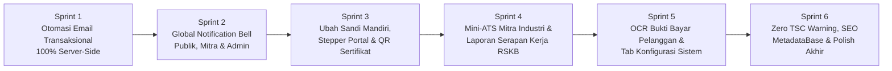

# 🗺️ BLUEPRINT PENGEMBANGAN GLOBAL SELANJUTNYA — EKOSISTEM SINTESA / SOLO TECHNOPARK

> **Dokumen Panduan Eksekusi Terstruktur (Siap Dijalankan Bertahap oleh Gemini Flash 3.8)**  
> **Tanggal Audit:** 29 Oktober 2026  
> **Status Baseline Saat Ini:**  
> - Ekosistem Alumni × RSKB × Mitra Industri × Dual-Zone Forum: **100% Live**  
> - Autentikasi Profesional (Email/Sandi + Google + Klaim Alumni 1-Langkah + Hostinger SMTP `marketing@solotechnopark.id`): **100% Live**  
> - Unit Test Suite: **28/28 File Lulus (185/185 Tests)** | Production Build: **77/77 Rute Hijau**

---

## 📌 Ringkasan Eksekutif

1. **Fondasi Utama Telah Matang:** Arsitektur keamanan berlapis (Edge Proxy JWT, RBAC `roles.ts`, Custom Claims Cloud Functions, Firestore Rules), AI Clario 15 model, Forum Dual-Zone Alumni–Industri, dan Email Resmi Hostinger (`marketing@solotechnopark.id`) telah berjalan di produksi.
2. **6 Fokus Penyempurnaan Global Berikutnya:** Audit menyeluruh terhadap 33 *services*, 28 *Cloud Functions*, dan 77 rute menemukan **6 area strategis** untuk menjadikan sistem benar-benar *autopilot* dari hulu ke hilir.
3. **Dirancang Modular untuk Gemini Flash 3.8:** Seluruh pekerjaan dibagi ke dalam **6 Sprint Independen** dengan spesifikasi nama file, *schema*, *trigger*, dan perintah verifikasi eksak sehingga hemat kuota token dan bebas regresi.
4. **Prioritas Tertinggi (Sprint 1 & 2):** Menutup celah penulisan email sisi klien (`src/services/email.service.ts`) ke *trigger* otomatis di server serta memasang **Lonceng Notifikasi Terpadu** di seluruh portal.
5. **Dampak Bisnis Langsung (Sprint 3–5):** Fitur **Ubah Kata Sandi Mandiri** (penting bagi Mitra dengan sandi sementara), **Verifikasi E-Sertifikat Publik via QR**, **Pelacakan Serapan Kerja RSKB/STP**, dan **Auto-Scan Bukti Bayar (OCR AI)** ke meja Kasir.

---

## ⚠️ ATURAN WAJIB UNTUK AI AGENT EKSEKUTOR (GEMINI FLASH 3.8)

Sebelum mengeksekusi Sprint mana pun di bawah ini, **WAJIB** patuhi 7 aturan arsitektur berikut tanpa pengecualian:

1. **Baca Konteks Wajib:** Selalu baca `AGENTS.md` dan `.agents/skills/teknopark-architecture/SKILL.md` sebelum mulai menulis kode.
2. **Jangan Sentuh Rahasia SMTP:** File `functions/.env` berisi kredensial produksi Hostinger (`marketing@solotechnopark.id`) dan sudah di-*gitignore*. **Dilarang keras** menghapus, menimpa, atau memasukkan kredensial ke dalam kode yang ter-lacak Git.
3. **Lazy Admin Initialization di Cloud Functions:** Di setiap file baru dalam `functions/src/`, **DILARANG** memanggil `const db = admin.firestore()` di level teratas modul (akan menyebabkan *discovery timeout* 10 detik di Windows). Selalu gunakan fungsi *lazy*:
   ```ts
   function getDb() {
     if (!admin.apps.length) admin.initializeApp();
     return admin.firestore();
   }
   ```
   Dan saat deploy di PowerShell selalu sertakan `$env:FUNCTIONS_DISCOVERY_TIMEOUT=60`.
4. **Delegasi `firestore.rules`:** Jika suatu task memerlukan perubahan `firestore.rules`, **WAJIB** delegasikan ke subagent spesialis `firestore-rules-author` (jangan edit `firestore.rules` secara manual).
5. **Service Layer & Zod Schema:** Semua entitas baru wajib memiliki Zod Schema di `src/types/`, dan komponen React dilarang memanggil `firebase/firestore` secara langsung (wajib lewat `src/services/`).
6. **Batas Ukuran File:** Jaga setiap file komponen baru maksimal **250 baris** (pecah sub-komponen jika mulai besar). Gunakan `edit_file` untuk file lama, jangan menimpa (*overwrite*) file penting tanpa izin.
7. **Gerbang Kualitas Sebelum Selesai:** Setiap selesai 1 Sprint, wajib jalankan `npx vitest run`, `npm --prefix functions run build`, dan `npm run build` hingga ketiganya keluar dengan **exit code `0`**.

---

## 🚀 PETA JALAN 6 SPRINT PENGEMBANGAN GLOBAL



---

### 📧 SPRINT 1: Unifikasi Otomasi Email Transaksional 100% Server-Side (✅ SELESAI)
**Masalah Saat Ini:**  
File klien `src/services/email.service.ts` masih mencoba menulis langsung `addDoc(collection(db, 'mail_queue'))` dari *browser*, padahal `firestore.rules` memblokir penulisan klien ke `mail_queue` demi keamanan *anti-spam*. Selain itu, perubahan status Booking, pelunasan Invoice Kasir, dan undangan karir Mitra belum otomatis memicu email `marketing@solotechnopark.id`.

**Daftar Tugas Eksekusi:**
1. [x] **Buat Trigger Firestore Baru `functions/src/triggers/transactionalMailTriggers.ts`** (ekspor di `functions/src/index.ts`):
   - `onBookingWrittenMail` (`artifacts/{appId}/public/data/bookings/{bookingId}`):
     - Saat dokumen baru dibuat → antrekan `BOOKING_CONFIRMATION`.
     - Saat `before.status !== after.status` menjadi `'approved'` atau `'rejected'` → kirim email pembaruan status (`BOOKING_STATUS_UPDATE`).
   - `onInvoiceLifecycleMail` (`artifacts/{appId}/public/data/invoices/{invoiceId}`):
     - Saat dokumen baru berstatus `'PENDING'` dibuat → antrekan `INVOICE_NOTIFICATION`.
     - Saat status berubah menjadi `'PAID'` → otomatis antrekan `PAYMENT_RECEIPT` (Kuitansi Resmi Lunas BLUD).
   - `onTalentInvitationCreatedMail` (`artifacts/{appId}/public/data/talent_invitations/{invId}`):
     - Kirim email undangan karir mitra ke alumni (`TALENT_INVITATION`).
   - `onJobApplicationStatusMail` (`artifacts/{appId}/public/data/job_applications/{appId}`):
     - Saat status lamaran berubah → kirim notifikasi hasil seleksi (`JOB_APPLICATION_STATUS`).
2. [x] **Tambahkan Template Email Pendukung di `functions/src/templates/emailTemplates.ts` & `mailAutomation.ts`:**
   - Template `renderBookingStatusUpdatedEmail`, `renderTalentInvitationEmail`, & `renderJobApplicationStatusEmail`.
3. [x] **Bersihkan `src/services/email.service.ts`:**
   - Hapus penulisan langsung klien ke `mail_queue`, aman dan patuh terhadap `firestore.rules`.

---

### 🔔 SPRINT 2: Global In-App Notification Center (Lonceng Notifikasi Terpadu) (✅ SELESAI)
**Masalah Saat Ini:**  
`src/services/notification.service.ts` dan koleksi `ecosystem_notifications` sudah aktif, tetapi belum ada antarmuka **Lonceng Notifikasi (*Bell Dropdown*)** di navigasi utama sehingga pengguna/admin harus membuka halaman manual untuk melihat aktivitas baru.

**Daftar Tugas Eksekusi:**
1. [x] **Buat Komponen `src/components/common/NotificationBellDropdown.tsx`:**
   - Menggunakan TanStack Query (`useQuery` dengan `staleTime: 60_000`) memanggil `notificationService.getNotificationsForUser(user.uid, role)`.
   - Menampilkan titik merah / *badge* jumlah pesan yang belum dibaca (`!item.readByUids.includes(user.uid)`).
   - Klik item notifikasi → memanggil `notificationService.markAsRead(item.id, user.uid)` dan mengarahkan ke `item.actionUrl`.
   - Menambahkan tombol *"Tandai Semua Dibaca"* (`markAllAsRead` di `notification.service.ts`).
2. [x] **Integrasikan ke Seluruh Header Portal:**
   - Terpasang di `src/components/common/PublicNavbar.tsx` (Desktop dan Mobile header saat user login).
   - Terpasang di Topbar Admin `src/app/(admin)/layout.tsx` (Desktop Header & Mobile Top Header).

---

### 🔐 SPRINT 3: Keamanan Mandiri Pengguna, Onboarding Stepper `/portal` & Verifikasi QR E-Sertifikat (✅ SELESAI)
**Masalah Saat Ini:**  
1. Mitra Industri baru yang dibuatkan akun otomatis menerima *Kata Sandi Sementara* via email, namun belum ada form **Ubah Kata Sandi** di profil/dashboard mereka.
2. Pengguna baru yang masuk ke `/portal` membutuhkan panduan langkah awal yang jelas.
3. Sertifikat pelatihan vokasi STP & status lulusan RSKB membutuhkan halaman verifikasi keaslian publik bagi HRD industri.

**Daftar Tugas Eksekusi:**
1. [x] **Fitur Ubah Kata Sandi Mandiri (`updatePassword` Firebase Auth):**
   - Komponen `src/components/auth/ChangePasswordCard.tsx` (re-autentikasi `EmailAuthProvider`, validasi min. 6 karakter, show/hide password).
   - Terpasang di `src/app/(public)/profil/components/TabDataDiri.tsx` dan tab *Keamanan & Sandi* pada `/mitra/dashboard`.
2. [x] **Onboarding Checklist di `/portal` (`src/app/(public)/portal/page.tsx`):**
   - Komponen `src/components/portal/UserOnboardingChecklist.tsx`: menampilkan progres 4 langkah (*Akun Dibuat ✅ → Email Terverifikasi → Nomor WA Lengkap → Klaim Kode Alumni / Mulai Layanan*).
3. [x] **Halaman Publik Verifikasi Sertifikat & Alumni (`/verifikasi-sertifikat`):**
   - Rute baru `src/app/(public)/verifikasi-sertifikat/page.tsx` + fungsi pencarian aman `verifyCertificate` di `alumni.service.ts` berdasarkan Nomor Sertifikat atau Kode Registrasi publik untuk menampilkan nama lulusan, kejuruan, asal program (STP Vokasi / RSKB Surakarta), dan lencana **Terverifikasi Resmi Solo Technopark**.

---

### 🤝 SPRINT 4: Mini-ATS Portal Mitra Industri & Analitik Serapan Kerja (Tracer Study STP & RSKB) (✅ SELESAI)
**Masalah Saat Ini:**  
Manajemen Solo Technopark dan Pemkot Surakarta (program RSKB) membutuhkan data *real-time* berapa banyak lulusan pelatihan yang sudah terserap bekerja di industri, wirausaha, atau magang.

**Daftar Tugas Eksekusi:**
1. [x] **Pipeline Seleksi Kandidat di `/mitra/dashboard`:**
   - Tab Pelamar di `/mitra/dashboard` (`EntityApplicantsPanel.tsx`) memungkinkan PIC Mitra mengubah tahapan pelamar (`REVIEWING` → `INTERVIEWING` → `HIRED` / `REJECTED`).
2. [x] **Sinkronisasi Otomatis Status Kebekerjaan Alumni (*Auto Tracer Study*):**
   - Di trigger `functions/src/triggers/forumTriggers.ts` (`onJobApplicationWritten`), saat lamaran diubah menjadi `'HIRED'`, perbarui field `employmentStatus: 'Bekerja (Full-time)'`, `hiredByCompany`, `hiredAt`, dan `internalStatus: 'HIRED'` pada dokumen `alumnis` secara otomatis.
   - Form status karir mandiri aktif di `src/app/(public)/profil/components/TabAlumni.tsx`.
3. [x] **Kartu Statistik Serapan Kerja di `/manajemen-karir` (Admin):**
   - Tab baru `Tracer Study & Serapan Kerja` (`src/app/(admin)/manajemen-karir/components/TabTracerStudyAnalytics.tsx`) menampilkan persentase serapan kerja gabungan, STP Vokasi, dan RSKB Surakarta.
   - Tombol **Ekspor Laporan Tracer Study (Excel/CSV)** via `exportAlumniTracerStudy` di `careerExport.service.ts`.

---

### 💳 SPRINT 5: Integrasi Bukti Bayar OCR AI ke Meja Kasir & Tab Konfigurasi Sistem Admin
**Masalah Saat Ini:**  
Endpoint `/api/ai/ocr-receipt` (Clario Vision) sudah tersedia untuk membaca foto nota/bukti transfer, tetapi alur unggah bukti bayar pelanggan di `TabTagihan.tsx` (`/profil`) belum terhubung langsung dengan ekstraksi nominal otomatis untuk mempercepat verifikasi Kasir di `/billing`. Selain itu, tab **Konfigurasi Sistem** di `/pengaturan` masih berupa *placeholder*.

**Daftar Tugas Eksekusi:**
1. [x] **Unggah Bukti Transfer + Pre-Validation AI di `src/app/(public)/profil/components/TabTagihan.tsx` & `/bukti-bayar`:**
   - Saat pelanggan mengunggah foto bukti transfer untuk `Invoice` berstatus `PENDING`, simpan URL gambar ke Firebase Storage, panggil `/api/ai/ocr-receipt` untuk mengekstrak nominal & bank pengirim ke field `paymentProofMeta` pada dokumen invoice, dan ubah sub-status pembayaran menjadi `'WAITING_VERIFICATION'`.
   - Di halaman Admin `/billing`, tampilkan *badge* **"Bukti Bayar Masuk (Nominal Cocok AI ✅)"** sehingga Kasir cukup memeriksa foto struk dan klik **Verifikasi Lunas** (yang otomatis mengirim kuitansi email dari Sprint 1!).
2. **Aktifkan Tab `Konfigurasi Sistem` di `/pengaturan` (`src/app/(admin)/pengaturan/components/TabKonfigurasiSistem.tsx`):**
   - Gantikan *placeholder* `activeTab === 'Sistem'` di `src/app/(admin)/pengaturan/page.tsx`.
   - Simpan pengaturan global di koleksi `settings/system_config` (via `setting.service.ts`):
     - Pengumuman Banner Atas (*Global Announcement Bar* untuk info pendaftaran diklat / RSKB terbaru).
     - Jam Operasional Reservasi Fasilitas & Batas Hari Pengajuan Booking.
     - Nomor WhatsApp Helpdesk terpusat & tautan media sosial kawasan.

---

### 🛠️ SPRINT 6: Polish Kualitas Enterprise, SEO MetadataBase & Zero TypeScript Test Debt
**Masalah Saat Ini:**  
1. Saat `npm run build`, Next.js menampilkan peringatan ringan `metadataBase property in metadata export is not set` karena `metadataBase` belum didefinisikan di `src/app/layout.tsx`.
2. Empat file unit test lama (`career_export_pagination.test.ts`, `presensi_workflows.test.ts`, `training_batch_lifecycle.test.ts`, `training_program_selector.test.ts`) memiliki properti *mock* yang tertinggal saat dicek dengan `npx tsc --noEmit`.
3. Dua item di `AGENTS.md` Phase 2 (helper timestamp universal & sinkronisasi enum `FundingRound.roundName` ↔ `Tenant.fundingStage`) siap dituntaskan.

**Daftar Tugas Eksekusi:**
1. **Tambahkan `metadataBase: new URL(process.env.NEXT_PUBLIC_SITE_URL || 'https://katalog.solotechnopark.id')`** di `src/app/layout.tsx` agar seluruh gambar OpenGraph (`/api/og/*`) ter-resolve sempurna saat tautan dibagikan di WhatsApp/LinkedIn.
2. **Buat Utility `toMillis(val: unknown): number`** di `src/utils/format.ts` dan gunakan secara konsisten untuk membaca timestamp lintas format (`Firestore Timestamp`, `number`, `ISO string`).
3. **Selaraskan Enum `FundingStage`** di `src/types/tenant.types.ts`.
4. [x] **Perbarui Tipe Objek Mock pada 4 File Test Lama** di `src/__tests__/` hingga perintah `npx tsc --noEmit` menghasilkan **0 error** di seluruh repositori (baik kode sumber maupun seluruh 28+ file test).

---

## 💬 Contoh Prompt Siap Pakai untuk Sesi Gemini Flash 3.8 Berikutnya

Salin dan tempelkan prompt singkat berikut saat memulai sesi baru dengan **Gemini Flash 3.8**:

> *"Tolong baca `AGENTS.md` dan `public/docs/blueprint-pengembangan-global-selanjutnya.md`, lalu kerjakan **Sprint 1** dan **Sprint 2** sesuai aturan arsitektur yang tertulis di dalamnya. Pastikan `npx vitest run`, `npm --prefix functions run build`, dan `npm run build` lulus 100% sebelum selesai."*

