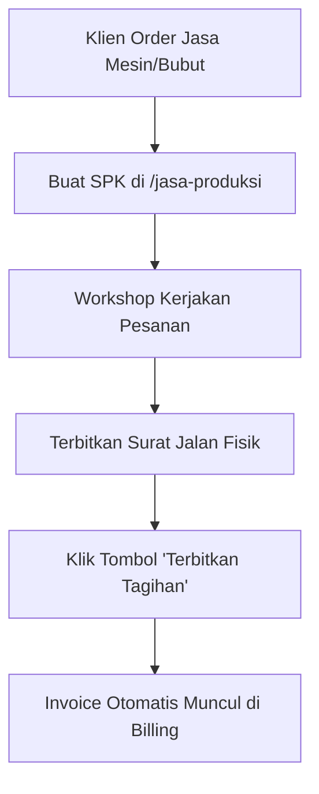
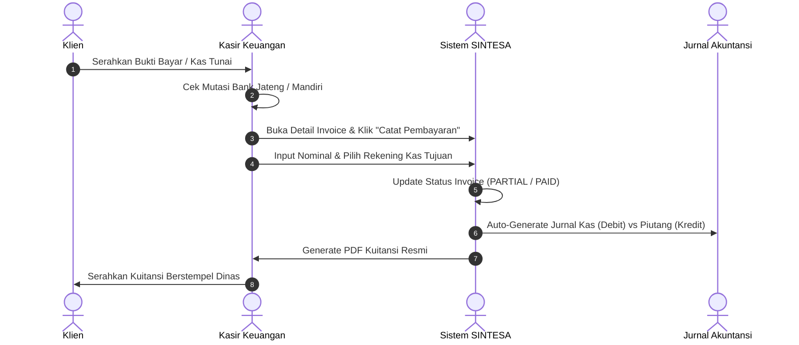
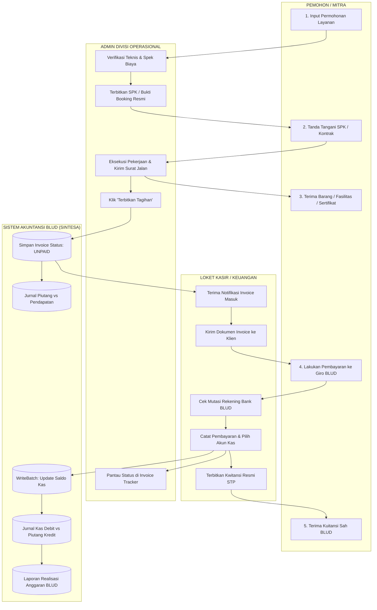
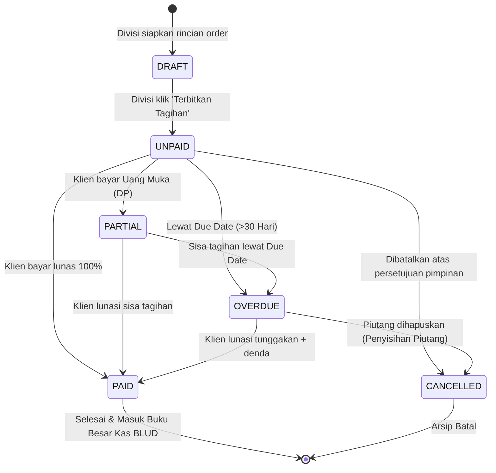

# 📘 PANDUAN OPERASIONAL TERPADU: MANAJEMEN BILLING & KEUNGGULAN AKUNTANSI BLUD LINTAS DIVISI

> **Dokumen Resmi Pedoman Kerja & Edukasi Admin Divisi Solo Technopark**  
> *Sistem Terintegrasi: Jasa Produksi • Sewa Aset & Fasilitas • Diklat & Sertifikasi Vokasi • Inkubasi Startup • E-Katalog Komersial • Loket Kasir & Pembukuan BLUD*

---

## 📑 DAFTAR ISI

1. [Landasan Kebijakan & Filosofi Tata Kelola BLUD](#1-landasan-kebijakan--filosofi-tata-kelola-blud)
   - 1.1 [Latar Belakang & Prinsip Single Invoicing Gateway](#11-latar-belakang--prinsip-single-invoicing-gateway)
   - 1.2 [Pemisahan Peran Operasional vs Keuangan (Separation of Duties)](#12-pemisahan-peran-operasional-vs-keuangan-separation-of-duties)
   - 1.3 [Siklus Hidup Transaksi (Service-to-Cash Lifecycle)](#13-siklus-hidup-transaksi-service-to-cash-lifecycle)
2. [Matriks Peran & Tanggung Jawab (RACI Matrix)](#2-matriks-peran--tanggung-jawab-raci-matrix)
   - 2.1 [Definisi 6 Aktor Sistem](#21-definisi-6-aktor-sistem)
   - 2.2 [Matriks RACI Lintas Divisi](#22-matriks-raci-lintas-divisi)
3. [Standar Penomoran Dokumen Baku (Document Hierarchy)](#3-standar-penomoran-dokumen-baku-document-hierarchy)
   - 3.1 [Hierarki Dokumen Pelayanan Teknopark](#31-hierarki-dokumen-pelayanan-teknopark)
   - 3.2 [Rumus & Format Baku Penomoran Resmi STP](#32-rumus--format-baku-penomoran-resmi-stp)
4. [Bagan Akun Standar (BAS) & Akuntansi Double-Entry BLUD](#4-bagan-akun-standar-bas--akuntansi-double-entry-blud)
   - 4.1 [Pemetaan Kode Rekening Pendapatan BLUD Per Divisi](#41-pemetaan-kode-rekening-pendapatan-blud-per-divisi)
   - 4.2 [Daftar Rekening Kas & Bank Penampung BLUD](#42-daftar-rekening-kas--bank-penampung-blud)
   - 4.3 [Mekanisme Jurnal Berpasangan Otomatis (Automated Double-Entry)](#43-mekanisme-jurnal-berpasangan-otomatis-automated-double-entry)
5. [Panduan Operasional Step-by-Step Per Divisi Admin](#5-panduan-operasional-step-by-step-per-divisi-admin)
   - 5.1 [Divisi Jasa Produksi & Manufaktur Presisi](#51-divisi-jasa-produksi--manufaktur-presisi)
   - 5.2 [Divisi Sewa Aset, Fasilitas & Ruangan](#52-divisi-sewa-aset-fasilitas--ruangan)
   - 5.3 [Divisi Pendidikan, Pelatihan & Vokasi (Diklat LMS)](#53-divisi-pendidikan-pelatihan--vokasi-diklat-lms)
   - 5.4 [Divisi Inkubasi Bisnis & Tenant Startup](#54-divisi-inkubasi-bisnis--tenant-startup)
   - 5.5 [Divisi E-Katalog & Kemitraan Komersial B2B](#55-divisi-e-katalog--kemitraan-komersial-b2b)
6. [Panduan Operasional Menu Billing & Loket Kasir (Keuangan)](#6-panduan-operasional-menu-billing--loket-kasir-keuangan)
   - 6.1 [Monitoring Piutang Multi-Divisi via Division Invoice Tracker](#61-monitoring-piutang-multi-divisi-via-division-invoice-tracker)
   - 6.2 [Penerimaan Pembayaran, Alokasi Kas & Rekonsiliasi](#62-penerimaan-pembayaran-alokasi-kas--rekonsiliasi)
   - 6.3 [Penanganan Pembayaran Bertahap (DP & Pelunasan Termin)](#63-penanganan-pembayaran-bertahap-dp--pelunasan-termin)
   - 6.4 [Penerbitan Kuitansi Sah & Dokumen Pelunasan](#64-penerbitan-kuitansi-sah--dokumen-pelunasan)
7. [Diagram Alir Sistem (Mermaid Flowcharts)](#7-diagram-alir-sistem-mermaid-flowcharts)
   - 7.1 [Enterprise Swimlane: Alur Pelayanan hingga Masuk Rekening Kas](#71-enterprise-swimlane-alur-pelayanan-hingga-masuk-rekening-kas)
   - 7.2 [State Machine Lifecycle Invoice & Piutang](#72-state-machine-lifecycle-invoice--piutang)
   - 7.3 [Peta Partisi Data & Koleksi Firestore](#73-peta-partisi-data--koleksi-firestore)
8. [Standar Penanganan Kasus Khusus (Troubleshooting SOP)](#8-standar-penanganan-kasus-khusus-troubleshooting-sop)
   - 8.1 [Perubahan Spek Kerja / Addendum Biaya](#81-perubahan-spek-kerja--addendum-biaya)
   - 8.2 [Pembatalan Pesanan / Invoice Batal](#82-pembatalan-pesanan--invoice-batal)
   - 8.3 [Penanganan Piutang Macet (Overdue > 30 Hari)](#83-penanganan-piutang-macet-overdue--30-hari)
   - 8.4 [Kustomisasi Pejabat Penandatangan Dokumen](#84-kustomisasi-pejabat-penandatangan-dokumen)
9. [Glosarium Istilah Teknis & Keuangan BLUD](#9-glosarium-istilah-teknis--keuangan-blud)

---

## 1. Landasan Kebijakan & Filosofi Tata Kelola BLUD

### 1.1 Latar Belakang & Prinsip Single Invoicing Gateway
Sebagai Badan Layanan Umum Daerah (BLUD), **Solo Technopark (STP)** memiliki fleksibilitas dalam pengelolaan keuangan berbasis kinerja pelayanan. Namun, fleksibilitas ini wajib diimbangi dengan akuntabilitas perbendaharaan yang ketat sesuai regulasi Kemendagri dan Kementerian Keuangan.

Sistem **SINTESA** mengusung arsitektur **Single Invoicing Gateway**:
* **Satu Pintu Tagihan Resmi:** Seluruh transaksi pelayanan jasa, penyewaan fasilitas, pelatihan vokasi, maupun penjualan produk wajib diterbitkan melalui satu modul penomoran invoice resmi terpusat.
* **Larangan Tagihan Manual/Liar:** Divisi operasional dilarang keras mengeluarkan surat tagihan manual atau nomor rekening pribadi/unit di luar sistem.
* **Kepastian Hukum Klien:** Mitra/pelanggan menerima dokumen resmi berkop dinas yang memuat nomor rekening kas resmi BLUD dan kode verifikasi sistem.

> [!IMPORTANT]
> **Aturan Emas Perbendaharaan BLUD:**  
> Divisi operasional bertugas **memvalidasi pesanan fisik/jasa dan memicu (trigger) penerbitan invoice**.  
> Unit Keuangan/Kasir adalah **satu-satunya pihak yang berwenang memvalidasi mutasi dana masuk, memilih rekening kas, dan menerbitkan kuitansi pelunasan sah**.

---

### 1.2 Pemisahan Peran Operasional vs Keuangan (Separation of Duties)
Prinsip *Separation of Duties (SoD)* diterapkan secara digital untuk mencegah fraud, kebocoran pendapatan asli daerah, dan konflik kepentingan:

```
┌───────────────────────────────────────┐       ┌───────────────────────────────────────┐
│     DIVISI OPERASIONAL (PELAKSANA)    │       │     UNIT KEUANGAN / KASIR (PENGENDALI)│
│  - Negosiasi teknis & spesifikasi     │       │  - Verifikasi mutasi rekening koran   │
│  - Penerbitan SPK / Bukti Booking     │ ───►  │  - Penagihan resmi (Invoice Unpaid)   │
│  - Pelaksanaan pekerjaan fisik/diklat │       │  - Rekonsiliasi penerimaan kas/bank   │
│  - Penyerahan hasil (Surat Jalan/BAST)│       │  - Penerbitan Kuitansi Pelunasan Sah  │
└───────────────────────────────────────┘       └───────────────────────────────────────┘
```

---

### 1.3 Siklus Hidup Transaksi (Service-to-Cash Lifecycle)
Siklus layanan dari awal hingga pelaporan keuangan terbagi menjadi 5 fase berurutan:


1. **Permohonan Layanan:** Klien mengajukan kebutuhan via portal publik atau loket front office.
2. **Kontrak / SPK Resmi:** Admin divisi menerbitkan dasar hukum pekerjaan (SPK, Form Sewa, atau Registrasi).
3. **Pelaksanaan & BAST:** Pekerjaan dilaksanakan dan diserahterimakan dengan bukti fisik (Surat Jalan/BAST).
4. **Penerbitan Tagihan:** Sistem menghasilkan Invoice dengan status `UNPAID` dan mengikat Kode Rekening BAS.
5. **Pelunasan & Kuitansi:** Kasir menerima dana di rekening kas resmi, mencatat pelunasan, membentuk jurnal akuntansi otomatis, dan menerbitkan kuitansi berstempel dinas.

---

## 2. Matriks Peran & Tanggung Jawab (RACI Matrix)

### 2.1 Definisi 6 Aktor Sistem

| Kode | Nama Peran | Hak Akses Modul | Tanggung Jawab Utama |
| :---: | :--- | :--- | :--- |
| **`AP`** | **Admin Produksi** | `/jasa-produksi` | Mengelola pesanan manufaktur, membuat SPK, mengontrol mesin CNC/bubut, menerbitkan surat jalan logistik, memicu tagihan produksi. |
| **`AF`** | **Admin Fasilitas** | `/fasilitas`, `/booking` | Mengelola ketersediaan ruangan, studio, lab, dan gedung kawasan; menyetujui jadwal sewa; memicu invoice sewa. |
| **`AD`** | **Admin Diklat** | `/pelatihan`, `/training` | Mengelola pendaftaran pelatihan kerja, memverifikasi peserta batch vokasi, memvalidasi biaya kursus, memicu invoice diklat. |
| **`AT`** | **Admin Tenant** | `/tenants`, `/inkubasi` | Mengelola startup binaan, memantau kontrak sewa ruang inkubasi, menghitung iuran pendampingan, memicu invoice tenant. |
| **`AK`** | **Admin E-Katalog** | `/katalog`, `/orders` | Mengelola etalase produk inovasi & merchandise, mengonfirmasi checkout order B2B, memicu invoice pesanan produk. |
| **`UK`** | **Admin Keuangan / Kasir** | `/billing`, `/finance` | Memverifikasi transfer bank/VA/kas, mencatat pelunasan invoice, merekonsiliasi jurnal kas BLUD, menerbitkan kuitansi sah. |

---

### 2.2 Matriks RACI Lintas Divisi

*Keterangan:*  
* **R (Responsible):** Pelaksana tugas yang bertanggung jawab langsung atas tindakan tersebut.  
* **A (Accountable):** Penanggung jawab akhir yang berhak mengesahkan atau memutuskan.  
* **C (Consulted):** Pihak yang diajak koordinasi atau dimintai konfirmasi.  
* **I (Informed):** Pihak yang diberi pemberitahuan hasil akhir transaksi.

| Tahapan Operasional & Keuangan | Admin Produksi (`AP`) | Admin Fasilitas (`AF`) | Admin Diklat (`AD`) | Admin Tenant (`AT`) | Admin Katalog (`AK`) | Kasir / Keuangan (`UK`) |
| :--- | :---: | :---: | :---: | :---: | :---: | :---: |
| Input Data Permohonan / Order Klien | **R / A** | **R / A** | **R / A** | **R / A** | **R / A** | **I** |
| Penerbitan SPK / Kontrak / Bukti Booking | **R / A** | **R / A** | **R / A** | **R / A** | **R / A** | **I** |
| Pelaksanaan Pekerjaan / Pemakaian Fasilitas | **R** | **R** | **R** | **R** | **R** | **I** |
| Penerbitan Surat Jalan / BAST Fisik | **R / A** | **R / A** | **R / A** | **R / A** | **R / A** | **I** |
| Trigger Penerbitan Tagihan (Generate Invoice) | **R** | **R** | **R** | **R** | **R** | **A** |
| Penentuan Kode Akun BAS Pendapatan BLUD | **C** | **C** | **C** | **C** | **C** | **R / A** |
| Verifikasi Dana Masuk di Rekening Koran Bank | **I** | **I** | **I** | **I** | **I** | **R / A** |
| Eksekusi Pelunasan di Menu Billing Kasir | **I** | **I** | **I** | **I** | **I** | **R / A** |
| Pembentukan Jurnal Otomatis Kas vs Pendapatan | — | — | — | — | — | **Sistem (Otomatis)** |
| Penerbitan Kuitansi Pelunasan Sah | **I** | **I** | **I** | **I** | **I** | **R / A** |
| Monitoring Piutang Macet / Aging Report | **C** | **C** | **C** | **C** | **C** | **R / A** |

---

## 3. Standar Penomoran Dokumen Baku (Document Hierarchy)

### 3.1 Hierarki Dokumen Pelayanan Teknopark
Agar seluruh dokumen saling tertaut dan memiliki rantai audit (*audit trail*) yang kuat, setiap dokumen wajib memiliki relasi referensi ke dokumen pendahulunya:

```
[Permohonan / Order]
       │
       ▼
[Surat Perintah Kerja (SPK) / Bukti Booking]
       │
       ▼
[Surat Jalan (SJ) / Berita Acara Serah Terima (BAST)]
       │
       ▼
[Invoice Penagihan Resmi (INV)]
       │
       ▼
[Kwitansi Pembayaran Sah (KWT)]
```

---

### 3.2 Rumus & Format Baku Penomoran Resmi STP

Setiap dokumen resmi yang dihasilkan oleh modul cetak sistem wajib mengikuti struktur penomoran standar pemerintah:

```
[KODE_DOKUMEN] / [KODE_DIVISI] / [TAHUN][BULAN][HARI] / [NOMOR_URUT_4_DIGIT]
```

#### Tabel Standar Format Nomor Dokumen

| Jenis Dokumen | Format Penomoran Baku | Contoh Nomor Resmi | Divisi Penerbit |
| :--- | :--- | :--- | :--- |
| **Surat Perintah Kerja (SPK)** | `SPK/PROD/{YYYYMMDD}/{XXXX}` | `SPK/PROD/20261028/0042` | Divisi Produksi |
| **Surat Jalan Logistik (SJ)** | `SJ/PROD/{YYYYMMDD}/{XXXX}` | `SJ/PROD/20261028/0019` | Divisi Produksi |
| **Bukti Booking Fasilitas** | `BKG/FAS/{YYYYMMDD}/{XXXX}` | `BKG/FAS/20261028/0105` | Divisi Fasilitas |
| **Registrasi Diklat / Vokasi** | `REG/TRN/{YYYYMMDD}/{XXXX}` | `REG/TRN/20261028/0088` | Divisi Diklat |
| **Perjanjian Sewa Tenant** | `KTR/TNT/{YYYYMMDD}/{XXXX}` | `KTR/TNT/20261028/0012` | Divisi Inkubasi |
| **Order E-Katalog B2B** | `ORD/CAT/{YYYYMMDD}/{XXXX}` | `ORD/CAT/20261028/0231` | Divisi Katalog |
| **Invoice Tagihan Resmi** | `INV/{DIVISI}/{YYYYMMDD}/{XXXX}` | `INV/PROD/20261028/0042` | Loket Billing Kasir |
| **Kwitansi Pelunasan Sah** | `KWT/{YYYY}/{MM}/{XXXX}` | `KWT/2026/10/0188` | Bendahara Kasir |

---

## 4. Bagan Akun Standar (BAS) & Akuntansi Double-Entry BLUD

### 4.1 Pemetaan Kode Rekening Pendapatan BLUD Per Divisi
Sesuai Peraturan Menteri Dalam Negeri tentang Tata Kelola Keuangan BLUD, seluruh pendapatan fungsional jasa layanan diklasifikasikan ke dalam akun kelas **4 (Pendapatan)**:

| Divisi Teknopark | Kode Akun BAS | Nama Rekening Akuntansi Resmi | Objek Layanan |
| :--- | :---: | :--- | :--- |
| **Jasa Produksi** | `4.1.04.10` / `4.1.02` | Pendapatan Jasa Layanan Manufaktur & Fabrikasi | Pemesanan CNC, 3D printing, bubut logam, perakitan mekanik. |
| **Fasilitas & Gedung** | `4.1.04.03` / `4.1.01` | Pendapatan Sewa Gedung, Lahan & Laboratorium | Sewa ruang konvensi, auditorium, ruang meeting, lab komputer. |
| **Diklat & Vokasi** | `4.1.04.05` / `4.1.03` | Pendapatan Jasa Pelatihan & Sertifikasi | Biaya bootcamp, sertifikasi BNSP, pelatihan korporat. |
| **Inkubasi Tenant** | `4.1.04.01` / `4.1.04` | Pendapatan Jasa Inkubasi Startup & Tenant | Sewa co-working tenant, program akselerasi, royalti pendampingan. |
| **Katalog Produk** | `4.1.04.09` / `4.1.05` | Pendapatan Penjualan Produk & Merchandise | Penjualan produk riset, souvenir resmi, merchandise teknologi. |
| **Layanan Umum** | `4.1.99.99` / `4.1.99` | Pendapatan Jasa Layanan Umum BLUD Lainnya | Parkir kawasan, event organizer eksternal, jasa survei. |

---

### 4.2 Daftar Rekening Kas & Bank Penampung BLUD
Pembayaran hanya boleh ditujukan ke rekening giro resmi Pemerintah Kota Surakarta c.q. BLUD Solo Technopark:

| Kode Akun Aset | Nama Akun / Bank | Nomor Rekening | Fungsi Operasional |
| :---: | :--- | :--- | :--- |
| `1.1.01.01` | **Kas Tunai Bendahara Penerimaan** | Tunai (Brankas Loket) | Khusus pembayaran tunai nominal mikro (< Rp 1.000.000). |
| `1.1.01.02` | **Bank Jateng Giro BLUD STP** | `1-002-09887-1` | Rekening penampung utama pendapatan BLUD (Transfer/RTGS/SKN). |
| `1.1.01.03` | **Bank Mandiri Operasional STP** | `138-00-1928374-2` | Penerimaan transaksi komersial B2B, kartu kredit & debit EDC. |
| `1.1.01.04` | **Virtual Account BPD Jateng** | `70088 + No. Invoice` | Pembayaran otomatis *host-to-host* langsung lunas ke sistem. |

---

### 4.3 Mekanisme Jurnal Berpasangan Otomatis (Automated Double-Entry)

Setiap aksi transaksi di modul billing otomatis membentuk pembukuan akuntansi tanpa perlu input manual oleh staf akuntansi:

#### 1. Saat Tagihan Terbit (Invoice Diterbitkan ke Klien)
Terjadi pencatatan Piutang Usaha di sisi Aset dan pengakuan Pendapatan di sisi Ekuitas:
```
(D) 1.1.03.01  Piutang Pelayanan BLUD               Rp 15.000.000
    (K) 4.1.04.10  Pendapatan Jasa Manufaktur            Rp 15.000.000
```

#### 2. Saat Klien Membayar di Rekening Kas/Bank
Terjadi perpindahan dari Piutang menjadi Aset Likuid Kas/Bank:
```
(D) 1.1.01.02  Bank Jateng Giro BLUD STP            Rp 15.000.000
    (K) 1.1.03.01  Piutang Pelayanan BLUD                Rp 15.000.000
```

> [!TIP]
> **Jaminan Keseimbangan (Zero-Imbalance Guarantee):**  
> Fungsi `billingService.addPaymentBatch` pada sistem SINTESA dilengkapi algoritma validasi mutlak:  
> `Total Debit == Total Kredit`. Jika ditemukan selisih Rp 1 sekalipun, transaksi akan dibatalkan (*atomic rollback*) untuk menjaga laporan keuangan wajar tanpa pengecualian (WTP).

---

## 5. Panduan Operasional Step-by-Step Per Divisi Admin

### 5.1 Divisi Jasa Produksi & Manufaktur Presisi
*Penanggung Jawab: Admin Workshop & Manufaktur STP*



1. **Membuat SPK Baru:**
   - Buka menu **Admin Produksi > Surat Perintah Kerja**.
   - Klik **Tambah Pesanan / SPK Baru**.
   - Masukkan identitas klien, deskripsi pekerjaan (misal: *Fabrikasi Gearbox Baja Tahan Karat*), estimasi waktu, dan harga satuan.
   - Sistem menghasilkan nomor SPK: `SPK/PROD/YYYYMMDD/XXXX`.
   - Cetak SPK resmi menggunakan tombol **Cetak SPK (PDF)** untuk ditandatangani Manajer Produksi dan Klien.
2. **Pengiriman & Serah Terima Hasil Kerja:**
   - Setelah pekerjaan selesai di bengkel mesin, buka detail pesanan.
   - Klik **Terbitkan Surat Jalan**.
   - Cetak dokumen Surat Jalan resmi ber-QR Code untuk menyertai kurir/armada pengiriman.
3. **Memicu Tagihan ke Menu Billing:**
   - Pada halaman detail pesanan, klik tombol **Terbitkan Tagihan (Invoice)**.
   - Pilih jenis termin pembayaran:
     * `FULL`: Pelunasan 100% langsung.
     * `DOWN_PAYMENT`: Memerlukan DP (misal 30% di awal sebelum barang diserahkan).
   - Sistem secara otomatis mengirimkan dokumen invoice ke **Menu Billing Kasir** dengan tag divisi `JASA_PRODUKSI` dan kode akun BAS `4.1.04.10`.
4. **Monitoring:**
   - Admin Produksi memantau status pembayaran via widget **Division Invoice Tracker** di dashboard produksi.

---

### 5.2 Divisi Sewa Aset, Fasilitas & Ruangan
*Penanggung Jawab: Admin Pengelola Aset & Ruang Kawasan STP*

1. **Pengecekan Kalender Ketersediaan:**
   - Klien mengajukan permohonan peminjaman aula/auditorium/lab komputer.
   - Admin membuka menu **Aset & Fasilitas > Jadwal Booking**.
   - Pastikan tanggal dan sesi jam tidak bentrok (*overlap*).
2. **Validasi & Penerbitan Form Booking:**
   - Isi formulir pemesanan dengan memilih aset, tanggal mulai, tanggal selesai, dan fasilitas tambahan (*sound system, videotron, proyektor*).
   - Sistem menghasilkan kode booking unik: `BKG/FAS/YYYYMMDD/XXXX`.
3. **Trigger Invoice Sewa:**
   - Klik tombol **Kunci Jadwal & Terbitkan Invoice**.
   - Sistem membukukan tagihan ke menu billing dengan divisi `FASILITAS_ASET` dan kode akun `4.1.04.03`.
   - Jadwal pada kalender publik otomatis berstatus *Reserved (Menunggu Pembayaran)*.

---

### 5.3 Divisi Pendidikan, Pelatihan & Vokasi (Diklat LMS)
*Penanggung Jawab: Admin Akademik & Training STP*

1. **Pembukaan Batch Pelatihan:**
   - Buka menu **Diklat & Pelatihan > Kelola Program**.
   - Buka pendaftaran batch baru (misal: *Pelatihan Pemrograman PLC Industri & Robotika*).
2. **Verifikasi Peserta Terdaftar:**
   - Periksa daftar pendaftar di portal publik.
   - Validasi data identitas (NIK, Email, No HP, dan Asal Instansi/Perusahaan).
3. **Penerbitan Invoice Pelatihan:**
   - Pilih peserta yang memenuhi syarat, klik **Terbitkan Tagihan Pelatihan**.
   - Invoice terbit dengan divisi `DIKLAT_PELATIHAN` dan kode akun `4.1.04.05`.
   - Peserta menerima email resmi invoice yang memuat nomor rekening Giro BLUD STP atau Virtual Account.

---

### 5.4 Divisi Inkubasi Bisnis & Tenant Startup
*Penanggung Jawab: Admin Inkubator Bisnis Teknologi (IBT) STP*

1. **Penetapan Kontrak Sewa Tenant:**
   - Startup yang lolos kurasi inkubasi dibuatkan profil di menu **Manajemen Tenant**.
   - Tetapkan paket ruang kantor (misal: *Office Suite Gedung Solo Technopark Lt. 2*).
2. **Penerbitan Tagihan Periodik:**
   - Setiap awal bulan atau awal periode sewa, admin membuka tab **Billing Tenant**.
   - Klik **Generate Tagihan Sewa Ruang & Utilisasi Listrik**.
   - Invoice otomatis terbit dengan divisi `INKUBASI_TENANT` dan kode akun `4.1.04.01`.

---

### 5.5 Divisi E-Katalog & Kemitraan Komersial B2B
*Penanggung Jawab: Admin Komersialisasi Produk STP*

1. **Penerimaan Checkout Order:**
   - Instansi pemerintah atau perusahaan swasta melakukan checkout via E-Katalog SINTESA.
   - Admin memeriksa rincian pesanan (spesifikasi produk riset, stok fisik di gudang).
2. **Konfirmasi Order Menjadi Tagihan Resmi:**
   - Klik tombol **Setujui Pesanan & Terbitkan Invoice**.
   - Invoice resmi terbit dengan divisi `KATALOG_PRODUK` dan kode akun `4.1.04.09`.

---

## 6. Panduan Operasional Menu Billing & Loket Kasir (Keuangan)

### 6.1 Monitoring Piutang Multi-Divisi via Division Invoice Tracker
Kasir dan Bendahara Penerimaan tidak perlu lagi membuka masing-masing menu divisi. Seluruh tagihan berkumpul di satu layar: `/admin/billing`.

Widget **Division Invoice Tracker** menyediakan pemfilteran instan:
- **Tab Filter Cepat:**
  * `SEMUA STATUS`: Seluruh arsip tagihan.
  * `BELUM LUNAS (UNPAID)`: Tagihan yang sedang menunggu pembayaran klien.
  * `TERBAYAR SEBAGIAN (PARTIAL)`: Klien baru membayar uang muka / termin 1.
  * `LUNAS (PAID)`: Transaksi selesai dan dana telah masuk rekening kas.
  * `JATUH TEMPO (OVERDUE)`: Tagihan yang melewati tanggal batas akhir pembayaran.
- **Filter Divisi:** Kasir dapat mengisolasi tampilan hanya untuk *Jasa Produksi*, *Sewa Fasilitas*, *Diklat*, *Tenant*, atau *E-Katalog*.

---

### 6.2 Penerimaan Pembayaran, Alokasi Kas & Rekonsiliasi
Saat klien datang ke loket kasir atau mengirimkan bukti transfer bank:



1. Kasir mencari nomor invoice di kolom pencarian (misal: `INV/PROD/20261028/0042`).
2. Klik tombol **Lihat Detail**.
3. Klik tombol **Catat Pembayaran Baru**.
4. Masukkan formulir pelunasan:
   - **Tanggal Bayar:** Sesuai tanggal efektif dana masuk di rekening koran bank.
   - **Nominal Dibayar (Rp):** Ketik jumlah pembayaran (bisa penuh atau sebagian).
   - **Metode Pembayaran:** Pilih *Transfer Bank*, *Virtual Account*, *EDC Mandiri*, atau *Tunai Loket*.
   - **Rekening Kas Tujuan (BAS):** Pilih salah satu rekening aktif:
     * `[1.1.01.02] Bank Jateng Giro BLUD STP` *(Paling direkomendasikan)*
     * `[1.1.01.03] Bank Mandiri Operasional STP`
     * `[1.1.01.01] Kas Tunai Bendahara Penerimaan`
   - **Nomor Referensi Bank:** Masukkan nomor transaksi bank (*Ref / RRN*) untuk keperluan audit BPK/Inspektorat.
5. Klik **Simpan & Rekonsiliasi**.

---

### 6.3 Penanganan Pembayaran Bertahap (DP & Pelunasan Termin)
Jika klien memesan pekerjaan bernilai besar (misal: jasa produksi Rp 50.000.000 dengan kesepakatan DP 40% dan pelunasan 60% setelah BAST):

* **Tahap 1 (Uang Muka 40% - Rp 20.000.000):**
  Kasir mencatat pembayaran Rp 20.000.000. Sistem mengubah status invoice menjadi `PARTIAL` (*Terbayar Sebagian*). Sisa piutang otomatis tercatat Rp 30.000.000. Sistem menerbitkan **Kwitansi Uang Muka**.
* **Tahap 2 (Pelunasan Akhir 60% - Rp 30.000.000):**
  Setelah barang diterima klien, kasir membuka invoice yang sama dan mencatat pembayaran sisa Rp 30.000.000. Status invoice otomatis berubah menjadi `PAID` (*Lunas*). Sisa piutang menjadi Rp 0. Sistem menerbitkan **Kwitansi Pelunasan Penuh**.

---

### 6.4 Penerbitan Kuitansi Sah & Dokumen Pelunasan
Setelah pembayaran berstatus `PAID` atau `PARTIAL`:
1. Klik tombol **Cetak Kwitansi (PDF)**.
2. Dokumen kuitansi resmi Solo Technopark otomatis di-generate dengan fitur:
   - Kop surat dinas resmi Pemerintah Kota Surakarta & Solo Technopark.
   - Nomor kuitansi baku: `KWT/{YYYY}/{MM}/{XXXX}`.
   - Teks terbilang otomatis dalam Bahasa Indonesia (*"Lima Belas Juta Rupiah"*).
   - Segel verifikasi digital centang hijau & kode hash anti-pemalsuan.
   - Tanda tangan resmi Bendahara Penerimaan BLUD.

---

## 7. Diagram Alir Sistem (Mermaid Flowcharts)

### 7.1 Enterprise Swimlane: Alur Pelayanan hingga Masuk Rekening Kas



---

### 7.2 State Machine Lifecycle Invoice & Piutang



---

### 7.3 Peta Partisi Data & Koleksi Firestore

```
Cloud Firestore NoSQL Root
│
├── Master Collections:
│   ├── /tenants                ── Profil startup binaan & masa sewa
│   ├── /assets                 ── Data inventaris ruangan, mesin CNC, lab
│   ├── /trainings              ── Program diklat, silabus, tarif batch
│   ├── /catalogs               ── Produk fisik e-katalog & merchandise
│   └── /users                  ── Akun pengguna, role RBAC, NIP staf
│
└── Multi-Tenant Artifact Collections (/artifacts/{appId}/public/data/):
    ├── /invoices               ── Arsip tagihan (Nomor, Nominal, Status, Divisi)
    ├── /bookings               ── Jadwal reservasi aset & fasilitas
    ├── /production_orders      ── Order workshop manufaktur, SPK, Surat Jalan
    ├── /accounts               ── Bagan Akun Standar (Kas Bank Jateng, Mandiri)
    ├── /journals               ── Buku Jurnal Umum Double-Entry
    └── /receipts               ── Arsip kuitansi pelunasan kasir
```

---

## 8. Standar Penanganan Kasus Khusus (Troubleshooting SOP)

### 8.1 Perubahan Spek Kerja / Addendum Biaya
* **Kasus:** Klien menambah pesanan komponen di tengah proses produksi setelah invoice terbit, namun belum dibayar.
* **Prosedur:**
  1. Admin divisi berkoordinasi dengan kasir untuk tidak memproses invoice lama.
  2. Buka menu detail invoice di menu billing, klik **Batalkan Tagihan** dengan alasan *"Revisi Spek Pesanan Klien"*.
  3. Admin divisi memperbarui data SPK di modul produksi.
  4. Klik **Terbitkan Ulang Tagihan**. Sistem menerbitkan invoice baru dengan revisi nominal.

### 8.2 Pembatalan Pesanan / Invoice Batal
* **Kasus:** Klien membatalkan sewa gedung karena force majeure.
* **Prosedur:**
  1. Pembatalan hanya dapat dilakukan jika invoice masih berstatus `UNPAID`.
  2. Klik tombol **Batalkan Tagihan (Cancel Invoice)** di loket billing.
  3. Masukkan berita acara pembatalan singkat pada catatan sistem.
  4. Jadwal gedung otomatis dibebaskan kembali (*Released to Available*) di kalender fasilitas.
  > [!CAUTION]
  > Invoice yang sudah berstatus `PAID` **tidak dapat dihapus atau dibatalkan sepihak** karena telah terikat dengan jurnal kas bank. Pengembalian dana (*refund*) wajib melalui mekanisme Surat Perintah Membayar (SPM) Pengeluaran Kas BLUD.

### 8.3 Keterlambatan Pembayaran (Overdue > 30 Hari)
* **Kasus:** Mitra belum melunasi tagihan yang telah jatuh tempo.
* **Prosedur:**
  1. Filter tagihan berstatus `OVERDUE` di *Division Invoice Tracker*.
  2. Klik tombol **Kirim Surat Peringatan / Reminder**.
  3. Sistem menghasilkan Surat Pemberitahuan Tunggakan Pembayaran resmi format PDF untuk dikirimkan ke alamat email dan penanggung jawab mitra.

### 8.4 Kustomisasi Pejabat Penandatangan Dokumen
* **Kasus:** Pejabat struktural (Direktur / Kasubag TU / Bendahara) sedang dinas luar sehingga penandatanganan didelegasikan ke Plt. atau staf pengganti.
* **Prosedur:**
  1. Pada modal cetak dokumen (SPK, Surat Jalan, Invoice, atau Kuitansi), terdapat opsi **Pilih Penandatangan Dokumen**.
  2. Admin dapat memilih langsung dari basis data pegawai aktif Solo Technopark (terintegrasi dengan modul Presensi & Kepegawaian).
  3. Data Nama, Jabatan, dan NIP pejabat otomatis tercetak rapi di lembar dokumen fisik.

---

## 9. Glosarium Istilah Teknis & Keuangan BLUD

* **BLUD (Badan Layanan Umum Daerah):** Unit kerja perangkat daerah yang dibentuk untuk memberikan pelayanan kepada masyarakat dengan pola pengelolaan keuangan khusus berdasarkan prinsip efisiensi dan produktivitas.
* **Bagan Akun Standar (BAS):** Daftar kodefikasi dan klasifikasi akun neraca, operasional, dan kas yang telah dibakukan secara nasional untuk pelaporan keuangan pemerintah.
* **Double-Entry Accounting:** Sistem tata buku berpasangan di mana setiap transaksi dicatat setidaknya pada dua akun: satu di sisi Debit dan satu di sisi Kredit dengan jumlah nilai yang sama.
* **SPK (Surat Perintah Kerja):** Dokumen legal perikatan antara Solo Technopark dan mitra/klien yang menjadi dasar dimulainya suatu pekerjaan jasa manufaktur atau pengadaan.
* **Surat Jalan (Delivery Order):** Dokumen bukti fisik pengiriman dan pengawalan barang dari bengkel/gudang Solo Technopark menuju lokasi pemesan.
* **BAST (Berita Acara Serah Terima):** Dokumen legal yang menyatakan bahwa pekerjaan atau layanan telah selesai diserahkan dan diterima dengan baik oleh pemesan.
* **Kuitansi (Receipt):** Tanda bukti penerimaan uang sah yang diterbitkan oleh bendahara penerimaan sebagai tanda bahwa kewajiban pembayaran telah lunas.
* **Reconciliation (Rekonsiliasi):** Proses pencocokan antara catatan transaksi di buku kas sistem SINTESA dengan mutasi kas riil pada rekening koran bank penampung.
* **Aging Piutang:** Laporan pengelompokan piutang usaha berdasarkan rentang waktu keterlambatan (0-30 hari, 31-60 hari, 61-90 hari, dan >90 hari).

---

> **PENGESAHAN DOKUMEN SOP**  
> Ditetapkan di: Surakarta  
> Tanggal: 28 Oktober 2026  
> Unit Penerbit: Unit Keuangan, Akuntansi & Sistem Informasi Manajemen SINTESA  
> **Badan Layanan Umum Daerah (BLUD) Solo Technopark**
