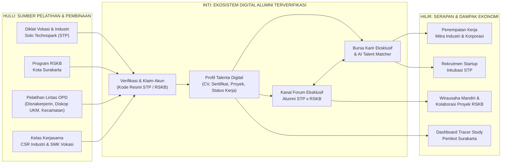
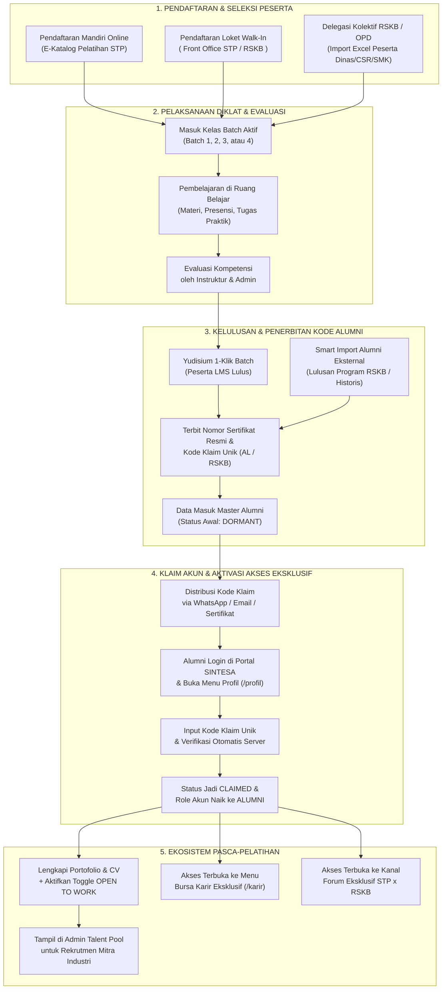
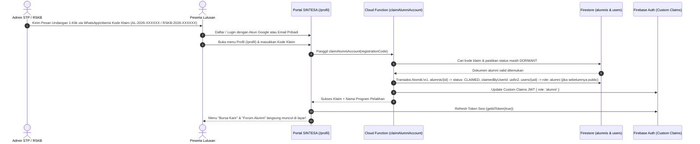
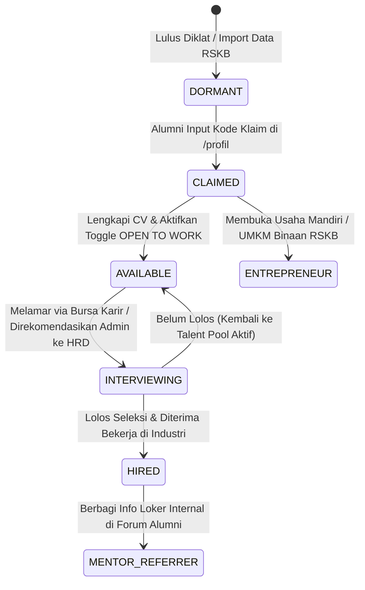
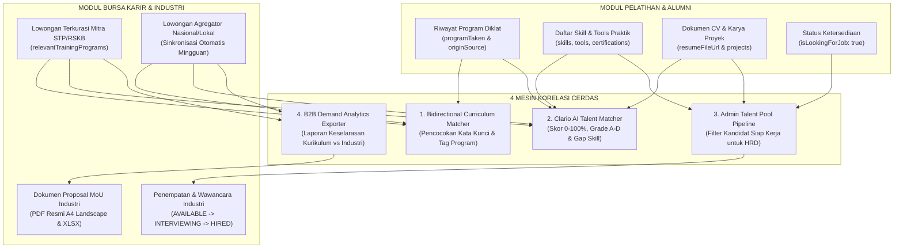
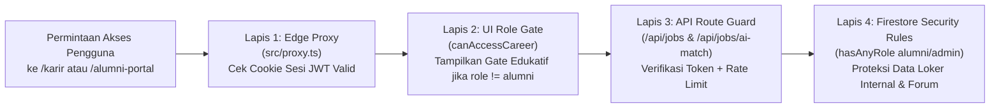
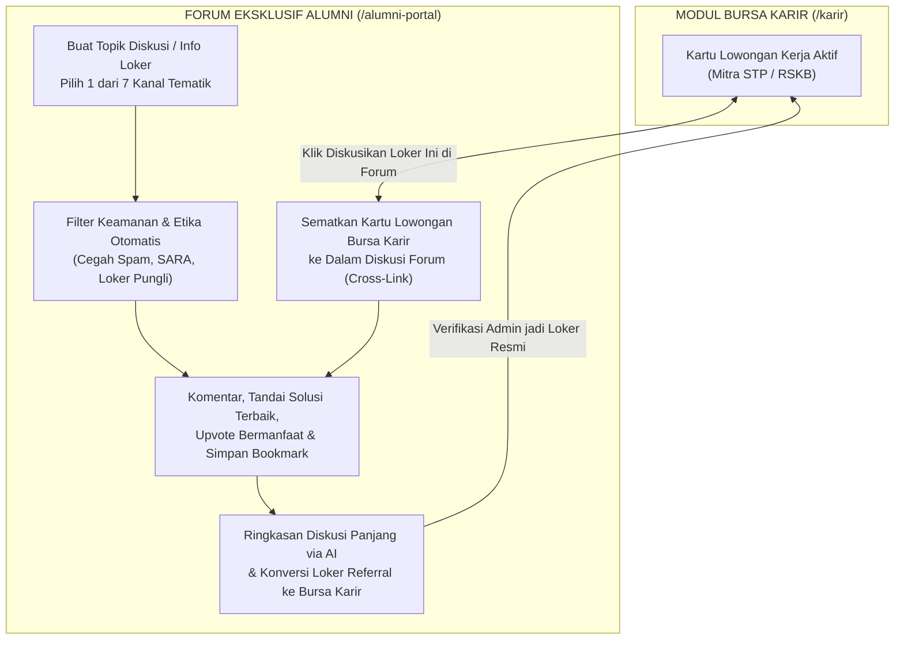
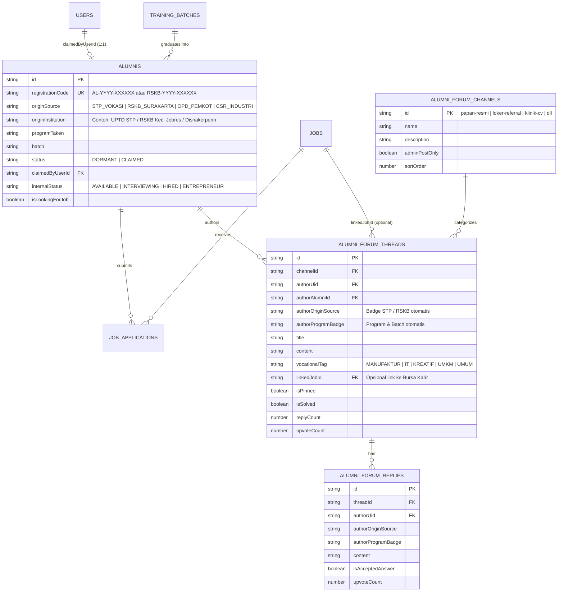

# 📘 EKOSISTEM ALUMNI PELATIHAN, BURSA KARIR EKSKLUSIF & FORUM KOLABORASI STP × RSKB KOTA SURAKARTA

> **Dokumen Penjelasan Komprehensif, Hasil Audit Sistem & Cetak Biru Pengembangan**  
> *Menghubungkan Pelatihan Vokasi Solo Technopark (STP) dan Program Rumah Siap Kerja Bersama (RSKB) Pemerintah Kota Surakarta ke dalam Satu Jembatan Penyaluran Karir & Jejaring Komunitas Alumni Terverifikasi*

---

## 📋 RINGKASAN EKSEKUTIF

1. **Integrasi Satu Pintu Talenta Kota Surakarta (STP × RSKB):** Sistem SINTESA telah memiliki fondasi hulu-ke-hilir (*end-to-end*) mulai dari manajemen pelatihan 4 batch tahunan, kelulusan otomatis (*Yudisium 1-Klik*), import massal data alumni lintas instansi, hingga **Bursa Karir (`/karir`)** berbasis kecerdasan buatan (*Clario AI Talent Matcher*). Ekosistem ini siap diperluas menjadi wadah tunggal bagi lulusan diklat **Solo Technopark (STP)** maupun alumni pelatihan lintas OPD **Rumah Siap Kerja Bersama (RSKB) Kota Surakarta**.
2. **Korelasi Langsung Pelatihan ke Penempatan Kerja:** Alumni yang mengklaim akun menggunakan Kode Verifikasi Resmi otomatis terhubung ke **Talent Pool Mitra Industri** dan mendapatkan rekomendasi lowongan yang dicocokkan langsung dengan kurikulum pelatihannya (*Bidirectional Curriculum Matching*).
3. **Nilai Strategis Bursa Karir Eksklusif:** Pembatasan menu **Bursa Karir (`/karir`)** khusus bagi alumni terverifikasi bukan sekadar pembatasan akses, melainkan **jaminan mutu kandidat (*Quality Signal*)** bagi HRD mitra industri, pelindung kuota rekrutmen jalur khusus MoU, serta pendorong minat masyarakat mengikuti program pelatihan resmi STP & RSKB.
4. **Temuan Audit Sistem Saat Ini (5 Fokus Perbaikan):** Hasil audit kode sumber mengungkap bahwa fondasi utama sudah berjalan baik, namun terdapat **bug kritis putusnya sinkronisasi role `alumni` saat klaim akun** (menyebabkan alumni yang sudah klaim kode masih tertahan di layar kunci Bursa Karir), celah proteksi pada endpoint `/api/jobs`, eksposur data pribadi pada aturan baca publik Firestore, serta belum tersedianya pencatatan lamaran internal (*in-app application tracking*).
5. **Pengembangan Kanal Forum Eksklusif Alumni STP × RSKB:** Ke depan, ekosistem diperkuat dengan **7 Kanal Forum Komunitas Eksklusif (`/alumni-portal`)** berfitur identitas terverifikasi (*Verified Program Badge*) sebagai ruang pertukaran info lowongan internal (*referral* antar-alumni), klinik bedah CV, diskusi kendala teknis kerja, hingga kolaborasi wirausaha binaan RSKB.

---

## 📑 DAFTAR ISI

1. [Visi Strategis Sinergi Solo Technopark (STP) × RSKB Kota Surakarta](#1-visi-strategis-sinergi-solo-technopark-stp--rskb-kota-surakarta)
2. [Hasil Audit Lengkap Sistem Saat Ini (Kondisi AS-IS & Temuan Kritis)](#2-hasil-audit-lengkap-sistem-saat-ini-kondisi-as-is--temuan-kritis)
3. [Mekanisme & Alur Lengkap Alumni Pelatihan (End-to-End Flow)](#3-mekanisme--alur-lengkap-alumni-pelatihan-end-to-end-flow)
4. [Matriks Benefit Alumni & Korelasi Strategis dengan Bursa Karir](#4-matriks-benefit-alumni--korelasi-strategis-dengan-bursa-karir)
5. [Analisis Mendalam Menu Bursa Karir Eksklusif Khusus Alumni](#5-analisis-mendalam-menu-bursa-karir-eksklusif-khusus-alumni)
6. [Desain & Deskripsi Lengkap Kanal Forum Eksklusif Alumni STP × RSKB](#6-desain--deskripsi-lengkap-kanal-forum-eksklusif-alumni-stp--rskb)
7. [Arsitektur Data, Keamanan & Peta Jalan Implementasi](#7-arsitektur-data-keamanan--peta-jalan-implementasi)

---

## 1. VISI STRATEGIS SINERGI SOLO TECHNOPARK (STP) × RSKB KOTA SURAKARTA

### 1.1 Tantangan Klasik Program Pelatihan Kerja Daerah
Selama ini, berbagai program pelatihan keterampilan dan penyiapan tenaga kerja yang diselenggarakan oleh lembaga vokasi maupun Organisasi Perangkat Daerah (OPD) sering menghadapi empat kendala pasca-pelatihan:
* **Data Lulusan Terpecah (*Siloed Data*):** Data peserta pelatihan tersebar di file Excel masing-masing penyelenggara setelah kegiatan selesai.
* **Putusnya Pendampingan Pasca-Sertifikasi:** Setelah sertifikat dibagikan, komunikasi antara penyelenggara dan alumni terputus (grup chat tenggelam atau nomor berganti).
* **Kesulitan *Tracer Study* (Pelacakan Serapan Kerja):** Pemerintah daerah dan pengelola pelatihan sulit mengukur secara *real-time* berapa persen lulusan yang sudah bekerja di industri, membuka usaha mandiri, atau masih mencari kerja.
* **Kesenjangan Informasi Lowongan Valid:** Alumni kesulitan membedakan lowongan kerja yang benar-benar memprioritaskan keahlian mereka dengan lowongan umum yang persaingannya terlalu acak.

### 1.2 Solusi Terpadu: *Single Talent, Career & Community Super-Hub*
Melalui integrasi **SINTESA Solo Technopark** dan **RSKB (Rumah Siap Kerja Bersama) Kota Surakarta**, seluruh lulusan pelatihan disatukan ke dalam satu ekosistem digital berkelanjutan:

### 1.3 Taksonomi Asal Alumni (*Multi-Origin Alumni Taxonomy*)
Agar sistem dapat membedakan sekaligus menyatukan alumni dari Solo Technopark maupun program RSKB Kota Surakarta, setiap profil alumni memiliki identitas asal program yang jelas:

| Kode Sumber (`originSource`) | Label Identitas di Sistem & Forum | Cakupan Program Pelatihan | Metode Masuk ke Sistem |
| :--- | :--- | :--- | :--- |
| `STP_VOKASI` | **Alumni Vokasi STP** | Manufaktur (CNC, Welding, Drafter), IT/Software, Desain Kreatif, Otomasi | Otomatis via Yudisium LMS 4-Batch / Import Admin |
| `RSKB_SURAKARTA` | **Alumni RSKB Surakarta** | Program penyiapan kerja terpadu Rumah Siap Kerja Bersama Kota Surakarta | Delegasi Batch Khusus / Smart Import Excel RSKB |
| `OPD_PEMKOT` | **Alumni Pelatihan Pemkot** | Pelatihan Disnakerperin, Diskop UKM, DP3AP2KB, Kelurahan/Kecamatan | Smart Import Excel Lintas OPD + Kode Klaim |
| `CSR_INDUSTRI` | **Alumni Beasiswa Mitra** | Program pelatihan berbasis beasiswa CSR korporasi & asosiasi industri | Yudisium LMS Batch Kemitraan |
| `INKUBASI_WIRAUSAHA` | **Talenta Wirausaha Binaan** | Peserta pelatihan kewirausahaan pemula RSKB & pra-inkubasi STP | Import Terkurasi / Yudisium Program |

---

## 2. HASIL AUDIT LENGKAP SISTEM SAAT INI (KONDISI AS-IS & TEMUAN KRITIS)

Audit menyeluruh telah dilakukan terhadap seluruh lapisan arsitektur sistem saat ini: skema data (`src/types/`), layanan bisnis (`src/services/`), antarmuka publik & admin (`src/app/`), keamanan akses (`src/config/roles.ts`, `src/proxy.ts`, `firestore.rules`), hingga fungsi server (`functions/src/`).

### 2.1 Inventarisasi Modul Eksisting yang Sudah Berjalan (Kondisi AS-IS)

| Modul / Fitur | Lokasi Implementasi Utama | Status Saat Ini | Penjelasan Kapabilitas Eksisting |
| :--- | :--- | :--- | :--- |
| **Manajemen 4 Batch Pelatihan** | `src/services/batch.service.ts` & `BatchManagementTab.tsx` | ✅ **Aktif** | Mendukung inisialisasi Batch 1–4 per tahun, skema pendanaan (`MANDIRI_BLUD`, `BEASISWA_PEMKOT`, `CSR_INDUSTRI`, dll.), dan kuota per batch. |
| **5 Kanal Pendaftaran Peserta** | `src/types/learning.types.ts` & `training.service.ts` | ✅ **Aktif** | Mendukung pendaftaran online katalog (otomatis terbit invoice bila berbayar), *walk-in* loket, serta *bulk import* Excel delegasi dinas/mitra. |
| **Yudisium 1-Klik ke Alumni** | `batchService.graduateBatchParticipants()` | ✅ **Aktif** | Meluluskan peserta batch sekaligus menerbitkan Nomor Sertifikat resmi dan membuat dokumen `alumnis` berstatus `DORMANT` lengkap dengan kode klaim `AL-YYYY-XXXXXX`. |
| **Smart Import Excel & Undangan WA** | `alumniService.smartImportAlumnis()` & `AlumniTab.tsx` | ✅ **Aktif** | Mengimpor data alumni historis/eksternal dengan anti-duplikasi otomatis (`nama + program + batch`) serta tombol kirim kode klaim langsung ke WhatsApp. |
| **Klaim Akun & Portofolio Alumni** | `src/app/(public)/profil/` & `TabAlumni.tsx` | ✅ **Aktif (Perlu Fix Role)** | Form input kode klaim, unggah foto & CV PDF, toggle **OPEN TO WORK**, daftar skill, sertifikasi eksternal, galeri proyek, & indikator kelengkapan profil. |
| **Admin Talent Pool Industri** | `TalentPoolTab.tsx` & `useAlumniSearch.ts` | ✅ **Aktif** | Direktori khusus alumni berstatus `CLAIMED` dengan filter status kerja (`AVAILABLE`, `INTERVIEWING`, `HIRED`) dan pintasan unduh CV / hubungi WA. |
| **Bursa Karir Hibrida & Gate** | `src/app/(public)/karir/` & `CareerExclusiveGate.tsx` | ✅ **Aktif (Perlu Hardening)** | Menggabungkan loker kurasi mitra STP (`stp_partner`) & agregator eksternal (`jsearch_realtime`), dilengkapi gerbang kunci khusus alumni. |
| **Clario AI Talent Matcher** | `/api/jobs/ai-match` & `JobDetailClient.tsx` | ✅ **Aktif** | Menghitung skor kecocokan kandidat terhadap lowongan (0–100%, Grade A–D, keunggulan alumni, *skill gap*, & rekomendasi persiapan interview). |
| **Ekspor Dokumen MoU Industri** | `src/services/careerExport.service.ts` | ✅ **Aktif** | Mengekspor pemetaan lowongan industri vs kurikulum pelatihan STP ke format PDF A4 Landscape resmi (siap tanda tangan) dan Excel/CSV. |
| **Forum Diskusi Eksisting (`Smart Hub`)** | `src/app/(public)/ekosistem/` & `hub.service.ts` | ⚠️ **Publik Umum** | Forum saat ini berada di menu publik Ekosistem Startup, terbuka untuk umum, dan belum dirancang sebagai kanal tertutup khusus alumni STP/RSKB. |

### 2.2 Lima Temuan Audit Kritis & Rekomendasi Perbaikan Teknis

> [!IMPORTANT]
> Sebelum fitur diperluas untuk skala Kota Surakarta (RSKB), **Temuan #1, #2, dan #3 wajib diperbaiki terlebih dahulu** agar pengalaman klaim alumni berjalan mulus tanpa hambatan akses dan data pribadi peserta terlindungi penuh.

| No | Tingkat Risiko | Temuan Audit pada Sistem Saat Ini | Dampak Nyata di Lapangan | Solusi Teknis yang Direkomendasikan |
| :--- | :--- | :--- | :--- | :--- |
| **1** | 🔴 **KRITIS (Blocker Alur Utama)** | **Putusnya Sinkronisasi Role `alumni` Saat Klaim Kode:** Fungsi `alumniService.claimAlumni()` hanya mengubah status dokumen di koleksi `alumnis` menjadi `CLAIMED`, tetapi **tidak memperbarui** field `role: 'alumni'` pada dokumen `/users/{uid}` maupun JWT Custom Claims Firebase Auth. Selain itu, placeholder input di halaman `/profil` tertulis `ALM-XXXXXX` padahal kode asli berformat `AL-YYYY-XXXXXX`. | Alumni yang **sudah berhasil memasukkan kode klaim** tetap terbaca ber-role `'public'` oleh `AuthContext` dan `canAccessCareer(role)`. Akibatnya, menu **Bursa Karir tetap tersembunyi di Navbar** dan halaman `/karir` **tetap terkunci** bagi alumni tersebut! | Buat Cloud Function Callable `claimAlumniAccount` (atau Firestore Trigger `onAlumniClaimedPromoteRole`) menggunakan Admin SDK untuk: (1) memvalidasi kode klaim secara aman di server, (2) mengunci dokumen `alumnis`, (3) meng-update `/users/{uid}` menjadi `{ role: 'alumni' }` (tanpa menurunkan role admin/staf), yang otomatis memicu `syncUserRoleToClaims`, lalu panggil `user.getIdToken(true)` di klien agar akses `/karir` terbuka detik itu juga. |
| **2** | 🔴 **KRITIS (Keamanan API & Gate)** | **Endpoint `/api/jobs` Tanpa Autentikasi & Gate Hanya di Sisi Klien:** Route `POST`, `PUT`, dan `DELETE` pada `src/app/api/jobs/route.ts` belum memverifikasi token Admin. Tombol *"Sinkronkan Database Sekarang"* muncul pada banner alumni di `/karir`. Route `/karir` & `/manajemen-karir` belum masuk `PROTECTED_PREFIXES` di `src/proxy.ts`, dan `/api/jobs/ai-match` belum dipasangi `checkRateLimit`. | Pihak luar dapat memanipulasi/menghapus data lowongan via request HTTP langsung tanpa login admin, membebani kuota sinkronisasi API eksternal, atau menguras kuota AI Clario. | (1) Tambahkan verifikasi Firebase ID Token & role admin pada `POST`/`PUT`/`DELETE` `/api/jobs`. (2) Hapus tombol sinkronisasi paksa dari tampilan alumni (`AlumniQuickMatchBanner.tsx`), pindahkan khusus ke `/manajemen-karir`. (3) Daftarkan `/karir`, `/alumni-portal`, dan `/manajemen-karir` ke `src/proxy.ts`. (4) Pasang `checkRateLimit` pada `/api/jobs/ai-match`. |
| **3** | 🔴 **TINGGI (Privasi / UU PDP)** | **Eksposur Data Pribadi (PII) & Duplikasi Blok di `firestore.rules`:** Koleksi `/alumnis/{alumniId}` dan `/cache_alumnis/{docId}` memiliki aturan `allow read: if true;` serta terdapat blok `match` ganda pada `trainings`, `alumnis`, `jobs`, dan `app_settings`. | Data sensitif seperti NIK, nomor WhatsApp, tanggal lahir, dan alamat rumah peserta pelatihan dapat dibaca secara publik melalui SDK klien tanpa login, serta celah klaim akun tanpa validasi kode di sisi server. | Konsolidasikan blok `match` ganda di `firestore.rules`. Pisahkan data profil publik/komunitas dari PII sensitif (NIK, alamat, no. HP pribadi hanya boleh dibaca pemilik akun & Admin/HR terotorisasi), serta wajibkan proses klaim melewati Cloud Function. |
| **4** | 🟠 **MENENGAH (Tracer Study)** | **Belum Ada Pencatatan Lamaran Internal (*In-App Job Application*):** Tombol *"Lamar Sekarang"* di `/karir/[id]` langsung membuka tautan eksternal/email perusahaan tanpa merekam jejak lamaran di subkoleksi `jobs/{jobId}/applications`. | Admin Pelatihan & RSKB tidak mengetahui lowongan mana saja yang diminati alumni, berapa kali CV dikirim, dan tidak bisa memperbarui pipeline `AVAILABLE` → `INTERVIEWING` → `HIRED` secara semi-otomatis. | Saat alumni menekan *"Lamar Sekarang"*, rekam *one-click application log* (ID alumni, CV terlampir, skor AI opsional, waktu melamar) ke sistem sebelum mengarahkan ke portal rekrutmen mitra atau meneruskan berkas langsung ke dashboard HR Mitra STP. |
| **5** | 🟠 **MENENGAH (Kesiapan Forum)** | **Forum Eksisting Tidak Eksklusif & Route `/alumni-portal` Belum Dibangun:** `Smart Hub` di `/ekosistem` bersifat publik bebas, skema `HubThreadSchema` belum mengizinkan `authorRole: 'alumni'`, terdapat *hardcoded* `'user_dummy_123'` saat membalas diskusi, sedangkan route `/alumni-portal` sudah didefinisikan di `src/config/roles.ts` namun belum memiliki halaman. | Alumni STP & RSKB belum memiliki ruang tertutup yang aman untuk berbagi info loker internal (*ordal positif*), nominal gaji, atau kendala kerja tanpa terekspos ke publik luar. | Bangun modul khusus **Forum Eksklusif Alumni STP × RSKB** pada route `/alumni-portal` (yang sudah diizinkan untuk role `alumni` di `roles.ts`) menggunakan koleksi terpisah yang dikunci ketat di level Firestore Security Rules. |

---

## 3. MEKANISME & ALUR LENGKAP ALUMNI PELATIHAN (END-TO-END FLOW)

Bagian ini menjelaskan secara runtut perjalanan seorang peserta—baik dari program reguler **Solo Technopark** maupun program **RSKB Kota Surakarta**—mulai dari mendaftar pelatihan hingga menjadi alumni terverifikasi yang siap terserap industri.

### 3.1 Diagram Alur Utama Hulu-ke-Hilir

---

### 3.2 Penjelasan Detail Setiap Tahap Mekanisme

#### Tahap 1: Lima Pintu Masuk Peserta (Inklusif untuk STP & RSKB)
Sistem tidak membatasi peserta hanya dari pembelian online, melainkan mengakomodasi realitas operasional pemerintah daerah dan vokasi melalui 5 jalur masuk (`registrationChannel`):
1. **`CATALOG_ONLINE` (Mandiri via Website):** Masyarakat mendaftar lewat halaman katalog `/program-pelatihan`. Jika pelatihan gratis/beasiswa, status langsung aktif; jika berbayar (komersial BLUD), sistem otomatis menerbitkan tagihan resmi ke loket kasir/pembayaran sebelum kelas dibuka.
2. **`OFFLINE_WALKIN` (Loket Layanan Terpadu):** Petugas pendaftaran di Solo Technopark atau posko pelayanan RSKB menginput peserta yang datang langsung menggunakan formulir cepat (*Quick Walk-In*).
3. **`PARTNER_DINAS` (Jalur Utama RSKB & OPD Kota Surakarta):** Peserta hasil penjaringan kelurahan, kecamatan, Disnakerperin, atau Rumah Siap Kerja Bersama diunggah sekaligus menggunakan template Excel ke dalam Batch khusus (skema pendanaan `BEASISWA_PEMKOT`).
4. **`PARTNER_SMK` (Jalur Sinkronisasi Sekolah Vokasi/Kampus):** Kelas industri terpadu bagi siswa tingkat akhir SMK/Politeknik.
5. **`PARTNER_CSR` (Jalur Beasiswa Industri):** Kelas pesanan khusus perusahaan mitra yang mendanai pelatihan untuk kemudian merekrut langsung lulusannya.

#### Tahap 2: Pembelajaran Terstruktur dalam 4 Batch Kuartalan
* Setiap program kejuruan dikelola dalam siklus **Batch 1 (Kuartal I), Batch 2 (Kuartal II), Batch 3 (Kuartal III), dan Batch 4 (Kuartal IV)**.
* Peserta yang terkonfirmasi mengakses **Ruang Belajar (`/ruang-belajar`)** untuk mengunduh modul, mengumpulkan tugas praktik/proyek, dan dipantau kehadirannya oleh instruktur.

#### Tahap 3: Dua Jalur Pembentukan Data Master Alumni
Sistem menyediakan **dua mekanisme fleksibel** agar baik pelatihan yang memakai LMS penuh maupun pelatihan tatap muka singkat RSKB di lapangan tetap masuk ke satu database alumni yang sama:

* **Jalur A — Yudisium 1-Klik dari Kelas LMS (`graduateBatchParticipants`):**
  * Admin Pelatihan memilih peserta yang dinyatakan kompeten di halaman manajemen peserta, lalu menekan tombol **Yudisium / Luluskan**.
  * Secara otomatis dalam satu transaksi atomik, sistem:
    1. Mengubah status kelulusan peserta menjadi `GRADUATED`.
    2. Menerbitkan Nomor Sertifikat baku (contoh: `STP-CERT/2026/MAN/B1-0014`).
    3. Membuat profil awal di koleksi `alumnis` dengan status `DORMANT` (belum diklaim) dan menghasilkan **Kode Klaim Unik** (contoh: `AL-2026-482910` untuk reguler STP atau `RSKB-2026-839201` untuk program RSKB).
* **Jalur B — *Smart Import Excel* Lintas Program RSKB (`smartImportAlumnis`):**
  * Untuk pelatihan RSKB yang dilaksanakan secara *offline* di kelurahan/balai latihan tanpa melewati LMS, admin cukup mengunggah file Excel daftar lulusan.
  * Mesin *Smart Upsert* akan mengecek kombinasi `Nama Lengkap + Nama Program + Angkatan/Batch`:
    * Jika peserta **belum ada**, sistem membuatkan profil baru + Kode Klaim Unik secara otomatis.
    * Jika peserta **sudah pernah ikut pelatihan sebelumnya**, sistem memperbarui data tanpa membuat akun ganda (*zero duplicate*).

#### Tahap 4: Distribusi Undangan & Mekanisme Klaim Akun Alumni
Mengapa menggunakan sistem **Kode Klaim (`Registration Code`)**? Karena banyak peserta pelatihan (terutama jalur offline/dinas/RSKB) didaftarkan secara kolektif oleh petugas menggunakan data KTP/Excel, sehingga mereka belum tentu memiliki akun login saat pelatihan dimulai.

#### Tahap 5: Siklus Status Kesiapan Kerja (*Career Readiness State Machine*)
Setelah akun berhasil diklaim, profil alumni bergerak mengikuti siklus penyaluran kerja yang dipantau bersama oleh alumni dan tim penyaluran karir STP/RSKB:

---

## 4. MATRIKS BENEFIT ALUMNI & KORELASI STRATEGIS DENGAN BURSA KARIR

### 4.1 Delapan Benefit Utama Menjadi Alumni Terverifikasi (Bahan Sosialisasi Peserta)
Ketika seorang lulusan pelatihan STP atau RSKB mengklaim akunnya di sistem, mereka memperoleh **8 hak istimewa (*privileges*) permanen** yang tidak dimiliki pengguna umum:

1. **🔓 Akses Penuh Bursa Karir Eksklusif (`/karir`):** Membuka seluruh daftar lowongan kerja terkurasi dari perusahaan mitra MoU Solo Technopark, startup inkubasi STP, BUMN, dan jejaring industri RSKB Kota Surakarta.
2. **🤖 Asisten Analisis Kecocokan Kerja AI (*Clario AI Match*):** Sebelum melamar, alumni dapat menekan tombol analisis AI pada lowongan untuk mengetahui skor kecocokan profilnya (0–100%), poin keunggulan kurikulum pelatihannya yang harus ditonjolkan saat interview, serta keterampilan tambahan yang perlu disiapkan.
3. **🎯 Rekomendasi Lowongan Otomatis Sesuai Kejuruan (*Quick-Match*):** Sistem otomatis memfilter dan mengangkat lowongan yang paling relevan dengan bidang pelatihan yang pernah diambil alumni (misal lulusan *CNC Milling* langsung disuguhi lowongan manufaktur presisi di urutan teratas).
4. **🪪 Portofolio Talenta Digital & Lencana Terverifikasi (*Verified Badge*):** Halaman profil profesional berisi riwayat sertifikasi resmi STP/RSKB, dokumen CV PDF siap unduh, dan galeri foto proyek hasil karya selama pelatihan.
5. **🧲 Eksposur Jemput Bola di *Talent Pool* Mitra Industri:** Dengan menyalakan tombol **OPEN TO WORK**, profil dan CV alumni langsung tampil di etalase rekrutmen internal yang dilihat oleh tim penyaluran kerja STP/RSKB saat mitra perusahaan membutuhkan kandidat cepat tanpa iklan lowongan terbuka.
6. **💬 Akses Kanal Forum Eksklusif Alumni STP × RSKB:** Bergabung dalam ruang komunikasi tertutup bersama ribuan alumni lintas angkatan untuk mendapatkan info lowongan *referral* dalam perusahaan, bedah CV bersama praktisi, dan tanya-jawab kendala teknis di tempat kerja.
7. **🚀 Peluang Sub-Kontrak Proyek & Jejaring Wirausaha:** Bagi alumni yang memilih jalur mandiri/UMKM (khususnya binaan RSKB), forum dan ekosistem STP membuka peluang kolaborasi proyek produksi, *freelance*, hingga pendaftaran program inkubasi bisnis.
8. **🎓 Prioritas Beasiswa *Upskilling* & Uji Kompetensi Lanjutan:** Alumni aktif tercatat dalam radar prioritas ketika Pemkot Surakarta atau STP membuka kuota sertifikasi BNSP gratis maupun pelatihan tingkat lanjut (*advanced batch*).

---

### 4.2 Matriks Nilai Tambah 4 Pihak (*4-Way Stakeholder Benefits*)

| Pemangku Kepentingan | Masalah Sebelumnya | Benefit Nyata dari Ekosistem Terintegrasi Ini |
| :--- | :--- | :--- |
| **👨‍🎓 Alumni STP & RSKB** | Bingung mencari kerja yang sesuai sertifikat pelatihan; bersaing buta di portal loker umum. | Mendapat jalur khusus lowongan mitra, panduan interview berbasis AI, portofolio resmi, dan info loker *referral* dari senior se-almamater. |
| **🏭 Mitra Industri & HRD Perusahaan** | Kebanjiran ribuan CV pelamar umum yang tidak relevan dan belum teruji keterampilan praktiknya. | Mendapat kandidat pra-terverifikasi (*pre-screened*) yang sudah lulus praktik jam terbang bengkel/lab STP atau kurasi kesiapan kerja RSKB. |
| **🏛️ Pemkot Surakarta & Pengelola RSKB** | Sulit memantau dampak anggaran pelatihan terhadap penurunan angka pengangguran terbuka (TPT) secara akurat. | Memiliki data *real-time* serapan lulusan per kelurahan/kecamatan/program kejuruan, siap disajikan sebagai laporan kinerja kepala daerah. |
| **🏢 Manajemen BLUD Solo Technopark** | Kurikulum pelatihan berisiko tertinggal dari kebutuhan riil pabrik/industri terbaru. | Data keterampilan yang paling dicari di Bursa Karir menjadi umpan balik langsung (*market intelligence*) untuk memperbarui kurikulum batch berikutnya & bahan negosiasi MoU B2B. |

---

### 4.3 Mekanisme Teknis Korelasi Pelatihan dengan Bursa Karir
Korelasi antara **Modul Pelatihan** dan **Modul Bursa Karir** di dalam kode sistem bekerja melalui **4 jembatan penghubung otomatis**:

1. **Jembatan 1 — *Bidirectional Curriculum Matching* (`filterAndSortJobs`):**
   * Setiap lowongan yang diposting di `/manajemen-karir` memiliki atribut `relevantTrainingPrograms` (daftar program diklat STP/RSKB yang cocok untuk posisi tersebut).
   * Bahkan untuk lowongan eksternal hasil agregasi otomatis yang belum ditandai manual, algoritma tokenisasi dua arah mencocokkan nama kejuruan alumni terhadap judul lowongan, kategori industri, dan daftar `skills` yang diminta perusahaan.
2. **Jembatan 2 — *Clario AI Talent Matcher* (`/api/jobs/ai-match`):**
   * Saat alumni membuka detail sebuah lowongan di `/karir/[id]`, mesin penalaran cepat `deepseek-v4-flash` membandingkan profil kompetensi alumni dengan deskripsi & persyaratan lowongan.
   * Output yang dihasilkan sangat aplikatif bagi pencari kerja pemula:
     * **Skor & Grade Kecocokan** (`A: Sangat Cocok`, `B: Cocok`, `C: Cukup Potensial`, `D: Perlu Upskilling`).
     * **Matched Skills & Missing Skills** (keahlian yang sudah dikuasai vs yang perlu dipelajari singkat sebelum tes).
     * **Keunggulan Alumni STP/RSKB** (poin nilai jual praktik yang disarankan untuk disampaikan kepada pewawancara).
3. **Jembatan 3 — *Talent Pool* Aktif ke Rekrutmen Tertutup (`TalentPoolTab`):**
   * Tidak semua perusahaan ingin membuka lowongan secara terbuka. Banyak mitra industri menghubungi manajemen STP/RSKB: *"Kami butuh 5 operator las bersertifikat minggu depan."*
   * Admin cukup memfilter kejuruan *Welding* dengan status `AVAILABLE` di *Talent Pool*, mengunduh bundel CV alumni yang menyalakan `OPEN TO WORK`, dan mengubah status mereka menjadi `INTERVIEWING` hingga `HIRED`.
4. **Jembatan 4 — *Market Intelligence* ke Perencanaan Batch Baru (`careerExport.service`):**
   * Dari kumpulan lowongan aktif, admin dapat mencetak dokumen resmi analisis kebutuhan industri (PDF/Excel) untuk melihat kejuruan mana yang permintaannya melonjak, sehingga kuota Batch RSKB/STP kuartal berikutnya selalu tepat sasaran.

---

## 5. ANALISIS MENDALAM MENU BURSA KARIR EKSKLUSIF KHUSUS ALUMNI

### 5.1 Mengapa Menu Bursa Karir Dibuat Eksklusif (Tidak Dibuka Bebas untuk Umum)?
Keputusan arsitektur menjadikan menu **Bursa Karir (`/karir`)** bersifat eksklusif khusus bagi pemilik akun berstatus **Alumni Terverifikasi** (serta staf pengelola internal) memiliki **5 landasan strategis yang sangat kuat**:

| Pilar Strategis | Analisis Dampak Jika Dibuka Bebas (Publik Umum) | Keunggulan Nyata Saat Dikunci Eksklusif untuk Alumni STP & RSKB |
| :--- | :--- | :--- |
| **1. Kepercayaan HRD Mitra Industri (*Trust & Signal Quality*)** | Portal berubah menjadi situs loker biasa; HRD mitra menerima ratusan lamaran acak yang tidak terverifikasi kompetensinya, sehingga perusahaan enggan memberi jalur khusus lagi. | HRD perusahaan tahu pasti bahwa **100% pelamar dari kanal ini adalah binaan resmi STP atau RSKB Kota Surakarta** yang rekam jejak pelatihannya dapat dipertanggungjawabkan. |
| **2. Proteksi Kuota Jalur Khusus (*Hidden Job Market*)** | Kuota rekrutmen hasil kerja keras negosiasi MoU Pemkot/STP justru diserbu pelamar luar daerah atau non-binaan. | Lowongan khusus mitra industri benar-benar dinikmati oleh warga/peserta yang telah mengikuti pembinaan di STP dan RSKB. |
| **3. Daya Tarik & Kebanggaan Sertifikasi (*Conversion Driver*)** | Masyarakat merasa tidak ada bedanya ikut pelatihan resmi atau tidak dalam hal kemudahan akses jejaring kerja. | Layar kunci eksklusif (*Exclusive Gate*) berfungsi sebagai **etalase pemasaran edukatif**: pengunjung umum melihat nilai tambah nyata dan terdorong mendaftar pelatihan di STP/RSKB. |
| **4. Akurasi *Tracer Study* Pemerintah Daerah** | Statistik pelamar tercampur antara masyarakat umum dan lulusan binaan sehingga data serapan kerja bias. | Setiap aktivitas pencarian kerja, lamaran, dan penempatan kerja murni mencerminkan kinerja penyaluran lulusan STP & RSKB. |
| **5. Efisiensi Infrastruktur & Kuota AI** | Fitur pencocokan AI (*Clario AI Match*) rentan disalahgunakan oleh trafik publik anonim. | Sumber daya komputasi AI terfokus sepenuhnya untuk membimbing karir talenta binaan resmi. |

---

### 5.2 Mekanisme Pengalaman Pengguna pada Gerbang Eksklusif (*User Experience Flow*)
Sistem menerapkan pendekatan **"Tersembunyi di Navigasi Umum, Edukatif Saat Diakses Langsung"**:

1. **Pada Navigasi Atas (`PublicNavbar.tsx`):**
   * Bagi pengunjung yang belum login atau pengguna biasa (`role: 'public'`), tautan **Bursa Karir** tidak ditampilkan pada deretan menu publik agar navigasi tetap bersih dan fokus pada informasi layanan/pelatihan.
   * Begitu seorang pengguna login dan memiliki `role: 'alumni'` (atau staf pengelola), menu **Bursa Karir** dan **Forum Alumni** otomatis muncul secara personal di bilah navigasi.
2. **Pada Akses URL Langsung `/karir` (`CareerExclusiveGate.tsx`):**
   * Jika pengunjung umum membuka tautan `.../karir` (misalnya dari kiriman teman), mereka tidak disambut halaman *error 404* yang kaku, melainkan tampilan **Gerbang Eksklusif Alumni (`CareerExclusiveGate`)** yang elegan dan informatif:
     * **Kondisi Belum Login:** Menampilkan 3 keunggulan ekosistem karir serta dua tombol jelas: *"Masuk sebagai Alumni"* atau *"Lihat Program Pelatihan"* (mengarahkan calon peserta baru ke pendaftaran diklat).
     * **Kondisi Sudah Login tapi Belum Klaim Kode Alumni:** Menampilkan sapaan nama pengguna, penjelasan bahwa akunnya belum terhubung ke data kelulusan, serta tombol langsung **"Klaim Kode Alumni di Profil"** menuju `/profil`.

---

### 5.3 Arsitektur Keamanan Berlapis (*4-Layer Exclusivity Protection*)
Agar eksklusivitas Bursa Karir dan Forum Alumni benar-benar kedap celah (*zero-trust*), proteksi dijalankan pada 4 lapisan sekaligus:

---

## 6. DESAIN & DESKRIPSI LENGKAP KANAL FORUM EKSKLUSIF ALUMNI STP × RSKB

Untuk mewujudkan visi menjadikan sistem ini sebagai **rumah digital bersama bagi alumni pelatihan Solo Technopark maupun alumni program RSKB Kota Surakarta**, fitur komunitas tidak dicampur dengan forum publik umum, melainkan dibangun sebagai **Ruang Komunitas Eksklusif Alumni (`/alumni-portal`)**.

### 6.1 Mengapa Harus Kanal Forum Terintegrasi di Dalam Sistem (Bukan Sekadar Grup WhatsApp)?
Grup WhatsApp per angkatan tetap baik untuk sapaan harian, namun memiliki kelemahan struktural untuk skala ribuan alumni kota:
* **Kapasitas & Terpecahnya Angkatan:** Grup WA terpisah-pisah per batch/program, sehingga alumni RSKB Kecamatan A tidak pernah tahu ada info lowongan dari alumni Manufaktur STP Batch 1.
* **Informasi Penting Tenggelam:** Info lowongan kerja, file template CV, dan tips tes perusahaan hilang tertumpuk ratusan pesan obrolan dalam hitungan jam dan tidak bisa dicari ulang oleh alumni angkatan berikutnya.
* **Rawan Hoaks & Penipuan Loker:** Di grup pesan instan, sulit memverifikasi apakah pengirim info benar-benar alumni resmi atau nomor tak dikenal.
* **Keunggulan Forum Eksklusif di SINTESA:** Setiap anggota sudah **terverifikasi kode kelulusannya**, setiap postingan mencantumkan **Lencana Asal Program & Angkatan** secara otomatis, diskusi tersusun rapi per topik/kejuruan, dapat dicari kapan saja (*searchable knowledge base*), dan terhubung langsung ke kartu lowongan di **Bursa Karir**.

---

### 6.2 Pengembangan Deskripsi Lengkap 7 Kanal Forum Eksklusif Alumni STP × RSKB

Berikut adalah rancangan **7 Kanal Utama** beserta deskripsi lengkap yang siap digunakan baik untuk teks antarmuka aplikasi (*UI copywriting*) maupun bahan paparan sosialisasi program bersama Pemerintah Kota Surakarta:

---

#### 1. 📢 Kanal `#papan-resmi-stp-rskb` — **Pengumuman Resmi, Walk-In Interview & Panggilan Rekrutmen Cepat**
* **Label Tampilan:** `Papan Resmi STP & RSKB`
* **Deskripsi Singkat (UI Subtitle):** *Pusat pengumuman prioritas dari Manajemen Solo Technopark & Sekretariat RSKB Kota Surakarta terkait rekrutmen tertutup, jadwal walk-in interview, job fair khusus, dan program pemerintah.*
* **Deskripsi Lengkap & Fungsi Utama:**
  Kanal komunikasi satu arah berprioritas tinggi (*official broadcast*) yang dikelola langsung oleh Admin Karir STP dan Koordinator RSKB Kota Surakarta. Ketika mitra industri membutuhkan tenaga kerja mendadak (misal: *"Dibutuhkan 15 Teknisi Otomasi & 20 Operator Garmen minggu ini, tes langsung di Gedung STP Hari Kamis"*), pengumuman dipasang di kanal ini lengkap dengan tombol konfirmasi kehadiran (*RSVP*) dan lampiran kartu lowongan dari Bursa Karir. Alumni tetap dapat memberikan reaksi dan bertanya pada kolom komentar di bawah pengumuman untuk klarifikasi persyaratan berkas.
* **Hak Membuat Topik Baru:** Khusus `Admin Pelatihan`, `Koordinator RSKB`, `Instruktur`, dan `Super Admin` (Alumni dapat membalas/bertanya di komentar).

---

#### 2. 💼 Kanal `#loker-referral-alumni` — **Jejaring Loker Internal & Referral Antar-Alumni ("Ordal Positif")**
* **Label Tampilan:** `Info Loker & Referral Alumni`
* **Deskripsi Singkat (UI Subtitle):** *Dari alumni, oleh alumni, untuk alumni. Ruang berbagi info lowongan internal dari tempat kerja alumni senior lengkap dengan tips seleksi dan jalur rekomendasi rekan se-almamater.*
* **Deskripsi Lengkap & Fungsi Utama:**
  Di dunia industri nyata, banyak lowongan posisi teknis diisi melalui rekomendasi karyawan internal sebelum sempat diiklankan ke publik. Kanal ini memfasilitasi budaya **"bantu adik angkatan"**: alumni STP atau RSKB yang sudah lebih dulu bekerja di pabrik, studio kreatif, rumah sakit, perhotelan, atau perusahaan teknologi dapat membagikan info lowongan di kantornya langsung kepada sesama alumni terverifikasi. Pengunggah dapat menyematkan tag bidang keahlian, kisaran lokasi kerja, batas pengiriman CV, hingga bersedia menjadi *referrer* internal karena percaya pada standar pelatihan almamater yang sama.
* **Hak Membuat Topik Baru:** Seluruh `Alumni Terverifikasi` & `Admin` (dilengkapi format terstruktur: *Nama Perusahaan, Posisi, Lokasi, Syarat Utama, & Cara Kirim Berkas*).

---

#### 3. 📄 Kanal `#klinik-karir-dan-cv` — **Bedah CV, Portofolio, Simulasi Wawancara & Konsultasi Karir**
* **Label Tampilan:** `Klinik CV & Persiapan Tes Kerja`
* **Deskripsi Singkat (UI Subtitle):** *Tempat meminta review CV, portofolio proyek, latihan menjawab pertanyaan HRD/User, berbagi pengalaman psikotes, hingga diskusi etika kerja dan kontrak industri.*
* **Deskripsi Lengkap & Fungsi Utama:**
  Banyak lulusan pelatihan memiliki keterampilan praktik yang sangat bagus, namun gagal di tahap seleksi administrasi atau gugup saat wawancara kerja pertama mereka. Di kanal ini, alumni dari STP maupun RSKB dapat melampirkan draf CV/portofolio mereka (dengan data sensitif disamarkan) untuk mendapatkan masukan konstruktif dari instruktur, konselor RSKB, maupun alumni senior yang sudah berpengalaman menghadapi seleksi HRD. Kanal ini juga menjadi bank pengalaman nyata (*interview playbook*) mengenai pola tes praktik di berbagai kawasan industri.
* **Hak Membuat Topik Baru:** Seluruh `Alumni Terverifikasi`, `Instruktur`, & `Konselor Karir RSKB`.

---

#### 4. 🛠️ Kanal `#diskusi-kejuruan-teknis` — **Forum Pemecahan Masalah Teknis & Kejuruan Lintas Bidang**
* **Label Tampilan:** `Ruang Diskusi Teknis Kejuruan`
* **Deskripsi Singkat (UI Subtitle):** *Diskusi tanya-jawab teknis seputar kendala pekerjaan di lapangan, penggunaan mesin/software industri, standar K3, dan pembaruan teknologi sesuai kejuruan masing-masing.*
* **Deskripsi Lengkap & Fungsi Utama:**
  Pendampingan vokasi tidak berhenti saat lulus pelatihan. Ketika seorang alumni baru mulai bekerja di perusahaan dan menemui kasus teknis baru (misalnya: *setting parameter mesin CNC untuk material khusus, troubleshooting pengelasan pipa, bug deployment aplikasi web, penggunaan peralatan kuliner/barista komersial, atau pembukuan digital UMKM*), mereka dapat bertanya di kanal ini dan memfilter berdasarkan **Sub-Tag Kejuruan**:
  * `Manufaktur, Mesin & Pengelasan`
  * `Teknologi Informasi, AI & Jaringan`
  * `Desain Kreatif, Multimedia & Konten Digital`
  * `Otomasi, Elektronika & Otomotif`
  * `Jasa, Perhotelan, Kuliner & Kriya RSKB`
  Instruktur STP dan praktisi senior dapat menjawab langsung, menjadikan forum ini perpustakaan solusi teknis hidup (*living technical knowledge base*).
* **Hak Membuat Topik Baru:** Seluruh `Alumni Terverifikasi` & `Instruktur`.

---

#### 5. 🚀 Kanal `#wirausaha-dan-proyek-rskb` — **Kolaborasi Usaha Mandiri, UMKM RSKB & Bursa Proyek Freelance**
* **Label Tampilan:** `Kolaborasi Proyek & Wirausaha RSKB`
* **Deskripsi Singkat (UI Subtitle):** *Wadah mempertemukan alumni lintas keahlian untuk mengerjakan proyek bersama, sub-kontrak jasa produksi, pemasaran produk UMKM binaan RSKB, hingga pembentukan tim startup.*
* **Deskripsi Lengkap & Fungsi Utama:**
  Tidak semua lulusan pelatihan RSKB dan STP bertujuan menjadi karyawan; sebagian besar lulusan pelatihan kewirausahaan Kota Surakarta diarahkan untuk mandiri secara ekonomi dan menciptakan lapangan kerja baru. Kanal ini menghubungkan berbagai keahlian yang saling melengkapi antar-alumni!
  * *Contoh Sinergi Nyata:* Alumni pelatihan **Kuliner/Kriya RSKB** yang membutuhkan desain kemasan dan toko online dapat berkolaborasi langsung dengan alumni pelatihan **Desain Grafis & Web Development STP**. Alumni bengkel las yang mendapat pesanan pagar/konstruksi besar dapat mengajak alumni seangkatannya untuk pengerjaan proyek bersama.
* **Hak Membuat Topik Baru:** Seluruh `Alumni Terverifikasi`, `Tenant Inkubasi STP`, & `Pendamping UMKM RSKB`.

---

#### 6. 🎓 Kanal `#sertifikasi-dan-upskilling` — **Info Uji Kompetensi BNSP, Kelas Lanjutan & Beasiswa Vokasi**
* **Label Tampilan:** `Info Sertifikasi BNSP & Upskilling`
* **Deskripsi Singkat (UI Subtitle):** *Informasi jadwal uji sertifikasi profesi (LSP/BNSP), pembukaan batch pelatihan tingkat lanjut, webinar industri, serta kuota beasiswa peningkatan kompetensi.*
* **Deskripsi Lengkap & Fungsi Utama:**
  Dunia kerja menuntut pembaruan sertifikasi secara berkala. Kanal ini menghimpun seluruh informasi peningkatan kualifikasi bagi alumni yang ingin naik jabatan (*career progression*), seperti jadwal perpanjangan sertifikat kompetensi BNSP, beasiswa pelatihan tingkat mahir dari kementerian/Pemkot Surakarta, maupun kelas malam/akhir pekan bagi alumni yang sudah bekerja.
* **Hak Membuat Topik Baru:** `Admin Pelatihan`, `Koordinator RSKB`, `Instruktur`, & `Alumni Terverifikasi` (untuk berbagi info beasiswa valid).

---

#### 7. 🌟 Kanal `#jejak-sukses-dan-jejaring` — **Cerita Penempatan Kerja, Direktori Domisili Kerja & Inspirasi Alumni**
* **Label Tampilan:** `Jejak Sukses & Relasi Antar-Kota`
* **Deskripsi Singkat (UI Subtitle):** *Ruang apresiasi alumni yang baru diterima bekerja atau merintis usaha, berbagi kisah perjuangan dari bangku pelatihan ke industri, serta jejaring perantauan antar-kota.*
* **Deskripsi Lengkap & Fungsi Utama:**
  Membangun mentalitas siap kerja membutuhkan teladan nyata dari sesama rekan seperjuangan. Saat seorang alumni berhasil diterima bekerja atau mendapatkan pesanan pertamanya, mereka dapat membagikan ceritanya di kanal ini untuk menyemangati rekan-rekan yang sedang berjuang. Selain itu, alumni yang ditempatkan di luar kota (misal kawasan industri Cikarang, Karawang, Semarang, Batam, atau luar negeri/magang Jepang) dapat saling menyapa untuk membantu informasi tempat kos aman, transportasi, dan adaptasi lingkungan kerja bagi alumni junior yang baru menyusul.
* **Hak Membuat Topik Baru:** Seluruh `Alumni Terverifikasi` & `Admin`.

---

### 6.3 Sistem Identitas Terverifikasi & *Badge* Komunitas Otomatis
Setiap anggota yang menulis topik atau komentar di dalam forum otomatis menampilkan **Kartu Identitas Ringkas Terverifikasi** yang diambil langsung dari database kelulusan (tidak bisa dipalsukan manual):

* **Nama Asli & Foto Profil**
* **Lencana Asal Institusi (*Origin Badge*):**
  * 🟦 `Alumni Vokasi STP` (untuk lulusan program Solo Technopark)
  * 🟩 `Alumni RSKB Surakarta` (untuk lulusan program Rumah Siap Kerja Bersama & OPD Pemkot Surakarta)
  * 🟪 `Instruktur / Mentor Resmi` (untuk pengajar & konselor karir)
  * 🟨 `Tim Karir STP-RSKB` (untuk moderator & pengelola penyaluran kerja)
* **Sub-Info Kejuruan & Angkatan:** misal *"Teknik Pengelasan SMAW • Batch 2 / 2026"* atau *"Digital Marketing UMKM RSKB • Batch 3 / 2026"*.
* **Indikator Status Karir Opsional:**
  * `🟢 Siap Direkrut (Open to Work)` — memudahkan HR/senior langsung klik profil portofolionya.
  * `🏢 Bekerja di Industri (Verified Referrer)` — menandakan alumni yang sudah bekerja dan aktif membagikan info loker/mentor.
  * `🚀 Wirausaha Binaan` — menandakan pemilik usaha/freelancer aktif.

---

### 6.4 Mekanisme Interaksi Forum & Integrasi dua arah dengan Bursa Karir

**Keunggulan Mekanisme Saling Terhubung (*Cross-Module Synergy*):**
1. **Tombol *"Diskusikan Lowongan Ini di Forum"*:** Dari halaman detail lowongan di `/karir/[id]`, alumni bisa langsung membuka atau melihat diskusi terkait perusahaan/posisi tersebut di forum (misal menanyakan kisi-kisi tes kepada alumni yang sudah bekerja di sana).
2. **Promosi *Loker Referral Alumni* Menjadi Lowongan Resmi:** Jika seorang alumni membagikan info lowongan valid di kanal `#loker-referral-alumni`, Admin Karir dapat memverifikasi dan mempromosikannya dengan **1 klik** agar tampil resmi di halaman **Bursa Karir (`/karir`)** lengkap dengan fitur analisis kecocokan AI!
3. **Perlindungan Anti-Penipuan Loker (*Safe Space Policy*):** Sistem otomatis memberi peringatan dan memfilter kata kunci indikasi pungutan liar (*biaya admin tes, transfer uang seragam/travel*) serta menyediakan tombol **Laporkan Postingan** ke tim moderator STP-RSKB.

---

## 7. ARSITEKTUR DATA, KEAMANAN & PETA JALAN IMPLEMENTASI

### 7.1 Rancangan Relasi Entitas Database (`erDiagram`)
Seluruh skema baru wajib didefinisikan menggunakan **Zod Schema** pada `src/types/ecosystem.types.ts` dan diakses melalui *service layer* khusus (`src/services/alumniForum.service.ts`) sesuai aturan baku arsitektur SINTESA.

### 7.2 Pemisahan Data Publik Alumni vs Data Pribadi Sensitif (Kepatuhan UU PDP)
Untuk menjaga keamanan data warga Kota Surakarta dan lulusan STP:
* **Data Komunitas Internal (Boleh dilihat sesama Alumni Terverifikasi di Forum):** Nama lengkap, foto profil, asal program (`STP` / `RSKB`), kejuruan & angkatan, daftar keahlian (`skills`), galeri proyek publik, dan status karir umum.
* **Data Pribadi Terbatas (Hanya Pemilik Akun & Admin/Tim Karir Resmi):** NIK, tanggal lahir, alamat rumah lengkap, nomor WhatsApp pribadi (kecuali alumni secara eksplisit menyalakan izin kontak rekrutmen), dan berkas CV PDF.

---

### 7.3 Peta Jalan Eksekusi Bertahap (*Implementation Roadmap*)

| Fase | Target Capaian | Daftar Pekerjaan Teknis Utama | Estimasi Waktu |
| :--- | :--- | :--- | :--- |
| **Fase 1: Perbaikan Kritis & Pengamanan Gate (Fondasi Wajib)** | Alur klaim kode alumni langsung membuka Bursa Karir 100% tanpa hambatan & celah keamanan tertutup. | 1. Buat Cloud Function `claimAlumniAccount` untuk memvalidasi kode klaim & mempromosikan `users/{uid}.role = 'alumni'` + refresh token klien. 2. Perbaiki placeholder kode klaim di `/profil` & auto-isi profil alumni pada fitur *AI Match* di `/karir/[id]`. 3. Kunci endpoint mutasi `/api/jobs` khusus Admin, pasang rate limit pada `/api/jobs/ai-match`, pindahkan tombol sinkronisasi dari halaman publik, dan daftarkan `/karir` ke `src/proxy.ts`. 4. Rapikan duplikasi blok & perketat akses PII pada `firestore.rules`. | **1 – 3 Hari Kerja** |
| **Fase 2: Ekspansi Atribut RSKB & *In-App Job Tracking*** | Sistem siap menampung alumni program RSKB Kota Surakarta & melacak konversi lamaran kerja. | 1. Tambahkan field `originSource` (`STP_VOKASI`, `RSKB_SURAKARTA`, `OPD_PEMKOT`, dll.), `originInstitution`, & `district` (kecamatan/kelurahan Surakarta) pada `AlumniSchema` serta template *Smart Import Excel*. 2. Dukungan awalan kode klaim `RSKB-YYYY-XXXXXX` beserta template pesan undangan WhatsApp khusus RSKB. 3. Bangun pencatatan lamaran internal (*1-Click Apply Log*) ke `jobs/{id}/applications` yang terhubung ke status `TalentPoolTab`. | **1 – 2 Minggu** |
| **Fase 3: Peluncuran Kanal Forum Eksklusif STP × RSKB** | Ruang interaksi eksklusif 7 kanal di `/alumni-portal` aktif digunakan oleh alumni STP & RSKB. | 1. Implementasi skema Zod (`AlumniForumChannelSchema`, `AlumniForumThreadSchema`, `AlumniForumReplySchema`) dan `alumniForum.service.ts`. 2. Bangun halaman `/alumni-portal` lengkap dengan 7 kanal tematik, filter kejuruan, *Verified Origin Badge* (`STP` & `RSKB`), pencarian diskusi, *upvote*, dan sematan kartu lowongan dari Bursa Karir. 3. Tambahkan panel moderasi forum di dashboard Admin Pelatihan/Karir. | **2 – 3 Minggu** |
| **Fase 4: Dashboard Analitik Eksekutif Pemkot Surakarta** | Laporan dampak serapan tenaga kerja real-time bagi pimpinan STP & Pemerintah Kota Surakarta. | 1. Statistik visual perbandingan lulusan vs serapan kerja (`HIRED` & `ENTREPRENEUR`) per kejuruan, per batch, dan per sebaran wilayah RSKB Kota Surakarta. 2. Fitur unduh Laporan Kinerja Penyaluran Talenta STP × RSKB siap cetak (PDF/Excel). | **1 Minggu** |

---

> **Catatan Penutup Dokumen:**  
> Dokumen ini dirancang sebagai acuan tunggal (*Single Source of Truth*) yang menjembatani **kebutuhan penjelasan kebijakan/presentasi program bersama RSKB Kota Surakarta** sekaligus **spesifikasi rekayasa perangkat lunak** bagi tim pengembang SINTESA Solo Technopark.

