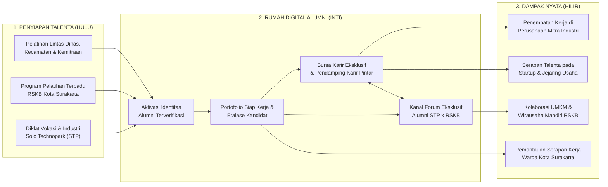
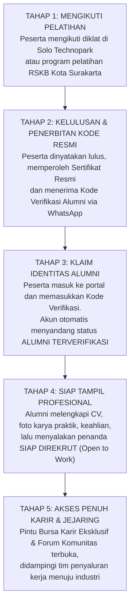
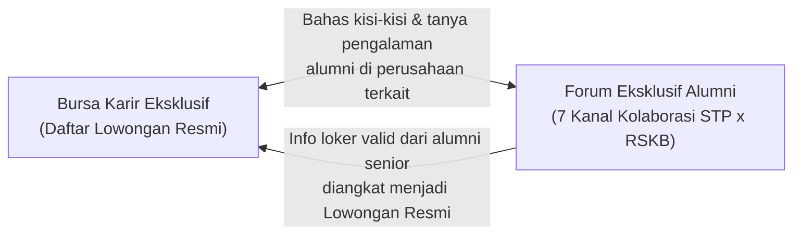

# 🌟 EKOSISTEM ALUMNI SIAP KERJA: INTEGRASI PELATIHAN, BURSA KARIR EKSKLUSIF & FORUM KOLABORASI
### Sinergi Solo Technopark (STP) × Rumah Siap Kerja Bersama (RSKB) Kota Surakarta

> *"Pelatihan yang tuntas bukan berhenti saat sertifikat dibagikan, melainkan saat lulusannya benar-benar terserap bekerja, berdaya secara ekonomi, dan kembali membantu adik angkatannya."*

---

## 📋 RINGKASAN EKSEKUTIF

1. **Satu Rumah Besar Talenta Kota Surakarta:** Mengintegrasikan seluruh lulusan pelatihan **Solo Technopark (STP)** dan lulusan program **Rumah Siap Kerja Bersama (RSKB) Pemerintah Kota Surakarta** ke dalam satu ekosistem digital berkelanjutan yang mendampingi alumni hingga mendapatkan pekerjaan atau mandiri berusaha.
2. **Alur Sederhana dari Ruang Kelas ke Dunia Industri:** Setiap lulusan pelatihan memperoleh **Kode Kehormatan Alumni** untuk mengaktifkan profil profesionalnya, menyalakan status *"Siap Direkrut"*, dan langsung terhubung dengan perusahaan mitra.
3. **Korelasi Cerdas Pelatihan dengan Lowongan Kerja:** Lowongan yang masuk ke **Bursa Karir** dicocokkan langsung dengan kejuruan pelatihan yang pernah diikuti peserta, dilengkapi **Asisten Pintar (AI)** yang membantu alumni mengukur kesiapan diri sebelum melamar.
4. **Nilai Tambah Eksklusivitas Bursa Karir:** Menu Bursa Karir dikhususkan bagi **Alumni Terverifikasi** sebagai bentuk jaminan mutu (*cap kualitas*) bagi HRD perusahaan mitra, perlindungan kuota jalur khusus binaan daerah, sekaligus daya tarik utama agar warga antusias mengikuti pelatihan resmi STP & RSKB.
5. **Ruang Kolaborasi Masa Depan (Forum Eksklusif 7 Kanal):** Pengembangan kanal komunitas tertutup khusus alumni STP & RSKB untuk saling berbagi info lowongan internal (*rekomendasi antar-alumni*), bedah CV bersama mentor, konsultasi kendala kerja, hingga kolaborasi usaha UMKM binaan.

---

## 1. GAGASAN BESAR: MENJAWAB TANTANGAN PASCA-PELATIHAN

Selama ini, banyak program pelatihan keterampilan berjalan sangat baik di ruang kelas, namun menghadapi tiga tantangan klasik setelah penutupan pelatihan:
* **Jejak Lulusan Terputus:** Setelah pelatihan selesai, data peserta tersebar dan komunikasi hanya mengandalkan grup pesan singkat yang lama-kelamaan sepi atau tenggelam.
* **Lulusan Berjalan Sendiri Mencari Kerja:** Peserta yang baru lulus sering bingung mencari lowongan yang benar-benar menghargai sertifikat pelatihannya dan harus bersaing bebas tanpa jalur pendampingan.
* **Sulit Memantau Serapan Kerja Secara Nyata:** Pimpinan daerah dan penyelenggara pelatihan membutuhkan gambaran utuh mengenai berapa banyak lulusan yang sudah bekerja di industri, merintis usaha mandiri, atau masih membutuhkan penyaluran.

### Solusi Terpadu: Ekosistem Hulu-ke-Hilir STP × RSKB Kota Surakarta
Melalui sistem terintegrasi ini, Solo Technopark dan program RSKB Kota Surakarta menyatukan langkah dari **penyiapan kompetensi (Hulu)**, **pendampingan & komunitas (Inti)**, hingga **penyerapan tenaga kerja & wirausaha (Hilir)**:

---

## 2. MEKANISME & ALUR PERJALANAN ALUMNI PELATIHAN

Alur sistem dirancang **sangat praktis dan ramah bagi semua kalangan peserta**—baik peserta yang mendaftar mandiri secara online maupun warga yang mengikuti pelatihan tatap muka RSKB melalui kelurahan, kecamatan, atau dinas terkait.

### Diagram Alur 5 Langkah Perjalanan Alumni

### Penjelasan Mekanisme di Setiap Tahap

1. **Pendaftaran yang Luwes (Mendukung Semua Jalur Program):**
   * **Jalur Mandiri:** Masyarakat mendaftar langsung melalui katalog program pelatihan di portal.
   * **Jalur Kolektif RSKB & Kemitraan:** Untuk pelatihan warga yang diselenggarakan oleh RSKB, kelurahan/kecamatan, dinas, sekolah vokasi, atau CSR perusahaan, panitia cukup memasukkan daftar peserta secara kolektif menggunakan lembar Excel standar—tanpa membebani peserta dengan proses administrasi rumit di awal.
2. **Kelulusan & Pembagian "Kunci Akses Alumni":**
   * Bagi kelas reguler, begitu instruktur dan pengelola menyatakan satu angkatan lulus (*Yudisium*), sistem langsung menerbitkan nomor sertifikat beserta **Kode Verifikasi Unik Alumni**.
   * Bagi program pelatihan RSKB yang berlangsung langsung di lapangan/balai warga, daftar lulusan dapat langsung dimasukkan secara massal dan otomatis mendapatkan Kode Verifikasi yang sama tanpa ada data ganda.
   * Petugas dapat mengirimkan undangan resmi beserta kode tersebut langsung ke **WhatsApp masing-masing lulusan hanya dengan satu klik**.
3. **Klaim Akun Sekali Seumur Hidup:**
   * Lulusan cukup masuk ke halaman profilnya dan mengetikkan Kode Verifikasi tersebut.
   * Seketika itu juga, sistem mengenali riwayat pelatihannya, menyematkan **Lencana Resmi Alumni** (*Alumni STP* atau *Alumni RSKB Surakarta*), dan membuka seluruh menu khusus alumni.
4. **Etalase Portofolio Digital & Status Kesiapan Kerja:**
   * Alumni tidak lagi sekadar memegang selembar kertas sertifikat, melainkan memiliki **Halaman Portofolio Profesional** yang memuat keahlian teknis, foto proyek/hasil karya praktik, dan dokumen CV siap unduh.
   * Tersedia tombol saklar **"Siap Direkrut (Open to Work)"** agar tim penyaluran karir tahu siapa saja alumni yang sedang aktif membutuhkan pekerjaan saat ini.
5. **Pendampingan Berkelanjutan (Pemantauan Status Karir):**
   * Perjalanan alumni tercatat dengan jelas mulai dari status **Siap Kerja** → **Dalam Proses Wawancara** → **Sudah Bekerja di Industri** atau **Wirausaha Mandiri**, sehingga pendampingan menjadi tepat sasaran.

---

## 3. BENEFIT ALUMNI & KORELASI DENGAN BURSA KARIR

Kekuatan utama ekosistem ini terletak pada **hubungan timbal balik yang erat antara ruang pelatihan dan pasar kerja**. Pelatihan tidak berjalan sendiri, dan Bursa Karir pun bukan sekadar papan tempel lowongan biasa.

### 3.1 Empat Jembatan Penghubung Pelatihan dengan Bursa Karir

| Mekanisme Penghubung | Cara Kerja yang Dirasakan Pengguna | Dampak Nyata bagi Penyerapan Kerja |
| :--- | :--- | :--- |
| **1. Pencocokan Lowongan Sesuai Kejuruan** | Setiap lowongan kerja dikaitkan langsung dengan bidang pelatihan yang relevan. Lulusan *Pengelasan/Mesin* otomatis melihat lowongan manufaktur di urutan utama; lulusan *Pemasaran Digital/IT* langsung bertemu lowongan kreatif & teknologi. | Alumni tidak membuang waktu memilah ratusan lowongan acak yang tidak sesuai keahliannya. |
| **2. Asisten Kecocokan Karir Pintar (AI)** | Pada setiap lowongan, alumni dapat menekan tombol **Cek Kecocokan Profil**. Sistem memberikan gambaran persentase kecocokan, nilai lebih pelatihan yang dimiliki, keahlian tambahan yang perlu disiapkan, serta tips menghadapi wawancara. | Meningkatkan rasa percaya diri dan kesiapan lulusan baru sebelum berhadapan dengan HRD perusahaan. |
| **3. Sistem "Jemput Bola" Kandidat (*Talent Pool*)** | Perusahaan mitra sering kali membutuhkan tenaga kerja cepat tanpa membuka iklan lowongan umum. Tim pengelola STP & RSKB cukup memfilter daftar alumni berstatus *"Siap Direkrut"* sesuai keahlian yang diminta, lalu mengirimkan kandidat terpilih ke HRD perusahaan. | Mempercepat proses penempatan kerja langsung dari basis data lulusan terbaik. |
| **4. Umpan Balik Kebutuhan Industri** | Sistem merangkum jenis keahlian dan posisi apa yang paling banyak dicari perusahaan setiap bulannya ke dalam laporan ringkas siap cetak. | Menjadi kompas akurat bagi pimpinan STP & RSKB agar jenis pelatihan yang dibuka selalu sesuai kebutuhan pasar kerja terkini. |

---

### 3.2 Delapan Keuntungan Nyata Menjadi Alumni Terverifikasi

1. ✅ **Akses Pintu Khusus Bursa Karir Mitra:** Membuka lowongan kerja terkurasi dari jejaring perusahaan mitra Solo Technopark, tenant bisnis, BUMN, dan mitra industri Kota Surakarta.
2. ✅ **Rekomendasi Kerja yang Tepat Sasaran:** Lowongan otomatis disesuaikan dengan riwayat pelatihan yang pernah ditempuh.
3. ✅ **Bimbingan Persiapan Melamar Berbasis AI:** Mendapat panduan instan mengenai kekuatan diri dan persiapan wawancara untuk setiap posisi yang dilamar.
4. ✅ **Portofolio Digital Berstempel Resmi:** Memiliki profil keahlian dan galeri karya yang meningkatkan kepercayaan perusahaan terhadap kemampuan praktik lulusan.
5. ✅ **Diprioritaskan dalam Rekrutmen Tertutup:** Masuk ke dalam radar pencarian kandidat utama saat mitra industri meminta rekomendasi tenaga kerja siap pakai kepada STP maupun RSKB.
6. ✅ **Tergabung dalam Forum Eksklusif Alumni STP × RSKB:** Memiliki keluarga besar lintas angkatan untuk bertukar info loker dalam perusahaan, berdiskusi teknis, dan memperluas relasi.
7. ✅ **Peluang Kolaborasi Proyek & Usaha Mandiri:** Terbuka kesempatan mengerjakan proyek bersama maupun mengembangkan produk UMKM binaan lintas bidang keahlian.
8. ✅ **Prioritas Informasi Sertifikasi Lanjutan & Beasiswa:** Mendapatkan kabar lebih awal saat dibuka kuota uji kompetensi profesi (BNSP) maupun pelatihan peningkatan level berikutnya.

---

### 3.3 Manfaat Strategis bagi Empat Pemangku Kepentingan

* **👨‍🎓 Bagi Warga & Peserta Pelatihan:** Mendapatkan kepastian pendampingan pasca-lulus, jalur kerja yang aman dari lowongan fiktif, dan komunitas yang saling mendukung.
* **🏭 Bagi Perusahaan & Dunia Industri:** Menghemat waktu dan biaya rekrutmen karena langsung mendapatkan kandidat yang sudah teruji keterampilan praktiknya dan dibina etos kerjanya oleh STP & RSKB.
* **🏛️ Bagi Pemerintah Kota Surakarta & RSKB:** Memiliki instrumen nyata yang terukur untuk menekan angka pengangguran terbuka, menyatukan data talenta lintas wilayah/OPD, dan memantau keberhasilan program secara transparan.
* **🏢 Bagi Solo Technopark:** Memperkuat posisi sebagai pusat keunggulan vokasi dan inovasi daerah yang menyambungkan pendidikan keterampilan langsung ke kebutuhan industri nyata.

---

## 4. ANALISIS STRATEGIS: MENGAPA MENU BURSA KARIR DIBUAT EKSKLUSIF?

Salah satu poin kebijakan terpenting dalam sistem ini adalah menjadikan menu **Bursa Karir bersifat eksklusif khusus bagi Alumni Terverifikasi** (tidak dibuka bebas layaknya portal lowongan kerja umum di internet).

Berikut adalah **5 alasan strategis** mengapa kebijakan eksklusif ini justru menciptakan nilai tambah yang jauh lebih besar:

### 1. Menjaga Kepercayaan HRD Perusahaan Mitra (*Jaminan Mutu Kandidat*)
Jika Bursa Karir dibuka bebas untuk siapa saja di luar binaan, perusahaan mitra akan kembali kebanjiran ribuan pelamar acak yang belum tentu menguasai keterampilan dasar. Dengan menjadikannya eksklusif, perusahaan mitra memiliki kepastian: **"Setiap pelamar yang masuk dari pintu ini adalah lulusan resmi binaan Solo Technopark atau RSKB Kota Surakarta."** Kepercayaan inilah yang membuat perusahaan bersedia memberikan kuota jalur khusus secara berkelanjutan.

### 2. Melindungi Kuota "Jalur Khusus" untuk Warga & Lulusan Binaan
Banyak lowongan yang hadir berkat kerja sama resmi (MoU) antara Pemerintah Kota Surakarta / Solo Technopark dengan dunia industri. Pembatasan akses memastikan bahwa buah dari kerja sama tersebut benar-benar dinikmati lebih dulu oleh warga dan peserta yang telah bersungguh-sungguh menyelesaikan pelatihan.

### 3. Menciptakan Kebanggaan & Daya Tarik Mengikuti Pelatihan
Eksklusivitas melahirkan rasa bangga (*sense of belonging*). Bagi masyarakat umum yang mengunjungi portal dan melihat tampilan **Gerbang Eksklusif Alumni**, pesan yang tersampaikan sangat positif: *"Ikuti dan selesaikan program pelatihan di Solo Technopark atau RSKB Surakarta, maka Anda tidak hanya mendapat ilmu, tetapi juga kunci masuk ke jaringan karir industri."* Hal ini otomatis mendorong minat pendaftaran pelatihan.

### 4. Kemurnian Data Pemantauan Serapan Kerja (*Tracer Study*)
Karena seluruh pengguna di dalam Bursa Karir adalah alumni resmi yang jelas asal program dan angkatannya, setiap aktivitas pencarian kerja dan penempatan industri menghasilkan laporan capaian kinerja yang akurat, bersih, dan dapat dipertanggungjawabkan untuk evaluasi pimpinan.

### 5. Ruang yang Aman, Terkurasi & Fokus pada Pendampingan
Sumber daya pendampingan karir dan fitur asisten pintar dapat difokuskan 100% untuk melayani kebutuhan alumni binaan tanpa terganggu lalu lintas pengguna anonim maupun spam.

> **Bagaimana Jika Masyarakat Umum Membuka Halaman Bursa Karir?**  
> Sistem tetap menyambut dengan tampilan yang ramah dan informatif: menjelaskan keunggulan jaringan karir alumni, lalu menyediakan tombol langsung untuk **Melihat Jadwal Pelatihan Terdekat** (bagi calon peserta baru) atau **Memasukkan Kode Alumni** (bagi lulusan yang belum mengaktifkan akunnya).

---

## 5. PENGEMBANGAN MASA DEPAN: KANAL FORUM EKSKLUSIF ALUMNI STP × RSKB

Untuk menyempurnakan ekosistem ini sebagai **wadah hidup bagi seluruh alumni Solo Technopark dan RSKB Kota Surakarta**, ke depan disiapkan **Forum Komunitas Eksklusif Alumni** di dalam platform.

### 5.1 Mengapa Perlu Kanal Forum Khusus (Tidak Cukup Hanya Grup WhatsApp)?

| Keterbatasan Grup Chat Biasa (WA/Telegram) | Keunggulan Kanal Forum Eksklusif STP × RSKB |
| :--- | :--- |
| Terkotak-kotak per kelas/angkatan; alumni RSKB satu kelurahan tidak terhubung dengan alumni kejuruan STP lainnya. | **Menyatukan seluruh angkatan dan lintas program** (STP & RSKB) dalam satu ruang kolaborasi besar Kota Surakarta. |
| Informasi lowongan penting dan tips kerja hilang tertumpuk ratusan pesan obrolan harian. | **Tersusun rapi per topik kanal & bidang keahlian**, mudah dicari kembali kapan saja oleh alumni baru maupun lama. |
| Sulit mengenali latar belakang pengirim pesan dan rawan tercampur info lowongan yang meragukan. | **Setiap anggota memiliki Lencana Identitas Resmi** (*Asal Program STP/RSKB & Angkatan*) sehingga diskusi jauh lebih aman, sopan, dan terpercaya. |
| Terpisah dari daftar lowongan resmi dan portofolio CV alumni. | **Terhubung langsung dengan Bursa Karir & Profil Talenta**—melihat info loker di forum bisa langsung melamar atau melihat portofolio rekan kolaborasi. |

---

### 5.2 Tujuh Kanal Utama Forum Eksklusif Alumni & Deskripsi Lengkapnya

Forum dirancang ke dalam **7 ruang tematik yang jelas fungsinya**, sehingga setiap alumni langsung tahu ke mana harus mencari informasi atau berbagi peluang:

---

#### 📢 1. Kanal Papan Pengumuman Resmi STP & RSKB
* **Fungsi Utama:** Pusat informasi prioritas satu pintu dari pengelola Solo Technopark dan Sekretariat RSKB Kota Surakarta.
* **Gambaran Aktivitas di Dalamnya:**
  * Pengumuman panggilan tes/wawancara langsung (*walk-in interview*) khusus alumni di kawasan STP atau lokasi mitra.
  * Undangan *Job Fair* terbatas, kunjungan industri, serta program penempatan kerja pemerintah daerah.
  * Alumni dapat langsung menyatakan kesiapan hadir dan menanyakan kelengkapan berkas pada kolom tanya-jawab resmi di bawah pengumuman.

---

#### 💼 2. Kanal Info Loker & Rekomendasi Antar-Alumni (*"Bantu Adik Angkatan"*)
* **Fungsi Utama:** Menghidupkan budaya gotong royong antar-alumni yang sudah bekerja untuk membuka jalan bagi rekan/adik angkatannya.
* **Gambaran Aktivitas di Dalamnya:**
  * Di dunia kerja nyata, banyak perusahaan menanyakan rekomendasi karyawan internal terlebih dahulu sebelum memasang iklan lowongan keluar.
  * Alumni STP atau RSKB yang sudah bekerja di pabrik, perusahaan teknologi, perhotelan, garmen, kuliner, atau usaha jasa dapat membagikan info lowongan di tempat kerjanya langsung ke kanal ini.
  * Karena berasal dari satu almamater pelatihan yang sama, alumni senior lebih yakin memberikan rekomendasi (*referral*), sementara pencari kerja mendapat informasi valid dari orang dalam yang tepercaya.

---

#### 📄 3. Kanal Klinik CV, Portofolio & Persiapan Wawancara
* **Fungsi Utama:** Ruang pembekalan praktis agar lulusan tidak gagal di tahap seleksi berkas maupun wawancara kerja.
* **Gambaran Aktivitas di Dalamnya:**
  * Banyak lulusan yang sangat terampil bekerja praktik, namun masih kaku saat menyusun CV atau menjawab pertanyaan HRD.
  * Di kanal ini, alumni bebas berkonsultasi mengenai tampilan CV, cara mempresentasikan hasil karya pelatihan, berbagi kisi-kisi psikotes/tes praktik di berbagai perusahaan, hingga berdiskusi mengenai etika kerja dan pemahaman kontrak kerja bagi pemula—didampingi oleh konselor karir RSKB, instruktur STP, dan alumni berpengalaman.

---

#### 🛠️ 4. Kanal Ruang Diskusi Kejuruan & Solusi Kerja Lapangan
* **Fungsi Utama:** Tempat bertanya dan memecahkan kendala teknis pekerjaan sehari-hari sesuai bidang keahlian masing-masing.
* **Gambaran Aktivitas di Dalamnya:**
  * Saat alumni baru mulai bekerja di industri atau menerima pesanan pelanggan, sering muncul tantangan teknis baru di lapangan.
  * Kanal ini dikelompokkan rapi berdasarkan rumpun keahlian—seperti **Manufaktur & Pengelasan**, **Teknologi Informasi & Digital**, **Desain & Kreatif**, **Otomasi & Teknik**, serta **Kuliner, Kriya & Jasa RSKB**.
  * Alumni dapat berdiskusi langsung dengan sesama praktisi maupun instruktur pembimbingnya dulu, menjadikan forum ini perpustakaan solusi kerja yang terus tumbuh.

---

#### 🚀 5. Kanal Kolaborasi Wirausaha RSKB & Proyek Bersama
* **Fungsi Utama:** Mempertemukan alumni lintas keahlian untuk mengembangkan usaha mandiri, UMKM binaan RSKB, maupun pengerjaan proyek bersama.
* **Gambaran Aktivitas di Dalamnya:**
  * Menjawab tujuan besar RSKB Kota Surakarta yang tidak hanya mencetak pencari kerja, tetapi juga **pencipta lapangan kerja mandiri**.
  * Menciptakan sinergi lintas bidang yang nyata: misalnya **alumni pelatihan kuliner/kerajinan RSKB** yang membutuhkan desain kemasan menarik dan pemasaran toko online dapat langsung menggandeng **alumni desain grafis & pemasaran digital STP**.
  * Alumni teknik/jasa yang mendapatkan pesanan proyek besar juga dapat mengajak rekan alumni lainnya untuk mengerjakan proyek secara tim.

---

#### 🎓 6. Kanal Info Sertifikasi Profesi & Peningkatan Keahlian (*Upskilling*)
* **Fungsi Utama:** Jembatan pengembangan karir jangka panjang agar alumni terus naik kelas.
* **Gambaran Aktivitas di Dalamnya:**
  * Berisi jadwal uji sertifikasi kompetensi resmi (BNSP), pembukaan kelas tingkat lanjut (*mahir*), seminar industri, hingga informasi kuota beasiswa pelatihan tambahan bagi alumni yang ingin meningkatkan posisi dan kesejahteraannya di tempat kerja.

---

#### 🌟 7. Kanal Jejak Sukses & Jejaring Alumni Antar-Kota
* **Fungsi Utama:** Ruang apresiasi, motivasi nyata, dan persaudaraan alumni di berbagai daerah penempatan kerja.
* **Gambaran Aktivitas di Dalamnya:**
  * Alumni yang baru diterima bekerja di perusahaan mitra atau berhasil membesarkan usahanya dapat membagikan cerita singkat perjalanannya untuk memotivasi rekan-rekan angkatan lain.
  * Menjadi simpul persaudaraan perantauan: alumni STP & RSKB yang bekerja di kawasan industri luar daerah (seperti Cikarang, Karawang, Semarang, Batam, hingga program magang luar negeri) dapat saling terhubung untuk berbagi info tempat tinggal yang aman, adaptasi kerja, dan saling menjaga di tanah rantau.

---

### 5.3 Sistem Lencana Identitas Kebanggaan (*Verified Alumni Badge*)
Agar interaksi di dalam forum terasa hangat, tertib, dan membanggakan, setiap anggota otomatis menampilkan tanda pengenal resmi saat berdiskusi:
* 🟦 **Lencana Alumni Vokasi STP** — Menandakan lulusan program diklat Solo Technopark beserta kejuruan & angkatannya.
* 🟩 **Lencana Alumni RSKB Surakarta** — Menandakan lulusan program Rumah Siap Kerja Bersama / pelatihan Pemerintah Kota Surakarta beserta bidang & wilayahnya.
* 🟪 **Lencana Instruktur & Pembina** — Penanda resmi pengajar vokasi dan konselor pendamping RSKB.
* 🟨 **Lencana Tim Penyaluran Karir** — Pengelola resmi yang memverifikasi lowongan dan menjaga kenyamanan ruang diskusi.

---

### 5.4 Sinergi Dua Arah antara Forum Komunitas & Bursa Karir

* Lowongan yang tampil di **Bursa Karir** dapat langsung didiskusikan di dalam **Forum** agar pelamar mendapat gambaran suasana kerja dari rekan yang mengenal perusahaan tersebut.
* Sebaliknya, info lowongan valid yang dibagikan oleh alumni senior di **Forum** dapat diangkat oleh pengelola menjadi daftar resmi di **Bursa Karir**, sehingga jangkauan manfaatnya semakin luas dan tetap terpantau dalam laporan penyaluran kerja.

---

## 6. TAHAPAN PENGEMBANGAN & HARAPAN DAMPAK BAGI KOTA SURAKARTA

Untuk memastikan ekosistem ini berjalan matang dan berkelanjutan, pengembangan dilaksanakan dalam **4 tahapan terstruktur**:

| Tahapan | Fokus Pengembangan | Hasil yang Dirasakan |
| :--- | :--- | :--- |
| **Tahap 1: Penguatan Gerbang & Kenyamanan Klaim Alumni** | Penyempurnaan alur aktivasi Kode Alumni dan penguatan gerbang eksklusif Bursa Karir. | Lulusan dapat mengaktifkan akun dalam hitungan detik dan langsung menikmati layanan Bursa Karir & Asisten Pintar tanpa kendala. |
| **Tahap 2: Penyatuan Basis Data Alumni STP × RSKB** | Penambahan identitas khusus program RSKB Kota Surakarta (lintas dinas & kewilayahan) serta pencatatan riwayat lamaran kerja terpadu. | Seluruh lulusan pelatihan STP maupun RSKB terhimpun rapi dalam satu rumah besar dengan lencana asal program masing-masing. |
| **Tahap 3: Peluncuran Kanal Forum Eksklusif 7 Ruang** | Pembukaan ruang diskusi tertutup khusus alumni lengkap dengan fitur berbagi loker antar-alumni, klinik CV, dan kolaborasi usaha RSKB. | Terbentuknya komunitas talenta Kota Surakarta yang hidup, aktif saling membantu informasi kerja, dan produktif berkolaborasi. |
| **Tahap 4: Dashboard Pemantauan Serapan Kerja Pimpinan** | Penyajian ringkasan eksekutif perkembangan karir dan usaha mandiri alumni per bidang keahlian dan wilayah. | Pimpinan Solo Technopark, RSKB, dan Pemerintah Kota Surakarta memiliki potret keberhasilan penyerapan kerja yang akurat setiap waktu. |

---

### Penutup: Membangun Ekosistem yang Menghidupi
Dengan menyatukan **Pelatihan Berkualitas**, **Bursa Karir Eksklusif**, dan **Forum Kolaborasi Alumni STP × RSKB**, Pemerintah Kota Surakarta bersama Solo Technopark tidak sekadar menyelenggarakan kegiatan pelatihan, melainkan membangun **mesin mobilitas ekonomi warga yang berkelanjutan**—di mana setiap lulusan didampingi saat mencari kerja, dihubungkan dengan industri yang tepat, dan ketika sukses, kembali merangkul generasi lulusan berikutnya.

