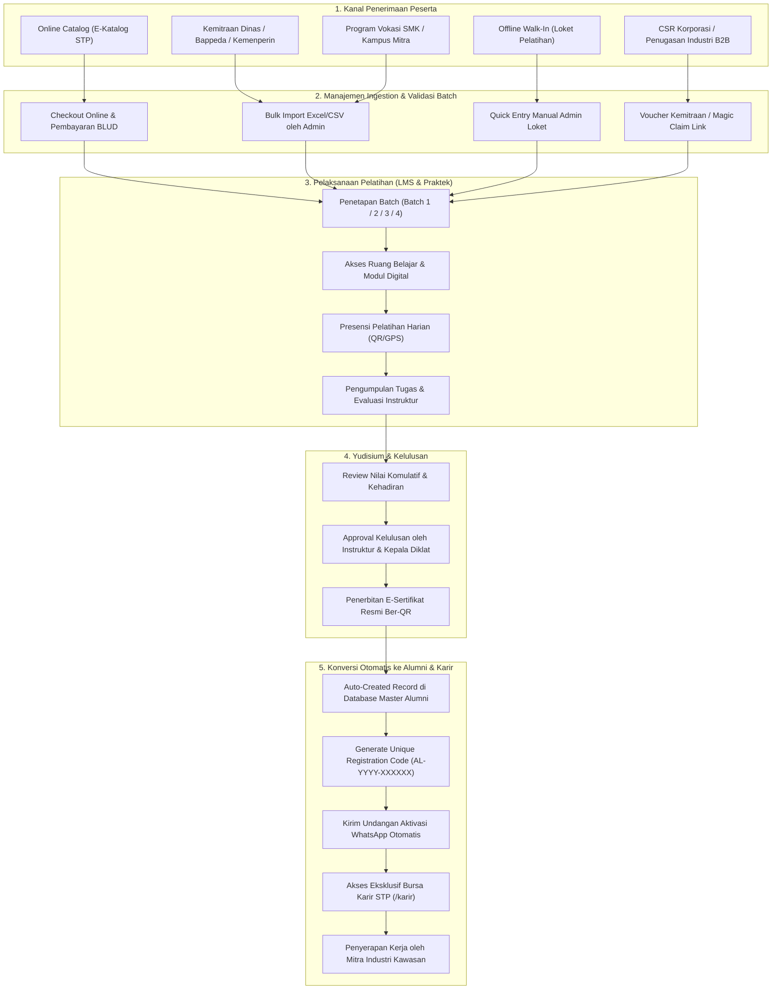

# 🗺️ Roadmap & Blueprint Arsitektur — Sistem Pelatihan & LMS Solo Technopark
## Manajemen 4 Batch Tahunan, Jalur Peserta Offline/Kemitraan, & Konversi Otomatis Alumni

> **Status:** Dokumen Strategis Resmi & Panduan Implementasi Teknis  
> **Target Rilis:** Q4 2026 – Q2 2027  
> **Konteks Operasional:** UPTD Kawasan Sains dan Teknologi (KST) Solo Technopark (STP)  
> **Fokus Utama:** Tata Kelola 4 Batch Reguler, Ingestion Peserta Offline/Dinas, LMS, & Penyaluran Karir Alumni  

---

## 📋 Ringkasan Eksekutif

1. **Dual-Channel Pendaftaran**: Mengintegrasikan kanal pendaftaran **Inbound** (pembelian mandiri via E-Katalog) dan **Outbound/Offline** (delegasi instansi dinas, vokasi/SMK, CSR korporasi, serta pendaftaran walk-in).
2. **Struktur 4 Batch Kuartalan**: Menstandarisasi siklus pelatihan menjadi **Batch 1 (Q1), Batch 2 (Q2), Batch 3 (Q3), dan Batch 4 (Q4)** di dalam satu master program pelatihan tanpa perlu membuat program baru berulang-ulang.
3. **Mekanisme Ingestion Peserta Offline yang Efisien**: Menyediakan 3 metode input peserta offline: *Bulk Import Excel/CSV dengan Template Cerdas*, *Formulir Registrasi Cepat Loket Walk-In*, dan *Magic Claim Link via WhatsApp/Email*.
4. **Siklus Hidup Terpadu (End-to-End Lifecycle)**: Calon Peserta &rarr; Seleksi/Verifikasi &rarr; Peserta Aktif Batch (LMS, Presensi, Tugas) &rarr; Evaluasi Nilai/Yudisium &rarr; Penerbitan Sertifikat &rarr; **Konversi Otomatis ke Master Alumni STP**.
5. **Jembatan Talenta Industri**: Mengintegrasikan alumni yang lulus langsung ke **Bursa Karir STP (`/karir`)** dan **Talent Pool Mitra Industri**, membuka peluang kerja nyata bagi lulusan diklat Solo Technopark.

---

## 🔍 I. Audit Arsitektur Saat Ini (Kondisi AS-IS)

### 1.1 Kondisi Existing di Codebase

| Komponen | Status Saat Ini | Batasan / Masalah yang Ditemukan |
| :--- | :--- | :--- |
| **Model Program (`Training`)** | File: `src/types/learning.types.ts` | Menggunakan field jadwal flat (`date`, `endDate`). Tidak memiliki entitas relasional **Batch** per tahun. Mengulang pelatihan di kuartal berikutnya mengharuskan admin menduplikasi seluruh data modul. |
| **Pendaftaran Peserta** | Subkoleksi `trainings/{id}/registrations` | Terdesentralisasi per program pelatihan. Hanya dirancang untuk pendaftaran online mandiri via form web `/program-pelatihan/[id]/daftar`. |
| **Peserta Offline** | Belum Ada Fitur Khusus di LMS | Peserta offline (titipan dinas/sekolah/CSR) tidak memiliki pintu masuk ke LMS kecuali admin membuatkan akun manual satu per satu atau peserta disuruh checkout web. |
| **Evaluasi & Penilaian** | Halaman `/pelatihan/[id]/peserta` | Sudah mendukung penilaian tugas dan verifikasi berkas, tetapi belum ada tombol kelulusan resmi (Yudisium) dan generate sertifikat digital. |
| **Database Alumni** | Koleksi `alumnis` terpisah | Fitur import Excel sudah ada di `AlumniTab.tsx`, tetapi **terputus (disconnected)** dari data kelas pelatihan LMS. Admin terpaksa menginput dua kali: satu kali saat pelatihan, satu kali saat jadi alumni. |

---

## 🎯 II. Desain Mekanisme Operasional: 4 Batch & Peserta Offline (Kondisi TO-BE)

### 2.1 Kalender 4 Batch Tahunan (Quarterly Cycle)

Solo Technopark menyelenggarakan program pelatihan vokasi dan teknologi dalam **4 Batch per Tahun Kalender**:

```
TAHUN ANGGARAN BERJALAN
┌─────────────────┬─────────────────┬─────────────────┬─────────────────┐
│     BATCH 1     │     BATCH 2     │     BATCH 3     │     BATCH 4     │
│  (Kuartal I)    │  (Kuartal II)   │  (Kuartal III)  │  (Kuartal IV)   │
│  Januari–Maret  │   April–Juni    │ Juli–September  │ Oktober–Desember│
├─────────────────┼─────────────────┼─────────────────┼─────────────────┤
│ • Pendaftaran:  │ • Pendaftaran:  │ • Pendaftaran:  │ • Pendaftaran:  │
│   Des – Awal Jan│   Mar – Awal Apr│   Jun – Awal Jul│   Sep – Awal Okt│
│ • Pelaksanaan:  │ • Pelaksanaan:  │ • Pelaksanaan:  │ • Pelaksanaan:  │
│   Januari–Maret │   April–Juni    │ Juli–September  │ Oktober–Desember│
│ • Yudisium:     │ • Yudisium:     │ • Yudisium:     │ • Yudisium:     │
│   Akhir Maret   │   Akhir Juni    │   Akhir Sept    │   Akhir Des     │
└─────────────────┴─────────────────┴─────────────────┴─────────────────┘
```

Setiap program pelatihan (misal: *Pengelasan Bawah Air / Underwater Welding*, *Mekatronika CNC*, *Cyber Security Operations*, *Fullstack Web Development*) dapat membuka salah satu atau seluruh 4 Batch ini dalam setahun.

---

### 2.2 Arsitektur Siklus Hidup Peserta (The Complete Participant Lifecycle)



---

## 🛠️ III. Mekanisme Detail Penanganan Peserta Offline (Luar Aplikasi)

Untuk peserta yang mendaftar di luar katalog online, disediakan **3 Mekanisme Masuk (Ingestion Channels)**:

### 1. Jalur A: Bulk Import Excel/CSV per Batch (Direkomendasikan untuk Rombongan/Dinas)
* **Konteks Penggunaan**: Ketika menerima 20–100 data peserta dari dinas tenaga kerja, sekolah mitra SMK, atau rombongan CSR industri dalam bentuk spreadsheet.
* **Fitur di Sistem**:
  - Tombol **"Import Data Peserta Batch"** pada panel Evaluasi & Peserta kelas.
  - Template Excel standar Solo Technopark (`template-import-peserta-diklat.xlsx`).
  - **Auto-Account Provisioning**: Sistem secara otomatis mengecek apakah email peserta sudah terdaftar di Firebase Auth. Jika belum, akun draft peserta dibuatkan, atau peserta dikirimi tautan aktivasi satu kali klik.
* **Kolom Template Excel Standar**:
  1. `nama_lengkap` (Wajib)
  2. `nik` (Wajib, 16 digit untuk verifikasi sertifikasi negara)
  3. `email` (Wajib, sebagai identitas login LMS)
  4. `nomor_whatsapp` (Wajib, diawali 08/62 untuk broadcast notifikasi kelas)
  5. `asal_instansi` (Nama sekolah/dinas/perusahaan/umum)
  6. `jalur_pendanaan` (Mandiri / Beasiswa Dinas / CSR / Subsidi BLUD)
  7. `nomor_surat_tugas` (Opsional, referensi administrasi dinas)

### 2. Jalur B: Pendaftaran Manual Loket STP (Walk-in Quick Entry)
* **Konteks Penggunaan**: Calon peserta datang langsung ke Customer Service / Loket Diklat Solo Technopark membawa berkas fisik (KTP, Ijazah, Formulir Kertas).
* **Fitur di Sistem**:
  - Modal Form: **"+ Tambah Peserta Offline"** di panel admin kelas pelatihan.
  - Admin menginput data pokok (Nama, NIK, Email/No WA, Asal, Jalur Pendanaan).
  - Status pendaftaran langsung di-set **`CONFIRMED`** (tanpa melewati gerbang checkout pembayaran online jika pembayaran tunai/invoice terpisah telah divalidasi oleh kasir).

### 3. Jalur C: Voucher Kemitraan & Magic Claim Link (Self-Onboarding)
* **Konteks Penggunaan**: Kerjasama dengan institusi mitra di mana pihak mitra membagikan kuota ke staf/siswanya, namun pengisian biodata detail tetap dilakukan sendiri oleh masing-masing siswa.
* **Fitur di Sistem**:
  - Admin membuat **Kode Voucher Batch / Kupon Kemitraan** (contoh: `STP-B1-DISNAKER2026`).
  - Kupon memiliki kuota (misal: 30 kursi) dan memotong harga kelas menjadi Rp 0 (100% subsidi).
  - Peserta membuka link khusus `katalog.solotechnopark.id/program-pelatihan/[id]/daftar?voucher=STP-B1-DISNAKER2026`. Form otomatis terkonfirmasi tanpa tagihan berbayar.

---

## 🎓 IV. Mekanisme Yudisium & Konversi Otomatis ke Master Alumni

Salah satu temuan audit terbesar adalah **ketiadaan jembatan data** antara peserta pelatihan yang telah selesai dengan database master alumni di `alumnis`.

### 4.1 Logika Konversi Otomatis (1-Click Graduation)
Di halaman manajemen peserta pelatihan (`/pelatihan/[id]/peserta`), ditambahkan aksi:
**"🎓 Proses Yudisium & Terbitkan Alumni Batch"**

Saat tombol ini dieksekusi untuk peserta yang telah memenuhi kriteria (Kehadiran &ge; 80% dan Tugas tuntas):
1. **Pembaruan Status Registrasi**:
   - Status registrasi diubah dari `CONFIRMED` &rarr; `GRADUATED`.
2. **Pencatatan Dokumen ke Koleksi `alumnis`**:
   - Dibuatkan dokumen baru di koleksi `alumnis` dengan pemetaan:
     ```typescript
     {
       name: participant.name,
       email: participant.email,
       phone: participant.phone,
       nik: participant.customData?.nik,
       programTaken: training.title,
       batch: `Batch ${batchNumber} (${trainingYear})`,
       trainingYear: String(trainingYear),
       graduationYear: String(new Date().getFullYear()),
       courseStartDate: batch.startDate,
       courseEndDate: batch.endDate,
       certificationResult: 'Kompeten / Lulus',
       certificateNumber: `STP-CERT/${trainingYear}/${training.category}/${serialNumber}`,
       certificateUrl: generatedCertificatePdfUrl,
       status: participant.userId ? 'CLAIMED' : 'DORMANT',
       claimedByUserId: participant.userId || null,
       registrationCode: `AL-${trainingYear}-${randomCode}`,
       employmentStatus: 'Proses Verifikasi',
       internalStatus: 'AVAILABLE',
       createdAt: Date.now()
     }
     ```
3. **Penyampaian Notifikasi WhatsApp Otomatis (Via Z-API / WhatsApp Gateway)**:
   - Peserta menerima pesan resmi kelulusan berisi:
     - Ucapan selamat atas kelulusan program diklat di Solo Technopark.
     - Nomor sertifikat kompetensi & tautan unduh E-Sertifikat.
     - **Kode Registrasi Alumni** dan instruksi aktivasi akun profil untuk langsung melamar pekerjaan di **Bursa Karir Solo Technopark (`/karir`)**.

---

## 🗄️ V. Pembaruan Skema Data & Tipe Zod (`src/types/learning.types.ts`)

Untuk mendukung struktur batch tahunan dan lifecycle lengkap, skema Zod diperluas:

```typescript
// Entitas Baru: TrainingBatchSchema
export const TrainingBatchSchema = z.object({
  id: z.string(),
  trainingId: z.string(),
  batchNumber: z.number().min(1).max(4), // Batch 1, 2, 3, atau 4
  year: z.number(),                      // Tahun Anggaran (misal: 2026, 2027)
  title: z.string(),                     // misal: "Batch 1 — Kuartal I 2026"
  startDate: z.string(),                 // YYYY-MM-DD
  endDate: z.string(),                   // YYYY-MM-DD
  registrationDeadline: z.string(),      // YYYY-MM-DD batas daftar
  quota: z.number().default(30),
  registeredCount: z.number().default(0),
  status: z.enum(['UPCOMING', 'REGISTRATION_OPEN', 'ONGOING', 'COMPLETED', 'ARCHIVED']).default('UPCOMING'),
  fundingScheme: z.enum(['MANDIRI_BLUD', 'BEASISWA_PEMKOT', 'KEMENPERIN', 'CSR_INDUSTRI', 'CAMPURAN']).default('MANDIRI_BLUD'),
  instructorIds: z.array(z.string()).default([]),
  location: z.string().default('Gedung Diklat Solo Technopark'),
  createdAt: z.number().optional()
});
export type TrainingBatch = z.infer<typeof TrainingBatchSchema>;

// Perluasan TrainingRegistrationSchema
export const TrainingRegistrationSchema = z.object({
  id: z.string().optional(),
  trainingId: z.string(),
  batchId: z.string().optional(),             // Relasi ke Batch tertentu
  batchNumber: z.number().optional(),         // 1, 2, 3, 4
  registrationSource: z.enum([                // Kanal asal pendaftaran
    'CATALOG_ONLINE', 
    'OFFLINE_WALKIN', 
    'PARTNER_DINAS', 
    'PARTNER_SMK', 
    'PARTNER_CSR'
  ]).default('CATALOG_ONLINE'),
  name: z.string(),
  email: z.string().email(),
  phone: z.string(),
  nik: z.string().optional(),                 // NIK 16 digit untuk sertifikasi
  origin: z.string(),
  customData: z.record(z.string(), z.string()).optional(),
  completedLessons: z.array(z.string()).optional().default([]),
  finalScore: z.number().optional(),          // Nilai evaluasi akhir (0-100)
  graduationStatus: z.enum([                  // Status kelulusan
    'IN_PROGRESS', 
    'GRADUATED', 
    'INCOMPLETE', 
    'DROPOUT'
  ]).default('IN_PROGRESS'),
  certificateNumber: z.string().optional(),   // Nomor sertifikat resmi
  alumniId: z.string().optional(),            // Foreign key ke koleksi 'alumnis'
  status: z.enum(['PENDING', 'CONFIRMED', 'REJECTED', 'CANCELLED']).default('PENDING'),
  createdAt: z.number().optional()
});
```

---

## 🗓️ VI. Roadmap Eksekusi Pengembangan (Timeline & Milestone)

```
2026                 2026                 2027                 2027
November             Desember             Januari              Februari-Maret
┌──────────────────┐ ┌──────────────────┐ ┌──────────────────┐ ┌──────────────────┐
│ SPRINT 1         │ │ SPRINT 2         │ │ SPRINT 3         │ │ SPRINT 4         │
│ Data Model Batch │ │ Bulk Import &    │ │ Yudisium &       │ │ Integrasi Bursa  │
│ & UI Batch Mgmt  │ │ Manual Entry     │ │ Auto-Alumni      │ │ Karir & Smart AI │
└──────────────────┘ └──────────────────┘ └──────────────────┘ └──────────────────┘
```

### 🚩 Sprint 1 — Desain Struktur Batch & UI Manajemen Batch (November 2026)
* [ ] Tambahkan `TrainingBatchSchema` dan update `TrainingRegistrationSchema` di `src/types/learning.types.ts`.
* [ ] Buat `batch.service.ts` untuk operasi CRUD batch (`trainings/{id}/batches/{batchId}`).
* [ ] Tambahkan tab **"Kelola Batch Pelatihan"** pada halaman detail kelas admin (`/pelatihan/[id]`).
* [ ] Buat selector batch pada halaman katalog pendaftaran publik agar pendaftar bisa memilih kuartal yang diinginkan (Batch 1, 2, 3, atau 4).

### 🚩 Sprint 2 — Jalur Pendaftaran Peserta Offline & Bulk Ingestion (Desember 2026)
* [ ] Buat komponen **"Modal Bulk Import Peserta (Excel/CSV)"** menggunakan library `xlsx` yang telah terpasang.
* [ ] Buat template spreadsheet resmi diklat STP yang dapat diunduh langsung dari admin panel.
* [ ] Tambahkan validasi data import: deteksi duplikasi NIK/Email/No HP dan validasi kuota batch.
* [ ] Buat form modal **"+ Tambah Peserta Offline"** untuk input walk-in cepat oleh staf loket.
* [ ] Implementasikan sistem kupon kemitraan / magic link registrasi gratis untuk dinas/SMK.

### 🚩 Sprint 3 — Modul Yudisium, E-Sertifikat, & Auto-Alumni (Januari 2027)
* [ ] Tambahkan fitur **Penilaian Akhir & Status Kelulusan** di tabel peserta kelas.
* [ ] Buat generator nomor sertifikat otomatis dengan format penomoran resmi BLUD Solo Technopark.
* [ ] Implementasikan fungsi `graduateToAlumni()`: memindahkan peserta lulus langsung ke koleksi master `alumnis` tanpa input ulang.
* [ ] Tambahkan template pesan WhatsApp otomatis di popup kelulusan untuk pengiriman kode klaim alumni.

### 🚩 Sprint 4 — Ekosistem Bursa Karir & Smart Talent Matching (Februari–Maret 2027)
* [ ] Integrasi profil alumni lulusan dengan menu **Bursa Karir (`/karir`)**.
* [ ] Tampilkan badge *"Lulusan Terverifikasi Solo Technopark"* pada profil kandidat yang melamar lowongan industri.
* [ ] Rekomendasi lowongan kerja otomatis berbasis keahlian program diklat yang diselesaikan alumni.
* [ ] Dashboard analitik serapan kerja alumni (KPI Tracer Study Vokasi BLUD Solo Technopark).

---

## 📊 VII. Matriks Analisis Keunggulan Solusi

| Aspek Operasional | Mekanisme Lama (Sebelumnya) | Mekanisme Baru (Roadmap) |
| :--- | :--- | :--- |
| **Penyelenggaraan Rutin** | Program harus dibuat ulang / tanggal ditimpa | 1 Program menaungi 4 Batch kuartalan dengan data historis terisolasi rapi |
| **Peserta Dinas / SMK** | Harus input manual satu per satu via form web | Cukup upload 1 file Excel rekap, ratusan peserta langsung masuk batch |
| **Peserta Walk-in STP** | Mengalami kebingungan harus checkout e-commerce | Dilayani staf loket via quick entry modal dalam 30 detik |
| **Penerbitan Alumni** | Admin export excel kelas &rarr; import ulang ke tab alumni (rawan selisih) | 1-Klik tombol *"Yudisium"*, data alumni & sertifikat terbentuk otomatis |
| **Penyaluran Kerja** | Alumni tidak tahu ada portal karir | Otomatis terima WA klaim akun & langsung diarahkan ke bursa lowongan mitra industri STP |

---

## 📌 VIII. Dokumen Referensi Terkait
* Arsitektur Sistem: [AGENTS.md](file:///d:/Project/teknopark/AGENTS.md)
* Roadmap Pengembangan Presensi: [roadmap-pengembangan-presensi.md](file:///d:/Project/teknopark/public/docs/roadmap-pengembangan-presensi.md)
* Audit Arsitektur Kawasan: [audit-arsitektur-roadmap-blueprint.md](file:///d:/Project/teknopark/public/docs/audit-arsitektur-roadmap-blueprint.md)
* Service Pelatihan: [`src/services/training.service.ts`](file:///d:/Project/teknopark/src/services/training.service.ts)
* Service Alumni & Smart Import: [`src/services/alumni.service.ts`](file:///d:/Project/teknopark/src/services/alumni.service.ts)
