# 📂 INDEKS & CHECKLIST KELENGKAPAN DOKUMEN PENGADAAN DAN SPJ
## PENGEMBANGAN & INTEGRASI SISTEM INFORMASI MANAJEMEN TERPADU (SINTESA)
### UPTD KAWASAN SAINS DAN TEKNOLOGI SOLO TECHNOPARK — PEMERINTAH KOTA SURAKARTA

> **Ringkasan Eksekutif:**
> - ✅ **Cakupan Paket:** 10 berkas dokumen lengkap berbentuk Markdown (`.md`) siap konversi ke PDF/DOCX, mencakup alur hulu-ke-hilir dari Audit Fungsionalitas Sistem, KAK, Penawaran & RAB, SPK/SPMK, Laporan Pelaksanaan, UAT/Uji Fungsi, BAPP/BAST, Invoice/BAP/Kuitansi SPJ BLUD, hingga **Analisis Valuasi & Nilai Riil Aplikasi**.
> - ✅ **Objek Sistem:** **SINTESA** (*Sistem Informasi Manajemen Terpadu Kawasan Sains & Teknologi Solo Technopark*) yang mengintegrasikan **Sistem Presensi Pegawai (Techno Sign v3 PWA)**, **E-Katalog & Portal Layanan Publik**, serta **9 Klaster Operasional** (**655 berkas kode / 161.605 baris kode**, 99 halaman, 15 API Routes, 41 Services, 15 Server Actions Presensi, 21 modul Cloud Functions v2, 20 Role RBAC).
> - ✅ **Nilai Kontrak Pengadaan:** **Rp 80.000.000,-** (*Delapan Puluh Juta Rupiah*) — dengan **Valuasi Wajar / Nilai Riil Pasar sebesar Rp 450 Juta – Rp 750 Juta (Median Rp 575 Juta)** sehingga sangat *value-for-money* (~86% di bawah harga pasar) dan tetap memenuhi batas Pengadaan Langsung BLUD/Pemerintah.
> - ✅ **Kepatuhan Regulasi:** Selaras dengan **Permendagri No. 79 Tahun 2018** tentang BLUD, **Perpres No. 16 Tahun 2018 jo. Perpres No. 12 Tahun 2021 jo. Perpres No. 46 Tahun 2025** tentang Pengadaan Barang/Jasa Pemerintah, **Perpres No. 95 Tahun 2018** tentang SPBE, **UU No. 27 Tahun 2022** tentang PDP, dan **PermenPAN-RB No. 14 Tahun 2017** tentang Survei IKM.

---

## 🗺️ 1. ALUR KRONOLOGIS DOKUMEN PENGADAAN HINGGA PENCAIRAN SPJ BLUD

```mermaid
flowchart LR
    A["01. Audit Sistem<br/>& Pemetaan Kebutuhan"] --> B["02. KAK<br/>(PPK / KPA)"]
    B --> C["03. Penawaran Teknis<br/>& RAB / BoQ (Penyedia)"]
    C --> D["04. BAKN, SPK<br/>& SPMK"]
    D --> E["05. Laporan Pendahuluan,<br/>Kemajuan & Akhir"]
    E --> F["06. UAT & Berita Acara<br/>Uji Fungsi"]
    F --> G["07. BAPP, BAST, Serah Terima<br/>Source Code & Garansi"]
    G --> H["08. Permohonan Bayar, BAP,<br/>Invoice, Kuitansi & SPTJM"]
    H --> I["Verifikasi Bendahara BLUD<br/>& Pencairan Dana"]
```

---

## 📑 2. DAFTAR LENGKAP BERKAS DOKUMEN DI FOLDER INI

| No. | Nama Berkas | Tahap Pengadaan / SPJ | Pihak Penyusun / Penandatangan | Fungsi Utama dalam Berkas SPJ |
|:---:|---|---|---|---|
| **00** | [`00-INDEX-DAN-CHECKLIST-SPJ-BLUD.md`](./00-INDEX-DAN-CHECKLIST-SPJ-BLUD.md) | Panduan & Kontrol | Penyedia & Tim Administrasi | Daftar isi induk, matriks kelengkapan SPJ, panduan isian placeholder, & matriks perpajakan |
| **01** | [`01-LAPORAN-AUDIT-FUNGSIONALITAS-SISTEM-TERPADU.md`](./01-LAPORAN-AUDIT-FUNGSIONALITAS-SISTEM-TERPADU.md) | Audit & Evaluasi Teknis | Tim Audit & Lead Architect | Bukti objektif kelengkapan fungsionalitas Presensi, E-Katalog, 9 klaster SIMT, keamanan, & hasil Vitest (270/271 lulus) |
| **02** | [`02-KERANGKA-ACUAN-KERJA-KAK.md`](./02-KERANGKA-ACUAN-KERJA-KAK.md) | Perencanaan Pengadaan | PPK / PPTK & Pemimpin BLUD | Dasar hukum, latar belakang, ruang lingkup, spesifikasi teknis, jadwal, keluaran, & HPS/pagu anggaran |
| **03** | [`03-DOKUMEN-PENAWARAN-TEKNIS-DAN-HARGA-RAB.md`](./03-DOKUMEN-PENAWARAN-TEKNIS-DAN-HARGA-RAB.md) | Pemilihan / Penawaran | Penyedia Jasa | Surat penawaran, pakta integritas, proposal teknis, susunan tim ahli, jadwal kerja, & rincian RAB/BoQ Rp 80.000.000,- |
| **04** | [`04-SPK-DAN-SPMK-KONTRAK-PEKERJAAN.md`](./04-SPK-DAN-SPMK-KONTRAK-PEKERJAAN.md) | Kontrak / Perikatan | PPK & Penyedia Jasa | Berita Acara Klarifikasi & Negosiasi (BAKN), Surat Perintah Kerja (SPK), Syarat Umum SPK, & SPMK |
| **05** | [`05-LAPORAN-PELAKSANAAN-PEKERJAAN-TERPADU.md`](./05-LAPORAN-PELAKSANAAN-PEKERJAAN-TERPADU.md) | Pelaksanaan Pekerjaan | Penyedia Jasa | Laporan Pendahuluan, Laporan Kemajuan/Antara, Laporan Akhir 100%, Inventarisasi Aset Digital, & Bukti ToK/Pelatihan |
| **06** | [`06-DOKUMEN-UAT-DAN-BERITA-ACARA-UJI-FUNGSI.md`](./06-DOKUMEN-UAT-DAN-BERITA-ACARA-UJI-FUNGSI.md) | Pengujian Mutu | Tim Teknis STP & Penyedia | Skenario uji fungsi lengkap 9 klaster + Presensi + E-Katalog + Security + Berita Acara Uji Fungsi (UAT) |
| **07** | [`07-BERITA-ACARA-PEMERIKSAAN-DAN-SERAH-TERIMA-BAPP-BAST.md`](./07-BERITA-ACARA-PEMERIKSAAN-DAN-SERAH-TERIMA-BAPP-BAST.md) | Serah Terima Hasil | PPK / Tim Pemeriksa & Penyedia | Surat Permohonan Pemeriksaan, BAPP, BAST (PHO), Berita Acara Serah Terima Source Code & HKI, Sertifikat Garansi 90 Hari, & Format FHO |
| **08** | [`08-DOKUMEN-PENAGIHAN-BAP-INVOICE-KUITANSI-SPP.md`](./08-DOKUMEN-PENAGIHAN-BAP-INVOICE-KUITANSI-SPP.md) | Penagihan & Pencairan | Penyedia, PPK, Bendahara & KPA | Surat Permohonan Pembayaran, BAP, Commercial Invoice, Kuitansi Dinas Bermeterai, SPTJM, & Checklist Pencairan SPP/SPM |
| **09** | [`09-ANALISIS-VALUASI-DAN-NILAI-RIIL-SISTEM.md`](./09-ANALISIS-VALUASI-DAN-NILAI-RIIL-SISTEM.md) | Kajian Nilai & Justifikasi Audit | Lead Architect & PPK | Analisis objektif nilai riil pengembangan (161.605 LOC), COCOMO II, INKINDO, TCO SaaS 3 Tahun (Valuasi Rp 450–750 Jt vs Kontrak Rp 80 Jt) |

---

## ✅ 3. MASTER CHECKLIST KELENGKAPAN BERKAS SPJ PENAGIHAN BLUD

Gunakan tabel berikut sebelum menyerahkan bundel fisik/digital ke **Pejabat Pembuat Komitmen (PPK)** dan **Bendahara Pengeluaran BLUD UPTD Solo Technopark**:

### A. Tahap Perencanaan & Perikatan
- [ ] **KAK (Kerangka Acuan Kerja)** yang telah ditandatangani PPK & disetujui KPA/Pemimpin BLUD (`02`)
- [ ] **HPS (Harga Perkiraan Sendiri)** / Dokumen Anggaran DPA-RBA BLUD Tahun Anggaran 2026
- [ ] **Undangan Pengadaan Langsung** dari Pejabat Pengadaan BLUD *(diterbitkan internal STP)*
- [ ] **Dokumen Penawaran Teknis & Harga (RAB)** + **Pakta Integritas** bermeterai Rp 10.000 (`03`)
- [ ] **Berita Acara Klarifikasi & Negosiasi Teknis dan Harga (BAKN)** (`04`)
- [ ] **Surat Perintah Kerja (SPK)** rangkap 2 bermeterai Rp 10.000 (`04`)
- [ ] **Surat Perintah Mulai Kerja (SPMK)** (`04`)

### B. Tahap Pelaksanaan, Pengujian & Serah Terima
- [ ] **Laporan Audit Fungsionalitas & Arsitektur Sistem** (`01`)
- [ ] **Laporan Pendahuluan, Laporan Kemajuan, & Laporan Akhir** beserta dokumentasi panduan 12 role (`05`)
- [ ] **Dokumentasi Transfer of Knowledge (ToK)** / Daftar Hadir & Foto/Screenshot Pelatihan Operator (`05`)
- [ ] **Dokumen UAT & Berita Acara Uji Fungsi** yang diparaf Tim Teknis TI Solo Technopark (`06`)
- [ ] **Surat Permohonan Pemeriksaan Hasil Pekerjaan** dari Penyedia (`07`)
- [ ] **Berita Acara Pemeriksaan Pekerjaan (BAPP)** oleh Tim Pemeriksa / PPK (`07`)
- [ ] **Berita Acara Serah Terima Pekerjaan (BAST)** rangkap 2 (`07`)
- [ ] **Berita Acara Serah Terima Source Code, Database, Akses Infrastruktur & HKI** (`07`)
- [ ] **Sertifikat Garansi & Service Level Agreement (SLA) 90 Hari Kalender** (`07`)

### C. Tahap Penagihan & Pencairan Keuangan
- [ ] **Surat Permohonan Pembayaran** ditujukan kepada KPA / Pemimpin BLUD (`08`)
- [ ] **Berita Acara Pembayaran (BAP)** (`08`)
- [ ] **Commercial Invoice / Faktur Tagihan Resmi** sesuai nomor SPK (`08`)
- [ ] **Kuitansi Dinas BLUD** bermeterai Rp 10.000,- (tanda tangan basah & stempel penyedia) (`08`)
- [ ] **Surat Pernyataan Tanggung Jawab Mutlak (SPTJM)** Penyedia (`08`)
- [ ] **Lampiran Identitas Legal & Perbankan Penyedia:**
  - [ ] Fotokopi KTP Pimpinan/Direktur atau Tenaga Ahli Perorangan
  - [ ] Fotokopi NPWP Badan Usaha / Perorangan (Status KSWP Valid)
  - [ ] Fotokopi NIB / Akta Pendirian & SK Kemenkumham *(khusus Badan Usaha CV/PT)*
  - [ ] Fotokopi Buku Tabungan / Surat Referensi Rekening Bank (disarankan Bank Jateng / Bank Mandiri)
  - [ ] Faktur Pajak e-Faktur & Kode Billing *(khusus Penyedia PKP)* atau Surat Pernyataan Non-PKP / Surat Keterangan PP 55/2022 UMKM

---

## 🧾 4. PANDUAN PENGISIAN PLACEHOLDER & KONSISTENSI DATA

Sebelum mencetak atau mengekspor seluruh file `.md` ini ke PDF/DOCX, lakukan *Find & Replace* pada seluruh folder untuk placeholder berikut agar 100% konsisten lintas dokumen:

| Placeholder | Keterangan Isian | Contoh Pengisian |
|---|---|---|
| `[NAMA_PENYEDIA]` | Nama Badan Usaha (PT/CV) atau Tenaga Ahli Perorangan | `CV. Solusi Teknologi Nusantara` / `[Nama Lengkap]` |
| `[NAMA_PIMPINAN_PENYEDIA]` | Nama Direktur / Pimpinan / Lead Developer | `[Nama Lengkap, S.Kom.]` |
| `[JABATAN_PENYEDIA]` | Jabatan penandatangan dari pihak Penyedia | `Direktur` / `Lead Software Architect` |
| `[ALAMAT_PENYEDIA]` | Alamat domisili resmi sesuai NPWP/NIB | `Jl. ..., Kota Surakarta, Jawa Tengah` |
| `[NPWP_PENYEDIA]` | Nomor Pokok Wajib Pajak 16 digit / NIK | `00.000.000.0-000.000` |
| `[NIB_PENYEDIA]` | Nomor Induk Berusaha *(kosongkan jika perorangan)* | `1234567890123` |
| `[NAMA_BANK_PENYEDIA]` | Nama Bank penerima transfer | `Bank Jateng Cabang Surakarta` / `Bank Mandiri` |
| `[NO_REKENING_PENYEDIA]` | Nomor rekening aktif atas nama Penyedia | `1-002-XXXXX-X` |
| `[ATAS_NAMA_REKENING]` | Nama pemilik rekening persis sesuai buku tabungan | `[Nama Rekening Resmi]` |
| `[NAMA_KPA_PEMIMPIN_BLUD]` | Nama Pemimpin BLUD / Kepala UPTD KST Solo Technopark | `[Nama Lengkap & Gelar]` |
| `[NIP_KPA]` | NIP Pemimpin BLUD / KPA | `19XXXXXXXX XXXXXX X XXX` |
| `[NAMA_PPK]` | Nama Pejabat Pembuat Komitmen (PPK) BLUD | `[Nama Lengkap & Gelar]` |
| `[NIP_PPK]` | NIP PPK | `19XXXXXXXX XXXXXX X XXX` |
| `[NAMA_BENDAHARA]` | Nama Bendahara Pengeluaran BLUD | `[Nama Lengkap & Gelar]` |
| `[NIP_BENDAHARA]` | NIP Bendahara Pengeluaran BLUD | `19XXXXXXXX XXXXXX X XXX` |
| `[NOMOR_SPK]` | Nomor resmi SPK dari Subbag Tata Usaha STP | `SPK/KST-STP/TI/2026/08-014` |
| `[NOMOR_DPA_RBA]` | Nomor DPA / RBA BLUD Tahun Anggaran 2026 | `DPA/A.1/3.31.0.00.0.00.01.0000/.../2026` |

---

## 💰 5. MATRIKS SIMULASI PERPAJAKAN BLUD (ACUAN BENDAHARA PENGELUARAN)

Nilai kontrak acuan pada dokumen ini adalah **Rp 80.000.000,-**. Sesuaikan perlakuan pajak dengan status legal Penyedia saat negosiasi/verifikasi Bendahara BLUD:

| Skenario Status Penyedia | Dasar Pengenaan Pajak (DPP) | PPN (11%) | Pemotongan PPh | Nilai Bersih Diterima Penyedia |
|---|---:|---:|---:|---:|
| **Opsi A — Badan Usaha Non-PKP (PPh 23 Jasa TI 2%)** | Rp 80.000.000 | Rp 0 | PPh 23 (2%): Rp 1.600.000 | **Rp 78.400.000** |
| **Opsi B — Badan Usaha UMKM (PP 55/2022 Final 0,5% dgn Suket)** | Rp 80.000.000 | Rp 0 | PPh Final (0,5%): Rp 400.000 | **Rp 79.600.000** |
| **Opsi C — Badan Usaha PKP (Kontrak Rp 80 Jt Inklusif PPN)** | Rp 72.072.072 | Rp 7.927.928 | PPh 23 (2% × DPP): Rp 1.441.441 | **Rp 70.630.631** *(PPN & PPh dipungut Bendahara)* |
| **Opsi D — Badan Usaha PKP (Kontrak Rp 80 Jt Eksklusif PPN)** | Rp 80.000.000 | Rp 8.800.000 *(Total Bruto Rp 88,8 Jt)* | PPh 23 (2%): Rp 1.600.000 | **Rp 78.400.000** |
| **Opsi E — Tenaga Ahli Perorangan (PPh 21 Bukan Pegawai)** | 50% × Rp 80 Jt = Rp 40.000.000 | Rp 0 | PPh 21 (5% × Rp 40 Jt): Rp 2.000.000 | **Rp 78.000.000** |

> **Catatan Bendahara:** Pemilihan skenario pajak di atas ditentukan berdasarkan kelengkapan NPWP, Surat Pengukuhan PKP, atau Surat Keterangan UMKM (PP 55/2022) yang dilampirkan Penyedia pada tahap penagihan.

---

## 🔗 6. DOKUMEN REFERENSI TEKNIS PENDUKUNG DI REPOSITORY

Seluruh klaim teknis dalam paket pengadaan ini terverifikasi langsung pada dokumentasi & kode sumber aktif di repository:
1. Panduan Operasional 12 Role Pengguna: [`public/panduan/00-INDEX-PANDUAN-SISTEM-SINTESA.md`](../panduan/00-INDEX-PANDUAN-SISTEM-SINTESA.md)
2. Audit Arsitektur & Roadmap Blueprint: [`public/docs/audit-arsitektur-roadmap-blueprint.md`](../docs/audit-arsitektur-roadmap-blueprint.md)
3. Audit Keamanan & Penetration Test: [`public/docs/laporan-audit-keamanan-dan-ketahanan-sistem.md`](../docs/laporan-audit-keamanan-dan-ketahanan-sistem.md)
4. Panduan Alur Billing & Keuangan Lintas Divisi: [`public/docs/panduan-alur-billing-dan-keuangan-lintas-divisi.md`](../docs/panduan-alur-billing-dan-keuangan-lintas-divisi.md)
5. Audit & Roadmap Sistem Presensi Pegawai (Techno Sign): [`public/docs/audit-presensi-pegawai-stp.md`](../docs/audit-presensi-pegawai-stp.md)
6. Panduan Ekosistem Alumni, Bursa Karir & Forum RSKB: [`public/docs/panduan-ekosistem-alumni-bursa-karir-forum-rskb.md`](../docs/panduan-ekosistem-alumni-bursa-karir-forum-rskb.md)
