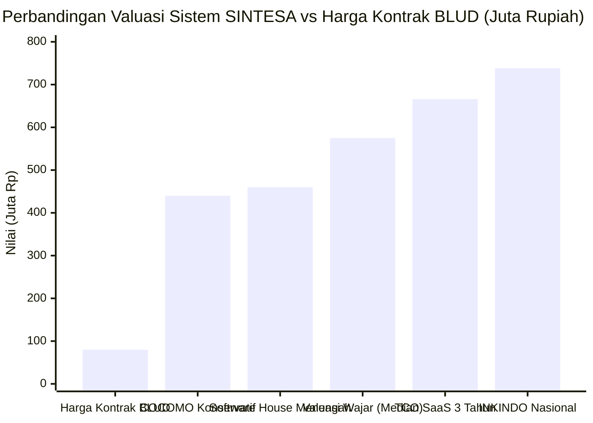

# 💎 ANALISIS VALUASI EKONOMI & NILAI RIIL APLIKASI
## SISTEM INFORMASI MANAJEMEN TERPADU (SINTESA) SOLO TECHNOPARK
### Kajian Objektif Biaya Konstruksi (*Replacement Cost*), Perbandingan Pasar SaaS, Valuasi Aset Digital, & Justifikasi Kewajaran Harga Pengadaan BLUD

---

## 📋 1. RINGKASAN EKSEKUTIF

Dokumen ini disusun secara **objektif, terukur, dan berbasis bukti kuantitatif kode sumber aktual** untuk menilai berapa sesungguhnya biaya pengembangan riil dan valuasi ekonomi (*Fair Market Value / Replacement Cost*) dari **Sistem Informasi Manajemen Terpadu (SINTESA) Solo Technopark**, serta membandingkannya terhadap harga penawaran kontrak sebesar **Rp 80.000.000,-**.

- 📊 **Skala Rekayasa Aktual Terverifikasi (24 November 2026):** Basis kode SINTESA mencakup **655 berkas kode sumber** dengan total **161.605 baris kode (*Lines of Code / LOC*)** — terdiri atas **156.291 baris kode produksi**, **5.314 baris automated tests (40 suites / 271 tests)**, **923 baris aturan keamanan `firestore.rules` (72 path rules)**, **99 halaman aplikasi**, **15 API endpoints**, **107 komponen UI**, **48 custom hooks**, **41 domain services**, **15 Server Actions Presensi**, **21 modul Cloud Functions v2**, **20 Role RBAC**, **15 Model AI terintegrasi**, dan **9 Generator PDF Vektor Resmi**.
- 💰 **Valuasi Biaya Penggantian (*Software Replacement Cost*):** Apabila sistem dengan kompleksitas setara dibangun dari awal melalui Software House / Konsultan TI profesional di Indonesia menggunakan standar *billing rate* INKINDO & pasar industri 2025–2026, biaya pengembangan riil berada pada rentang **Rp 450.000.000,- hingga Rp 750.000.000,-** (dengan titik tengah valuasi aset wajar **Rp 575.000.000,-**).
- 🏢 **Perbandingan Biaya Berlangganan SaaS Komersial (TCO 3 Tahun):** Menjalankan 9 klaster fungsi yang sama melalui langganan aplikasi SaaS komersial terpisah (HRIS/Presensi, Akuntansi/OCR, E-Katalog/Booking, ERP Manufaktur, LMS, Mini-ATS, CRM Inkubasi, Survei IKM, AI) membutuhkan biaya berulang **Rp 186.000.000 – Rp 350.000.000 per tahun**, atau **Rp 558.000.000 – Rp 1.050.000.000 selama 3 tahun** — tanpa kepemilikan *source code* dan tanpa integrasi lintas divisi.
- ✅ **Justifikasi Kewajaran Harga Pengadaan (Rp 80.000.000,-):** Nilai kontrak **Rp 80.000.000,-** merepresentasikan **penghematan (efisiensi) sebesar ~86,09%** terhadap nilai valuasi wajar (**Rp 575 juta**), sekaligus memberikan kepemilikan penuh (*100% Perpetual Ownership & HKI*) kepada UPTD KST Solo Technopark. Angka ini sepenuhnya defensibel (*audit-proof*) di hadapan PPK, KPA, Inspektorat Daerah, maupun BPK sebagai pengadaan **sangat wajar, bebas mark-up, dan bernilai tambah tinggi (*high value-for-money*)**.

---

## 📏 2. INVENTARISASI KUANTITATIF ASET KODE SUMBER (FAKTA TERUKUR)

Seluruh angka berikut diukur langsung melalui pemindaian statis direktori produksi repository `sintesa-kst` pada **24 November 2026**:

| Dimensi Teknis | Jumlah Terverifikasi | Kontribusi Nilai Teknis |
|---|---:|---|
| **Total Berkas Kode (`.ts` & `.tsx`)** | **655 berkas** | 630 berkas di `src/` + 25 berkas di `functions/src/` |
| **Total Baris Kode (LOC)** | **161.605 baris** | 156.852 baris Frontend/API/Actions + 4.753 baris Cloud Functions |
| **Baris Kode Produksi Murni (Non-Test)** | **156.291 baris** | Setara aplikasi ERP & Portal Terpadu skala korporasi/pemerintahan |
| **Sub-Sistem Presensi (Techno Sign v3 PWA)** | **74 berkas / 21.883 baris** | Setara 1 produk SaaS HRIS & Presensi Anti-Fraud mandiri |
| **Halaman Rute Aplikasi (`page.tsx`)** | **99 halaman** | Admin, Publik, Presensi PWA, Portal Tenant, Portal Mitra, LMS |
| **API Routes & Dynamic OG** | **15 endpoints** | Termasuk 7 AI endpoints (OCR, COA, Curation, Health, Match, Chat, Mod) |
| **Komponen UI Modular & Hooks** | **107 komponen + 48 hooks** | 14 Admin Shared Gen-2 + 7 Public Shared + 28 Presensi UI |
| **Business Service Layer & Server Actions** | **41 services + 15 actions** | Arsitektur bersih terpisah dari UI (*Clean Separation of Concerns*) |
| **Cloud Functions v2 (`asia-southeast2`)** | **21 modul (11 Callable + 10 Trigger)** | Anti-clash transaction, 1-Read Cache, Custom Claims, SMTP Automation |
| **Security Rules & Matriks RBAC** | **923 baris rules (72 paths) + 20 Role** | 44 granular permissions, Dual-Lookup, Fortis Edge Hardening |
| **Engine Dokumen PDF Vektor** | **9 generator (`stpDocumentKit`)** | SPK, BAST, Surat Jalan, MoU, Disposisi, IKM, Invoice, Quotation, BA |
| **Automated Test Suites (Vitest)** | **40 suites / 271 tests (5.314 baris)** | 99,63% pass rate mencakup keamanan, keuangan, presensi & bisnis |
| **Dokumentasi Operasional & Audit** | **13 Panduan Role (MD+PDF) + 17 Docs** | Menjamin keberlanjutan operasional (*maintainability*) oleh tim internal |

---

## 🧮 3. PERHITUNGAN VALUASI DENGAN 4 METODOLOGI OBJEKTIF

Untuk menjaga objektivitas penuh, valuasi sistem dihitung menggunakan **4 pendekatan independen** yang diakui dalam praktik rekayasa perangkat lunak dan akuntansi aset tak berwujud (*Intangible Asset Valuation*).

### Metode A — *Parametric Engineering Effort* (Adaptasi COCOMO II & Function Complexity)

Pada basis kode modern (React/Next.js/TypeScript/Tailwind), sebagian baris kode merupakan markup JSX dan deklarasi tipe. Oleh karena itu, dilakukan normalisasi konservatif:
- **Total LOC Produksi:** `156.291` baris.
- **Faktor Normalisasi Logika Efektif (40%):** `~62.500` baris logika bisnis, arsitektur keamanan, state, integrasi AI, dan komputasi PDF (*Logical SLOC*).
- **Produktivitas Tim Rekayasa Senior (dengan dukungan tools modern):** Rata-rata `1.800 – 2.500` *logical lines* per *Man-Month* (termasuk analisis, desain UI, integrasi API/database, debugging, testing, & dokumentasi).
- **Estimasi Usaha Riil (*Total Engineering Effort*):** **25 s.d. 35 Person-Months** (*~4.000 s.d. 5.600 jam kerja rekayasa*).
- **Konversi Biaya Konstruksi (Loaded Rate Pasar Indonesia 2026: Rp 110.000 – Rp 160.000 / jam):**
  - Skenario Konservatif (`4.000 jam × Rp 110.000`): **Rp 440.000.000,-**
  - Skenario Moderat (`4.800 jam × Rp 135.000`): **Rp 648.000.000,-**
  - Skenario Enterprise (`5.600 jam × Rp 160.000`): **Rp 896.000.000,-**

---

### Metode B — *Bottom-Up Software House & INKINDO Billing Rate* (Biaya Membangun dari Nol)

Jika UPTD Solo Technopark menenderkan pembangunan 9 klaster sistem yang sama dari nol kepada penyedia jasa konsultansi/software house (durasi realistis **6 bulan kalender**):

| Posisi Tim Proyek | Qty | Durasi | Rate Pasar Daerah / Menengah (Rp/Bln) | Rate Standar INKINDO / Nasional (Rp/Bln) | Subtotal Menengah (Rp) | Subtotal Nasional (Rp) |
|---|:---:|:---:|---:|---:|---:|---:|
| Project Manager / Lead Enterprise Architect | 1 | 6 bln | 16.000.000 | 26.000.000 | 96.000.000 | 156.000.000 |
| Senior Full-Stack Engineer (Next.js/TS) | 2 | 6 bln | 13.000.000 | 21.000.000 | 156.000.000 | 252.000.000 |
| Cloud, Security & AI Integration Engineer | 1 | 5 bln | 14.000.000 | 22.000.000 | 70.000.000 | 110.000.000 |
| UI/UX Designer & Design System | 1 | 4 bln | 10.000.000 | 16.000.000 | 40.000.000 | 64.000.000 |
| QA Automation & Technical Writer (12 Role) | 1 | 4 bln | 9.500.000 | 15.000.000 | 38.000.000 | 60.000.000 |
| **Subtotal Biaya Langsung Personel** | **6** | | | | **400.000.000** | **642.000.000** |
| Biaya Non-Personel, Uji Penetrasi, ToK & Margin (15%) | — | — | — | — | 60.000.000 | 96.300.000 |
| **TOTAL REPLACEMENT COST (BANGUN DARI NOL)** | | | | | **Rp 460.000.000** | **Rp 738.300.000** |

---

### Metode C — Valuasi Per Modul (Harga Pasar Terpisah *Modular Unbundled Price*)

Jika masing-masing sub-sistem dibeli atau dikembangkan secara terpisah di pasar perangkat lunak Indonesia:

| No. | Sub-Sistem / Modul Mandiri dalam SINTESA | Harga Pasar Terpisah Wajar (Rp) | Bobot Nilai Pasar |
|:---:|---|---:|:---:|
| 1 | **Sistem Presensi Pegawai Anti-Fraud, Geofencing, AI Liveness, LKH, Izin, Lembur & Approval (Techno Sign v3 PWA)** | 75.000.000 – 120.000.000 | 16,5% |
| 2 | **Sistem Keuangan BLUD Double-Entry (BAS), Single Invoicing Gateway 5 Divisi, Rekonsiliasi Bank & AI OCR Kuitansi** | 95.000.000 – 150.000.000 | 20,8% |
| 3 | **E-Katalog Resmi, Portal Publik, AI RAG Assistant, Peta Kawasan Interaktif & Lapor Aset QR** | 50.000.000 – 80.000.000 | 11,0% |
| 4 | **Manajemen Aset (QR Massal), Reservasi Fasilitas Anti-Clash, Kalkulator B2B & Service Desk (SPK/BAST)** | 55.000.000 – 85.000.000 | 11,9% |
| 5 | **Sistem Jasa Produksi & Manufaktur Bengkel (Work Order 7 Tahap, QC, SPK Bengkel & Surat Jalan)** | 45.000.000 – 70.000.000 | 9,8% |
| 6 | **Manajemen Inkubasi Tenant, Portal Startup (8 Halaman), Investor Room, KRENOVA & Studio Kurasi Multi-Agent AI** | 65.000.000 – 105.000.000 | 14,4% |
| 7 | **Pelatihan Vokasi, LMS, E-Sertifikat, Klaim Alumni P3MI, Bursa Karir RSKB, Mini-ATS, Forum Dual-Zone & Portal Mitra** | 65.000.000 – 110.000.000 | 14,8% |
| 8 | **Kemitraan MoU/PKS, Afiliasi, Survei IKM PermenPAN-RB 14/2017, Executive BI & 9 Engine PDF Vektor (`stpDocumentKit`)** | 40.000.000 – 65.000.000 | 8,9% |
| | **TOTAL NILAI PASAR TERPISAH (UNBUNDLED)** | **Rp 490.000.000 – Rp 785.000.000** | **100%** |

---

### Metode D — *SaaS Substitution Cost* (Perbandingan Biaya Langganan 3 Tahun)

| Kebutuhan Operasional Solo Technopark | Contoh Pembanding SaaS Komersial | Estimasi Langganan / Tahun (Rp) | TCO 3 Tahun (Rp) |
|---|---|---:|---:|
| Presensi GPS + Liveness + LKH/HRIS (~80–100 Pegawai) | Talenta / GreatDay / Hadirr | 42.000.000 | 126.000.000 |
| Akuntansi Double-Entry + Invoicing + OCR Nota | Jurnal.id / Accurate Enterprise | 30.000.000 | 90.000.000 |
| E-Katalog & Sistem Booking Ruangan/Aset | Skedda / Shopify Plus / Custom | 24.000.000 | 72.000.000 |
| ERP Work Order Manufaktur & Service Desk Tiket | Odoo Enterprise / Zendesk | 36.000.000 | 108.000.000 |
| LMS Pelatihan, Sertifikasi & Evaluasi | TalentLMS / Moodle Cloud | 30.000.000 | 90.000.000 |
| Job Portal, Mini-ATS & Portal Mitra | Workable / Breezy HR | 30.000.000 | 90.000.000 |
| CRM Inkubasi, Survei IKM & AI Knowledge Bot | HubSpot / Typeform / Custom AI | 30.000.000 | 90.000.000 |
| **TOTAL BIAYA SAAS TERPISAH (TIDAK TERINTEGRASI)** | **7+ Vendor Terpisah** | **Rp 222.000.000 / thn** | **Rp 666.000.000** |
| **BIAYA INVESTASI SINTESA (MILIK PENUH / PERPETUAL)** | **1 Platform Terpadu + Source Code** | **Rp 80.000.000 (Sekali Bayar)** | **Rp 80.000.000*** |

*\*Belum termasuk biaya infrastruktur cloud Firebase/Domain/AI API pemakaian aktual (pay-as-you-go rendah, estimasi ~Rp 3–8 juta/tahun).*

---

## 📊 4. SINTESIS VALUASI & POSISI HARGA KONTRAK RP 80.000.000,-

### Tabel Ringkasan Posisi Valuasi Objektif

| Indikator Valuasi | Rentang / Nilai (Rp) | Keterangan |
|---|---:|---|
| **Biaya Konstruksi Riil Minimum (Konservatif)** | **Rp 440.000.000** | Batas bawah biaya pembangunan dari nol |
| **Biaya Konstruksi Standar Nasional (INKINDO)** | **Rp 738.300.000** | Standar konsultan TI resmi untuk proyek pemerintah |
| **Nilai Pasar Terpisah 8 Modul (*Unbundled*)** | **Rp 490.000.000 – Rp 785.000.000** | Akumulasi harga modul bila dibeli terpisah |
| **TCO Pengganti SaaS 3 Tahun** | **Rp 666.000.000** | Biaya sewa berulang tanpa hak milik kode sumber |
| **Valuasi Aset Digital Wajar (*Fair Market Value / Median*)** | **Rp 575.000.000** | **Nilai riil objektif aset perangkat lunak SINTESA** |
| **Nilai Kontrak Pengadaan ke BLUD Solo Technopark** | **Rp 80.000.000** | **Harga khusus kemitraan strategis pemerintah daerah** |
| **Penghematan / Nilai Manfaat Bersih bagi BLUD** | **Rp 495.000.000 (86,09%)** | Efisiensi anggaran luar biasa & *Break-Even Point* < 5 bulan dibanding SaaS |

---

## 🛡️ 5. ANALISIS KELAYAKAN AUDIT & KEPATUHAN PENGADAAN (BLUD / INSPEKTORAT / BPK)

Mengapa nilai penagihan **Rp 80.000.000,-** sangat sehat dan aman dari perspektif audit pengadaan barang/jasa pemerintah maupun keuangan BLUD:
1. **Memenuhi Batas Metode Pengadaan Langsung:** Berdasarkan Perpres No. 16 Tahun 2018 jo. Perpres No. 12 Tahun 2021 jo. Perpres No. 46 Tahun 2025, nilai **Rp 80.000.000,-** berada nyaman di bawah ambang batas **Pengadaan Langsung Jasa Konsultansi (≤ Rp 100 Juta)** maupun **Pengadaan Langsung Jasa Lainnya (≤ Rp 200 Juta)**, serta selaras dengan fleksibilitas pengadaan BLUD (Permendagri No. 79/2018).
2. **Bebas Risiko Temuan *Mark-Up* / Kemahalan Harga:** Dengan biaya konstruksi riil minimum Rp 440 juta dan valuasi median Rp 575 juta, harga kontrak Rp 80 juta berada **86% di bawah harga pasar wajar**. Hal ini merupakan bukti kuantitatif kuat (*value for money*) apabila dilakukan pemeriksaan oleh APIP / Inspektorat Kota Surakarta maupun BPK.
3. **Pencatatan Aset Tak Berwujud (ATB) pada Neraca BLUD:** Sesuai **PSAP No. 14 tentang Akuntansi Aset Tak Berwujud**, perangkat lunak SINTESA memenuhi seluruh kriteria pengakuan Aset Tak Berwujud (dapat diidentifikasi, dikendalikan penuh via HKI & *source code*, serta memberikan manfaat ekonomi langsung berupa pendapatan PNBP/BLUD dan efisiensi operasional). Nilai perolehan tercatat pada neraca sebesar nilai kontrak (**Rp 80.000.000,-**), sementara nilai ekonomis pemanfaatannya mencapai ratusan juta rupiah.
4. **Return on Investment (ROI) Cepat:** Dengan mengintegrasikan *Single Invoicing Gateway* di 5 divisi pendapatan (sewa aset, manufaktur, pelatihan, tenant, e-katalog) dan mengeliminasi kebocoran pencatatan/biaya langganan SaaS Rp 222 juta/tahun, investasi Rp 80 juta mencapai titik impas (**Payback Period**) dalam **± 4,3 bulan operasional**.

---

## ✍️ 6. PERNYATAAN OBJEKTIVITAS PENILAIAN

Dokumen analisis valuasi ini disusun berdasarkan data metrik kode sumber aktual (`161.605 LOC / 655 files`), standar praktik rekayasa perangkat lunak (COCOMO II), rujukan *billing rate* industri perangkat lunak Indonesia (INKINDO), serta data pembanding harga SaaS komersial yang dapat diverifikasi secara independen.

Surakarta, 24 November 2026  
**Disusun oleh:**

| Penyusun Kajian Teknis & Valuasi | Mengetahui, Pejabat Pembuat Komitmen (PPK) |
| :---: | :---: |
|     |     |
| **(`[NAMA_PIMPINAN_PENYEDIA]`)** | **(`[NAMA_PPK]`)** |
| `[JABATAN_PENYEDIA]` — `[NAMA_PENYEDIA]` | NIP. `[NIP_PPK]` |
