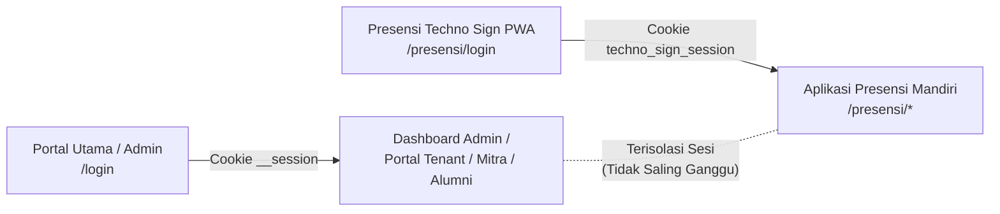

# 📚 INDEKS MASTER PANDUAN PENGGUNAAN SISTEM SINTESA
## PANDUAN LENGKAP 21 ROLES SISTEM TERPADU & 3 PERAN SISTEM PRESENSI TECHNO SIGN V3

> **Ringkasan Eksekutif:**
> - ✅ **Cakupan Penuh 21 Role Resmi (`src/config/roles.ts`):** Mencakup seluruh 15 peran internal BLUD (termasuk `direktur`, `admin_keuangan`, `kasir`, `kasir_pengeluaran`, admin/operator per divisi, dan `pegawai`) serta 6 peran eksternal/ekosistem (`tenant`, `alumni`, `industri`, `investor`, `kampus`, `public`).
> - ✅ **3 Buku Khusus Sistem Presensi (Techno Sign v3 PWA):** Dipisah khusus untuk **Pegawai (ASN/Non-ASN)**, **Atasan / Approver (`rankLevel <= 4`)**, dan **Admin Presensi / Kepegawaian (Subbag TU)** karena arsitektur sesi dan PWA presensi berjalan mandiri terisolasi.
> - ✅ **Diperbarui Sesuai Fitur Produksi Terkini:** Mencakup Admin UI Gen-2 (`Ctrl+K` Command Palette, Deep-Link `?tab=...`), Studio Kurasi & Asesmen AI (`/manajemen-kurasi/[id]`), Service Desk SPK/BAST, Kemitraan MoU/PKS, Laporan IKM PermenPAN-RB 14/2017, Executive Command (`/eksekutif`), dan Overhaul Profil (`/profil`).

---

## 🗺️ 1. MATRIKS LENGKAP 21 ROLES SINTESA & FILE PANDUANNYA

| No. | Kode Role (`APP_ROLES`) | Nama Resmi Peran | Klaster | Akses Rute Utama | File Panduan |
|:---:|---|---|---|---|---|
| 1 | `super_admin` | Super Administrator | Pimpinan & TI | `*` (Seluruh Rute & Sistem) | [`01-PANDUAN-ROLE-SUPER-ADMIN-DAN-ADMIN.md`](./01-PANDUAN-ROLE-SUPER-ADMIN-DAN-ADMIN.md) |
| 2 | `admin` | Administrator Umum | Pimpinan & TI | Seluruh menu admin operasional & konten | [`01-PANDUAN-ROLE-SUPER-ADMIN-DAN-ADMIN.md`](./01-PANDUAN-ROLE-SUPER-ADMIN-DAN-ADMIN.md) |
| 3 | `direktur` | Direktur / Kepala UPTD BLUD | Eksekutif | `/eksekutif`, `/dashboard`, monitoring 12 modul | [`02-PANDUAN-ROLE-DIREKTUR-PIMPINAN-BLUD.md`](./02-PANDUAN-ROLE-DIREKTUR-PIMPINAN-BLUD.md) |
| 4 | `admin_keuangan` | Admin Keuangan & Billing | Keuangan BLUD | `/billing` (11 tab), `/katalog`, `/afiliasi`, `/pengaturan` | [`03-PANDUAN-ROLE-KEUANGAN-KASIR-POS-DAN-KASIR-AP.md`](./03-PANDUAN-ROLE-KEUANGAN-KASIR-POS-DAN-KASIR-AP.md) |
| 5 | `kasir` | Kasir Pendapatan (POS) | Keuangan BLUD | `/billing` (Tagihan, Verifikasi Bayar, Aging) | [`03-PANDUAN-ROLE-KEUANGAN-KASIR-POS-DAN-KASIR-AP.md`](./03-PANDUAN-ROLE-KEUANGAN-KASIR-POS-DAN-KASIR-AP.md) |
| 6 | `kasir_pengeluaran` | Kasir Pengeluaran (AP) | Keuangan BLUD | `/billing` (Pengeluaran AP & AI OCR Nota) | [`03-PANDUAN-ROLE-KEUANGAN-KASIR-POS-DAN-KASIR-AP.md`](./03-PANDUAN-ROLE-KEUANGAN-KASIR-POS-DAN-KASIR-AP.md) |
| 7 | `admin_aset` | Admin Aset & Booking | Operasional | `/aset`, `/booking`, `/service-desk`, `/manajemen-ikm` | [`04-PANDUAN-ROLE-ADMIN-DAN-OPERATOR-ASET-BOOKING.md`](./04-PANDUAN-ROLE-ADMIN-DAN-OPERATOR-ASET-BOOKING.md) |
| 8 | `operator_aset` | Operator Aset Lapangan | Operasional | `/aset`, `/booking`, `/service-desk` (non-delete/non-approve) | [`04-PANDUAN-ROLE-ADMIN-DAN-OPERATOR-ASET-BOOKING.md`](./04-PANDUAN-ROLE-ADMIN-DAN-OPERATOR-ASET-BOOKING.md) |
| 9 | `admin_produksi` | Admin Layanan Jasa Produksi | Manufaktur | `/jasa-produksi` (penuh + SPK/DO/Invoice), `/billing` | [`05-PANDUAN-ROLE-ADMIN-DAN-OPERATOR-JASA-PRODUKSI.md`](./05-PANDUAN-ROLE-ADMIN-DAN-OPERATOR-JASA-PRODUKSI.md) |
| 10 | `operator_produksi` | Operator Bengkel & Produksi | Manufaktur | `/jasa-produksi` (log progres bengkel & QC) | [`05-PANDUAN-ROLE-ADMIN-DAN-OPERATOR-JASA-PRODUKSI.md`](./05-PANDUAN-ROLE-ADMIN-DAN-OPERATOR-JASA-PRODUKSI.md) |
| 11 | `admin_tenant` | Admin Ekosistem Tenant | Inkubasi | `/tenant`, `/manajemen-kurasi`, `/manajemen-kemitraan`, `/manajemen-krenova`, `/manajemen-event`, `/manajemen-ikm` | [`06-PANDUAN-ROLE-ADMIN-DAN-OPERATOR-TENANT-INKUBASI.md`](./06-PANDUAN-ROLE-ADMIN-DAN-OPERATOR-TENANT-INKUBASI.md) |
| 12 | `operator_tenant` | Operator Tenant | Inkubasi | `/tenant`, `/manajemen-event` (operasional harian) | [`06-PANDUAN-ROLE-ADMIN-DAN-OPERATOR-TENANT-INKUBASI.md`](./06-PANDUAN-ROLE-ADMIN-DAN-OPERATOR-TENANT-INKUBASI.md) |
| 13 | `admin_pelatihan` | Admin Pelatihan (LMS) | Pendidikan | `/pelatihan`, `/lms`, `/manajemen-review-pelatihan`, `/manajemen-karir`, `/manajemen-kurasi` | [`07-PANDUAN-ROLE-ADMIN-DAN-OPERATOR-PELATIHAN-LMS.md`](./07-PANDUAN-ROLE-ADMIN-DAN-OPERATOR-PELATIHAN-LMS.md) |
| 14 | `operator_pelatihan` | Operator Pelatihan | Pendidikan | `/pelatihan`, `/lms`, `/manajemen-review-pelatihan`, `/manajemen-karir` | [`07-PANDUAN-ROLE-ADMIN-DAN-OPERATOR-PELATIHAN-LMS.md`](./07-PANDUAN-ROLE-ADMIN-DAN-OPERATOR-PELATIHAN-LMS.md) |
| 15 | `pegawai` | Pegawai Solo Technopark | Kepegawaian | `/presensi/*`, `/karir`, `/alumni-portal`, `/profil` | [`12-PANDUAN-PRESENSI-PEGAWAI-TECHNO-SIGN.md`](./12-PANDUAN-PRESENSI-PEGAWAI-TECHNO-SIGN.md) |
| 16 | `tenant` | Akun Tenant Startup Binaan | Binaan | `/tenant/*` (8 menu), `/ekosistem`, `/lms`, Forum Zona B | [`08-PANDUAN-ROLE-TENANT-STARTUP-BINAAN.md`](./08-PANDUAN-ROLE-TENANT-STARTUP-BINAAN.md) |
| 17 | `alumni` | Alumni KST / RSKB | Lulusan | `/karir`, `/alumni-portal` (Zona A & B), `/lms`, `/profil` | [`09-PANDUAN-ROLE-ALUMNI-DAN-BURSA-KARIR.md`](./09-PANDUAN-ROLE-ALUMNI-DAN-BURSA-KARIR.md) |
| 18 | `industri` | Mitra Industri / Korporasi | Mitra Eksternal | `/mitra/*` (5 menu), `/ekosistem`, Forum Zona B | [`10-PANDUAN-ROLE-MITRA-INDUSTRI-INVESTOR-KAMPUS.md`](./10-PANDUAN-ROLE-MITRA-INDUSTRI-INVESTOR-KAMPUS.md) |
| 19 | `investor` | Mitra Investor / VC | Mitra Eksternal | `/ekosistem`, `/investor-room`, `/portfolio` | [`10-PANDUAN-ROLE-MITRA-INDUSTRI-INVESTOR-KAMPUS.md`](./10-PANDUAN-ROLE-MITRA-INDUSTRI-INVESTOR-KAMPUS.md) |
| 20 | `kampus` | Mitra Perguruan Tinggi | Mitra Eksternal | `/ekosistem`, `/riset` | [`10-PANDUAN-ROLE-MITRA-INDUSTRI-INVESTOR-KAMPUS.md`](./10-PANDUAN-ROLE-MITRA-INDUSTRI-INVESTOR-KAMPUS.md) |
| 21 | `public` | Pengguna Umum / Instruktur | Publik | `/`, `/e-katalog`, `/fasilitas`, `/program-pelatihan`, `/curation`, `/survei-ikm`, `/bukti-bayar`, `/lms` | [`11-PANDUAN-ROLE-PENGGUNA-UMUM-DAN-INSTRUKTUR.md`](./11-PANDUAN-ROLE-PENGGUNA-UMUM-DAN-INSTRUKTUR.md) |

---

## 🕒 2. MATRIKS 3 TINGKAT PERAN SISTEM PRESENSI (TECHNO SIGN V3 PWA)

Sistem Presensi (`/presensi/*`) berjalan sebagai **aplikasi PWA mandiri yang terisolasi sesi login-nya** (`techno_sign_session`) dari portal admin katalog (`__session`):

| Tingkat Peran Presensi | Kriteria Sistem | Menu yang Terbuka | File Panduan |
|---|---|---|---|
| **1. Pegawai (ASN / Non-ASN BLUD)** | `presensiRole: "pegawai"` (semua rank) | Dashboard, Presensi Swafoto, Laporan Kinerja (LKH), Pengajuan Cuti/Izin, Pengajuan Lembur, Permohonan Revisi, Kalender Kerja, Profil | [`12-PANDUAN-PRESENSI-PEGAWAI-TECHNO-SIGN.md`](./12-PANDUAN-PRESENSI-PEGAWAI-TECHNO-SIGN.md) |
| **2. Atasan / Pejabat Penyetuju** | `rankLevel <= 4` *(Kepala UPTD, Pejabat Teknis, Manager, Kepala Divisi)* | Semua menu Pegawai + **Approval Atasan (`/presensi/approval`)** + **Rekap & Statistik (`/presensi/statistik`)** | [`13-PANDUAN-PRESENSI-ATASAN-APPROVER.md`](./13-PANDUAN-PRESENSI-ATASAN-APPROVER.md) |
| **3. Admin Presensi / Subbag TU** | `presensiRole: "admin"` atau `super_admin`/`admin` | Semua menu di atas + **Data Pegawai STP (`/presensi/pegawai`)** + **Hierarki Jabatan (`/presensi/jabatan`)** + **Pengaturan Kantor (`/presensi/pengaturan`)** + Koreksi Langsung & Audit Log | [`14-PANDUAN-PRESENSI-ADMIN-KEPEGAWAIAN.md`](./14-PANDUAN-PRESENSI-ADMIN-KEPEGAWAIAN.md) |

---

## 🔑 3. ATURAN UMUM LOGIN, KEAMANAN & NAVIGASI CEPAT

1. **Pemisahan Sesi Login:**
   - Masuk ke portal admin, tenant, mitra, atau alumni melalui **`/login`**.
   - Masuk ke sistem presensi pegawai melalui **`/presensi/login`**. *(Khusus `super_admin` dan `admin` dapat membuka `/presensi` langsung dari sidebar Admin karena diberikan fallback otorisasi inspeksi).*
2. **Refresh Token Setelah Perubahan Role:** Jika Super Admin mengubah peran akun Anda di menu `/pengaturan` (tab Keamanan RBAC), silakan **Logout → Login ulang** agar Firebase Custom Claims pada JWT Anda diperbarui.
3. **Navigasi Kilat Admin (`Ctrl + K` / `Cmd + K`):** Pada seluruh halaman admin, tekan **`Ctrl + K`** (Windows) atau **`Cmd + K`** (Mac) untuk membuka **Admin Command Palette** guna melompat instan ke menu atau sub-tab mana pun.
4. **Dukungan 3 Perangkat:** Seluruh tampilan SINTESA menyesuaikan otomatis di **Desktop/PC** (tabel & sidebar penuh), **Tablet** (sidebar dapat dilipat *mini-rail*), dan **Smartphone** (kartu mobile `AdminMobileCard` & menu navigasi bawah/drawer).
