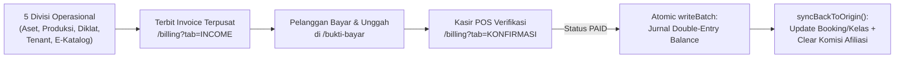

# 💰 PANDUAN PENGGUNAAN: KEUANGAN BLUD, KASIR POS & KASIR PENGELUARAN
**Role Terkait:** `admin_keuangan` (Admin Keuangan & BAS), `kasir` (Kasir Pendapatan / POS), dan `kasir_pengeluaran` (Kasir Pengeluaran / AP)

---

## 1. Pemisahan Tugas (*Segregation of Duties*) 3 Role Keuangan

Untuk menjamin kontrol internal BLUD yang akuntabel, SINTESA memisahkan hak akses pada 11 sub-tab modul **Billing & Invoice (`/billing`)**:

| Sub-Tab `/billing` | `admin_keuangan` | `kasir` (POS) | `kasir_pengeluaran` (AP) |
|---|:---:|:---:|:---:|
| Dasbor Keuangan (`DASHBOARD`) | ✅ | ❌ | ❌ |
| Tagihan & Pendapatan (`INCOME`) | ✅ Penuh (+ Hapus) | ✅ Buat & Terima Bayar | ❌ |
| Verifikasi Bukti Bayar (`KONFIRMASI`) | ✅ | ✅ | ❌ |
| Pengeluaran / AP (`EXPENSE`) | ✅ (+ Approve) | ❌ | ✅ Input Pengeluaran |
| Umur Piutang (`AGING_PIUTANG`) | ✅ | ✅ | ❌ |
| Laba/Rugi Divisi (`PROFIT_CENTER`) | ✅ | ❌ | ❌ |
| Arus Kas (`CASH_FLOW`) | ✅ | ❌ | ❌ |
| Kas & Bank + Transfer (`CASH`) | ✅ | ❌ | ❌ |
| Rekap Alokasi BAS (`REKAP_ALOKASI`) | ✅ | ❌ | ❌ |
| Buku Besar / Jurnal (`REPORT`) | ✅ | ❌ | ❌ |
| Pusat Ekspor (`EXPORT`) | ✅ | ❌ | ❌ |
| Katalog (`/katalog`), Afiliasi (`/afiliasi`), BAS (`/pengaturan`) | ✅ | ❌ | ❌ |

---

## 2. Alur Kerja Single Invoicing Gateway & Jurnal Otomatis

---

## 3. Panduan Operasional: Kasir Pendapatan (`kasir`)

### A. Memverifikasi Bukti Transfer Pelanggan
1. Buka **Billing & Invoice → Verifikasi Bayar** (`/billing?tab=KONFIRMASI`).
2. Pilih transaksi berstatus `WAITING_VERIFICATION` yang masuk dari portal publik `/bukti-bayar`.
3. Periksa foto bukti transfer pada *Document Preview Drawer* dan cocokkan dengan mutasi rekening BLUD.
4. Klik **Setujui Pembayaran (Catat Lunas / Termin)**:
   - Pilih akun Kas/Bank penerima.
   - Pastikan nominal bayar sesuai.
   - Klik **Konfirmasi**. Sistem otomatis menjurnal berpasangan (`Debit Kas/Bank = Kredit Piutang/Pendapatan`) dan menjalankan `syncBackToOrigin()`.
5. Jika bukti buram atau tidak cocok, klik **Tolak Bukti** dengan menyertakan alasan agar pelanggan mengunggah ulang.

### B. Menerbitkan Invoice Manual & Cetak Kwitansi
1. Buka tab **Tagihan & Pendapatan** (`/billing?tab=INCOME`), klik **Buat Invoice Baru** (atau gunakan **Invoice Editor** di `/billing/invoice/editor`).
2. Isi data pelanggan, pilih divisi/referensi layanan, rincian item, dan jatuh tempo.
3. Untuk transaksi lunas, klik ikon cetak untuk menghasilkan **Invoice** atau **Kwitansi Resmi BLUD** berformat A4 siap serah.

### C. Memantau Umur Piutang (*Aging*)
- Buka tab **Umur Piutang** (`/billing?tab=AGING_PIUTANG`) untuk memantau tagihan jatuh tempo (0–30 hari, 31–60 hari, >60 hari) dan menindaklanjuti penagihan ke pelanggan atau admin divisi terkait.

---

## 4. Panduan Operasional: Kasir Pengeluaran (`kasir_pengeluaran`)

### A. Mencatat Pengeluaran Menggunakan AI OCR Pembaca Kuitansi
1. Buka **Billing & Invoice → Pengeluaran (AP)** (`/billing?tab=EXPENSE`).
2. Klik **Tambah Pengeluaran Baru**.
3. Unggah foto nota/struk/kuitansi fisik, lalu klik tombol **Scan Nota dengan AI OCR** (`/api/ai/ocr-receipt`).
4. Sistem AI Vision akan otomatis mengisi nama toko/vendor, tanggal, rincian item, pajak, total nominal, dan kategori beban.
5. Gunakan tombol **Saran Akun BAS (AI Smart COA)** (`/api/ai/suggest-coa`) untuk mendapatkan rekomendasi kode akun debit/kredit sesuai BAS BLUD.
6. Periksa kembali seluruh angka, lalu klik **Ajukan Pengeluaran** agar diverifikasi oleh `admin_keuangan`.

---

## 5. Panduan Operasional: Admin Keuangan (`admin_keuangan`)

Selain seluruh kemampuan Kasir POS dan Kasir AP, `admin_keuangan` bertugas:
1. **Persetujuan Pengeluaran (Approval AP):** Meninjau dan menyetujui draf pengeluaran dari `kasir_pengeluaran` di `/billing?tab=EXPENSE` hingga masuk buku besar.
2. **Transfer Antar-Kas & Rekonsiliasi Bank:** Mengelola mutasi kas tunai ke bank di tab **Kas & Bank** (`/billing?tab=CASH`) dan mencocokkan rekening koran via **Modal Rekonsiliasi Bank**.
3. **Pelaporan Keuangan BLUD:** Memeriksa keseimbangan **Buku Besar (`REPORT`)**, **Arus Kas (`CASH_FLOW`)**, **Laba/Rugi per Divisi (`PROFIT_CENTER`)**, **Rekap Alokasi BAS (`REKAP_ALOKASI`)**, dan mengunduh data laporan melalui **Pusat Ekspor (`EXPORT`)**.
4. **Manajemen E-Katalog (`/katalog`) & Afiliasi (`/afiliasi`):**
   - Mengelola harga & publikasi layanan di `/katalog/builder` serta memantau order katalog.
   - Memverifikasi mitra afiliasi, memantau buku besar komisi, dan memproses pencairan komisi di `/afiliasi?tab=pencairan`.
5. **Pengaturan Bagan Akun Standar (BAS):** Mengelola daftar COA/akun di `/pengaturan?tab=Keuangan`.

> **Catatan Integritas Akuntansi:** Sistem menerapkan validasi matematis mutlak `Total Debit === Total Kredit` pada setiap penyimpanan jurnal (`addPaymentBatch`). Jika muncul peringatan *unbalanced journal*, periksa kembali pemetaan akun debit/kredit sebelum menyimpan.
