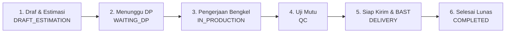

# ⚙️ PANDUAN PENGGUNAAN: ADMIN & OPERATOR JASA PRODUKSI MANUFAKTUR
**Role Terkait:** `admin_produksi` (Admin Layanan Jasa Produksi) & `operator_produksi` (Operator Bengkel & Produksi)

---

## 1. Perbedaan Hak Akses `admin_produksi` vs `operator_produksi`

| Kewenangan / Fitur | `admin_produksi` | `operator_produksi` |
|---|:---:|:---:|
| Membuat Work Order / Pesanan Produksi Baru & RAB | ✅ | ❌ |
| Menyetujui Pesanan & Cetak SPK Manufaktur | ✅ | ❌ |
| Menerbitkan Invoice DP / Pelunasan & Akses `/billing` | ✅ | ❌ |
| Memperbarui Log Progres Pengerjaan Bengkel & Uji Mutu (QC) | ✅ | ✅ |
| Menerbitkan Surat Jalan (*Delivery Order*) & BAST Barang | ✅ | ❌ |
| Melihat Monitoring Tagihan Divisi Produksi (`INVOICES`) | ✅ | ❌ |

---

## 2. Alur Pipeline 7 Tahap Jasa Produksi (`/jasa-produksi`)

---

## 3. Panduan Operasional: Admin Jasa Produksi (`admin_produksi`)

1. **Menerima & Membuat Pesanan Produksi (Work Order):**
   - Buka **Jasa Produksi** (`/jasa-produksi`) → klik **Buat Pesanan Produksi Baru**.
   - Masukkan data pemesan (perusahaan/individu), spesifikasi teknis pekerjaan (CNC Milling, Bubut, Welding, 3D Printing, Fabrikasi Prototipe), estimasi material, biaya mesin/operator, dan target selesai.
   - Pesanan masuk tab **Draf & Estimasi (`DRAFT_ESTIMATION`)**.
2. **Menerbitkan Tagihan DP & Menunggu Pembayaran:**
   - Klik tombol **Terbitkan Invoice** (`ModalInvoiceProduction`) untuk membuat tagihan DP (misal 50%) yang otomatis tercatat di *Single Invoicing Gateway* (`/billing`) dan terpantau di tab **Monitoring Tagihan (`INVOICES`)**.
   - Status pesanan berpindah ke **Menunggu DP (`WAITING_DP`)**.
3. **Mencetak SPK Manufaktur Resmi:**
   - Setelah Kasir memverifikasi DP lunas, status pesanan siap masuk produksi (`IN_PRODUCTION`).
   - Klik **Cetak SPK Bengkel** (`workOrderPdf.ts`) → pilih penandatangan pejabat produksi → pratinjau dan cetak SPK Vektor A4 sebagai dasar perintah kerja bagi Operator Bengkel.
4. **Penerbitan Pelunasan & Surat Jalan (*Delivery Order*):**
   - Setelah barang lolos QC (`DELIVERY`), terbitkan invoice pelunasan sisa tagihan.
   - Klik **Cetak Surat Jalan / Delivery Order** (`deliveryOrderPdf.ts`) untuk dokumentasi serah terima barang jadi ke pemesan, lalu tandai **Selesai Lunas (`COMPLETED`)**.

---

## 4. Panduan Operasional: Operator Bengkel (`operator_produksi`)

1. Login ke `/login` dan buka menu **Jasa Produksi → Pengerjaan Bengkel (`IN_PRODUCTION`)**.
2. Pilih pesanan sesuai nomor SPK fisik yang diterima dari Admin Produksi.
3. Klik **Catat Log Progres (`ModalProgressLog`)** setiap kali menyelesaikan tahapan pengerjaan (pemotongan material, pemesinan CNC, perakitan, finishing) disertai foto progres dan catatan teknis.
4. Setelah pengerjaan selesai, pindahkan status ke **Uji Mutu (`QC`)**, unggah foto hasil inspeksi dimensi/kualitas, lalu konfirmasi lolos QC agar Admin Produksi dapat memproses pengiriman (*Delivery Order*).
