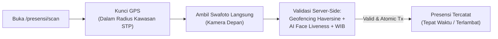

# 📱 PANDUAN SISTEM PRESENSI TECHNO SIGN V3: PEGAWAI (ASN & NON-ASN)
**Peran Terkait:** Seluruh Pegawai & Instruktur Internal UPTD KST Solo Technopark (`pegawai` / `presensiRole: pegawai`)  
**Alamat Akses Resmi:** `/presensi` *(Login terpisah di `/presensi/login`)*

---

## 1. Instalasi Aplikasi PWA Mandiri di Smartphone (Android & iOS)

**Techno Sign** memiliki *manifest* dan *Service Worker* mandiri (`/presensi/manifest.webmanifest` & `sw-presensi.js`) sehingga dapat dipasang seperti aplikasi native di layar utama HP tanpa memakan memori besar:

- **Pengguna Android (Chrome):**
  1. Buka Chrome → kunjungi `https://katalog.solotechnopark.id/presensi/login`.
  2. Ketuk banner **"Install Techno Sign"** atau ketuk ikon titik tiga (⋮) di kanan atas → pilih **Tambahkan ke Layar Utama / Install App**.
  3. Ikon **Techno Sign** akan muncul di *home screen* dan berjalan dalam mode layar penuh (*standalone*).
- **Pengguna iPhone / iOS (Safari):**
  1. Buka Safari → kunjungi `https://katalog.solotechnopark.id/presensi/login`.
  2. Ketuk tombol **Share** (kotak dengan panah ke atas) di bagian bawah.
  3. Gulir dan pilih **Add to Home Screen (Tambah ke Layar Utama)** → ketuk **Add**.

---

## 2. Login Terisolasi & Navigasi Menu Pegawai

1. Buka aplikasi **Techno Sign** → masuk menggunakan **Email Kedinasan (`@solotechnopark.id`) / NIP** dan kata sandi Anda di **`/presensi/login`**.
2. Sesi login disimpan terpisah di cookie **`techno_sign_session`** (aman dan tidak mencampuri sesi admin/portal katalog).
3. Menu utama yang tersedia bagi Pegawai:
   - **Dashboard Utama (`/presensi`):** Ringkasan status kehadiran hari ini, tingkat kehadiran 30 hari, kalender bulanan, dan tombol cepat *Presensi Sekarang* & *Logbook Harian*.
   - **Presensi Swafoto (`/presensi/scan`):** Check-In (Datang) & Check-Out (Pulang) dengan GPS + Kamera.
   - **Laporan Kinerja / LKH (`/presensi/laporan`):** Pencatatan aktivitas kerja harian (*logbook*).
   - **Pengajuan Cuti / Izin (`/presensi/izin`):** Form pengajuan Sakit, Cuti Tahunan, Izin, atau Dinas Luar.
   - **Pengajuan Lembur (`/presensi/lembur`):** Pengajuan dan rekam kehadiran lembur hari kerja / hari libur.
   - **Permohonan Revisi (`/presensi/revisi`):** Pengajuan koreksi apabila lupa absen atau kendala teknis.
   - **Kalender Kerja (`/presensi/kalender`)** & **Profil (`/presensi/profil`)**.

---

## 3. SOP Presensi Harian (Check-In & Check-Out Anti-Fraud)

### Langkah Melakukan Check-In / Check-Out:
1. Pastikan **Lokasi (GPS Akurasi Tinggi)** dan izin **Kamera** pada browser/HP dalam keadaan **Aktif**.
2. Buka **`/presensi/scan`**, pastikan indikator peta menampilkan status **"Di Dalam Radius Kantor"** (batas jam masuk standar WIB `07:30`).
3. Arahkan wajah menghadap kamera di tempat bercahaya cukup, lalu ketuk **Ambil Swafoto & Check-In** (atau **Check-Out** saat jam pulang).
4. Tunggu konfirmasi hijau **"Presensi Berhasil Tercatat"**. Sistem menggunakan **Atomic Transaction** sehingga ketukan ganda (*double-tap*) tidak akan menyebabkan data korup.

### ⚠️ Larangan Keras Sistem Anti-Fraud (Otomatis Ditolak & Tercatat di Audit Log)
Sistem dilengkapi deteksi keamanan berlapis di sisi server:
- ❌ **Mock GPS / Fake GPS:** Aplikasi pemalsu lokasi otomatis terdeteksi dan diblokir.
- ❌ **Impossible Travel:** Perpindahan lokasi tidak wajar (>140 km/jam antar titik presensi) otomatis ditandai.
- ❌ **Foto Layar / Foto Cetak / Foto Ulang (*Anti-Replay*):** AI Face Liveness mendeteksi wajah asli (*live*) dan menolak pemakaian ulang foto check-in untuk check-out. *(Jika server AI sedang offline, fail-safe mode tetap mengizinkan absen dengan penandaan verifikasi manual agar pegawai tidak dirugikan).*

### 📶 Mode Offline & Network Sentinel
Jika sinyal internet di area bengkel/gedung melemah, indikator **Network Sentinel** akan muncul di bagian atas layar. Data operasional sementara diamankan pada **IndexedDB lokal** perangkat dan akan disinkronkan saat koneksi kembali normal.

---

## 4. Mengisi Laporan Kinerja Harian / LKH (`/presensi/laporan`)

1. Buka menu **Laporan Kinerja (LKH)** (`/presensi/laporan`) dan pilih tanggal aktif pada *Logbook Date Strip*.
2. Klik **Tambah Kegiatan**, pilih kategori dari *Aktivitas Combobox* atau tulis uraian kegiatan kerja, waktu pelaksanaan, dan hasil/output.
3. Lampirkan bukti dukung (foto/PDF melalui `FileUploadInput`) bila diperlukan.
4. Klik **Simpan Draft** (bisa diedit lagi) atau **Kirim ke Atasan** untuk proses persetujuan. Pantau status persetujuan (Menunggu / Disetujui / Ditolak) langsung pada **Kinerja Tracker Card** dan notifikasi *push* (FCM).

---

## 5. Pengajuan Izin/Cuti, Lembur & Revisi Presensi

- **Pengajuan Izin / Cuti (`/presensi/izin`):** Pilih jenis (`Sakit`, `Cuti Tahunan`, `Dinas Luar`, `Izin`), tentukan rentang tanggal mulai–selesai, tulis keterangan, unggah surat dokter/surat tugas, lalu kirim. *(Hari Sabtu & Minggu otomatis dikecualikan saat disetujui).*
- **Pengajuan Lembur (`/presensi/lembur`):** Pilih jenis lembur (*Hari Kerja* atau *Hari Libur*), tanggal, estimasi jam, dan uraian pekerjaan lembur untuk disetujui atasan sebelum/saat pelaksanaan.
- **Permohonan Revisi Presensi (`/presensi/revisi`):** Jika terjadi kendala teknis (lupa check-out, kendala GPS, penugasan mendadak), pilih tanggal terkait, pilih status usulan, tuliskan alasan kronologis yang jelas, dan lampirkan bukti untuk ditinjau Atasan & Subbag TU.

---

## 6. Pemecahan Masalah Cepat (*Troubleshooting*)

| Masalah | Penyebab Umum | Solusi Cepat |
|---|---|---|
| Posisi GPS melenceng / di luar radius | GPS HP belum *lock* atau mode hemat baterai | Aktifkan *High Accuracy Location*, keluar sebentar ke area terbuka/dekat jendela, lalu ketuk **Refresh Lokasi**. |
| Kamera tidak muncul (layar hitam) | Izin kamera diblokir browser | Buka Pengaturan Browser → Site Settings → Izinkan Kamera & Lokasi untuk domain Solo Technopark, lalu muat ulang halaman. |
| Terlempar kembali ke `/presensi/login` | Sesi `techno_sign_session` kedaluwarsa | Login ulang di `/presensi/login`; pastikan tanggal & jam perangkat diatur **Otomatis (WIB)**. |
