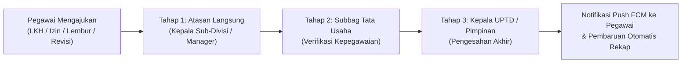

# 👔 PANDUAN SISTEM PRESENSI TECHNO SIGN V3: ATASAN & APPROVER
**Peran Terkait:** Pejabat Struktural & Pimpinan dengan tingkat jabatan **`rankLevel <= 4`** *(Kepala UPTD/Pimpinan, Pejabat Teknis/Kasubag TU, Manager, Kepala Divisi/Sub-Divisi)*

---

## 1. Hak Akses Tambahan untuk Atasan (`rankLevel <= 4`)

Selain seluruh fitur presensi pribadi (Check-In/Out, LKH, Izin, Lembur, Revisi, Kalender), akun dengan `rankLevel <= 4` pada master Hierarki Jabatan otomatis membuka **2 menu manajerial tambahan** di sidebar Techno Sign:

1. **Approval Atasan (`/presensi/approval`):** Meja kerja terpusat untuk menyetujui atau menolak pengajuan bawahan.
2. **Rekap & Statistik (`/presensi/statistik`):** Dasbor pemantauan kedisiplinan, tingkat kehadiran, keterlambatan, dan produktivitas LKH unit kerja yang dipimpin.

---

## 2. Alur Persetujuan Berjenjang (*Hierarchical Approval*)

---

## 3. SOP Melakukan Persetujuan di `/presensi/approval`

1. Login di **`/presensi/login`**, lalu buka menu **Approval Atasan (`/presensi/approval`)**.
2. Pilih tab kategori antrean yang menunggu tindakan Anda:
   - **Tab LKH (Laporan Kinerja Harian):** Periksa kesesuaian uraian aktivitas harian bawahan dan lampiran bukti kerja.
     - Klik **Setujui (Approve)** jika valid → pegawai otomatis menerima notifikasi FCM dan skor kinerja bertambah.
     - Klik **Tolak / Minta Revisi (Reject)** dengan menuliskan catatan perbaikan → status LKH kembali ke `rejected` agar pegawai dapat memperbaiki dan mengirim ulang.
   - **Tab Pengajuan Izin / Cuti:** Periksa jenis cuti/izin, rentang tanggal, dan lampiran surat dokter/surat tugas. Setelah disetujui, sistem otomatis mengisi status presensi hari kerja pada rentang tersebut (melewati Sabtu/Minggu).
   - **Tab Pengajuan Lembur:** Tinjau urgensi pekerjaan dan kesesuaian jam lembur dengan kebutuhan operasional divisi.
   - **Tab Permohonan Revisi Presensi:** Verifikasi kebenaran alasan lupa absen/dinas mendadak dan bukti pendukung sebelum menyetujui perubahan status kehadiran.

---

## 4. Pemantauan Disiplin Tim di `/presensi/statistik`

1. Buka menu **Rekap & Statistik (`/presensi/statistik`)**.
2. Filter berdasarkan **Bulan/Periode** dan **Divisi/Unit Kerja** di bawah supervisi Anda.
3. Tinjau indikator utama tim:
   - Persentase kehadiran tepat waktu (*on-time rate*).
   - Frekuensi keterlambatan & akumulasi menit terlambat (berbasis standar waktu WIB `Asia/Jakarta`).
   - Status kepatuhan pengisian LKH harian dan distribusi izin/sakit/cuti/lembur.
4. Manfaatkan hasil rekap ini sebagai dasar pembinaan berkala pegawai dan validasi laporan kinerja bulanan sebelum diserahkan ke Subbag Tata Usaha.
