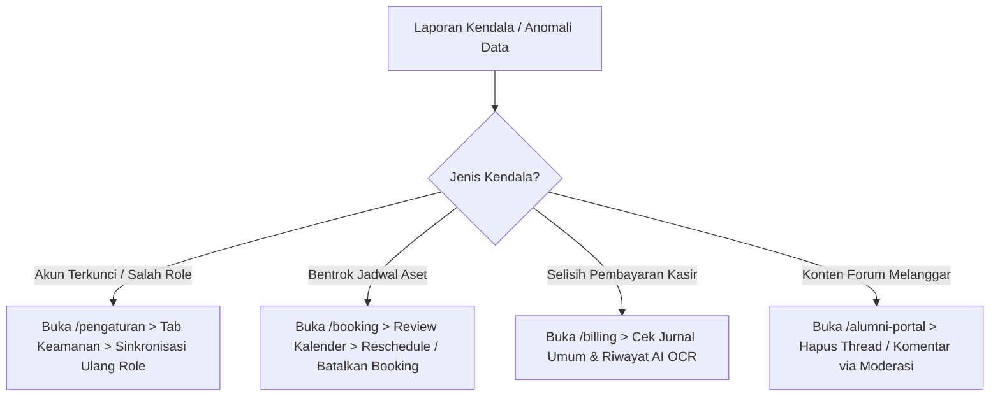

# 📘 Panduan Operasional: Super Administrator & Pimpinan Eksekutif
## Sistem Manajemen Kawasan Solo Technopark (Sintesa)

> **Kode Role:** `super_admin` & `admin`  
> **Sasaran Pengguna:** Pemimpin BLUD, Pejabat Teknis, Kepala Bagian Tata Usaha, dan Administrator Sistem Utama

---

## 1. Ringkasan Peran & Kewenangan

Sebagai **Super Administrator** atau **Pimpinan Eksekutif**, Anda memegang kendali tertinggi atas operasional platform Sintesa. Peran ini bertanggung jawab terhadap integritas data antar-divisi, pengelolaan perizinan berbasis peran (RBAC), penentuan parameter operasional kawasan, serta pengawasan kesehatan finansial BLUD.

### Rute Utama yang Diakses
- `/dashboard`: Panel eksekutif statistik performa 6 divisi utama.
- `/pengaturan`: Pengaturan profil instansi, keuangan BAS, sistem pengumuman, notifikasi email, dan RBAC.
- Seluruh rute operasional (`/aset`, `/booking`, `/jasa-produksi`, `/billing`, `/tenant`, `/pelatihan`, `/manajemen-karir`, `/manajemen-event`, `/manajemen-krenova`, `/manajemen-artikel`, `/manajemen-faq`).

---

## 2. Matriks Hak Akses & Permissions (RBAC)

| Modul / Aksi | Super Admin (`super_admin`) | Administrator (`admin`) | Keterangan |
| :--- | :---: | :---: | :--- |
| **Kelola Pengguna & Role RBAC** | ✅ Penuh | ❌ Dibatasi | Hanya `super_admin` yang berhak mengubah role akun staf/admin lain. |
| **Konfigurasi Sistem Global** | ✅ Penuh | ⚠️ Lihat Saja | Pengaturan pita pengumuman dan batas hari booking. |
| **Bagan Akun Standar (BAS) & Bank** | ✅ Penuh | ⚠️ Terbatas | Rekening bank tujuan penerimaan dan parameter invoice BLUD. |
| **Approval Sewa Aset & Fasilitas** | ✅ Penuh | ✅ Penuh | Menyetujui booking jadwal agar bebas bentrok. |
| **Hapus Transaksi Finansial** | ✅ Khusus | ❌ Dilarang | Penghapusan invoice memerlukan konfirmasi ganda pimpinan. |
| **Moderasi Forum Alumni & Karir** | ✅ Penuh | ✅ Penuh | Menghapus postingan spam atau melanggar etika di komunitas. |

---

## 3. Prosedur Operasional Standar (SOP) Langkah demi Langkah

### SOP 3.1: Manajemen Akun Staf & Penugasan Role (RBAC)
1. Buka menu **Pengaturan Sistem** (`/pengaturan`).
2. Klik tab **Keamanan (RBAC)** di bagian atas.
3. Cari nama atau email pengguna yang ingin disesuaikan hak aksesnya pada kolom pencarian.
4. Pada kolom **Role Saat Ini**, klik tombol *dropdown* dan pilih salah satu dari 20 peran yang tersedia (misal: `kasir`, `admin_aset`, `admin_pelatihan`).
5. Klik **Simpan Perubahan Role**.
6. Sistem akan memicu Cloud Function `syncUserRoleToClaims` yang menyematkan hak akses baru langsung ke JWT token pengguna.
7. Informasikan ke staf terkait untuk melakukan *logout* dan *login* ulang.

> [!IMPORTANT]  
> Jangan pernah memberikan role `super_admin` kepada pihak di luar pimpinan puncak atau staf IT penanggung jawab sistem utama.

---

### SOP 3.2: Mengatur Pengumuman Global (*Announcement Bar*)
1. Masuk ke `/pengaturan` lalu pilih tab **Konfigurasi Sistem**.
2. Pada bagian **Announcement Bar Global**, geser tombol *switch* ke posisi **Aktif**.
3. Ketikkan isi pengumuman pada kolom **Teks Pengumuman** (misal: *"Pendaftaran Batch Baru Pelatihan Vokasi RSKB telah dibuka!"*).
4. Masukkan teks tombol (misal: *"Lihat Program"*) dan rute tujuan (misal: `"/program-pelatihan"`).
5. Perhatikan kotak *Preview Banner* di bawah form untuk memastikan keterbacaan teks.
6. Klik tombol **Simpan Konfigurasi Sistem**. Pengumuman akan langsung tampil di seluruh halaman publik tanpa *rebuild* sistem.

---

### SOP 3.3: Menyesuaikan Jam Operasional & Batas Hari Booking
1. Di tab **Konfigurasi Sistem**, gulir ke bagian **Operasional Fasilitas & Batas Booking**.
2. Perbarui teks **Jam Operasional Layanan** (contoh: *"08:00 - 17:00 WIB (Senin - Jumat)"*).
3. Atur **Min. Pemesanan Dimuka (Hari)**: Masukkan angka `1` jika pelanggan paling lambat memesan H-1 sebelum acara.
4. Atur **Maks. Reservasi Dimuka (Hari)**: Masukkan angka `30` atau `60` hari kalender ke depan.
5. Klik **Simpan Konfigurasi Sistem**.

---

### SOP 3.4: Membaca Indikator Kesehatan Dashboard Eksekutif (`/dashboard`)
1. Akses menu **Dashboard Utama** (`/dashboard`).
2. Periksa 4 Kartu KPI Puncak:
   - **Total Pendapatan BLUD Berjalan**: Menghitung akumulasi penerimaan dari seluruh kuitansi lunas (`PAID`).
   - **Tingkat Okupansi Aset (%)**: Persentase waktu gedung dan ruang rapat yang terisi sewa.
   - **Serapan Lulusan Pelatihan (%)**: Rasio alumni yang berstatus *Bekerja (Full-time)* atau *Wirausaha* terhadap total lulusan.
   - **Jumlah Startup Aktif Binaan**: Jumlah tenant yang sedang menjalani masa inkubasi aktif.
3. Jika terdapat lonjakan pada antrean **Invoice Menunggu Verifikasi**, lakukan koordinasi dengan Divisi Keuangan/Kasir untuk verifikasi cepat.

---

## 4. Integrasi Lintas Divisi & Penanganan Insiden

---

## 5. Pertanyaan Kerap Diajukan (FAQ)

**T: Staf sudah diubah perannya menjadi `admin_keuangan`, tetapi saat membuka `/billing` muncul pesan "Akses Terbatas"?**  
*J: Token otentikasi Firebase Auth masih menyimpan role lama. Minta staf tersebut melakukan Logout di pojok kanan atas, lalu Login kembali.*

**T: Bagaimana cara mengganti nomor rekening bank yang tertera di seluruh invoice tagihan pelanggan?**  
*J: Masuk ke `/pengaturan` -> Tab **Billing & Keuangan**. Anda dapat menambah, menyunting nomor rekening, nama bank, serta nama pemilik rekening yang otomatis tercetak di footer invoice.*

---

## 6. Lembar Checklist Harian Pimpinan

- [ ] Memeriksa ringkasan transaksi masuk pada `/dashboard`.
- [ ] Memastikan tidak ada pengaduan fasilitas atau aset yang terbengkalai pada `/booking`.
- [ ] Meninjau kelengkapan laporan serapan kerja alumni di `/manajemen-karir`.
- [ ] Mengontrol keaktifan pita pengumuman publik jika ada agenda nasional/daerah di kawasan.
