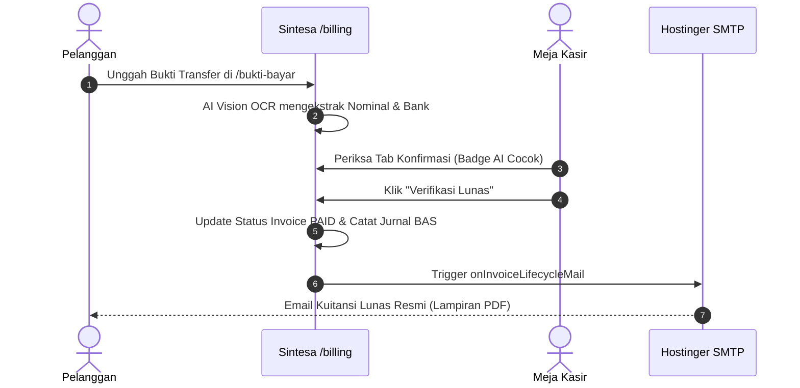

# 📘 Panduan Operasional: Keuangan, Billing, & Meja Kasir
## Sistem Manajemen Kawasan Solo Technopark (Sintesa)

> **Kode Role:** `admin_keuangan`, `kasir`, & `kasir_pengeluaran`  
> **Sasaran Pengguna:** Bendahara Penerimaan BLUD, Staf Meja Kasir (POS), Staf Kasir Pengeluaran (AP), dan Petugas Pembukuan Keuangan

---

## 1. Ringkasan Peran & Kewenangan

Divisi Keuangan bertanggung jawab mengelola seluruh arus kas masuk (*Account Receivable*) dan kas keluar (*Account Payable*) Solo Technopark sesuai standar Akuntansi Keuangan Badan Layanan Umum Daerah (BLUD). 

### Pembagian Tugas:
1. **Kasir Pendapatan (`kasir`)**: Melayani pembayaran langsung, memeriksa transfer pelanggan dengan asistensi AI OCR, menerbitkan kuitansi resmi, dan mencetak struk thermal.
2. **Kasir Pengeluaran (`kasir_pengeluaran`)**: Mencatat pengeluaran kas operasional, belanja persediaan, serta mengunggah bukti nota fisik.
3. **Admin Keuangan (`admin_keuangan`)**: Mengatur Bagan Akun Standar (BAS/COA), rekonsiliasi jurnal umum, menyetujui pengeluaran, dan menyusun laporan keuangan berkala.

---

## 2. Matriks Hak Akses Modul Keuangan

| Fitur / Tindakan | Kasir Pendapatan | Kasir Pengeluaran | Admin Keuangan |
| :--- | :---: | :---: | :---: |
| **Lihat Antrean Konfirmasi Bukti Bayar** | ✅ Penuh | ⚠️ Lihat Saja | ✅ Penuh |
| **Verifikasi Lunas Tagihan (Pelunasan)** | ✅ Penuh | ❌ Tidak Berhak | ✅ Penuh |
| **Buat Invoice Tagihan Baru** | ✅ Penuh | ❌ Tidak Berhak | ✅ Penuh |
| **Catat Pengeluaran Beban / Kas Kecil** | ❌ Tidak Berhak | ✅ Penuh | ✅ Penuh |
| **Persetujuan (Approval) Pengeluaran** | ❌ Tidak Berhak | ❌ Tidak Berhak | ✅ Penuh |
| **Kelola Bagan Akun Standar (BAS / COA)** | ❌ Tidak Berhak | ❌ Tidak Berhak | ✅ Penuh |
| **Lihat Laporan Keuangan & Jurnal Umum** | ⚠️ Terbatas | ⚠️ Terbatas | ✅ Penuh |

---

## 3. Prosedur Operasional Standar (SOP) Langkah demi Langkah

### SOP 3.1: Verifikasi Bukti Transfer dengan Asistensi AI OCR di Meja Kasir
1. Buka menu **Billing & Invoice** (`/billing`).
2. Klik tab **Konfirmasi Pembayaran**. Pada tab ini terlihat daftar pelanggan yang baru saja mengunggah bukti transfer via portal publik atau profil.
3. Perhatikan kolom **Pemeriksaan AI**:
   - 🟢 **AI: Cocok 100% ✅**: AI Vision OCR mendeteksi nominal pada foto struk tepat sama dengan sisa tagihan invoice.
   - 🟡 **AI: Perlu Cek Manual ⚠️**: Terdapat perbedaan nominal, tanggal transfer tidak cocok, atau foto buram.
4. Klik tombol **Periksa Bukti** untuk membuka modal detail invoice.
5. Kasir membandingkan foto mutasi asli dengan ringkasan AI (Bank Pengirim, Tanggal, Nominal yang terbaca).
6. Jika pembayaran valid:
   - Pilih metode pembayaran (misal: *Transfer Bank BNI / Bank Jateng*).
   - Masukkan nominal yang diterima.
   - Klik **Verifikasi Lunas & Terbitkan Kuitansi**.
7. Sistem otomatis:
   - Mengubah status tagihan menjadi `PAID`.
   - Mengirimkan email kuitansi resmi ber-PDF ke email pelanggan.
   - Mengirim notifikasi lonceng ke akun pelanggan.
   - Menambahkan catatan ke Buku Kas & Jurnal Umum BAS secara *real-time*.

---

### SOP 3.2: Penerbitan Invoice Baru Lintas Divisi
1. Pada menu `/billing`, klik tombol **+ Buat Tagihan Baru**.
2. Pilih **Jenis Pelanggan**: *Tenant Binaan* atau *Pelanggan Umum*.
3. Lengkapi identitas pelanggan: Nama, Nomor Telepon/WhatsApp, dan Email aktif.
4. Pilih **Divisi Layanan**:
   - `FASILITAS_ASET`: Untuk sewa gedung, coworking, atau ruang pertemuan.
   - `JASA_PRODUKSI`: Untuk pesanan bengkel manufaktur CNC/Fabrikasi.
   - `DIKLAT_PELATIHAN`: Untuk biaya kursus/pelatihan berbayar.
   - `INKUBASI_TENANT`: Untuk biaya utilitas/fasilitas binaan startup.
   - `KATALOG_PRODUK`: Untuk penjualan produk fisik inovasi.
5. Tambahkan rincian item layanan, volume, dan tarif satuan.
6. Tentukan **Syarat Pembayaran (Term)**:
   - *Full Payment*: Tagihan 100% langsung.
   - *Down Payment (DP)*: Uang muka (misal 30% atau 50%).
   - *Installment / Termin*: Pembayaran bertahap dengan batas jatuh tempo per tahap.
7. Pilih akun rekening tujuan pembayaran BLUD yang akan tertera pada invoice.
8. Klik **Simpan & Terbitkan Invoice**. Invoice siap dicetak atau dikirim tautan pembayarannya ke pelanggan.

---

### SOP 3.3: Pencatatan Pengeluaran Operasional (Kasir AP)
1. Di halaman `/billing`, masuk ke tab **Pengeluaran Operasional**.
2. Klik tombol **+ Catat Pengeluaran Baru**.
3. Isi tanggal pengeluaran, nominal biaya, dan nama penerima dana.
4. Pilih **Kategori Akun COA Beban** (misal: *5.1.02.01 - Beban Bahan Perawatan Aset*).
5. Unggah foto nota fisik / struk belanja sebagai dokumen pendukung wajib.
6. Klik **Ajukan Pengeluaran**. Status transaksi akan berstatus `MENUNGGU_APPROVAL` sebelum disahkan oleh Admin Keuangan.

---

### SOP 3.4: Pengelolaan Bagan Akun Standar (BAS) & Jurnal Umum
1. Sebagai **Admin Keuangan**, buka tab **Buku Besar & COA** di `/billing`.
2. Untuk menambah akun rekening BAS:
   - Klik **Tambah Kode Akun**.
   - Masukkan Kode Rekening (contoh: `4.1.01.02`), Nama Akun (`Pendapatan Sewa Gedung Serbaguna`), dan Kelompok Akun (`Pendapatan Jasa Layanan`).
3. Sistem secara otomatis mencatat setiap penerimaan kuitansi ke Jurnal Umum berpasangan (*Double-Entry Bookkeeping*):
   - **Debit**: Rekening Kas BLUD Bank Jateng / BNI.
   - **Kredit**: Rekening Pendapatan Layanan bersangkutan.
4. Saldo Debit dan Kredit wajib selalu seimbang (`totalDebit === totalCredit`).

---

## 4. Alur Integrasi Notifikasi Otomatis

---

## 5. Pertanyaan Kerap Diajukan (FAQ)

**T: Pelanggan membayar secara tunai langsung di meja kasir Solo Technopark, bagaimana prosedurnya?**  
*J: Buka invoice pelanggan yang bersangkutan di `/billing`, klik tombol **Bayar Langsung**, pilih metode `TUNAI`, masukkan nominal uang yang diterima, lalu klik Simpan. Sistem langsung mencetak bukti tanda terima tunai.*

**T: Bagaimana jika hasil AI OCR menyatakan "Perlu Cek Manual"?**  
*J: Kasir cukup memeriksa mutasi pada internet banking instansi (misal CMS Bank Jateng). Jika dana benar-benar sudah masuk ke rekening giro STP, kasir tetap dapat mengklik Verifikasi Lunas secara manual.*

---

## 6. Lembar Checklist Harian Divisi Keuangan

- [ ] Memeriksa seluruh antrean pada tab *Konfirmasi Pembayaran* hingga bersih di akhir jam kerja.
- [ ] Merekonsiliasi total penerimaan kasir harian dengan rekening koran bank.
- [ ] Menyetujui atau meninjau pengajuan beban operasional harian.
- [ ] Mengontrol jatuh tempo invoice sewa gedung yang mendekati H-1.

