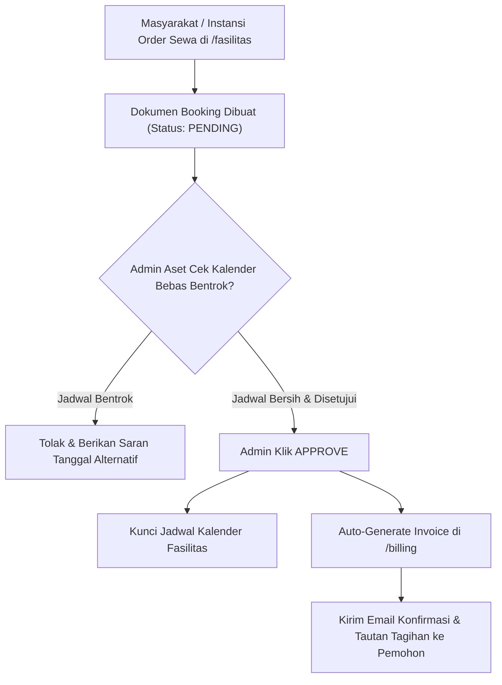

# 📘 Panduan Operasional: Aset, Fasilitas, & Reservasi Jadwal
## Sistem Manajemen Kawasan Solo Technopark (Sintesa)

> **Kode Role:** `admin_aset` & `operator_aset`  
> **Sasaran Pengguna:** Penanggung Jawab Pemanfaatan Fasilitas, Tim Sarana Prasarana (Sarpras), dan Operator Lapangan Gedung

---

## 1. Ringkasan Peran & Kewenangan

Divisi Aset bertanggung jawab atas pengelolaan fisik seluruh sarana dan prasarana di kawasan Solo Technopark seluas puluhan hektar, mencakup ruang auditorium, gedung serbaguna, ruang kelas diklat, ruang rapat VIP, area *coworking*, serta mesin-mesin canggih di laboratorium inovasi.

### Pembagian Tugas:
1. **Admin Aset (`admin_aset`)**: Mendaftarkan inventaris aset, menentukan tarif resmi pemakaian, meninjau permohonan reservasi masyarakat/instansi, dan menyetujui jadwal bebas bentrok.
2. **Operator Aset (`operator_aset`)**: Memeriksa fisik ruangan sebelum acara, memandu teknis penyewa gedung (sound system, proyektor, AC), dan memeriksa inventaris pasca acara.

---

## 2. Matriks Hak Akses Modul Aset & Reservasi

| Fitur / Tindakan | Operator Aset | Admin Aset | Keterangan |
| :--- | :---: | :---: | :--- |
| **Lihat Daftar Aset & Kalender Jadwal** | ✅ Penuh | ✅ Penuh | Dapat melihat ketersediaan tanggal seluruh fasilitas. |
| **Tambah / Edit Master Data Aset** | ⚠️ Terbatas | ✅ Penuh | Menambah ruang baru, foto, deskripsi, & kapasitas. |
| **Ubah Struktur Tarif Sewa** | ❌ Dilarang | ✅ Penuh | Menentukan tarif per jam, per hari, atau per bulan. |
| **Approve / Tolak Permohonan Booking** | ❌ Dilarang | ✅ Penuh | Menyetujui reservasi yang otomatis memicu invoice. |
| **Checklist Fisik & Serah Terima Ruangan** | ✅ Penuh | ✅ Penuh | Checklist inventaris sarana sebelum dan sesudah acara. |
| **Cetak Tiket & Bukti Reservasi** | ✅ Penuh | ✅ Penuh | Tiket resmi izin pemakaian tempat. |

---

## 3. Prosedur Operasional Standar (SOP) Langkah demi Langkah

### SOP 3.1: Mendaftarkan Aset / Ruangan Baru di Sistem
1. Masuk ke menu **Manajemen Aset** (`/aset`).
2. Klik tombol **+ Tambah Aset Baru**.
3. Lengkapi form profil aset:
   - **Nama Aset / Ruangan**: Contoh: *"Auditorium Ki Hajar Dewantara"*.
   - **Kategori**: Pilih *Gedung / Ruang Pertemuan / Coworking / Mesin Produksi / Kendaraan Operasional*.
   - **Lokasi Fisik**: Misal: *Gedung Utama Lantai 2*.
   - **Kapasitas Maksimal**: Misal: *300 Orang*.
   - **Fasilitas Bawaan**: Centang sound system, proyektor laser, mikrofon wireless, AC sentral, podium.
4. Tentukan **Skema Tarif Sewa**:
   - Tarif per Jam (jika disewakan hitungan jam).
   - Tarif per Hari (pukul 08.00 - 17.00 WIB).
   - Tarif per Bulan (khusus sewa ruang tenant startup).
5. Unggah foto-foto resolusi tinggi ruangan untuk katalog publik.
6. Klik **Simpan Aset**. Fasilitas langsung muncul di katalog publik `/fasilitas` sehingga masyarakat dapat melakukan permohonan pemesanan.

---

### SOP 3.2: Memeriksa dan Menyetujui Booking Jadwal Bebas Bentrok
1. Buka menu **Booking & Jadwal** (`/booking`).
2. Buka tab **Kalender Reservasi** untuk melihat visualisasi okupansi jadwal seluruh aset.
3. Pada tab **Permohonan Menunggu**, klik salah satu permohonan booking yang berstatus `PENDING`.
4. Sistem secara otomatis melakukan pengecekan tumpang tindih waktu (*Overlap Conflict Check*). Jika kalender bersih, status validasi akan menampilkan lencana hijau *"Jadwal Tersedia"*.
5. Admin meninjau berkas surat permohonan atau proposal acara yang dilampirkan pemohon.
6. Jika permohonan disetujui:
   - Klik tombol **Setujui Permohonan (Approve)**.
   - Status booking berubah menjadi `CONFIRMED`.
   - Sistem secara instan:
     - Mengunci jadwal aset pada kalender sehingga tidak dapat dipesan orang lain.
     - Menerbitkan Invoice otomatis ke meja kasir (`/billing`) dengan nomor ref `/BKG/...`.
     - Mengirimkan email konfirmasi persetujuan jadwal dan tautan tagihan ke pemohon.
7. Jika ditolak (misal ruangan sedang masa renovasi):
   - Klik **Tolak Permohonan**, ketikkan alasan penolakan, lalu klik Kirim. Email notifikasi penolakan akan otomatis terkirim.

---

### SOP 3.3: Checklist Lapangan & Serah Terima Ruangan (Operator Lapangan)
1. Pada hari H-1 sebelum acara, operator membuka detail tiket booking di aplikasi `/booking`.
2. Lakukan inspeksi fisik ke lokasi:
   - Kebersihan ruangan dan toilet.
   - Kesiapan listrik, pendingin udara (AC), dan internet Wi-Fi.
   - Fungsi peralatan presentasi (sound system dan kabel HDMI).
3. Saat penyewa tiba di lokasi:
   - Tunjukkan ruangan dan minta penanggung jawab menandatangani formulir serah terima fisik.
4. Pasca acara selesai:
   - Lakukan pemeriksaan akhir. Pastikan tidak ada kerusakan fasilitas atau inventaris yang hilang sebelum penyewa meninggalkan area kawasan.

---

## 4. Alur Integrasi Otomatis Booking & Billing

---

## 5. Pertanyaan Kerap Diajukan (FAQ)

**T: Pemohon ingin mengubah tanggal acara (*Reschedule*), bagaimana prosedurnya?**  
*J: Buka tiket booking bersangkutan di `/booking`. Klik tombol **Reschedule Tanggal**, pilih tanggal baru yang kosong di kalender, lalu klik Simpan. Sistem akan memindahkan blok jadwal dan memperbarui data tagihan secara otomatis.*

**T: Apakah instansi pemerintah yang meminjam tempat secara gratis tetap perlu dicatat di sistem?**  
*J: Ya, tetap wajib diinputkan booking dengan memilih opsi **Bebas Biaya / Diskon 100% (Surat Dispensasi Pimpinan)** agar jadwal ruangan tetap terkunci di kalender dan tidak tertabrak oleh penyewa umum berbayar.*

---

## 6. Lembar Checklist Harian Tim Aset & Sarpras

- [ ] Membuka kalender `/booking` pada pagi hari untuk merekap agenda acara yang berlangsung hari ini.
- [ ] Memproses seluruh permohonan booking baru yang masuk maksimal 1x24 jam kerja.
- [ ] Berkoordinasi dengan petugas kebersihan (*cleaning service*) dan teknisi kelistrikan untuk ruangan acara H-1.
- [ ] Memastikan AC dan lampu dimatikan di seluruh gedung yang telah selesai digunakan.

