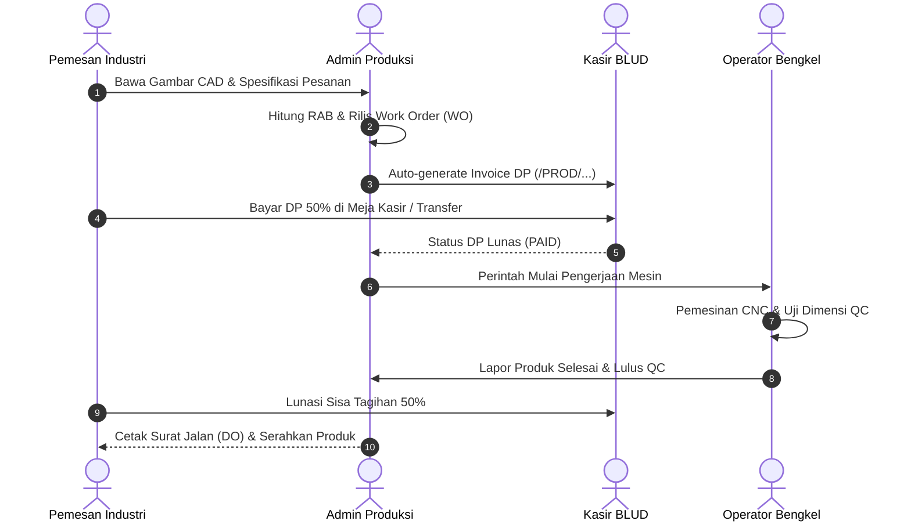

# 📘 Panduan Operasional: Layanan Jasa Produksi & Manufaktur
## Sistem Manajemen Kawasan Solo Technopark (Sintesa)

> **Kode Role:** `admin_produksi` & `operator_produksi`  
> **Sasaran Pengguna:** Manajer Bengkel Manufaktur, Estimator Teknis, Operator Mesin CNC, Mekanik Fabrikasi, dan Quality Control (QC)

---

## 1. Ringkasan Peran & Kewenangan

Layanan Jasa Produksi Solo Technopark melayani kebutuhan manufaktur presisi, rekayasa mekanik, pembuatan prototipe inovasi, jasa permesinan CNC (*Computer Numerical Control*), bubut konvensional, cetak 3D (*3D Printing*), serta fabrikasi lembaran logam (*sheet metal*) bagi industri, kampus, dan UMKM.

### Pembagian Tugas:
1. **Admin Produksi (`admin_produksi`)**: Menerima pesanan teknis, mereview gambar kerja/CAD, menghitung Rencana Anggaran Biaya (RAB), menerbitkan *Work Order* (SPK), dan menerbitkan Surat Jalan (DO).
2. **Operator Produksi (`operator_produksi`)**: Mengeksekusi pengerjaan pada mesin produksi bengkel, mencatat jam operasi mesin (*machine running hours*), dan melakukan pengujian dimensi *Quality Control* (QC).

---

## 2. Matriks Hak Akses Modul Jasa Produksi

| Fitur / Tindakan | Operator Bengkel | Admin Produksi | Keterangan |
| :--- | :---: | :---: | :--- |
| **Lihat Antrean Work Order (SPK)** | ✅ Penuh | ✅ Penuh | Memantau daftar pekerjaan mesin bengkel. |
| **Buat Perintah Kerja (Work Order) Baru** | ❌ Dilarang | ✅ Penuh | Menetapkan nomor SPK pesanan pelanggan. |
| **Kalkulasi RAB Bahan & Jasa Mesin** | ⚠️ Terbatas | ✅ Penuh | Menghitung ongkos material & tarif per jam mesin. |
| **Update Progres Mesin (Tahapan Bengkel)**| ✅ Penuh | ✅ Penuh | Mengubah status dari Bahan Baku ke QC. |
| **Catat Jam Operasi Mesin & Sisa Bahan** | ✅ Penuh | ✅ Penuh | Menjaga efisiensi bahan dan perawatan mesin. |
| **Cetak Surat Jalan / Delivery Order (DO)** | ❌ Dilarang | ✅ Penuh | Dokumen serah terima produk jadi ke pemesan. |

---

## 3. Prosedur Operasional Standar (SOP) Langkah demi Langkah

### SOP 3.1: Penerimaan Pesanan & Pembuatan Work Order (SPK) Baru
1. Masuk ke menu **Jasa Produksi** (`/jasa-produksi`).
2. Klik tombol **+ Buat Perintah Kerja (WO) Baru**.
3. Isi informasi pemesan: Nama Perusahaan / Instansi Pemesan, Kontak PIC, dan Email.
4. Input parameter teknis pekerjaan:
   - **Nama Komponen / Pekerjaan**: Misal: *"Fabrikasi Poros Impeller Pompa Air Baja Paduan"*.
   - **Jenis Permesinan yang Digunakan**: Pilih *CNC Milling 5-Axis / CNC Lathe / 3D Printing Industrial / Wire Cut EDM / Welding*.
   - **Spesifikasi Material**: Misal: *Stainless Steel SUS304 / Aluminium 6061 / Filamen PLA+*.
   - **Volume / Jumlah Pesanan**: Misal: *50 Unit*.
5. Unggah berkas gambar kerja teknis (format PDF gambar teknik atau file 3D CAD `.step` / `.stl`).
6. Klik **Hitung RAB Biaya**:
   - Biaya Bahan Baku: Nominal total material yang dipotong.
   - Biaya Operasi Mesin: (Estimasi Jam Pengerjaan) × (Tarif Sewa Mesin per Jam BLUD).
   - Biaya Finishing & QC: Ongkos perlakuan panas / pelapisan permukaan.
7. Simpan Work Order. Sistem akan menerbitkan nomor SPK resmi (misal: `WO-2026-PRD-042`).

---

### SOP 3.2: Koordinasi Uang Muka (DP) ke Divisi Keuangan
1. Setelah Work Order disetujui pemesan, klik tombol **Terbitkan Tagihan (Invoice)** di pojok kanan atas WO.
2. Sistem otomatis membuat dokumen invoice di modul `/billing` dengan prefix divisi `/PROD/...`.
3. Tentukan syarat pembayaran uang muka (minimal DP 50% untuk pengadaan bahan baku).
4. Operator bengkel **TIDAK DIPERKENANKAN** memulai pemotongan bahan baku sebelum status tagihan DP tercatat `PAID` atau disahkan oleh Admin Keuangan.

---

### SOP 3.3: Eksekusi Pengerjaan & Pembaruan Progres (Operator Bengkel)
1. Operator mesin membuka aplikasi `/jasa-produksi` pada tablet bengkel.
2. Pilih nomor Work Order yang ditugaskan.
3. Geser tahapan pengerjaan secara bertahap:
   - 🟡 **Persiapan Bahan**: Pengambilan material dari gudang dan pemotongan kasar.
   - 🔵 **Pengerjaan Mesin (Machining)**: Mesin CNC sedang beroperasi memotong part. Catat durasi jam kerja mesin.
   - 🟣 **Quality Control (QC)**: Pengukuran dimensi toleransi menggunakan jangka sorong, mikrometer, atau mesin CMM (*Coordinate Measuring Machine*).
   - 🟢 **Selesai / Siap Diambil**: Komponen telah dibersihkan, diverifikasi QC, dan dikemas rapi.
4. Jika terdapat *reject* atau patah pisau pahat (*tool wear*), catat pada kolom catatan insiden bengkel.

---

### SOP 3.4: Serah Terima Produk & Penerbitan Surat Jalan (Delivery Order)
1. Pelanggan datang ke bengkel Solo Technopark untuk mengambil pesanan jadi.
2. Admin Produksi memastikan sisa pelunasan tagihan 100% sudah diverifikasi lunas oleh Kasir.
3. Klik tombol **Cetak Surat Jalan (DO)** di halaman detail Work Order.
4. Cetak rangkap 2 dokumen Surat Jalan:
   - Lembar 1: Diserahkan kepada pelanggan sebagai bukti serah terima resmi.
   - Lembar 2: Ditandatangani pemesan dan disimpan sebagai arsip internal bengkel.
5. Klik tombol **Tandai Pekerjaan Selesai (Completed)** untuk menutup tiket produksi.

---

## 4. Alur Integrasi Alur Kerja Manufaktur

---

## 5. Pertanyaan Kerap Diajukan (FAQ)

**T: Pemesan meminta perubahan desain di tengah-tengah proses pemesinan berjalan?**  
*J: Segera minta operator menghentikan operasi mesin. Admin Produksi wajib membuat addendum Work Order (Revisi RAB Tambahan) jika perubahan mengakibatkan terbuangnya material awal atau menambah jam mesin baru.*

**T: Bagaimana cara menghitung tarif pengerjaan jika menggunakan mesin 3D printer berjam-jam?**  
*J: Tarif dihitung berdasarkan berat gram filamen yang terpakai ditambah tarif daya listrik/jam operasional mesin sesuai peraturan tarif layanan BLUD yang terdaftar di sistem.*

---

## 6. Lembar Checklist Harian Tim Bengkel Manufaktur

- [ ] Memastikan Alat Pelindung Diri (APD: kacamata safety, sepatu safety, earplug) dipakai seluruh teknisi bengkel.
- [ ] Memeriksa ketersediaan oli pendingin (*coolant*) dan pelumas mesin CNC sebelum saklar utama dihidupkan.
- [ ] Memperbarui status seluruh Work Order yang sedang dikerjakan sebelum pergantian shift kerja.
- [ ] Membersihkan serbuk logam (*scrap/chips*) dari meja mesin dan mengunci panel kelistrikan di akhir hari.
