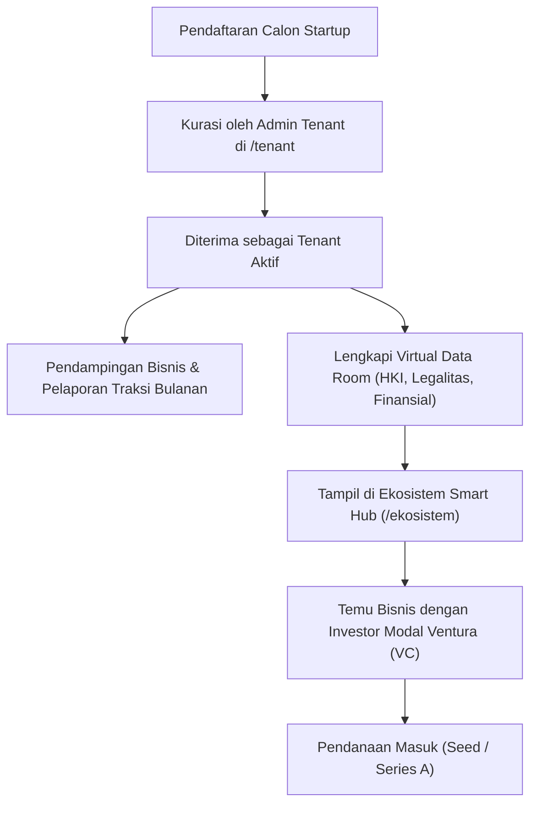

# 📘 Panduan Operasional: Inkubasi Startup, Tenant, & Inovasi KRENOVA
## Sistem Manajemen Kawasan Solo Technopark (Sintesa)

> **Kode Role:** `admin_tenant` & `operator_tenant`  
> **Sasaran Pengguna:** Manajer Inkubator Bisnis, Pendamping Tenant Startup, Panitia Lomba KRENOVA, dan Pengelola Event Ekosistem

---

## 1. Ringkasan Peran & Kewenangan

Divisi Inkubasi & Ekosistem Startup bertanggung jawab membina, menginkubasi, dan mengakselerasi pertumbuhan wirausaha berbasis teknologi (*technopreneur*) di Solo Technopark. Divisi ini juga memfasilitasi temu bisnis (*matchmaking*) dengan investor serta menyelenggarakan kompetisi inovasi tahunan Kota Surakarta (**KRENOVA**).

### Pembagian Tugas:
1. **Admin Tenant (`admin_tenant`)**: Menyeleksi calon startup binaan, memverifikasi portofolio legalitas & VDR, mengevaluasi putaran pendanaan (*funding rounds*), dan mengelola penjurian Krenova.
2. **Operator Tenant (`operator_tenant`)**: Membantu administrasi onboarding tenant, memantau pengisian laporan traksi bulanan (omzet & tim), dan mengkoordinasikan pelaksanaan workshop mentoring.

---

## 2. Matriks Hak Akses Modul Inkubasi & Tenant

| Fitur / Tindakan | Operator Tenant | Admin Tenant | Keterangan |
| :--- | :---: | :---: | :--- |
| **Lihat Profil & Daftar Seluruh Tenant** | ✅ Penuh | ✅ Penuh | Data master startup inkubasi. |
| **Kurasi & Penerimaan Tenant Baru** | ⚠️ Review Saja | ✅ Penuh | Menyetujui status Menunggu Review -> Aktif. |
| **Monitoring Traksi Omzet & Jumlah Tim** | ✅ Penuh | ✅ Penuh | Evaluasi performa perkembangan bisnis binaan. |
| **Kelola Cap Table, VDR, & Putaran Dana** | ⚠️ Terbatas | ✅ Penuh | Akses dokumen rahasia legalitas & kepemilikan saham. |
| **Penjurian & Rekap Lomba KRENOVA** | ✅ Rekap Nilai | ✅ Penuh | Mengatur dewan juri dan publikasi pemenang inovasi. |
| **Manajemen Event Demo Day & Expo** | ✅ Penuh | ✅ Penuh | Pendaftaran peserta, tier tiket, & agenda pembicara. |

---

## 3. Prosedur Operasional Standar (SOP) Langkah demi Langkah

### SOP 3.1: Kurasi dan Penerimaan Calon Tenant Startup
1. Buka menu **Inkubasi Tenant** (`/tenant`).
2. Masuk ke tab **Menunggu Review**.
3. Klik nama startup yang mendaftar untuk membuka lembar evaluasi calon tenant.
4. Periksa komponen penilaian kurasi:
   - **Profil Usaha**: Nama startup, sektor bisnis (*Teknologi Informasi / Rekayasa / Agrotek / Industri Kreatif*).
   - **Problem & Solution Statement**: Kejelasan masalah yang dipecahkan dan keunggulan nilai produk.
   - **Pitch Deck & Legalitas**: Unduh dan pelajari slide presentasi dan izin usaha (NIB/PT/CV).
5. Jika memenuhi kriteria inkubasi:
   - Klik tombol **Terima Menjadi Tenant Aktif (Approve)**.
   - Tentukan nama program inkubasi (misal: *Inkubasi Startup Batch 2026*).
   - Berikan kode akses (*Access Code*) dan tautan aktivasi akun portal tenant.
   - Status tenant berubah menjadi `Aktif`.
6. Jika belum memenuhi syarat:
   - Klik tombol **Tolak dengan Catatan**, masukkan masukan perbaikan bisnis, lalu kirim email evaluasi.

---

### SOP 3.2: Pengawasan Traksi Bulanan & Cap Table Saham
1. Pada menu `/tenant`, buka salah satu profil tenant aktif.
2. Buka tab **Traksi & Pertumbuhan**:
   - Tinjau grafik omzet bulanan (*Monthly Revenue*).
   - Tinjau jumlah penyerapan tenaga kerja (*Team Size*).
   - Periksa capaian target milestone (misal: *Peluncuran Aplikasi v1.0, Ekspor Perdana*).
3. Buka tab **Struktur Permodalan (Cap Table)**:
   - Pantau komposisi persentase saham founder, investor, dan opsi karyawan (*ESOP*).
4. Buka tab **Putaran Pendanaan (Funding Rounds)**:
   - Verifikasi tahap pendanaan yang sedang dijalani (*Bootstrapped / Pre-Seed / Seed / Pre-Series A / Series A / Series B+*).
   - Input nominal pendanaan yang berhasil diraih dan nama investor penyuntik dana untuk bahan laporan statistik kinerja BLUD.

---

### SOP 3.3: Penatausahaan Virtual Data Room (VDR)
1. Pada tab **Virtual Data Room (VDR)** profil tenant, pastikan berkas esensial telah terunggah:
   - Akta Pendirian Perusahaan & SK Kemenkumham.
   - Sertifikat HKI / Paten Merek dari DJKI.
   - Dokumen Model Finansial (*Financial Projection* 3 tahun).
2. Dokumen pada VDR ini dilindungi secara ketat dan hanya dapat dilihat oleh Tim Inkubator dan Mitra Investor terverifikasi di portal Smart Hub.

---

### SOP 3.4: Pengelolaan Lomba Inovasi KRENOVA Kota Surakarta
1. Buka menu **Manajemen KRENOVA** (`/manajemen-krenova`).
2. Buka tab **Proposal Masuk**.
3. Filter berdasarkan kategori peserta (*Pelajar / Mahasiswa / Masyarakat Umum / Tenaga Pendidik*).
4. Unduh berkas karya tulis inovasi dan video demonstrasi alat.
5. Berikan penilaian berdasarkan 4 kriteria baku Krenova:
   - Orisinalitas & Kebaruan Ide (Bobot 25%).
   - Kemanfaatan bagi Masyarakat Surakarta (Bobot 35%).
   - Kemudahan Penerapan & Skalabilitas Industri (Bobot 20%).
   - Efisiensi Biaya Produksi (Bobot 20%).
6. Input nilai angka (0 - 100) dan catatan dewan juri, lalu klik **Simpan Penilaian**.
7. Sistem otomatis menyusun peringkat nominasi (*Leaderboard*) untuk penentuan Juara 1, 2, 3, dan Harapan.

---

## 4. Alur Integrasi Ekosistem Inkubasi ke Investor Hub

---

## 5. Pertanyaan Kerap Diajukan (FAQ)

**T: Startup binaan sudah lulus masa inkubasi (2 tahun), bagaimana statusnya di sistem?**  
*J: Buka profil tenant bersangkutan, ubah status dari `Aktif` menjadi `Alumni`. Data profil mereka tetap tersimpan di direktori etalase inovasi kawasan namun tagihan sewa inkubator dihentikan.*

**T: Siapa saja yang berhak melihat dokumen Virtual Data Room (VDR) tenant?**  
*J: Hanya akun dengan role `super_admin`, `admin_tenant`, dan akun mitra dengan role `investor` yang telah menandatangani persetujuan kerahasiaan (*Non-Disclosure Agreement/NDA*).*

---

## 6. Lembar Checklist Harian Pendamping Tenant

- [ ] Memeriksa apakah ada pengajuan pendaftaran tenant baru yang masuk di tab *Menunggu Review*.
- [ ] Mengingatkan tenant binaan untuk mengupdate laporan omzet dan penambahan karyawan di awal bulan.
- [ ] Memastikan tidak ada kendala fasilitas ruangan atau Wi-Fi bagi tenant yang berkantor di gedung inkubator.
- [ ] Menyiapkan materi dan absensi digital untuk agenda workshop mentoring mingguan.

