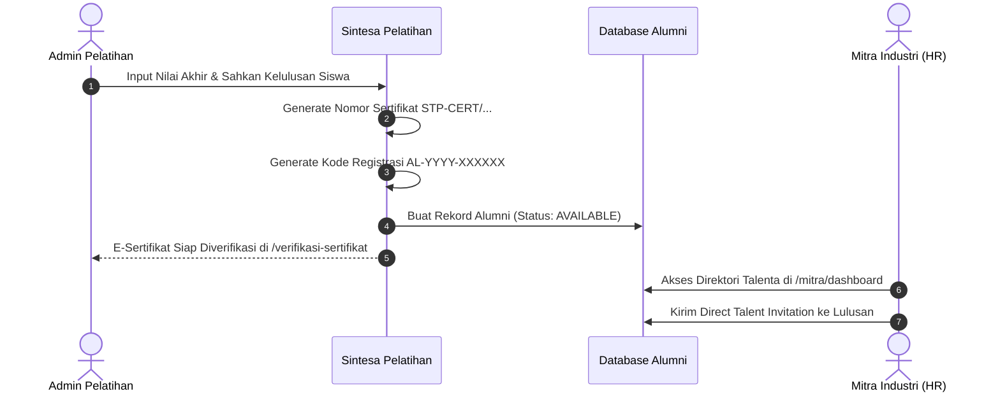

# 📘 Panduan Operasional: Pelatihan Vokasi, LMS, & Tracer Study
## Sistem Manajemen Kawasan Solo Technopark (Sintesa)

> **Kode Role:** `admin_pelatihan` & `operator_pelatihan`  
> **Sasaran Pengguna:** Pengelola Balai Latihan Kerja/Vokasi STP, Koordinator Program Rumah Siap Kerja Bersama (RSKB), Operator Kelas LMS, dan Analis Data Lulusan

---

## 1. Ringkasan Peran & Kewenangan

Divisi Pelatihan Vokasi Solo Technopark bertugas menyelenggarakan pendidikan keterampilan berbasis kompetensi industri, mengelola platform pembelajaran digital (*Learning Management System* / LMS), menerbitkan sertifikasi resmi, serta melacak keterserapan kerja para lulusan (*Tracer Study*) baik dari program reguler STP Vokasi maupun program kemitraan Pemkot Surakarta (RSKB).

### Pembagian Tugas:
1. **Admin Pelatihan (`admin_pelatihan`)**: Merancang program diklat, menyusun kurikulum & silabus, menugaskan instruktur, mensahkan kelulusan siswa, menerbitkan sertifikat, dan mengontrol analitik serapan kerja industri.
2. **Operator Pelatihan (`operator_pelatihan`)**: Mengelola berkas pendaftaran calon siswa, presensi harian siswa, mengunggah materi ajar di LMS, dan merekap nilai ujian teori/praktik.

---

## 2. Matriks Hak Akses Modul Pelatihan & Tracer Study

| Fitur / Tindakan | Operator Pelatihan | Admin Pelatihan | Keterangan |
| :--- | :---: | :---: | :--- |
| **Buka Program & Batch Pelatihan Baru** | ⚠️ Draft Saja | ✅ Penuh | Menentukan silabus, kuota kelas, & jadwal. |
| **Kelola Peserta & Absensi Kelas LMS** | ✅ Penuh | ✅ Penuh | Input kehadiran & tugas harian peserta. |
| **Input Nilai Ujian Akhir Kompetensi** | ✅ Input Nilai | ✅ Pengesahan | Nilai teori dan praktik bengkel/lab. |
| **Terbitkan E-Sertifikat Kelulusan** | ❌ Dilarang | ✅ Penuh | Generate nomor registrasi resmi `STP-CERT/...`. |
| **Konversi Siswa Lulus Menjadi Alumni** | ❌ Dilarang | ✅ Otomatis | Mengisi database `alumnis` berstatus `AVAILABLE`. |
| **Pantau Analitik Tracer Study & Serapan**| ⚠️ Terbatas | ✅ Penuh | Grafik serapan kerja STP Vokasi & RSKB. |
| **Ekspor Data Lulusan (Excel / CSV)** | ❌ Dilarang | ✅ Penuh | Ekspor rekapan untuk pelaporan Walikota/BLUD. |

---

## 3. Prosedur Operasional Standar (SOP) Langkah demi Langkah

### SOP 3.1: Membuka Program & Batch Pelatihan Baru
1. Masuk ke menu **Pelatihan** (`/pelatihan`).
2. Klik tombol **+ Buat Program Diklat Baru**.
3. Isi informasi umum:
   - **Nama Program**: Misal: *"Teknisi Mesin CNC Industri & CAD/CAM"*.
   - **Kategori Bidang**: Pilih *Teknologi Informasi / Mekanik Manufaktur / Otomasi Industri / Pengelasan (Welding) / Bisnis Digital*.
   - **Asal Sumber Program**: Pilih `STP_VOKASI` atau `RSKB_SURAKARTA`.
   - **Deskripsi & Sasaran Kompetensi**: Uraikan keterampilan yang akan dikuasai lulusan.
4. Buka tab **Batch Pelatihan**:
   - Klik **Tambah Batch**.
   - Berikan nama batch (misal: *Batch 1 Tahun 2026*).
   - Tentukan tanggal mulai dan selesai kursus (misal: durasi 3 bulan).
   - Tentukan **Kuota Maksimal Peserta** (misal: 25 orang).
   - Tentukan jenis pembiayaan: *Beasiswa Penuh (Gratis) / Subsidi Pemerintah / Swadana Berbayar*.
5. Buka tab **Kurikulum & Modul LMS**:
   - Tambahkan bab pelajaran, tautan video pembelajaran, dan file modul PDF.
6. Klik **Publikasikan Program**. Program langsung tampil di katalog publik `/program-pelatihan` dan siap menerima pendaftaran online.

---

### SOP 3.2: Seleksi Peserta & Penatausahaan Kelas LMS
1. Pada menu `/pelatihan`, pilih program dan klik tombol **Kelola Peserta**.
2. Di tab **Pendaftar Masuk**, verifikasi berkas calon siswa: KTP/NIK, Ijazah terakhir, dan surat komitmen belajar.
3. Ubah status calon siswa yang lolos seleksi menjadi `TERIMA`.
4. Siswa yang diterima otomatis mendapatkan akses ke kelas digital di portal LMS (`/lms`).
5. Selama kelas berlangsung, Operator Pelatihan:
   - Membuka form absensi harian pada tab **Presensi Kelas**.
   - Memastikan siswa mengumpulkan tugas praktik mingguan sebelum batas waktu.

---

### SOP 3.3: Ujian Kompetensi & Penerbitan Sertifikat Resmi STP-CERT
1. Di akhir masa pelatihan, instruktur dan operator menginput rekapitulasi nilai akhir (Skala 0 - 100).
2. Syarat predikat lulus: Nilai Akhir minimal `75` dan Kehadiran minimal `85%`.
3. Admin Pelatihan membuka tab **Kelulusan Batch**:
   - Centang seluruh siswa yang dinyatakan Lulus Kompeten.
   - Klik tombol **Terbitkan Sertifikat & Konversi ke Alumni**.
4. Sistem secara instan:
   - Men-generate nomor sertifikat berstandar: `STP-CERT/2026/TEK/B1-XXX`.
   - Men-generate kode unik klaim alumni: `AL-2026-XXXXXX`.
   - Menghasilkan dokumen e-sertifikat resmi lengkap dengan kode QR verifikasi publik.
   - Memasukkan data lulusan ke koleksi database `alumnis` berstatus internal `AVAILABLE` sehingga langsung dapat dilamar oleh mitra industri di bursa kerja.

---

### SOP 3.4: Analisis Data Keterserapan Kerja (*Tracer Study*)
1. Buka menu **Bursa Karir** (`/manajemen-karir`).
2. Klik tab **Tracer Study & Serapan Kerja**.
3. Di bagian atas terlihat 3 Indikator Serapan Utama:
   - **Tingkat Serapan Kerja Gabungan (%)**: Total lulusan yang sudah bekerja / wirausaha.
   - **Serapan Lulusan STP Vokasi (%)**.
   - **Serapan Lulusan RSKB Surakarta (%)**.
4. Periksa rincian status kebekerjaan:
   - *Bekerja (Full-time di Industri)*
   - *Magang Industri (Internship Bersertifikat)*
   - *Wirausaha Mandiri / Startup Founder*
   - *Melanjutkan Studi / Kuliah*
   - *Masih Mencari Kerja (Available)*
5. Untuk pelaporan ke Walikota Surakarta atau Kementerian, klik tombol **Ekspor Tracer Study (Excel / CSV)**. Berkas unduhan memuat nama lengkap, NIK, nama perusahaan perekrut, dan besaran gaji/pendapatan.

---

## 4. Alur Integrasi Otomatis Kelulusan ke Bursa Karir

---

## 5. Pertanyaan Kerap Diajukan (FAQ)

**T: Siswa kehilangan sertifikat fisiknya, bagaimana cara membuktikannya ke perusahaan yang melamar?**  
*J: Arahkan siswa atau perusahaan ke halaman publik `/verifikasi-sertifikat`. Masukkan Nomor Sertifikat atau Kode Registrasi alumni, sistem langsung menampilkan status keabsahan resmi Solo Technopark.*

**T: Bagaimana jika ada alumni yang sudah diterima kerja di luar portal karir STP?**  
*J: Alumni dapat mengupdate mandiri di halaman `/profil` -> Tab Alumni, atau Admin dapat mengedit status alumni bersangkutan di `/manajemen-karir` dengan mengisi nama perusahaan perekrut dan tanggal mulai kerja.*

---

## 6. Lembar Checklist Harian Divisi Pelatihan

- [ ] Memeriksa absensi harian seluruh kelas diklat vokasi yang aktif di portal LMS.
- [ ] Memproses pendaftaran calon siswa baru yang masuk di tab registrasi program.
- [ ] Berkoordinasi dengan instruktur terkait jadwal ujian praktik bengkel/laboratorium.
- [ ] Memperbarui laporan keterserapan alumni (*Tracer Study*) mingguan.

