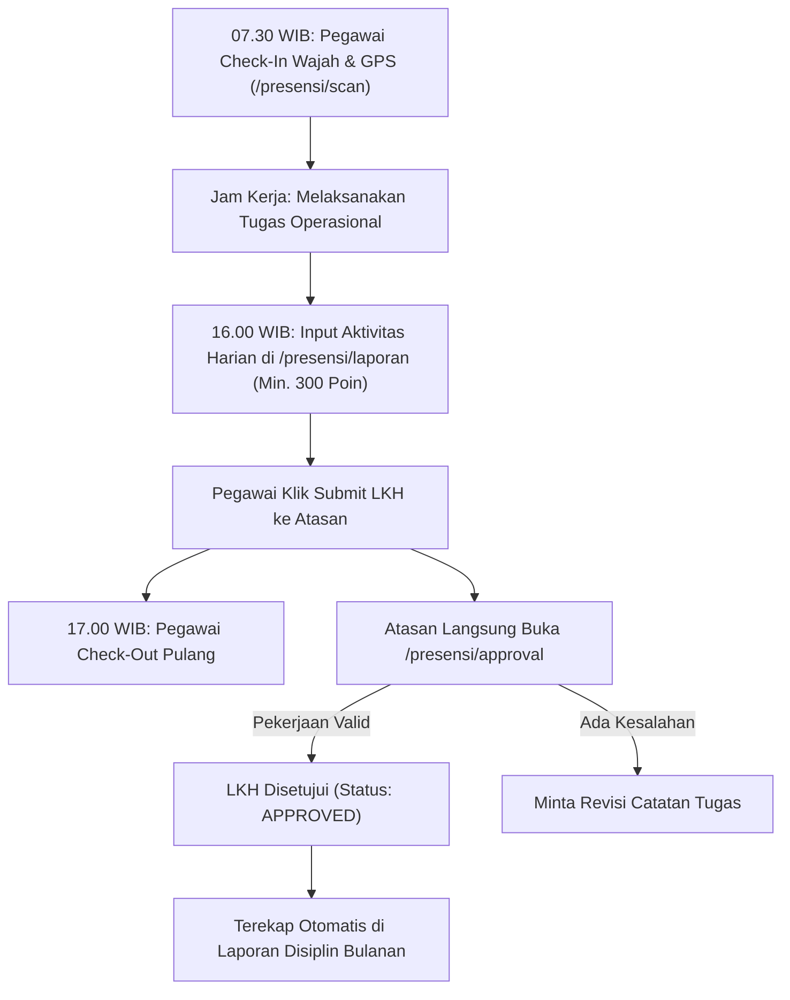

# 📘 Panduan Operasional: Pegawai & Presensi Mandiri Techno Sign
## Sistem Manajemen Kawasan Solo Technopark (Sintesa)

> **Kode Role:** `pegawai` (seluruh staf operasional, tenaga teknis, instruktur, dan pejabat BLUD)  
> **Sasaran Pengguna:** Pegawai Tetap BLUD, Tenaga Kontrak, Instruktur Pelatihan, dan Pejabat Struktural

---

## 1. Ringkasan Peran & Kewenangan

Sistem **Techno Sign** adalah modul presensi digital dan pelaporan kinerja terintegrasi bagi seluruh pegawai Solo Technopark. Sistem ini mengombinasikan pencatatan kehadiran berbasis radius lokasi kantor (*GPS Geofencing*) dan verifikasi swafoto biometrik dengan kecerdasan buatan (*AI Anti-Spoofing*), serta pengisian **Lembar Kerja Harian (LKH)** berstandar akumulasi poin kinerja.

### Akses Rute Pegawai:
- `/presensi`: Dashboard presensi mandiri, riwayat kehadiran, dan rekapitulasi poin LKH bulanan.
- `/presensi/scan`: Kamera presensi kehadiran Masuk (Check-In) dan Pulang (Check-Out).
- `/presensi/laporan`: Formulir pengisian Lembar Kerja Harian (LKH) berbasis 152 Master Aktivitas.
- `/presensi/izin`: Pengajuan cuti tahunan, izin sakit, dan dinas luar kawasan.
- `/presensi/lembur`: Pengajuan permohonan lembur dan realisasi jam tugas malam/hari libur.
- `/presensi/approval`: (Khusus Atasan/Supervisor) Panel persetujuan izin, lembur, dan LKH bawahan.

---

## 2. Matriks Hak Akses Modul Presensi & Kinerja

| Fitur / Tindakan | Staf / Bawahan | Atasan Langsung (RankLevel ≤ 4) | Admin Presensi |
| :--- | :---: | :---: | :---: |
| **Check-in / Check-out Masuk & Pulang** | ✅ Mandiri | ✅ Mandiri | ✅ Mandiri |
| **Input Lembar Kerja Harian (LKH)** | ✅ Mandiri | ✅ Mandiri | ✅ Mandiri |
| **Persetujuan (Approval) LKH Harian** | ❌ Tidak Berhak | ✅ Penuh (Bawahan) | ✅ Penuh |
| **Pengajuan Izin, Cuti, & Sakit** | ✅ Mandiri | ✅ Mandiri | ✅ Mandiri |
| **Persetujuan Cuti / Izin / Lembur** | ❌ Tidak Berhak | ✅ Penuh (Bawahan) | ✅ Penuh |
| **Cetak Rekap Presensi & TPP Pegawai** | ⚠️ Lihat Sendiri | ⚠️ Rekap Divisi | ✅ Seluruh Kantor |

---

## 3. Prosedur Operasional Standar (SOP) Langkah demi Langkah

### SOP 3.1: Presensi Masuk (Check-In) & Pulang (Check-Out)
1. Buka aplikasi browser di ponsel pintar (*smartphone*) atau laptop yang terhubung ke jaringan Solo Technopark.
2. Akses halaman **Presensi Mandiri** (`/presensi/scan`).
3. Pastikan fitur **GPS / Lokasi (Location Services)** pada perangkat telah aktif dan diizinkan (*Allow*).
4. Indikator Lokasi akan mendeteksi koordinat Anda terhadap titik pusat kantor UPTD KST Solo Technopark (Radius toleransi maksimal: **100 meter**).
5. Arahkan wajah ke kamera depan untuk pengambilan foto swafoto:
   - Pastikan wajah terlihat jelas tanpa masker dan di area berpenerangan cukup.
   - Algoritma AI Anti-Spoofing memverifikasi bahwa wajah adalah manusia hidup (*Live Person*) dan bukan foto dari layar lain.
6. Klik tombol **Rekam Kehadiran Masuk** (pukul 07.00 - 08.00 WIB) atau **Rekam Kehadiran Pulang** (setelah pukul 16.30 / 17.00 WIB).
7. Muncul konfirmasi hijau *"Presensi Berhasil Direkam"* beserta koordinat dan jam ketukan server.

---

### SOP 3.2: Pengisian Lembar Kerja Harian (LKH)
1. Masuk ke menu `/presensi/laporan`.
2. Klik tombol **+ Tambah Aktivitas Harian**.
3. Pilih tanggal kerja (hanya dapat diisi untuk hari ini atau maksimal H-1 jika lembur).
4. Pada kolom **Aktivitas Pekerjaan**, pilih salah satu tugas dari **152 Master Aktivitas Baku** Solo Technopark (contoh: *"Pemeliharaan Jaringan Jaringan Fiber Optic"*, *"Mengajar Praktik Mesin CNC"*, *"Verifikasi Pembayaran Kasir"*).
5. Masukkan **Jam Mulai** (misal: `08:30`) dan **Jam Selesai** (misal: `11:30`).
6. Masukkan **Volume Kegiatan** (misal: `1`) dan **Satuan** (misal: `Laporan / Sesi / Modul`).
7. Tuliskan rincian pada **Deskripsi Tugas** dan **Output / Hasil Pekerjaan** yang dicapai.
8. Sistem otomatis mengalikan volume dengan nilai bobot poin baku (Target Poin Minimal Harian Pegawai: **300 Poin**).
9. Unggah foto dokumentasi pekerjaan atau dokumen PDF pendukung.
10. Klik **Simpan sebagai Draft**, lalu klik **Kirim ke Atasan (Submit LKH)** di akhir jam kerja.

---

### SOP 3.3: Pengajuan Cuti, Izin Alasan Penting, atau Sakit
1. Masuk ke menu `/presensi/izin`.
2. Klik tombol **+ Ajukan Permohonan Izin / Cuti**.
3. Pilih **Jenis Permohonan**:
   - `Cuti Tahunan`: Memotong sisa kuota cuti tahunan pegawai.
   - `Izin Alasan Penting`: Keperluan keluarga darurat (pernikahan/kematian).
   - `Sakit`: Wajib melampirkan foto Surat Keterangan Dokter dari klinik/rumah sakit.
   - `Dinas Luar`: Tugas resmi kedinasan di luar kawasan Solo Technopark.
4. Tentukan tanggal mulai dan tanggal selesai izin.
5. Tuliskan alasan lengkap pada kolom keterangan.
6. Klik **Kirim Pengajuan**. Sistem otomatis mengarahkan notifikasi ke akun `supervisorId` atasan langsung Anda.

---

### SOP 3.4: Verifikasi & Approval Kinerja oleh Atasan Langsung
1. Sebagai Kepala Divisi / Atasan Langsung, buka menu `/presensi/approval`.
2. Pada tab **LKH Menunggu Persetujuan**, tinjau daftar laporan kerja harian staf di bawah divisi Anda.
3. Periksa kesesuaian uraian tugas dan bukti foto yang dilampirkan.
4. Klik tombol hijau **Setujui (Approve)** jika pekerjaan sesuai fakta lapangan, atau berikan catatan revisi dan klik **Tolak**.
5. Pada tab **Permohonan Cuti & Lembur**, periksa permohonan staf dan klik **Setujui Permohonan**. Status presensi staf otomatis disesuaikan pada kalender induk kepegawaian.

---

## 4. Alur Integrasi Presensi & Penilaian Kinerja (LKH)

---

## 5. Pertanyaan Kerap Diajukan (FAQ)

**T: Muncul pesan "Di Luar Radius Kantor" padahal saya sudah berada di Solo Technopark?**  
*J: Pastikan GPS HP Anda tersetting ke mode Akurasi Tinggi (*High Accuracy*). Jika Anda berada di dalam gedung beton tebal, cobalah mendekat ke jendela atau nyalakan Wi-Fi agar sinyal lokasi terkalibrasi dengan tepat.*

**T: Lupa melakukan presensi Pulang (Check-Out) kemarin sore, apa yang harus dilakukan?**  
*J: Segera ajukan **Permohonan Revisi Presensi** di menu `/presensi/revisi`. Tuliskan alasan lupa absen pulang dan minta Atasan Langsung Anda untuk menyetujui revisi jam pulang tersebut.*

---

## 6. Lembar Checklist Harian Pegawai Solo Technopark

- [ ] Melakukan presensi masuk sebelum pukul 08.00 WIB.
- [ ] Menyicil pencatatan aktivitas kerja di `/presensi/laporan` setelah menyelesaikan tugas penting.
- [ ] Memastikan total akumulasi poin LKH mencapai minimal 300 poin sebelum dikirim.
- [ ] Melakukan submit LKH harian dan melakukan presensi pulang setelah pukul 17.00 WIB.
