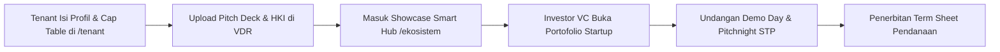

# 📘 Panduan Pengguna: Tenant Startup & Wirausaha Binaan
## Sistem Manajemen Kawasan Solo Technopark (Sintesa)

> **Kode Role:** `tenant`  
> **Sasaran Pengguna:** Founder Startup, Direktur Perusahaan Binaan, Pengelola Usaha Tenant Inkubator, dan Staf Administrasi Tenant

---

## 1. Ringkasan Peran & Kewenangan

Sebagai **Tenant Binaan Solo Technopark**, Anda memiliki akses ke ekosistem akselerasi terlengkap di Jawa Tengah. Portal Mandiri Tenant dirancang untuk membantu Anda memantau traksi pertumbuhan bisnis, mengamankan dokumen investasi pada *Virtual Data Room* (VDR), membayar tagihan utilitas/sewa ruangan, merekrut lulusan kompeten dari balai diklat, serta terhubung langsung dengan jaringan pemodal ventura.

### Rute Utama Portal Tenant:
- `/tenant/dashboard`: Ikhtisar performa bisnis, pengumuman inkubator, dan status masa sewa.
- `/tenant/traction`: Formulir pelaporan metrik bulanan (pendapatan, jumlah pengguna, ukuran tim).
- `/tenant/profile`: Kelola profil publik startup, logo, media sosial, dan tim inti.
- `/tenant/incubation`: Virtual Data Room (VDR: legalitas, HKI, proposal investasi, pitch deck).
- `/tenant/billing`: Daftar tagihan sewa ruang kantor, utilitas listrik/air, dan invoice layanan bengkel.
- `/tenant/talent`: Pasang lowongan kerja dan rekrut talenta lulusan diklat vokasi Solo Technopark.
- `/ekosistem`: Direktori jejaring Smart Hub ekosistem teknologi kawasan.

---

## 2. Matriks Hak Akses Akun Tenant

| Fitur / Tindakan | Tenant Binaan | Keterangan |
| :--- | :---: | :--- |
| **Kelola Profil & Etalase Produk Inovasi** | ✅ Penuh | Produk otomatis tayang di E-Katalog STP. |
| **Input Laporan Traksi Omzet Bulanan** | ✅ Penuh | Menjadi penilaian kelayakan rekomendasi investor. |
| **Unggah Dokumen Rahasia di VDR** | ✅ Penuh | Akta PT, HKI, laporan laba rugi internal. |
| **Lihat & Konfirmasi Tagihan Sewa Kantor** | ✅ Penuh | Terintegrasi dengan meja kasir BLUD STP. |
| **Pasang Lowongan Kerja ke Alumni Diklat** | ✅ Penuh | Otomatis terbit di Bursa Karir STP. |
| **Akses Data Startup Lain di Kawasan** | ⚠️ Terbatas | Hanya melihat etalase publik (bukan data rahasia VDR). |

---

## 3. Prosedur Operasional Standar (SOP) Langkah demi Langkah

### SOP 3.1: Login Pertama Kali & Pengisian Profil Usaha
1. Akses halaman login di `/login` menggunakan email yang didaftarkan saat kurasi.
2. Masukkan password awal atau login instan menggunakan akun Google.
3. Setelah masuk, sistem otomatis mengarahkan Anda ke **Portal Tenant** (`/tenant/dashboard`).
4. Klik menu **Profil Usaha** (`/tenant/profile`):
   - Unggah **Logo Usaha** (resolusi minimal 500x500 px, format PNG/JPG).
   - Tuliskan **Elevator Pitch**: Deskripsi 1 kalimat yang menjelaskan solusi inovasi Anda.
   - Pilih **Bentuk Badan Usaha**: *PT / CV / Yayasan / Perorangan / Belum Berbadan Hukum*.
   - Masukkan Nomor Induk Berusaha (NIB) dan NPWP Badan jika sudah ada.
   - Masukkan tautan website resmi dan media sosial (Instagram, LinkedIn).
5. Klik **Simpan Profil Usaha**.

---

### SOP 3.2: Pelaporan Traksi Bisnis Bulanan (*Monthly Traction*)
1. Pada awal setiap bulan (paling lambat tanggal 5), buka menu `/tenant/traction`.
2. Klik tombol **+ Input Traksi Bulan Ini**.
3. Isi parameter kinerja terkini:
   - **Bulan & Tahun Pelaporan**: (misal: *Oktober 2026*).
   - **Omzet / Pendapatan Kotor Bulan Ini**: Masukkan angka dalam nominal Rupiah.
   - **Jumlah Pengguna Aktif (Active Users / Clients)**.
   - **Jumlah Tenaga Kerja (Team Size)**: Total pendiri dan karyawan tetap/kontrak.
   - **Pencapaian Kunci (Milestone)**: Tuliskan capaian produk (misal: *"Telah menyelesaikan uji coba versi Beta di 3 rumah sakit"*).
4. Klik **Kirim Laporan Traksi**. Grafik pertumbuhan omzet startup Anda akan terbarui dan dipantau oleh Manajer Inkubator.

---

### SOP 3.3: Mengunggah Dokumen Investasi ke Virtual Data Room (VDR)
1. Buka menu `/tenant/incubation`, lalu klik tab **Virtual Data Room (VDR)**.
2. Unggah berkas resmi pendukung bisnis:
   - **Pitch Deck Terkini**: Berkas presentasi format PDF (maks. 10MB).
   - **Akta Pendirian PT / SK Kemenkumham**: Bukti keabsahan badan hukum.
   - **Sertifikat Hak Kekayaan Intelektual (HKI)**: Bukti kepemilikan paten, hak cipta software, atau merek dagang DJKI.
   - **Proyeksi Finansial**: Lembar kalkulasi proyeksi keuangan 3 tahun ke depan.
3. Geser pengaturan visibilitas:
   - *Tampilkan ke Investor Terverifikasi*: Jika Anda sedang membuka putaran pendanaan (*isRaising: True*).
4. Klik **Perbarui Data VDR**.

---

### SOP 3.4: Pembayaran Tagihan Sewa Ruang & Utilitas
1. Buka menu **Billing & Tagihan** (`/tenant/billing`).
2. Tinjau daftar invoice yang berstatus `PENDING` atau `OVERDUE`.
3. Klik tombol **Lihat Tagihan** untuk membaca rincian biaya sewa dan nomor rekening giro Solo Technopark.
4. Lakukan transfer bank sesuai nominal pas yang tertera.
5. Unggah foto struk transfer Anda melalui tombol **Konfirmasi Pembayaran (Upload Bukti)** atau melalui halaman publik `/bukti-bayar`.
6. AI Vision OCR akan memvalidasi bukti Anda. Dalam hitungan menit, Kasir BLUD akan memverifikasi lunas kuitansi Anda dan mengirimkan bukti lunas ke email perusahaan.

---

### SOP 3.5: Merekrut Tenaga Kerja Lulusan Diklat Solo Technopark
1. Buka menu `/tenant/talent`.
2. Klik tombol **+ Pasang Lowongan Karir Baru**.
3. Isi posisi yang dibutuhkan (misal: *Frontend Developer*, *Operator Mesin CNC*, *Digital Marketer*).
4. Tentukan tipe kerja (*Full-time, Magang, Kontrak*) dan sistem kerja (*On-site STP, Hybrid, Remote*).
5. Pada kolom **Program Pelatihan Terkait**, pilih kejuruan lulusan Solo Technopark yang relevan.
6. Klik **Publikasikan Lowongan**. Lowongan Anda langsung tampil di bursa karir eksklusif alumni `/karir` dan ratusan alumni kompeten dapat langsung melamar.

---

## 4. Alur Integrasi Tenant ke Pemodal Ventura (*Investor*)

---

## 5. Pertanyaan Kerap Diajukan (FAQ)

**T: Apakah data keuangan di laporan traksi dan VDR saya aman dari intipan kompetitor?**  
*J: Sangat aman. Dokumen VDR dilindungi enkripsi Firebase Storage dan aturan ketat Firebase Security Rules. Startup lain di kawasan tidak memiliki izin untuk melihat berkas VDR Anda.*

**T: Perusahaan kami baru saja menerima pendanaan benih (Seed Round), bagaimana mencatatnya?**  
*J: Buka `/tenant/incubation` -> Tab **Funding Rounds**. Klik Tambah Putaran Dana, pilih *Seed*, masukkan nominal dana yang didapat, dan tuliskan nama pemodal. Sistem akan memperbarui lencana tahap pendanaan startup Anda.*

---

## 6. Lembar Checklist Bulanan Founder Tenant

- [ ] Menginput laporan omzet bulanan di `/tenant/traction` sebelum tanggal 5 tiap bulan.
- [ ] Memeriksa dan melunasi tagihan utilitas/sewa ruangan di `/tenant/billing`.
- [ ] Memperbarui slide Pitch Deck jika ada pencapaian produk baru.
- [ ] Mengecek lamaran talenta alumni yang masuk pada menu `/tenant/talent`.
