# 📘 Panduan Pengguna: Alumni Diklat, Bursa Karir, & Forum Komunitas
## Sistem Manajemen Kawasan Solo Technopark (Sintesa)

> **Kode Role:** `alumni`  
> **Sasaran Pengguna:** Seluruh Lulusan Pelatihan Solo Technopark (STP Vokasi) dan Lulusan Program Rumah Siap Kerja Bersama (RSKB Surakarta)

---

## 1. Ringkasan Peran & Kewenangan

Sebagai **Alumni Solo Technopark**, Anda berhak mengakses kanal fasilitas karir eksklusif yang dirancang untuk mempercepat keterserapan kerja Anda di industri manufaktur, teknologi, otomasi, maupun wirausaha. 

### Hak Istimewa Akun Alumni:
- Akses penuh ke **Bursa Karir Eksklusif** (`/karir`): Ratusan lowongan kerja dari mitra industri terverifikasi yang mengutamakan lulusan diklat STP & RSKB.
- Direktori **Talent Pool**: Profil Anda dapat ditemukan dan diundang wawancara langsung oleh perusahaan mitra (*Direct Talent Invitation*).
- **Forum Komunitas Terverifikasi** (`/alumni-portal`): Berdiskusi teknis sesama alumni (Zona A) dan berkonsultasi karir langsung dengan HR industri (Zona B).
- **Layanan Verifikasi Sertifikat Publik** (`/verifikasi-sertifikat`): Bukti sah kompetensi kelulusan yang dapat diakses oleh rekruter dari mana saja.

---

## 2. Matriks Hak Akses Alumni

| Fitur / Halaman | Pengguna Umum | Alumni Terverifikasi | Keterangan |
| :--- | :---: | :---: | :--- |
| **Akses Bursa Karir & Detail Gaji** | ❌ Dibatasi | ✅ Penuh | Khusus akun alumni & staf internal. |
| **Melamar Pekerjaan Rekanan Industri** | ❌ Dibatasi | ✅ Penuh | Mengirim berkas CV & portfolio langsung. |
| **Terima Undangan Wawancara Khusus** | ❌ Tidak Bisa | ✅ Penuh | Notifikasi langsung dari HR mitra. |
| **Akses Forum Alumni Zona A (Eksklusif)**| ❌ Dilarang | ✅ Penuh | Ruang diskusi tertutup sesama lulusan. |
| **Pembaruan Status Tracer Study** | ❌ Tidak Bisa | ✅ Mandiri | Lapor mandiri status tempat bekerja. |

---

## 3. Prosedur Operasional Standar (SOP) Langkah demi Langkah

### SOP 3.1: Tata Cara Aktivasi & Klaim Akun Alumni Baru
1. Pastikan Anda telah dinyatakan **Lulus / Kompeten** oleh panitia pelatihan Solo Technopark.
2. Siapkan **Kode Registrasi Alumni** yang tercantum pada sertifikat kelulusan Anda (format: `AL-2026-XXXXXX`) atau NIK KTP Anda.
3. Buka halaman **Aktivasi Alumni** di `/alumni-portal`.
4. Masukkan Kode Registrasi Alumni dan NIK KTP pada formulir klaim.
5. Klik tombol **Verifikasi Data Kelulusan**.
6. Sistem mencocokkan data Anda dengan Buku Induk Pelatihan. Jika cocok, sistem menampilkan nama lengkap, kejuruan, tahun pelatihan, dan batch kelulusan Anda.
7. Buat kata sandi akun baru atau tautkan dengan akun Google Anda.
8. Akun Anda seketika aktif berstatus `alumni` terverifikasi.

---

### SOP 3.2: Melamar Lowongan Pekerjaan di Bursa Karir
1. Buka menu **Bursa Karir** (`/karir`).
2. Gunakan filter pencarian:
   - **Kategori Bidang**: *IT & Perangkat Lunak, Teknik Mesin & Manufaktur, Pengelasan, Digital Marketing, dll.*
   - **Tipe Kerja**: *Full-time, Magang Industri, Kontrak, Freelance*.
   - **Sistem Kerja**: *On-site (Solo Technopark), Hybrid, Remote (WFH)*.
   - **Program Terkait**: Centang kejuruan yang sesuai dengan sertifikat Anda.
3. Klik salah satu lowongan untuk membaca deskripsi tugas, syarat kualifikasi, dan rentang gaji bulanan yang ditawarkan mitra industri.
4. Klik tombol biru **Lamar Posisi Ini**:
   - Periksa ringkasan data diri dan nomor WhatsApp Anda.
   - Lampirkan surat lamaran singkat (*Cover Letter*).
   - Unggah berkas CV terbaru (PDF maks. 2MB) dan tautan portofolio/GitHub jika ada.
5. Klik **Kirim Lamaran Karir**. Lamaran Anda langsung masuk ke antrean Mini-ATS HR perusahaan terkait.

---

### SOP 3.3: Menerima Undangan Wawancara (*Direct Talent Invitation*)
1. Jika profil Anda menarik minat mitra industri, Anda akan menerima:
   - **Notifikasi Lonceng** di sudut kanan atas navbar portal (`NotificationBellDropdown`).
   - **Email Resmi** dari pengirim `marketing@solotechnopark.id` berisi detail tawaran posisi dan undangan wawancara kerja.
2. Buka notifikasi untuk membaca undangan.
3. Anda dapat melihat nama perusahaan pengundang, jadwal wawancara, lokasi (atau link Google Meet/Zoom), dan kontak HR perekrut.
4. Balas undangan tersebut untuk mengonfirmasi kehadiran Anda.

---

### SOP 3.4: Berpartisipasi di Forum Komunitas Alumni
1. Akses **Kanal Forum** di `/alumni-portal`.
2. Pilih zona diskusi:
   - **Zona A (Ruang Alumni KST & RSKB)**: Tempat berbagi tips wawancara kerja, lowongan internal antar-alumni, dan pemecahan masalah teknis di tempat kerja.
   - **Zona B (Kanal Mitra Industri & Konsultasi Karir)**: Bertanya langsung kepada perwakilan industri rekanan Solo Technopark.
3. Klik **+ Buat Diskusi Baru**:
   - Masukkan judul diskusi yang jelas.
   - Pilih tag keahlian terkait (misal: *#CNC, #NextJS, #Welding, #InterviewTips*).
   - Tuliskan pesan Anda dan klik **Terbitkan Thread**.
4. Berikan jawaban berkualitas pada pertanyaan rekan lain. Jika jawaban Anda ditandai sebagai *"Solusi Diterima"*, skor reputasi forum Anda akan meningkat.

---

### SOP 3.5: Lapor Status Karir Mandiri (*Tracer Study Self-Report*)
1. Jika Anda sudah berhasil diterima bekerja, membuka usaha wirausaha, atau melanjutkan kuliah, wajib melaporkan status Anda untuk mendukung evaluasi program Pemkot Surakarta.
2. Masuk ke halaman **Profil Pengguna** (`/profil`).
3. Klik tab **Data Alumni & Karir**.
4. Pada kolom **Status Kebekerjaan Saat Ini**, pilih:
   - *Bekerja (Full-time)*
   - *Wirausaha Mandiri / Startup Founder*
   - *Magang Industri (Internship)*
   - *Melanjutkan Studi*
5. Isi **Nama Perusahaan Tempat Bekerja**, **Jabatan / Posisi**, **Tanggal Mulai Bekerja**, serta rentang gaji bulanan (opsional dan dijamin kerahasiaannya).
6. Klik **Simpan Data Karir**. Data Anda otomatis tercatat pada dashboard statistik *Tracer Study* Solo Technopark.

---

## 4. Alur Integrasi Alumni ke Penyerapan Industri

```mermaid
flowchart LR
  Graduation["Lulus Uji Kompetensi Diklat STP/RSKB"] --> Claim["Klaim Akun di /alumni-portal (Kode AL-...)"]
  Claim --> CareerPortal["Akses Bursa Karir Eksklusif (/karir)"]
  CareerPortal --> Apply["Kirim Lamaran ke Mitra Industri"]
  Apply --> MiniATS["HR Review di /mitra/dashboard"]
  MiniATS --> Interview["Wawancara Kerja (Online / On-site STP)"]
  Interview --> Hired["Diterima Bekerja (Status: HIRED)"]
  Hired --> AutoTracer["Auto-Tracer Study: Status Berubah Bekerja di Database"]
```

---

## 5. Pertanyaan Kerap Diajukan (FAQ)

**T: Saya lupa kode alumni saya, di mana saya bisa melihatnya?**  
*J: Buka sertifikat pelatihan Anda, kode registrasi tercetak di bagian bawah sertifikat (misal: `AL-2026-819201`). Anda juga bisa menghubungi Admin Pelatihan di gedung Solo Technopark dengan menunjukkan KTP asli.*

**T: Perusahaan tempat saya melamar meminta bukti keaslian sertifikat STP, bagaimana caranya?**  
*J: Minta perusahaan tersebut membuka tautan publik: `https://katalog.solotechnopark.id/verifikasi-sertifikat`. Mereka cukup mengetikkan Nomor Sertifikat Anda untuk melihat lencana "Terverifikasi Resmi Solo Technopark".*

---

## 6. Lembar Checklist Alumni Sukses

- [ ] Mengklaim akun alumni di `/alumni-portal` segera setelah kelulusan.
- [ ] Melengkapi profil data diri, CV, nomor WhatsApp, dan link portofolio di `/profil`.
- [ ] Memeriksa bursa karir `/karir` minimal 2 kali seminggu untuk lowongan terbaru.
- [ ] Mengupdate status kebekerjaan di tab *Data Alumni* saat sudah diterima bekerja.
