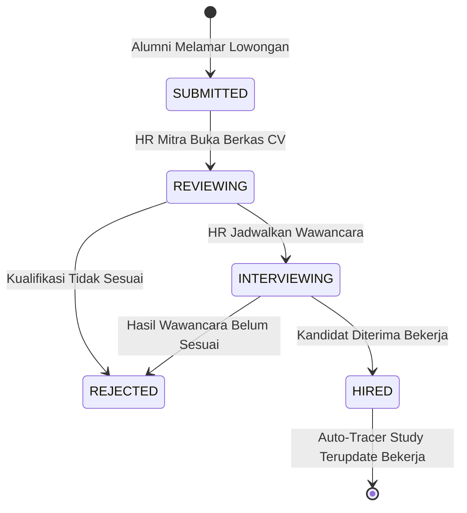

# 📘 Panduan Pengguna: Mitra Industri, Rekrutmen, & Mini-ATS
## Sistem Manajemen Kawasan Solo Technopark (Sintesa)

> **Kode Role:** `industri`  
> **Sasaran Pengguna:** HR Manager Perusahaan Rekanan, Talent Acquisition, Pimpinan Industri Manufaktur & Teknologi, serta Rekruter Tenaga Kerja

---

## 1. Ringkasan Peran & Kewenangan

Sebagai **Mitra Industri Resmi Solo Technopark**, perusahaan Anda memiliki akses prioritas ke ribuan talenta siap kerja hasil didikan balai latihan kerja teknologi tinggi (STP Vokasi) dan program Rumah Siap Kerja Bersama (RSKB Surakarta). Portal Kemitraan dilengkapi dengan sistem pelacakan pelamar kerja mandiri (**Mini-ATS / Applicant Tracking System**) dan direktori talenta terverifikasi.

### Rute Utama Portal Mitra Industri:
- `/mitra`: Halaman portal perkenalan dan pengajuan kemitraan baru.
- `/mitra/dashboard`: Dashboard terpusat pengelolaan rekrutmen perusahaan Anda:
  - **Tab Lowongan Kerja**: Memasang dan mengedit iklan lowongan pekerjaan terverifikasi.
  - **Tab Pelamar (Mini-ATS)**: Mengelola tahapan seleksi kandidat (*Reviewing, Interviewing, Hired*).
  - **Tab Direktori Talenta**: Mencari lulusan kompeten dan mengirim undangan langsung (*Talent Invitation*).
  - **Tab Keamanan & Sandi**: Mengubah kata sandi mandiri akun perusahaan Anda.

---

## 2. Matriks Hak Akses Mitra Industri

| Fitur / Tindakan | Mitra Industri (`industri`) | Keterangan |
| :--- | :---: | :--- |
| **Pasang Iklan Lowongan Kerja** | ✅ Penuh | Otomatis tayang di bursa karir `/karir`. |
| **Unduh Berkas CV & Portofolio Pelamar** | ✅ Penuh | Akses berkas lamaran dari lulusan diklat. |
| **Ubah Tahapan Seleksi Pelamar (ATS)** | ✅ Penuh | Reviewing -> Interviewing -> Hired/Rejected. |
| **Kirim Undangan Wawancara Langsung** | ✅ Penuh | Otomatis mengirim email resmi & notifikasi lonceng. |
| **Akses Data Rahasia Keuangan BLUD** | ❌ Dilarang | Terisolasi khusus akun mitra rekrutmen. |

---

## 3. Prosedur Operasional Standar (SOP) Langkah demi Langkah

### SOP 3.1: Pendaftaran Akun Mitra Industri & Verifikasi Profil
1. Buka halaman kemitraan di `/kemitraan`.
2. Klik tombol **Daftar Sebagai Mitra Industri**.
3. Isi data profil korporasi:
   - **Nama Perusahaan**: Contoh: *"PT Inovasi Presisi Nusantara"*.
   - **Sektor Industri**: *Manufaktur & Otomotif / Teknologi Informasi / Fabrikasi Logam / Energi Terbarukan / Logistik*.
   - **Alamat Kantor**: Alamat pabrik atau kantor pusat.
   - **Nama Penanggung Jawab (PIC HR)**, Nomor Telepon/WhatsApp, dan Email Perusahaan resmi.
   - **Nomor NIB / Legalitas Perusahaan**.
4. Klik **Kirim Pendaftaran Kemitraan**. Tim Kemitraan Solo Technopark akan memverifikasi legalitas perusahaan dalam 1x24 jam kerja dan mengaktifkan role `industri` pada akun Anda.

---

### SOP 3.2: Memasang Lowongan Kerja Terverifikasi Solo Technopark
1. Masuk ke **Dashboard Mitra** (`/mitra/dashboard`).
2. Pada tab **Lowongan Kerja**, klik tombol **+ Pasang Lowongan Baru**.
3. Masukkan rincian pekerjaan:
   - **Judul Posisi**: Contoh: *"Operator Mesin CNC Milling 5-Axis"*, *"Junior Web Developer"*.
   - **Tipe Pekerjaan**: *Full-time / Internship (Magang Industri) / Contract / Project*.
   - **Sistem Kerja**: *On-site (Solo Technopark) / On-site Pabrik / Hybrid / Remote*.
   - **Kategori Bidang**: Sesuaikan dengan kejuruan industri Anda.
   - **Rentang Gaji Bulanan**: Contoh: `Rp 4.500.000` s/d `Rp 7.000.000` (dapat dicentang *Nego* atau *Disclosed*).
   - **Program Diklat Terkait**: Centang program diklat lulusan STP yang ingin Anda utamakan (misal: *Teknisi Mesin Industri*).
   - **Kualifikasi & Tanggung Jawab**: Tuliskan kriteria yang dicari.
4. Klik **Publikasikan Lowongan**. Lowongan Anda langsung terbit dengan lencana **"Mitra Resmi Solo Technopark"** di portal `/karir`.

---

### SOP 3.3: Mengelola Pipeline Seleksi Pelamar (Mini-ATS)
1. Di `/mitra/dashboard`, buka tab **Pelamar Kerja (Mini-ATS)**.
2. Tinjau seluruh kandidat alumni yang telah melamar pada lowongan aktif Anda.
3. Klik tombol **Lihat Berkas** untuk membuka CV, nomor WhatsApp, sertifikat kompetensi STP-CERT, dan portfolio karya pelamar.
4. Jalankan tahapan seleksi menggunakan tombol *dropdown* tahapan:
   - 🟡 **REVIEWING**: Berkas lamaran sedang ditinjau oleh tim HR Anda.
   - 🔵 **INTERVIEWING**: Kandidat lolos seleksi berkas dan dijadwalkan wawancara (Masukkan tanggal dan tautan meeting).
   - 🟢 **HIRED**: Kandidat resmi dinyatakan diterima bekerja.
   - 🔴 **REJECTED**: Kandidat belum memenuhi kualifikasi saat ini.
5. Saat Anda menggeser status ke **HIRED**:
   - Sistem secara otomatis mengirimkan ucapan selamat ke email kandidat.
   - Database kelulusan alumni Solo Technopark otomatis terbarui bahwa lulusan tersebut telah terserap kerja di perusahaan Anda (*Auto Tracer Study*).

---

### SOP 3.4: Mencari Lulusan di Direktori Talenta & Kirim Direct Invitation
1. Buka tab **Direktori Talenta Lulusan**.
2. Gunakan filter untuk mencari kandidat berdasarkan:
   - Kejuruan Pelatihan (misal: *Cyber Security, Desain Grafis, Pengelasan 6G*).
   - Batch Kelulusan & Nilai Sertifikasi Kompetensi.
   - Status Ketersediaan: *Tersedia (Available)*.
3. Klik profil lulusan untuk membaca riwayat pelatihan dan keterampilan teknisnya.
4. Klik tombol **Kirim Undangan Wawancara Langsung (Invite Talent)**:
   - Pilih posisi lowongan kerja yang ingin ditawarkan.
   - Masukkan pesan pengantar dari HR perusahaan Anda.
   - Masukkan opsi tanggal wawancara kerja.
5. Klik **Kirim Undangan**. Sistem akan mengirimkan email resmi berlogo Solo Technopark serta notifikasi prioritas ke akun kandidat.

---

## 4. Alur Kerja Mini-ATS Rekrutmen Terpadu

---

## 5. Pertanyaan Kerap Diajukan (FAQ)

**T: Apakah ada biaya untuk memasang lowongan kerja dan merekrut lulusan Solo Technopark?**  
*J: Layanan bursa karir dan penyerapan lulusan diklat vokasi STP untuk mitra industri berstatus resmi adalah **Bebas Biaya (Gratis)** sebagai wujud komitmen BLUD dalam menyerap tenaga kerja lokal Surakarta.*

**T: Bisakah perusahaan kami mengadakan rekrutmen massal (*Walk-in Interview*) di kawasan Solo Technopark?**  
*J: Sangat bisa. Hubungi Tim Kemitraan di gedung utama STP atau ajukan reservasi ruangan rekrutmen melalui modul pemesanan fasilitas kawasan.*

---

## 6. Lembar Checklist Rekruter Industri

- [ ] Memeriksa tab *Pelamar Kerja* minimal 2 kali seminggu untuk merespons pelamar baru.
- [ ] Memperbarui tahapan status pelamar menjadi *Interviewing* atau *Hired/Rejected* agar pelamar mendapat kepastian.
- [ ] Menutup iklan lowongan pekerjaan jika kuota posisi telah terpenuhi.
- [ ] Memastikan status *Hired* dicatat di sistem saat ada alumni STP yang resmi bergabung.

