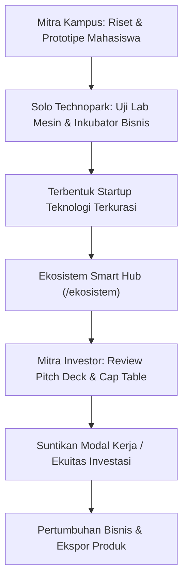

# 📘 Panduan Pengguna: Mitra Investor & Perguruan Tinggi
## Sistem Manajemen Kawasan Solo Technopark (Sintesa)

> **Kode Role:** `investor` & `kampus`  
> **Sasaran Pengguna:** Mitra Pemodal Ventura (*Venture Capital/VC*), Angel Investor, Perbankan, Pimpinan Perguruan Tinggi, Dosen Peneliti, dan Pengelola LPPM Kampus

---

## 1. Ringkasan Peran & Kewenangan

Solo Technopark merupakan titik temu kolaborasi strategis antara akademisi, industri, pemerintah, dan pemodal (*Triple/Quadruple Helix*). Melalui platform Sintesa Smart Hub:
1. **Mitra Investor (`investor`)**: Memperoleh akses langsung ke portofolio startup teknologi binaan terkurasi yang siap menerima pendanaan tahap awal (*Early-stage Investments*).
2. **Mitra Perguruan Tinggi (`kampus`)**: Membangun kerjasama riset terapan, hilirisasi paten inovasi kampus, program magang mahasiswa bersertifikat (MBKM), dan pemanfaatan laboratorium mesin bersama.

---

## 2. Matriks Hak Akses Investor & Kampus

| Fitur / Halaman | Pengguna Publik | Mitra Investor | Mitra Kampus |
| :--- | :---: | :---: | :---: |
| **Akses Direktori Startup di Smart Hub** | ⚠️ Ringkasan | ✅ Lengkap | ✅ Lengkap |
| **Akses Pitch Deck & Virtual Data Room (VDR)**| ❌ Dilarang | ✅ Penuh (NDA) | ⚠️ Sesuai Izin |
| **Lihat Grafik Traksi Omzet & Pertumbuhan** | ❌ Dilarang | ✅ Penuh | ⚠️ Terbatas |
| **Kirim Undangan Business Matchmaking** | ❌ Dilarang | ✅ Penuh | ❌ Tidak Berhak |
| **Pengajuan Kolaborasi Riset & Lab Bersama** | ❌ Dilarang | ❌ Tidak Berhak | ✅ Penuh |

---

## 3. Prosedur Operasional Standar (SOP) Langkah demi Langkah

### BAGIAN A: PANDUAN MITRA INVESTOR / VENTURE CAPITAL

#### SOP 3.1: Eksplorasi Portofolio Startup Terkurasi di Smart Hub
1. Masuk ke halaman **Smart Hub Ekosistem** (`/ekosistem` atau `/portfolio`).
2. Gunakan bilah filter investor:
   - **Tahap Pendanaan (Funding Stage)**: *Bootstrapped / Pre-Seed / Seed / Pre-Series A / Series A / Series B+*.
   - **Status Penggalangan Dana**: Centang *Sedang Mencari Investasi (isRaising: True)*.
   - **Sektor Usaha**: *Teknologi Informasi, Smart City, Agroteknologi, Energi Hijau, Robotika/IoT, Edukasi*.
3. Klik kartu profil startup untuk membaca:
   - *Elevator Pitch* dan Solusi Masalah.
   - Grafik Traksi Pertumbuhan Omzet dan Ukuran Tim 12 bulan terakhir.
   - Komposisi Struktur Pemegang Saham (*Cap Table Summary*).

#### SOP 3.2: Peninjauan Pitch Deck & Akses Virtual Data Room (VDR)
1. Pada profil startup binaan, buka tab **Virtual Data Room (VDR)**.
2. Unduh berkas presentasi resmi **Pitch Deck** (format PDF).
3. Jika tertarik untuk melakukan analisa mendalam (*Due Diligence*), Anda dapat melihat kelengkapan:
   - Akta Pendirian & Legalitas Badan Usaha.
   - Sertifikat Paten / Hak Cipta Software (HKI).
   - Lembar Proyeksi Keuangan 3 Tahun.
4. Klik tombol **Jadwalkan Temu Bisnis (Request Matchmaking)**. Tim Inkubator Solo Technopark akan menghubungkan Anda secara resmi dengan founder startup bersangkutan.

---

### BAGIAN B: PANDUAN MITRA PERGURUAN TINGGI & POLITEKNIK

#### SOP 3.3: Pengajuan Kolaborasi Riset Terapan & Laboratorium Bersama
1. Buka menu **Riset & Ekosistem Akademik** (`/ekosistem` atau `/riset`).
2. Tinjau fasilitas riset tingkat tinggi yang tersedia di kawasan Solo Technopark:
   - Fasilitas Bengkel Permesinan CNC 5-Axis dan Pemotongan Presisi.
   - Laboratorium Cetak 3D Industri (*Additive Manufacturing*).
   - Laboratorium Artificial Intelligence, Cyber Security, dan Game Development.
3. Klik tombol **+ Ajukan Proposal Riset Bersama**:
   - Masukkan Judul Riset / Prototipe yang akan dikembangkan.
   - Nama Dosen Peneliti Utama / Tim Laboratorium Kampus.
   - Fasilitas atau mesin laboratorium yang dibutuhkan.
   - Durasi jadwal penelitian.
4. Unggah proposal riset singkat (PDF).
5. Tim Pengelola Laboratorium STP akan memverifikasi permohonan dan menerbitkan kesepakatan penggunaan laboratorium bersama (*Lab Sharing Agreement*).

#### SOP 3.4: Program Magang Mahasiswa Bersertifikat (MBKM)
1. Kampus dapat mendaftarkan mahasiswa tingkat akhir untuk mengikuti program pelatihan vokasi industri intensif di Solo Technopark.
2. Buka menu `/program-pelatihan`, pilih kejuruan industri yang relevan dengan kurikulum program studi.
3. Hubungi admin pelatihan untuk skema konversi Satuan Kredit Semester (SKS) mahasiswa magang bersertifikat industri.

---

## 4. Alur Integrasi Kerjasama Multi-Helix

---

## 5. Pertanyaan Kerap Diajukan (FAQ)

**T: Bagaimana cara investor menghadiri agenda Demo Day / Pitching Night Solo Technopark?**  
*J: Buka menu `/event`. Agenda Demo Day khusus investor akan diberi lencana *Exclusive for Investors*. Akun dengan role `investor` otomatis mendapatkan tiket VIP gratis dan tautan streaming privat.*

**T: Apakah dosen dan mahasiswa kampus berhak mendapatkan diskon pemanfaatan laboratorium mesin?**  
*J: Ya. Perguruan tinggi yang telah menandatangani Nota Kesepahaman (MoU) kemitraan resmi dengan Solo Technopark berhak mendapatkan skema tarif subsidi pendidikan khusus untuk riset non-komersial.*

---

## 6. Lembar Checklist Mitra Investor & Kampus

- [ ] Memeriksa daftar startup baru yang sedang membuka putaran dana (*isRaising*) di `/ekosistem`.
- [ ] Menyampaikan tanggapan proposal kerjasama riset dalam 3 hari kerja.
- [ ] Berkoordinasi dengan Tim Manajemen Kawasan sebelum kunjungan fisik delegasi ke Solo Technopark.
