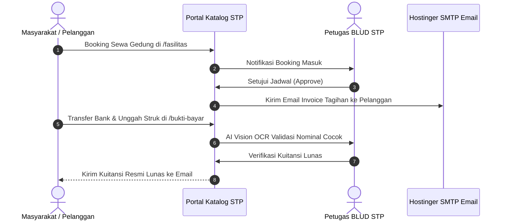

# 📘 Panduan Pengguna: Masyarakat Umum & Portal Layanan Publik
## Sistem Manajemen Kawasan Solo Technopark (Sintesa)

> **Kode Role:** `public` (Pengguna Terdaftar, Pemesan Fasilitas, Siswa Pendaftar Diklat, & Pembeli E-Katalog)  
> **Sasaran Pengguna:** Warga Masyarakat, Pelaku UMKM, Komunitas Kreatif, Pencari Sertifikasi, dan Pengunjung Kawasan

---

## 1. Ringkasan Peran & Kewenangan

Sebagai **Pengguna Publik**, Anda dapat menikmati seluruh fasilitas, program pelatihan keterampilan, serta produk-produk inovasi unggulan Solo Technopark secara transparan dan mudah melalui portal mandiri digital.

### Layanan Publik yang Dapat Anda Akses:
- **Peminjaman Sarana & Gedung** (`/fasilitas`): Reservasi gedung serbaguna, auditorium, ruang rapat, dan arena olahraga.
- **Pendaftaran Kursus & Pelatihan Vokasi** (`/program-pelatihan`): Mengikuti diklat teknologi, mekanik, IT, digital marketing, dan program RSKB Surakarta.
- **E-Katalog Produk Inovasi** (`/e-katalog`): Membeli produk karya startup dan bengkel manufaktur Solo Technopark.
- **Portal Onboarding Mandiri** (`/portal`): Panduan 4 langkah praktis penyelesaian profil dan aktivasi layanan.
- **Konfirmasi Pembayaran Mandiri** (`/bukti-bayar`): Mengunggah bukti transfer bank untuk tagihan invoice apa pun.
- **Pusat Verifikasi Sertifikat** (`/verifikasi-sertifikat`): Cek keaslian ijazah/sertifikat kompetensi resmi lulusan Solo Technopark.

---

## 2. Matriks Hak Akses Pengguna Publik

| Fitur / Layanan | Publik Tanpa Login | Publik Terdaftar (Login) | Keterangan |
| :--- | :---: | :---: | :--- |
| **Lihat Brosur Fasilitas & Pelatihan** | ✅ Penuh | ✅ Penuh | Informasi umum dan jadwal publik. |
| **Pemesanan Sewa Gedung / Fasilitas** | ⚠️ Wajib Login | ✅ Penuh | Otomatis mencatat tiket booking Anda. |
| **Daftar Program Pelatihan Vokasi** | ⚠️ Wajib Login | ✅ Penuh | Upload berkas KTP & ijazah pendidikan. |
| **Konfirmasi Pembayaran Bukti Transfer**| ✅ Penuh | ✅ Penuh | Bisa via `/bukti-bayar` tanpa login. |
| **Lacak Status Tagihan & Kuitansi Lunas** | ❌ Dibatasi | ✅ Penuh di `/profil` | Arsip riwayat seluruh kuitansi lunas Anda. |
| **Verifikasi Keaslian Sertifikat Kelulusan**| ✅ Penuh | ✅ Penuh | Layanan terbuka untuk publik & HR rekruter. |

---

## 3. Prosedur Operasional Standar (SOP) Langkah demi Langkah

### SOP 3.1: Pendaftaran Akun & Onboarding Checklist di `/portal`
1. Buka website resmi di `/daftar`.
2. Isi Nama Lengkap, Alamat Email aktif, dan Kata Sandi baru (minimal 6 karakter), atau klik tombol **Daftar dengan Google** untuk proses instan.
3. Cek kotak masuk email Anda dan klik tautan verifikasi email yang dikirimkan sistem.
4. Akses halaman **Portal Layanan** (`/portal`):
   - Perhatikan **Checklist Onboarding 4 Langkah**:
     1. *Akun Dibuat ✅*
     2. *Email Terverifikasi*
     3. *Nomor WhatsApp Lengkap* (untuk konfirmasi jadwal & kuitansi)
     4. *Pilih Layanan / Klaim Status Alumni*
5. Lengkapi nomor WhatsApp dan profil diri Anda agar pemesanan dapat diproses cepat oleh admin.

---

### SOP 3.2: Cara Memesan (Booking) Sewa Gedung atau Fasilitas
1. Buka menu **Fasilitas Kawasan** (`/fasilitas`).
2. Pilih fasilitas yang Anda inginkan (misal: *Gedung Serbaguna, Ruang Rapat VIP, Lapangan Futsal*).
3. Baca rincian spesifikasi kapasitas ruangan, jam ketersediaan, dan daftar fasilitas bawaan.
4. Klik tombol **Pesan Sekarang (Booking)**:
   - Pilih tanggal rencana acara pada kalender.
   - Pilih durasi waktu (jam mulai dan jam selesai acara).
   - Masukkan nama kegiatan (misal: *"Seminar Nasional Kecerdasan Buatan"*).
   - Lampirkan surat permohonan atau proposal kegiatan jika ada.
5. Klik **Kirim Permohonan Booking**. Status pemesanan Anda tercatat sebagai `PENDING`.
6. Tim Admin Aset akan meninjau jadwal Anda maksimal dalam 1x24 jam kerja. Setelah disetujui, Anda akan menerima email notifikasi berisi rincian tagihan invoice sewa.

---

### SOP 3.3: Cara Mendaftar Program Pelatihan Vokasi & RSKB
1. Masuk ke menu **Program Pelatihan** (`/program-pelatihan`).
2. Pilih bidang keahlian yang diminati (contoh: *Operator Mesin CNC Industri, Cyber Security, Desain Manufaktur CAD*).
3. Periksa kriteria persyaratan, durasi kursus, dan tanggal penutupan pendaftaran.
4. Klik tombol **Daftar Program Ini**:
   - Isi formulir pendaftaran siswa.
   - Masukkan NIK KTP, tanggal lahir, dan pendidikan terakhir.
   - Unggah foto KTP dan scan ijazah terakhir.
5. Klik **Submit Pendaftaran Pelatihan**. Anda dapat memantau pengumuman hasil seleksi berkas melalui menu `/profil` atau email pribadi Anda.

---

### SOP 3.4: Pembayaran & Konfirmasi Bukti Transfer di `/bukti-bayar`
1. Jika Anda menerima tagihan invoice sewa gedung atau pelatihan, lakukan transfer bank ke rekening giro Solo Technopark yang tertera pada invoice (Bank Jateng / Bank BNI).
2. Simpan foto resi mutasi / struk transfer Anda.
3. Buka halaman publik **Portal Konfirmasi Pembayaran** di `/bukti-bayar`:
   - Masukkan **Nomor Tagihan / Invoice** (contoh: `INV/SEWA/2026/012` atau `INV-TRN-...`).
   - Masukkan nominal pembayaran Anda.
   - Unggah foto struk bukti transfer (format JPG, PNG, atau PDF).
4. Klik **Kirim Konfirmasi Pembayaran**.
5. Mesin AI Vision OCR akan memvalidasi bukti Anda. Meja Kasir Solo Technopark akan memverifikasi kuitansi dan mengirimkan bukti pembayaran lunas berformat PDF langsung ke email Anda.

---

### SOP 3.5: Verifikasi Keaslian Sertifikat Diklat di `/verifikasi-sertifikat`
1. Jika Anda adalah alumni yang ingin memeriksa keabsahan sertifikat Anda, atau HR perusahaan yang sedang memverifikasi ijazah pelamar kerja:
2. Buka halaman `/verifikasi-sertifikat`.
3. Masukkan salah satu identitas sertifikat:
   - **Nomor Registrasi Sertifikat**: (contoh: `STP-CERT/2026/TEK/B1-001`).
   - ATAU **Kode Registrasi Alumni**: (contoh: `AL-2026-782190`).
4. Klik tombol **Cari & Verifikasi Sertifikat**.
5. Sistem akan menampilkan rincian:
   - Nama Lengkap Pemegang Sertifikat.
   - Nama Program Kejuruan Pelatihan.
   - Asal Program (STP Vokasi / RSKB Surakarta).
   - Tanggal Kelulusan & Predikat Kompetensi.
   - Lencana Emas: **"Terverifikasi Resmi Solo Technopark"**.

---

## 4. Alur Layanan Publik Terpadu

---

## 5. Pertanyaan Kerap Diajukan (FAQ)

**T: Apakah saya boleh datang langsung ke Solo Technopark tanpa memesan di website terlebih dahulu?**  
*J: Boleh, namun untuk pemakaian gedung pertemuan, laboratorium mesin, dan pendaftaran diklat vokasi, pemesanan melalui website sangat dianjurkan untuk memastikan ketersediaan kuota dan jadwal yang bebas bentrok.*

**T: Jika saya membutuhkan bantuan teknis atau informasi mendesak, ke mana saya harus menghubungi?**  
*J: Anda dapat menghubungi Pusat Bantuan Helpdesk Solo Technopark melalui WhatsApp resmi di nomor **08112634567** atau melalui email **marketing@solotechnopark.id**.*

---

## 6. Lembar Checklist Pengguna Layanan Publik

- [ ] Memastikan email dan nomor WhatsApp diisi dengan benar saat mendaftar.
- [ ] Memeriksa ketersediaan tanggal gedung di `/fasilitas` sebelum mengajukan permohonan.
- [ ] Melakukan pembayaran transfer bank sesuai nominal pas yang tercantum pada invoice.
- [ ] Menyimpan file PDF kuitansi resmi sebagai bukti sah saat serah terima ruangan di lokasi.
